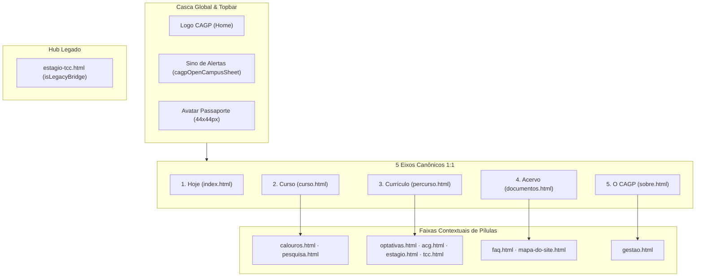

# AGENTS.md — Manual Operacional de Arquitetura, Governança e Execução do Super App CAGP UFMG

**Repositório:** Portal Institucional & Super App Discente — Centro Acadêmico de Gestão Pública (CAGP FAFICH/UFMG)  
**Documento Canônico de Origem:** [`_designs/plano_mestre_superapp_cagp.md`](file:///home/gsathler/Nextcloud/Projects/cagp/_designs/plano_mestre_superapp_cagp.md) (Plano Mestre v2.1)  
**Documentos Relacionados:** [`_brand.yml`](file:///home/gsathler/Nextcloud/Projects/cagp/_brand.yml) • [`_quarto.yml`](file:///home/gsathler/Nextcloud/Projects/cagp/_quarto.yml) • [`styles.css`](file:///home/gsathler/Nextcloud/Projects/cagp/styles.css)  
**Status:** Documento Operacional Ativo para Execução por Agentes de IA (**Regra de Zero-Decisão**)

---

## 1. Princípios Inegociáveis e Diretrizes de Execução (Cláusulas Pétreas)

1. **Integridade Factual Absoluta (100% Zero Invenção / Zero Supressão):**
   - Todos os dados acadêmicos, regras regimentais (PPC 2020, Regulamento do Curso Versão `N-20229`, Regimento Interno do CAGP de `14/10/2024`, Resoluções CEPE/UFMG), cargas horárias (`3.000h` totais, `2.880h` Núcleo Específico, `120h` Formação Livre, `300h` Extensão Obrigatória, até `300h` AAC, `300h` Estágio Supervisionado A+B, `180h` TCC A+B), códigos e ementas das `27` disciplinas obrigatórias e `68` optativas, prazos normativos (`120 dias corridos` para protocolo de certificados de AAC — Art. 15, § 4º; final do `2º período letivo` para aproveitamento de estudos — Res. CEPE 06/2019), horários operacionais (`RU II Setorial`, linhas do Circular Interno, `Secretaria Sala F-2039` com Norma Guedes, `CEAG FAFICH` das 08h às 22h), e-mails institucionais (`coordgestaopublica@gmail.com`) e arquivos em `documentos/` são autênticos e preservados.
   - **Proibição Estrita:** Nenhum agente pode inventar dados, alterar cargas horárias, suprimir regras regimentais, modificar códigos de matérias ou alterar nomes reais dos PDFs da pasta `documentos/`.
   - Textos extensos e notas regulamentares são encapsulados em `<details class="cagp-normative-details">` com `<summary>` autoexplicativo (primeiras 8 palavras do título original).
2. **Decisões Arquiteturais Travadas (Locked Invariants):**
   - **Espelho N-20229 Decomissionado:** Remoção completa da rotina legada client-side de montagem de espelho (`#cagp-n20229-print-sheet`, botões e modais). Links diretos aos formulários oficiais autênticos (PDF/DOCX) da Sala F-2039.
   - **Controle Segmentado Sem Rolagem:** As sub-views de cada página ficam 100% visíveis simultaneamente no mobile sem transbordamento ou rolagem horizontal entre `280px` e `1440px`.
   - **Brite Institucional Refinado:** Tipografia institucional `Oswald` em caixa-alta, bordas estruturais de `1px solid #DFDBD2`. Borda `2px` e sombra dura `2px 2px 0 #0A0A0A` **exclusivamente** em botões de ação primária (`.cagp-btn-primary`), aba ativa e modal aberto.
   - **Simetria 1:1 dos 5 Eixos Canônicos:** Barra inferior mobile, PWA standalone e menu desktop sincronizados rigorosamente nos 5 Eixos (`Hoje · Curso · Currículo · Acervo · O CAGP`).
   - **Cofre Discente em 9 Chaves Canônicas:** Persistência estritamente local em `localStorage`, compatibilidade retroativa e backup Base64 `CAGP1:...` com checksum CRC32.
   - **Operação Estática e 100% Offline:** Sem dependência de servidor ativo. O site é compilado via Quarto CLI e opera offline via Service Worker (`sw.js`).
3. **Regra de Arbitragem em 3 Camadas de Design:**
   - **Camada 1 — Marca & Pele (Soberana: Brite Institucional / CAGP):** Paleta Borgonha `#8B1E2D` / Vinho `#9E2424`, Preto Candango `#0A0A0A`, Creme `#F7F5F0`, bordas sólidas, cantos `0px`–`4px`, opacidade 100%. Veta glassmorphism (`backdrop-filter: blur`), cantos pill (`9999px`) em cards ou sombras difusas.
   - **Camada 2 — Ergonomia, Zonas de Toque & Navegação (`apple-design`):** Alvos de toque mínimos de `44×44px` (ideal `48×48px`), respeito a Safe Areas (`env(safe-area-inset-*)`), Bottom Sheets com animação fluida, física com fallback instantâneo em `prefers-reduced-motion: reduce`.
   - **Camada 3 — Contenção, Densidade & Feedback Operacional (`m3-expressive`):** Proibição de *over-boxing* (máximo 4 elementos com borda `2px`/sombra dura na 1ª dobra), controle segmentado, feedback claro de estado e barras de progresso com metas explícitas.
4. **Regra da Execução Zero-Decisão:**
   - O agente implementador deve seguir as fases, comandos e contratos exatamente como especificados neste documento, sem improvisar nomes de arquivos, classes CSS, chaves de armazenamento ou regras de layout.

---

## 2. Glossário de Domínio e Convenções de Nomenclatura

### 2.1. Glossário de Termos

| Termo | Significado no Projeto |
| :--- | :--- |
| **CAGP** | Centro Acadêmico de Gestão Pública (órgão representativo dos estudantes da FAFICH/UFMG). |
| **FAFICH / UFMG** | Faculdade de Filosofia e Ciências Humanas / Universidade Federal de Minas Gerais. |
| **DCP** | Departamento de Ciência Política (departamento sede do curso de Gestão Pública). |
| **DRCA** | Departamento de Registro e Controle Acadêmico da UFMG. |
| **AAC / ACG** | Atividades Acadêmicas Complementares. O curso usa AAC; a rota (`acg.qmd`) usa ACG. **Trata-se do mesmo tema.** |
| **Extensão / 600h** | 300h de Extensão Obrigatória + até 300h de AAC (Atividades Complementares) a integralizar. |
| **N-20229** | Código da versão oficial do Regulamento/PPC do curso. O Requerimento N-20229 é o formulário de integralização de créditos. |
| **Guardião de 120 Dias** | Módulo de `acg.qmd` que monitora o prazo decadencial de 120 dias para protocolo de certificados de eventos e anais. |
| **Art. 41** | Artigo do regulamento que rege a dispensa de Estágio Supervisionado (300h: `DCP 135` 180h + `DCP 136` 120h). |
| **TCE / TCC / IC** | Termo de Compromisso de Estágio / Trabalho de Conclusão de Curso / Iniciação Científica (90h AAC). |
| **RU II / Circular** | Restaurante Universitário II Setorial / Ônibus Circular Interno Noturno da UFMG. |
| **Sub-view** | Aba operacional interna de uma página (`.cagp-workspace-view`). |
| **N** | Quantidade de sub-views reais de uma página, **sem** incluir o botão "Ver Tudo" (`__all__`). |
| **PWA Standalone** | Aplicação instalada na tela inicial móvel (`display-mode: standalone`), sem barra de navegação do browser. |
| **Lie-Fi** | Situação em que o dispositivo parece conectado à rede do campus, mas os pacotes não trafegam (requer timeout curto no SW). |

### 2.2. Convenções de Siglas e Prefixos

- `A1` a `A5`: Arquétipos de página (Hub, Ferramenta, Catálogo, Guia, Hub Legado).
- `F1` a `F7`: Eixos de formato da matriz multiformato (Largura, Modo, Orientação, Preferências, Mídia, Entrada, Gestos).
- `M1` a `M8`: Métricas empíricas de DOM medidas via script `audit.js` no `/browser`.
- `T01` a `T10`: Tarefas canônicas de implementação.
- `G0` a `G4`: Gates de transição de fase com critérios formais de aprovação.
- `Fase 0` a `Fase 4`: Fases cronológicas de execução.
- `E1` a `E12`: Itens da Errata do v1.

---

## 3. Arquitetura do Site: 15 Rotas, 5 Eixos e 5 Arquétipos

### 3.1. Mapeamento Canônico dos 5 Eixos e 15 Rotas



| Eixo | ID Canônico | Rótulo | Ícone Bootstrap | Rota Raiz | Rotas-Filhas no Eixo |
| :--- | :--- | :--- | :--- | :--- | :--- |
| **1** | `axis-1` | `Hoje` | `bi-compass` | [`index.qmd`](file:///home/gsathler/Nextcloud/Projects/cagp/index.qmd) | — |
| **2** | `axis-2` | `Curso` | `bi-mortarboard` | [`curso.qmd`](file:///home/gsathler/Nextcloud/Projects/cagp/curso.qmd) | [`calouros.qmd`](file:///home/gsathler/Nextcloud/Projects/cagp/calouros.qmd), [`pesquisa.qmd`](file:///home/gsathler/Nextcloud/Projects/cagp/pesquisa.qmd) |
| **3** | `axis-3` | `Currículo` | `bi-diagram-3` | [`percurso.qmd`](file:///home/gsathler/Nextcloud/Projects/cagp/percurso.qmd) | [`optativas.qmd`](file:///home/gsathler/Nextcloud/Projects/cagp/optativas.qmd), [`acg.qmd`](file:///home/gsathler/Nextcloud/Projects/cagp/acg.qmd), [`estagio.qmd`](file:///home/gsathler/Nextcloud/Projects/cagp/estagio.qmd), [`tcc.qmd`](file:///home/gsathler/Nextcloud/Projects/cagp/tcc.qmd) |
| **4** | `axis-4` | `Acervo` | `bi-folder2-open` | [`documentos.qmd`](file:///home/gsathler/Nextcloud/Projects/cagp/documentos.qmd) | [`faq.qmd`](file:///home/gsathler/Nextcloud/Projects/cagp/faq.qmd), [`mapa-do-site.qmd`](file:///home/gsathler/Nextcloud/Projects/cagp/mapa-do-site.qmd) |
| **5** | `axis-5` | `O CAGP` | `bi-people` | [`sobre.qmd`](file:///home/gsathler/Nextcloud/Projects/cagp/sobre.qmd) | [`gestao.qmd`](file:///home/gsathler/Nextcloud/Projects/cagp/gestao.qmd) |
| — | — | *Hub Legado* | — | [`estagio-tcc.qmd`](file:///home/gsathler/Nextcloud/Projects/cagp/estagio-tcc.qmd) | `isLegacyBridge: true` (fora da contagem de 14 ativas) |

### 3.2. Matriz dos 5 Arquétipos de Página e Metas de 1ª Dobra (`360×640`)

Referência de medição móvel: **`360×640px`** (área útil do Chrome Android, descontadas a barra de navegação superior e a barra de rodapé de `64px`).

| Arquétipo | Modo `impeccable` | Rotas Correspondentes | Metas de 1ª Dobra (`360×640`) |
| :--- | :--- | :--- | :--- |
| **A1 Hub** | `Operate` | [`index.qmd`](file:///home/gsathler/Nextcloud/Projects/cagp/index.qmd) | Saudação compacta + status do campus + 1º acesso de eixo em **`y <= 300px`**. |
| **A2 Ferramenta** | `Operate` | [`acg.qmd`](file:///home/gsathler/Nextcloud/Projects/cagp/acg.qmd), [`estagio.qmd`](file:///home/gsathler/Nextcloud/Projects/cagp/estagio.qmd), [`percurso.qmd`](file:///home/gsathler/Nextcloud/Projects/cagp/percurso.qmd) | Topo da barra de sub-views em **`y <= 200px`**; 1º controle interativo em **`y <= 300px`**. |
| **A3 Catálogo** | `Operate` | [`documentos.qmd`](file:///home/gsathler/Nextcloud/Projects/cagp/documentos.qmd), [`optativas.qmd`](file:///home/gsathler/Nextcloud/Projects/cagp/optativas.qmd), [`mapa-do-site.qmd`](file:///home/gsathler/Nextcloud/Projects/cagp/mapa-do-site.qmd) | Topo da barra em **`y <= 200px`**; campo de busca/filtro em **`y <= 300px`** (em `mapa-do-site`: 1º link em `y <= 300px`). |
| **A4 Guia** | `Read` | [`curso.qmd`](file:///home/gsathler/Nextcloud/Projects/cagp/curso.qmd), [`calouros.qmd`](file:///home/gsathler/Nextcloud/Projects/cagp/calouros.qmd), [`pesquisa.qmd`](file:///home/gsathler/Nextcloud/Projects/cagp/pesquisa.qmd), [`tcc.qmd`](file:///home/gsathler/Nextcloud/Projects/cagp/tcc.qmd), [`faq.qmd`](file:///home/gsathler/Nextcloud/Projects/cagp/faq.qmd), [`sobre.qmd`](file:///home/gsathler/Nextcloud/Projects/cagp/sobre.qmd), [`gestao.qmd`](file:///home/gsathler/Nextcloud/Projects/cagp/gestao.qmd) | Topo da barra em **`y <= 200px`**; 1º bloco substantivo em **`y <= 300px`**. |
| **A5 Hub Legado** | `Operate` | [`estagio-tcc.qmd`](file:///home/gsathler/Nextcloud/Projects/cagp/estagio-tcc.qmd) | Conteúdo preservado; 1º botão de direcionamento em **`y <= 300px`**. |

*Relaxamento em N=4:* Em telas `< 320px` ou com fonte ampliada (`data-a11y-font="lg|xl"`), o grid 2×2 admite o 1º controle em **`y <= 340px`**.  
*Regra de Otimização do Cabeçalho:* Em viewports `< 768px`, badges e subtítulos do cabeçalho são recolhidos dentro de `<details class="cagp-normative-details"><summary>Sobre esta página</summary>...</details>`, garantindo o topo da barra em `y <= 200px`.

### 3.3. Especificação por Rota (Desvios do Arquétipo e Tarefas Específicas)

| Rota | Arq. | N Sub-views | Rótulos Curtos das Abas | Tarefas Específicas / Desvios |
| :--- | :---: | :---: | :--- | :--- |
| [`index.qmd`](file:///home/gsathler/Nextcloud/Projects/cagp/index.qmd) | A1 | **3** | `Hoje · Apps · CAGP` | Bento Grid com classes nativas `row row-cols-2 row-cols-md-3 row-cols-lg-5 g-2 g-md-3` (**proibido criar `col-lg-2-4`**); completar `data-ws-hash` no botão `__all__`. |
| [`acg.qmd`](file:///home/gsathler/Nextcloud/Projects/cagp/acg.qmd) | A2 | **3** | `Calculadora · 120 dias · Guia` | HUD linear compacto (`#cagp-calc-hud-linear`, 64px); aba 3 com links diretos aos formulários autênticos N-20229 em PDF local e DOCX externo; limpar listeners no evento `cagp:navigated`. |
| [`estagio.qmd`](file:///home/gsathler/Nextcloud/Projects/cagp/estagio.qmd) | A2 | **2** | `Art. 41 · Tutorial` | Simulador Art. 41 com 1º controle `<= 300px`; tutorial TCE em `<details>`; conferir links para modelos DOCX/PDF existentes em `documentos/`. |
| [`percurso.qmd`](file:///home/gsathler/Nextcloud/Projects/cagp/percurso.qmd) | A2 | **3** | `Grafo · Ementas · Percursos` | Callout de 145 palavras em `<details>`; *roving tabindex* nos 27 nós do SVG (`#cagp-grafo-svg`) navegáveis por setas; manter as 28 `<details>` de ementas com títulos limpos. |
| [`documentos.qmd`](file:///home/gsathler/Nextcloud/Projects/cagp/documentos.qmd) | A3 | **3** | `Atos · Formulários · DRCA` | Faixa offline compacta (`#cagp-offline-status-strip`, 44px); busca instantânea chama `window.cagpActivateWorkspaceView('v2')` sem o argumento quebrado `scroll: false`. |
| [`optativas.qmd`](file:///home/gsathler/Nextcloud/Projects/cagp/optativas.qmd) | A3 | **2** | `Catálogo · Formação Livre` | 68 `<details>` recolhidos; filtro e busca no topo; lista em 1 coluna (`< 768px`), 2 colunas (`>= 768px`) e 3 colunas (`>= 1280px`). |
| [`mapa-do-site.qmd`](file:///home/gsathler/Nextcloud/Projects/cagp/mapa-do-site.qmd) | A3 | **2** | `Árvore · Atalhos` | Árvore estática gerada na compilação a partir dos dados de `CAGP_TAXONOMY_V1` (sem dependência de JS para renderizar os links); contagem textual "14 Páginas" conferida por teste. |
| [`curso.qmd`](file:///home/gsathler/Nextcloud/Projects/cagp/curso.qmd) | A4 | **4** | `Visão · Egressos · Colegiado · Ingresso` | `fig-alt` acessível em gráficos de cientometria; tabela de salários com scroll horizontal contido (`overflow-x: auto` exclusivamente no wrapper da tabela). |
| [`calouros.qmd`](file:///home/gsathler/Nextcloud/Projects/cagp/calouros.qmd) | A4 | **4** | `Checklist · Rotina · FAFICH · FUMP` | Checklist de sobrevivência de 30 dias na 1ª dobra (`y <= 340px`); vídeos com `loading="lazy"`; links diretos de discagem `tel:`. |
| [`pesquisa.qmd`](file:///home/gsathler/Nextcloud/Projects/cagp/pesquisa.qmd) | A4 | **3** | `Núcleos · Iniciação · Imersão` | Catálogo dos 11 núcleos em lista de 1 coluna; link da Iniciação Científica (90h AAC) apontando para `acg.html#calculadora-horas`. |
| [`tcc.qmd`](file:///home/gsathler/Nextcloud/Projects/cagp/tcc.qmd) | A4 | **2** | `Modalidades · Termo e Banca` | Termo de Aceite com PDF local (`termo-aceite-orientador-tcc.pdf`) e DOCX externo rotulado com "(requer internet)". |
| [`faq.qmd`](file:///home/gsathler/Nextcloud/Projects/cagp/faq.qmd) | A4 | **2** | `Perguntas · Acessibilidade` | Questões regimentais em `<details>`; preservar âncora fixa `faq.html#acessibilidade` (consumida pelo rodapé global). |
| [`sobre.qmd`](file:///home/gsathler/Nextcloud/Projects/cagp/sobre.qmd) | A4 | **3** | `Princípios · Governança · Esferas` | Artigos estatutários 1º–8º e 20–45 integrais preservados em `<details>` com sumários concisos. |
| [`gestao.qmd`](file:///home/gsathler/Nextcloud/Projects/cagp/gestao.qmd) | A4 | **3** | `Organograma · Equipe · Contas` | Organograma em lista hierárquica acessível; links de RREO e atas com compromisso de transparência em até 3 dias úteis. |
| [`estagio-tcc.qmd`](file:///home/gsathler/Nextcloud/Projects/cagp/estagio-tcc.qmd) | A5 | **0** | — | Hub legado com cards e badges normativos preservados; direcionamento por âncora (`data-cagp-redirect`); `<meta name="robots" content="noindex">`. |

---

## 4. Contratos de Engenharia e Interfaces de Código

### 4.1. Contrato da Casca e Sub-Views: Controle Segmentado por N (`.cagp-workspace-bar`)

Toda página com sub-views deve adotar rigorosamente este markup no topo:

```html
<div class="cagp-workspace-bar">
  <div class="cagp-workspace-tabs" role="tablist" data-tab-count="3">
    <button type="button" class="cagp-workspace-tab is-active" role="tab" id="ws-tab-v1" aria-controls="ws-panel-v1" aria-selected="true" tabindex="0" data-ws-tab="v1" data-ws-hash="#calculadora-horas">
      <span class="cagp-tab-label-full">Calculadora 600h</span>
      <span class="cagp-tab-label-short" aria-hidden="true">Calculadora</span>
    </button>
    <button type="button" class="cagp-workspace-tab" role="tab" id="ws-tab-v2" aria-controls="ws-panel-v2" aria-selected="false" tabindex="-1" data-ws-tab="v2" data-ws-hash="#guardiao-120-dias">
      <span class="cagp-tab-label-full">Guardião 120 Dias</span>
      <span class="cagp-tab-label-short" aria-hidden="true">120 dias</span>
    </button>
    <button type="button" class="cagp-workspace-tab" role="tab" id="ws-tab-v3" aria-controls="ws-panel-v3" aria-selected="false" tabindex="-1" data-ws-tab="v3" data-ws-hash="#guia-tramitacao">
      <span class="cagp-tab-label-full">Guia & Tramitação</span>
      <span class="cagp-tab-label-short" aria-hidden="true">Guia</span>
    </button>
  </div>
  <button type="button" class="cagp-workspace-viewall" aria-pressed="false" aria-label="Ver todas as abas" data-ws-tab="__all__" data-ws-hash="#visao-completa">
    <i class="bi bi-layout-text-sidebar" aria-hidden="true"></i>
  </button>
</div>
```

**Regras Fundamentais de CSS e Roteamento:**
1. **Sem `:has()`:** A contagem N é informada estaticamente via atributo `data-tab-count="N"` (`2`, `3` ou `4`), garantindo compatibilidade com WebViews Android antigas.
2. **Botão "Ver Tudo":** Fica **fora do `tablist`**, não possui `role="tab"` nem a classe `.cagp-workspace-tab`. Tem altura mínima de `44×44px` e ocupa coluna fixa de `44px` na mesma linha da barra.
3. **Acessibilidade:** As abas inativas recebem `tabindex="-1"`. A navegação por setas (`ArrowLeft`/`ArrowRight`) circula exclusivamente entre as abas ativas do `tablist`. O botão "Ver Tudo" usa `aria-pressed="true|false"`.
4. **Fallback Sem JS:** Incluir `<noscript><style>.cagp-workspace-view[hidden]{display:block!important;}</style></noscript>` em `_includes/pwa-meta.html`.

### 4.2. Contrato de Cabeçalho Único e Revelação Progressiva

1. **Regra do H1 Único:** Exatamente um `<h1>` por documento renderizado, posicionado dentro de `<header class="cagp-workspace-header">`.
2. **Compactação em Telas Móveis (< 768px):** Breadcrumbs são ocultados. Badges e subtítulo vão para dentro de `<details class="cagp-normative-details">`.
3. **Banner de Campanha (`#quarto-announcement`):** Inicia com altura de `36px` no mobile (`.is-compact`), expandindo ao toque em `[EXPANDIR ▼]`.

### 4.3. Contrato de Design System e Tipografia (Brite Institucional Refinado)

- **Cores Oficiais:** Primário `#8B1E2D` (Borgonha) / `#9E2424` (Candango), Sucesso `#15803D`, Alerta `#B45309`, Perigo `#DC2626`, Fundo `#F7F5F0`, Superfície `#FFFFFF`, Bordas estruturais `#DFDBD2`, Preto `#0A0A0A`.
- **Bordas e Sombras:** Borda padrão `1px solid #DFDBD2`. Borda `2px solid #0A0A0A` e sombra dura `2px 2px 0 #0A0A0A` (blur `0px`) são reservadas para botões primários (`.cagp-btn-primary`, `.btn-primary`), abas ativas e modais abertos.
- **Tipografia:** `Oswald` (uppercase) em cabeçalhos e display; `Inter` em texto corrido e formulários; `JetBrains Mono` em contadores, códigos e hashes.
- **Alto Contraste AAA (`html[data-a11y-contrast="high"]`):** Fundo `#000000 !important`, texto `#FFFF00 !important`, bordas `2px solid #FFFF00 !important`.

### 4.4. Escala Unificada de `z-index` (10 Níveis Proporcionais)

Proibido inventar números aleatórios (ex.: `999999`). Obedecer rigorosamente à escala:
- `1020`: Barra de progresso de leitura (`.cagp-reading-progress`)
- `1030`: Banners de topo (`#quarto-announcement`), botão voltar ao topo (`.cagp-back-to-top`)
- `1040`: Barras de navegação fixas (`.cagp-superapp-header`, `.cagp-mobile-nav`, `.cagp-superapp-tabbar`)
- `1050`: Dropdowns do cabeçalho desktop (`.cagp-island-dropdown-menu`)
- `1060`: Gaveta de menu mobile off-canvas (`.cagp-mobile-drawer`)
- `1070`: Modal do Spotlight / Command Palette (`.cagp-spotlight-modal`)
- `1080`: Backdrop de Bottom Sheets e Modais (`.cagp-a11y-backdrop`, `.cagp-sheet-backdrop`)
- `1090`: Bottom Sheets modais (`#cagp-settings-sheet`, `#cagp-campus-sheet`, `#cagp-a11y-panel`)
- `1100`: Toasts flutuantes (`.cagp-toast`) e Skip Links em foco (`.cagp-skip-link:focus`)

### 4.5. Contrato do Roteador SPA (`_includes/super-app-router.html`)

1. **Evento Canônico:** A cada troca de rota, disparar `window.dispatchEvent(new CustomEvent('cagp:navigated', { detail: { url: targetUrl } }))`.
2. **Histórico e Hash Seguro:** Guardar `currentPath`. No evento `popstate`, só sincronizar workspace se `new URL(location.href).pathname === currentPath`; caso o pathname mude, acionar navegação completa da SPA.
3. **Eliminação do Bug `done()`:** Substituir qualquer invocação de `window.cagpRouteProgress.done()` por `window.cagpRouteProgress.finish()`.
4. **Preservação de Estado no `<html>`:** Durante `applyPageSwap()`, manter intactos os atributos `data-a11y-*` e classes `cagp-is-standalone` em `document.documentElement`.
5. **Remoção de Resize Redundante:** Remover `window.dispatchEvent(new Event('resize'))` disparado a cada troca de aba no header (limitar o disparo exclusivamente para o SVG de `percurso.qmd`).

### 4.6. Contrato do Cofre Discente (`localStorage` & 9 Chaves Canônicas)

Todas as operações de persistência local devem utilizar exclusivamente as seguintes chaves:

| Recurso / Módulo | Chave Canônica | Formato do Valor | Consumidores |
| :--- | :--- | :--- | :--- |
| **Calculadora 600h** | `cagp_calc_ext_aac_v1` | JSON Object `{ "ext_lab_a": 90, ... }` | `acg.qmd`, `pwa-install.html` |
| **Guardião de 120 Dias** | `cagp_aac_120d_certs_v1` | JSON Array `[{ id, title, mod, date, hours }]` | `acg.qmd`, `super-app-header.html`, `pwa-install.html` |
| **Notificações & Campus** | `cagp_notifications_prefs_v1` | JSON Object `{ ru1815, circular2230, aac120d, lastFired }` | `super-app-header.html`, `sw.js`, `pwa-install.html` |
| **Checklist do Calouro** | `cagp_calouro_checklist_v1` | JSON Object `{ "item_1": true, ... }` | `calouros.qmd`, `pwa-install.html` |
| **Quiz de Percurso** | `cagp_percurso_quiz_v1` | JSON Object `{ answers, resultPath }` | `percurso.qmd`, `pwa-install.html` |
| **Minha Grade / Optativas** | `cagp_minha_grade_v1` | JSON Object `{ savedCourses: [...] }` | `percurso.qmd`, `optativas.qmd`, `pwa-install.html` |
| **Checklist Art. 41** | `cagp_art41_checklist_v1` | JSON Object `{ "disp_1": true, ... }` | `estagio.qmd`, `estagio-tcc.qmd`, `pwa-install.html` |
| **Acessibilidade** | `cagp_a11y_prefs_v2` | JSON Object `{ font, contrast, dyslexia, motion }` | `accessibility.html`, `pwa-meta.html`, `super-app-router.html` |
| **Passaporte Discente** | `cagp_student_profile_v1` | JSON Object `{ name, period, photoDataUrl, ... }` | `pwa-install.html`, `index.qmd`, `super-app-header.html` |

- **Backup Base64 com CRC32:** Formato `CAGP1:<payloadBase64>.<crc32Hex>`. Vetor de teste: `CRC32("123456789") = "cbf43926"`. Restauração valida checksum e filtra estritamente as 9 chaves canônicas com `JSON.parse` protegido em `try/catch`.
- **Limpeza de Dados (2 Toques):** Botão `#cagp-clear-vault-btn` exige primeiro toque para armar contagem de 4 segundos e segundo toque para confirmar. Remove as 9 chaves canônicas e as 4 chaves legadas (`cagp_percurso_quiz_resultado`, `cagp_calouros_checklist`, `cagp_acg_total_horas`, `cagp_a11y_prefs`). **Não remove** o marcador efêmero `cagp_onboard_v1_dismissed`.
- **Chaves Legadas:** A chave `cagp_a11y_prefs` deixa de ser gravada em `accessibility.html` (mantida apenas como leitura defensiva de fallback em `pwa-meta.html`).

### 4.7. Contrato do Service Worker (`sw.js`) e PWA Standalone

1. **Versão de Cache:** Incrementar para `CACHE_NAME = 'cagp-pwa-v6'`.
2. **Pré-Cache Resiliente:** Utilizar laço com `Promise.allSettled()` (tolerante a falhas individuais por URL), incluindo recursos críticos de `site_libs/`.
3. **Estratégia Network-First com AbortController (1500ms):** Caso a rede demore mais de `1500ms` (evitando *lie-fi* no subsolo da FAFICH), abortar o fetch e entregar o conteúdo do cache local.
4. **Cache de PDFs Oficiais (`PDF_CACHE_NAME = 'cagp-pdfs-oficiais-v1'`):** Estratégia Stale-While-Revalidate para garantir atualização sem quebrar a disponibilidade offline dos 9 PDFs essenciais.
5. **PWA Standalone & Viewport:** Garantir `maximum-scale=5` no `<meta name="viewport">` mesmo em modo standalone. Proibido bloquear gestos de zoom com `preventDefault()` em multitoque.

---

## 5. Roteamento de Skills em 3 Níveis e Passo 0

### 5.1. Script do Passo 0 (Validação Estática de Caminhos)

Antes de iniciar qualquer fase de código ou verificação, o agente deve rodar o script `_designs/evidencias_v2/passo0.sh`:

```bash
#!/usr/bin/env bash
set -euo pipefail
root="$(git rev-parse --show-toplevel)"
plan="$root/AGENTS.md"
paths="$(grep -o '`\(impeccable\|apple-design\|m3-expressive\|quarto-authoring\|brand-yml\|alt-text\)/[^`]*\.md`' "$plan" | tr -d '`' | sort -u)"
[ "$(printf '%s\n' "$paths" | wc -l)" -ge 40 ] || { echo "ERRO: Poucos caminhos detectados"; exit 1; }
bad=0
while read -r p; do
  if [ ! -f "$root/.agents/skills/$p" ]; then
    echo "CAMINHO AUSENTE: $p"
    bad=1
  fi
done <<< "$paths"
if [ "$bad" -eq 0 ]; then
  echo "OK: Todos os $(printf '%s\n' "$paths" | wc -l) caminhos de skills existem."
fi
exit $bad
```

### 5.2. Nível 1: Modo por Arquétipo

| Arquétipo / Superfície | Modo `impeccable` | Arquivo Base do Modo | Foco do Modo |
| :--- | :--- | :--- | :--- |
| **Casca Global** | `Operate` | `impeccable/reference/mode-operate.md` | Eficiência de navegação, persistência, alvos touch `>= 44px`. |
| **A1 Hub / A2 Ferramenta / A3 Catálogo** | `Operate` | `impeccable/reference/mode-operate.md` | Scanabilidade, ausência de overflow, primeira dobra `<= 300px`. |
| **A4 Guia** | `Read` | `impeccable/reference/mode-read.md` | Legibilidade, ritmo de leitura, hierarquia de cabeçalhos semânticos. |
| **A5 Hub Legado** | `Operate` | `impeccable/reference/mode-operate.md` | Hardening e clareza de direcionamento. |

### 5.3. Nível 2: Tarefas Canônicas (T01 a T10) com Referências Verificadas

| ID | Tarefa | Fase | Skills & Referências Obrigatórias (em `.agents/skills/`) |
| :---: | :--- | :---: | :--- |
| **T01** | Tokens, Cores Institucionais e Contenção Visual | 1 | `brand-yml/references/quarto.md`, `brand-yml/references/brand-yml-spec.md`<br>`impeccable/reference/colorize.md`, `impeccable/reference/quieter.md`<br>`m3-expressive/references/tokens.md`, `m3-expressive/references/color.md`, `m3-expressive/references/shape.md`, `m3-expressive/references/components/containment.md` |
| **T02** | Controle Segmentado por N, Rótulos Curtos e Migração Mecânica | 1 | `apple-design/references/hig/segmented-controls.md`<br>`impeccable/reference/layout.md`, `impeccable/reference/adapt.md`<br>`m3-expressive/references/components/navigation.md` |
| **T03** | Cabeçalho Único, Badges, Revelação Progressiva e ARIA | 1, 3 | `impeccable/reference/typeset.md`, `impeccable/reference/distill.md`<br>`quarto-authoring/references/divs-and-spans.md`<br>`apple-design/references/hig/disclosure-controls.md` |
| **T04** | Casca, Router SPA, Cofre Local e Service Worker | 2 | `apple-design/references/hig/tab-bars.md`, `apple-design/references/hig/sheets.md`, `apple-design/references/hig/alerts.md`, `apple-design/references/hig/notifications.md`, `apple-design/references/hig/privacy.md`, `apple-design/references/hig/loading.md`<br>`m3-expressive/references/platforms.md`, `m3-expressive/references/components/bars.md`, `m3-expressive/references/components/feedback.md`<br>`impeccable/reference/harden.md`, `impeccable/reference/optimize.md` |
| **T05** | Acessibilidade Universal, Alto Contraste AAA e Preferências | 1, 2 | `apple-design/references/hig/accessibility.md`, `apple-design/references/hig/inclusion.md`, `apple-design/references/hig/voiceover.md`, `apple-design/references/hig/dark-mode.md`<br>`impeccable/reference/audit.md` |
| **T06** | Movimento, Animações e Respeito a `prefers-reduced-motion` | 1, 2 | `apple-design/references/hig/motion.md`, `apple-design/references/hig/gestures.md`<br>`m3-expressive/references/motion.md`, `m3-expressive/references/transitions.md`, `m3-expressive/references/interaction.md`<br>`impeccable/reference/animate.md` |
| **T07** | Reflow Responsivo, Foldables, Tablets e Split View | 1 | `apple-design/references/hig/designing-for-iphone-duo.md`, `apple-design/references/hig/designing-for-ipados.md`, `apple-design/references/hig/multitasking.md`, `apple-design/references/hig/split-views.md`<br>`m3-expressive/references/layout.md` |
| **T08** | Navegação por Teclado, Foco Visível e Ponteiros | 1, 2 | `apple-design/references/hig/keyboards.md`, `apple-design/references/hig/pointing-devices.md`, `apple-design/references/hig/focus-and-selection.md` |
| **T09** | Impressão Nítida, Open Graph e WebView Mobile | 1, 2 | `apple-design/references/hig/printing.md`, `apple-design/references/hig/web-views.md`, `apple-design/references/hig/collaboration-and-sharing.md`<br>`quarto-authoring/references/yaml-front-matter.md`<br>`impeccable/reference/polish.md` |
| **T10** | Textos Alternativos e Descrições de Dados | 3 | `alt-text/references/quarto.md`<br>`quarto-authoring/references/figures.md` |

### 5.4. Lentes de Revisão Especializadas (`/egm-*`)
- `egm-design`: Foco em ergonomia, ausência de overflow e estética institucional.
- `egm-zoom-out`: Foco em minimalismo, YAGNI e eliminação de código redundante.
- `egm-codebase-details`: Auditoria pedante de sintaxe Quarto, integridade de arquivos e seletores.
- `egm-structural`: Validação de hierarquia de títulos H1–H4 e conformidade de templates.
- `egm-comprehension`: Acessibilidade cognitiva e clareza para o discente.
- `egm-implementation-readiness`: Garantia estrita da Regra de Zero-Decisão.

---

## 6. Matriz de Formatos e Protocolo de Verificação sem Playwright

### 6.1. Os 7 Eixos de Formato (F1 a F7)

- **F1 Largura / Altura de Viewport:** `280×653` (foldable fechado), `360×640` (mobile referência), `412×915` (Android padrão), `507×800` (iPad Split View), `700×900` (foldable aberto), `768×1024` (tablet retrato), `1024×768` (tablet paisagem), `1440×900` (desktop widescreen).
- **F2 Modo de Exibição:** `web` (navegador padrão), `standalone` (`sessionStorage['cagp_force_app_mode']='true'`), `offline` (Service Worker cache).
- **F3 Orientação & Janela:** Retrato, paisagem (`640×360`), redimensionamento contínuo de viewport.
- **F4 Preferências do Discente:** `contrast` (Alto Contraste AAA), `dyslexia` (OpenDyslexic), `font-lg` (115%), `font-xl` (130%), `reduced-motion` (animações suprimidas), `dark` (comportamento defensivo), `zoom200` (escala 200%).
- **F5 Mídia de Saída:** Impressão `@media print`, Open Graph (`og:*`), leitor de tela (TalkBack / VoiceOver).
- **F6 Dispositivos de Entrada:** Toque capacitivo, teclado físico, mouse, caneta stylus.
- **F7 Gestos e Física:** Toque duplo sem zoom indevido, sem conflito de swipe horizontal com o botão voltar nativo do SO, transições `<= 200ms`.

### 6.2. As 3 Camadas de Profundidade (152 Células Exatas)

Geradas via script `_designs/evidencias_v2/gerar_matriz.py` no arquivo `_designs/evidencias_v2/matriz_celulas.csv`:

1. **Camada A (60 células):** Todas as 15 rotas testadas em 4 larguras fundamentais (`280×653`, `360×640`, `768×1024`, `1440×900`) com `modo=web` e `prefs=none`.
2. **Camada B (32 células):** 4 rotas representativas dos arquétipos (`calouros`, `faq`, `estagio`, `optativas`) testadas em `360×640` com preferências (`contrast`, `dyslexia`, `font-xl`, `reduced-motion`, `dark`, `print`) + viewports especiais (`700×900 none`, `640×360 none`).
3. **Camada C (60 células):** 4 rotas críticas do core discente (`index`, `acg`, `documentos`, `percurso`) testadas na matriz exaustiva de modos (`standalone`, `offline`), preferências avançadas (`zoom200`, `keyboard`), Split View (`507×800`) e formatos dinâmicos.

### 6.3. Métricas de DOM (M1 a M8) e Critérios Objetivos F2 a F7

O subagente `/browser` executa verbatim o script unificado `_designs/evidencias_v2/audit.js` no console da página:

| Métrica | Propriedade Avaliada | Critério de Aprovação Estrito |
| :---: | :--- | :--- |
| **M1** | Transbordamento Horizontal | `document.documentElement.scrollWidth <= window.innerWidth` (`true`). |
| **M2** | Contenção das Abas | Todo `.cagp-workspace-tab` e `.cagp-workspace-viewall` com `0 <= left` e `right <= innerWidth`; `.cagp-workspace-bar.scrollWidth === clientWidth`. |
| **M3** | Coordenadas da 1ª Dobra (`360×640`) | Topo da barra `<= 200px`; 1º controle interativo `<= 300px` (em N=4: `<= 340px`). |
| **M4** | Alvos de Toque Mínimos | Zero alvos visíveis interativos (`button`, `[role=tab]`, `summary`, inputs, links destacados) com `width < 44px` ou `height < 44px`. |
| **M5** | Hierarquia de Título | Exatamente `1` elemento `<h1>` visível no documento. |
| **M6** | Erros de Console JS | Exatamente `0` erros no console (exceção para falhas de rede esperadas em modo offline estrito). |
| **M7** | Contraste Cromático WCAG | Razão `>= 4.5:1` (AA) nas 5 cores institucionais; em `contrast`: texto amarelo `#FFFF00` sobre fundo `#000000` (`ratio >= 7:1`). |
| **M8** | Contenção de Over-Boxing | Máximo de `4` elementos com `border-width >= 2px` ou sombra dura deslocada na 1ª dobra (desativado no modo Alto Contraste). |

**Critérios para Eixos F2 a F7:**
- **F2 Standalone:** 5 eixos na barra inferior; botão `#cagp-stab-ajustes` ausente; Avatar presente no topo direito (`44×44px`).
- **F2 Offline:** Status HTTP `200` servido via CacheStorage; `site_libs` operantes após instalação sem navegação prévia (*cold-offline*).
- **F4 Reduced Motion:** Todas as propriedades `transition-duration` e `animation-duration` computadas `<= 0.01ms`.
- **F4 Dark Defensivo:** `getComputedStyle(documentElement).colorScheme === 'light'`; legibilidade intacta sem inversão errática.
- **F5 Impressão:** `@media print` oculta casca, banner, sino e botão Ver Tudo; apenas a sub-view ativa é impressa nítida.
- **F5 Open Graph:** Tags `og:title`, `og:description`, `og:image` (URL absoluta válida) e `twitter:card` presentes no HTML.
- **F6 Teclado:** Foco visível com contorno `>= 2px`; *roving tabindex* funcional nas abas e no grafo SVG.
- **F7 Gestos:** `<meta name="viewport">` com `maximum-scale >= 5`; sem bloqueio de pinch-to-zoom; transições `<= 200ms`.

### 6.4. Invocação do Subagente `/browser` e Execução Verbatim de `audit.js`

1. Subir servidor HTTP local em background:
   ```bash
   quarto render && (python3 -m http.server 8080 -d docs &)
   ```
2. Invocar o subagente nativo `/browser` com o prompt padronizado contendo rota, viewport, modo e preferências.
3. O script `audit.js` devolve um JSON puro com os valores calculados de M1 a M8.
4. O agente-pai registra a linha em `_designs/evidencias_v2/findings.jsonl`.
5. Em caso de divergência em medições, executar 3 vezes e adotar o resultado da maioria.

### 6.5. Papéis e Limites do `/generative_ui`

- **Protótipo Interativo Isolado (Fase 1):** Validação antecipada do Controle Segmentado em N=2, 3 e 4 nas diversas larguras móveis.
- **Relatório Final Consolidado (Fase 4):** Artefato HTML interativo rico com mapa de calor das 152 células e auditoria de conformidade.
- **Limitações:** Seguir rigorosamente as restrições de CSP (apenas Tailwind CSS permitido via `gstatic`, fontes `>= 12px`, sem CDNs externos).

### 6.6. Checklist Humano em Hardware Real (Anexo C)

Executado formalmente ao fim das Fases 2 e 4 em dispositivos físicos. Qualquer reprovação impede a emissão do Gate G4:
- `C1`: Navegação dentro da WebView do Instagram e WhatsApp (Android/iOS).
- `C2`: Leitor de tela nativo (TalkBack no Android e VoiceOver no iOS).
- `C3`: Instalação real do PWA e navegação em modo avião (offline autêntico).
- `C4`: Dispositivo dobrável real (Galaxy Z Fold ou similar).
- `C5`: Gesto nativo de voltar do sistema operacional sem travamento por swipe horizontal.
- `C6`: Navegação com caneta stylus e tela de alta densidade (`3×`).
- `C7`: Pré-visualização de cartão Open Graph colado no WhatsApp.

---

## 7. Rastreamento Delta e Ledger de Estado Atual

A Fase 0 atualiza formalmente o arquivo `_designs/evidencias_v2/fase0/ledger.md` aplicando os comandos de verificação:

| Componente / Arquivo | Estado Inicial Auditado | Comando de Verificação | Pendência Real a Executar |
| :--- | :---: | :--- | :--- |
| [`_quarto.yml`](file:///home/gsathler/Nextcloud/Projects/cagp/_quarto.yml) | Parcial | `grep -c "brand: _brand.yml"` | Adicionar configuração de Open Graph e Twitter Card; ajustar altura do banner. |
| [`super-app-header.html`](file:///home/gsathler/Nextcloud/Projects/cagp/_includes/super-app-header.html) | Parcial | `grep -c "CAGP_TAXONOMY_V1"` | Ativar sino de alertas, avatar único `44×44px` e remover `dispatchEvent('resize')` redundante. |
| [`super-app-router.html`](file:///home/gsathler/Nextcloud/Projects/cagp/_includes/super-app-router.html) | Parcial | `grep -c "cagpRouteProgress.done"` | Substituir `.done()` por `.finish()`; blindar `popstate` com verificação de `currentPath`. |
| [`pwa-install.html`](file:///home/gsathler/Nextcloud/Projects/cagp/_includes/pwa-install.html) | Pendente | `grep -c "CAGP_TAXONOMY_V1"` | Unificar as 5 abas inferiores; fluxo de 2 toques no clear; backup Base64 com CRC32. |
| [`acg.qmd`](file:///home/gsathler/Nextcloud/Projects/cagp/acg.qmd) | Feito | `grep -c "n20229-print-sheet"` | Confirmar ausência do espelho e manter links da aba 3 aos formulários autênticos. |
| [`documentos.qmd`](file:///home/gsathler/Nextcloud/Projects/cagp/documentos.qmd) | Feito | `grep -c "cagp-offline-status-strip"` | Corrigir chamada da busca chamando `cagpActivateWorkspaceView('v2')` sem argumentos quebrados. |
| [`percurso.qmd`](file:///home/gsathler/Nextcloud/Projects/cagp/percurso.qmd) | Parcial | `grep -c "cagp-normative-details"` | Encapsular callout de 145 palavras em `<details>`; implantar roving tabindex no SVG. |
| [`index.qmd`](file:///home/gsathler/Nextcloud/Projects/cagp/index.qmd) | Feito | `grep -c "row-cols-lg-5"` | Bento Grid validado em N=3; completar `data-ws-hash` no botão Ver Tudo. |
| 10 `.qmd` Restantes | Pendente | `grep -c "cagp-tab-label-short"` | Migração mecânica da barra de abas (spans full/short, IDs `ws-tab-vN`, ARIA e Ver Tudo externo). |
| [`sw.js`](file:///home/gsathler/Nextcloud/Projects/cagp/sw.js) | Parcial | `grep -c "cagp-pwa-v5"` | Incrementar para `v6`; incluir `site_libs` no pré-cache com `allSettled`; PDFs com Stale-While-Revalidate. |
| [`styles.css`](file:///home/gsathler/Nextcloud/Projects/cagp/styles.css) | Parcial | `grep -n "cagp-workspace-bar"` | Substituir bloco móvel legado pelo Controle Segmentado por N; eliminar `!important` conflitantes. |
| Contexto Impeccable | Ausente | `git cat-file -e HEAD:PRODUCT.md` | Restaurar `PRODUCT.md`, `DESIGN.md`, `AGENTS.md`, `RELATORIO.md` e `.impeccable/` do HEAD. |
| Testes Legados | Obsoleto | `ls tests/ docs/tests/` | Remover pastas de testes Playwright obsoletas. |

---

## 8. Precedência e Errata do v1 (E1 a E12)

Em caso de qualquer divergência entre o v1 ([`modernizacao_superapp_cagp.md`](file:///home/gsathler/Nextcloud/Projects/cagp/_designs/modernizacao_superapp_cagp.md)) e este documento, **prevalece este AGENTS.md / Plano Mestre v2.1**:

- **E1:** Controle Segmentado utiliza `data-tab-count="N"` com Ver Tudo fora do `tablist` em coluna fixa de `44px`. O CSS legado `repeat(3, 1fr)` é descontinuado.
- **E2:** Rótulos curtos (`.cagp-tab-label-short`) ativam em todas as larguras `< 768px`.
- **E3:** Rótulos reais de `documentos.qmd`: `Atos`, `Formulários` e `DRCA` (curtos).
- **E4:** Remoção de `@playwright/test` e arquivos `tests/audit_fase*.cjs`. Auditoria delegada ao subagente nativo `/browser`.
- **E5:** Correção de caminhos de skills: pasta `reference/` no singular em `impeccable`; `m3-expressive/references/components/containment.md`.
- **E6:** `@media print` preserva a sub-view ativa e oculta componentes globais e dica de tela `.cagp-print-hint`.
- **E7:** Níveis de fonte padronizados nos valores reais de `data-a11y-font` (`sm`, `md`, `lg`, `xl`). Código morto de `data-a11y-font-scale` removido.
- **E8:** Sincronização de hash já existente em `super-app-header.html` é preservada; pendência restrita a incluir `data-ws-hash` em botões `__all__`.
- **E9:** `estagio-tcc.qmd` é um hub legítimo com badges e dados normativos preservados; direcionamento por âncora e meta `noindex`.
- **E10:** Cor primária institucional unificada estritamente em **`#8B1E2D`**.
- **E11:** Breakpoints da §6.5.5 prevalecem sobre a matriz responsiva anterior.
- **E12:** Timeout de `1500ms` e status 503 no SW já implementados; trabalho restrito a pré-cache resiliente e versão `v6`.

---

## 9. Plano de Implementação Passo a Passo (Fases 0 a 4)

### 9.1. Tabela Unificada de Gates de Aprovação

| Gate | Fase Concluída | Células Obrigatórias Auditadas | Critério de Aprovação sem Exceção |
| :---: | :---: | :--- | :--- |
| **G0** | Fase 0 | Camada A completa (60 células de baseline) | `quarto render` exit 0; backup git realizado; Passo 0 exit 0; capacidades do `/browser` validadas; ledger inicial preenchido. |
| **G1** | Fase 1 | Camada A das rotas `acg` (N=3), `calouros` (N=4) e `estagio` (N=2) | M1, M2, M4, M5, M7 aprovados; M8 `<= 4`; protótipo interativo do controle segmentado aprovado; barras migradas nos 14 `.qmd`. |
| **G2** | Fase 2 | Camada A de `index`, `acg`, `documentos`; células C em `standalone` e `offline` | Rotação SPA sem erros (`M6 = 0`); fluxo Voltar no histórico funcional; backup CRC32 validado; 2 toques no clear; cold-offline aprovado. |
| **G3a** | Fase 3a | Camada C completa das 4 rotas core (`index`, `acg`, `documentos`, `percurso`) | M3 dentro das metas de 1ª dobra; zero menções ao espelho N-20229; roving tabindex no SVG operante. |
| **G3b** | Fase 3b | Camada A das 11 rotas restantes + Camada B completa | Contagem de PDFs consistente ("9 PDFs"); script `check_fatos.sh` com zero remoções factuais. |
| **G4** | Fase 4 | Matriz Global Completa (152 células das Camadas A + B + C) | Passo 0 exit 0; `docs/` limpo; checklist humano (Anexo C) 100% aprovado; relatório final interativo gerado. |

---

### 9.2. Fase 0: Linha de Base, Proteção Git, Limpeza e Pré-requisitos

1. **Snapshot e Branch de Segurança:**
   ```bash
   git status > _designs/evidencias_v2/fase0/git_status.txt
   git switch -c plano-v2-execucao
   git add -A && git commit -m "chore: snapshot de seguranca antes da execucao do plano v2"
   ```
2. **Restauração de Contexto do Impeccable:**
   ```bash
   for f in PRODUCT.md DESIGN.md AGENTS.md RELATORIO.md .impeccable; do
     if git cat-file -e "HEAD:$f" 2>/dev/null; then
       git checkout HEAD -- "$f"
     fi
   done
   .agents/skills/impeccable/scripts/impeccable context
   ```
3. **Criação da Infraestrutura de Scripts de Auditoria:**
   - Criar `_designs/evidencias_v2/passo0.sh` e conceder permissão de execução.
   - Criar `_designs/evidencias_v2/gerar_matriz.py` e gerar `matriz_celulas.csv` (152 células exatas).
   - Extrair a lógica dos testes Playwright legados em `_designs/evidencias_v2/audit.js` (função autônoma que retorna JSON puro com M1 a M8).
   - Criar `_designs/evidencias_v2/check_fatos.sh` (extração e comparação de telefones, e-mails, salas, artigos e ementas contra o HEAD).
4. **Execução do Passo 0:**
   ```bash
   bash _designs/evidencias_v2/passo0.sh
   ```
5. **Teste de Capacidades do `/browser`:**
   - Iniciar servidor local: `quarto render && (python3 -m http.server 8080 -d docs &)`
   - Auditar suporte a redimensionamento, emulação mobile, standalone, offline, preferências e retorno de JSON. Salvar relatório em `_designs/evidencias_v2/fase0/capacidades.md`.
6. **Remoção de Pastas de Teste Obsoletas:**
   ```bash
   rm -rf tests docs/tests
   ```
7. **Fechamento do Ledger Inicial e Medição de Baseline da Camada A:**
   - Registrar `_designs/evidencias_v2/fase0/ledger.md`.
   - Executar Camada A no `/browser` e arquivar em `_designs/evidencias_v2/fase0/findings.jsonl`.
- **Critério de Saída:** Gate G0 aprovado.

---

### 9.3. Fase 1: Tokens, Contrato CSS Unificado e Migração Mecânica das Barras

* **Arquivos Afetados:** [`_brand.yml`](file:///home/gsathler/Nextcloud/Projects/cagp/_brand.yml), [`_variables.scss`](file:///home/gsathler/Nextcloud/Projects/cagp/_variables.scss), [`_quarto.yml`](file:///home/gsathler/Nextcloud/Projects/cagp/_quarto.yml), [`styles.css`](file:///home/gsathler/Nextcloud/Projects/cagp/styles.css), [`_includes/pwa-meta.html`](file:///home/gsathler/Nextcloud/Projects/cagp/_includes/pwa-meta.html), e os 14 `.qmd` com sub-views.
* **Skills Vinculadas:** T01, T02, T03, T05, T06, T07, T08, T09.
* **Passos Acionáveis:**
  1. Configurar `_brand.yml` com paleta institucional soberana (`primary: "#8B1E2D"`, `success: "#15803D"`, `warning: "#B45309"`) e tipografias oficiais.
  2. Ajustar `_variables.scss`: definir `$border-width: 1px`, `$cagp-red: #8B1E2D !default;`, remover `@import` bloqueante de fontes na linha 5 e sincronizar cinemática de clique (`translate(-2px, -2px)` com sombra `2px 2px 0 #0A0A0A`).
  3. Em `styles.css`: implementar o Controle Segmentado por N (§4.1), redefinir abas inativas para `1px solid #DFDBD2` sem sombra, eliminar seletores mortos de `data-a11y-font-scale` e aplicar folha limpa de `@media print`.
  4. Implementar cabeçalho compacto: em `< 768px`, recolher badges e subtítulo para `<details class="cagp-normative-details">`.
  5. Migração mecânica da barra de abas nos 14 arquivos `.qmd`:
     - Injetar `data-tab-count="N"` no container `.cagp-workspace-tabs`.
     - Injetar spans `<span class="cagp-tab-label-full">` e `<span class="cagp-tab-label-short">`.
     - Atribuir IDs canônicos `id="ws-tab-vN"`, `aria-controls="ws-panel-vN"` e `tabindex="-1"` nas inativas.
     - Extrair o botão "Ver Tudo" para fora do `tablist` com a classe `.cagp-workspace-viewall`.
     - Garantir atributo `data-ws-hash="#visao-completa"` em todos os botões Ver Tudo.
  6. Corrigir alvos de toque conhecidos com tamanho inferior a 44px (`.cagp-header-live-btn`, botão de sincronização e botões do sheet).
  7. Gerar protótipo interativo do controle segmentado via `/generative_ui`.
- **Critério de Saída:** Gate G1 aprovado (medição das rotas `acg`, `calouros` e `estagio` na Camada A).

---

### 9.4. Fase 2: Casca Global, Roteador SPA, Cofre e Service Worker

* **Arquivos Afetados:** [`_includes/super-app-header.html`](file:///home/gsathler/Nextcloud/Projects/cagp/_includes/super-app-header.html), [`_includes/super-app-router.html`](file:///home/gsathler/Nextcloud/Projects/cagp/_includes/super-app-router.html), [`_includes/pwa-install.html`](file:///home/gsathler/Nextcloud/Projects/cagp/_includes/pwa-install.html), [`_includes/pwa-meta.html`](file:///home/gsathler/Nextcloud/Projects/cagp/_includes/pwa-meta.html), [`_includes/accessibility.html`](file:///home/gsathler/Nextcloud/Projects/cagp/_includes/accessibility.html), [`sw.js`](file:///home/gsathler/Nextcloud/Projects/cagp/sw.js), [`_quarto.yml`](file:///home/gsathler/Nextcloud/Projects/cagp/_quarto.yml).
* **Skills Vinculadas:** T04, T05, T06, T08, T09.
* **Passos Acionáveis:**
  1. **Roteador SPA (`super-app-router.html`):**
     - Tratar `.cagp-workspace-viewall` explicitamente no clique e atalhos.
     - Guardar `currentPath` e validar no evento `popstate` para evitar que o botão Voltar fique travado.
     - Substituir chamada inválida `window.cagpRouteProgress.done()` por `.finish()`.
     - Consumir defensivamente `window.CAGP_TAXONOMY_V1` e derivar metadados de rota a partir dele.
  2. **Casca Superior (`super-app-header.html`):**
     - Reativar o sino do campus (`.cagp-header-live-btn`) apontando para `window.cagpOpenCampusSheet()`.
     - Fixar Avatar único do Passaporte (`#cagp-topbar-profile-btn`) no canto superior direito (`44×44px`).
     - Armazenar e cancelar timer de fechamento de sheets para evitar colisões.
     - Suprimir disparo redundante de `resize` em trocas de sub-views.
  3. **Cofre e Instalação (`pwa-install.html`):**
     - Unificar `#cagp-mobile-nav` e `#cagp-superapp-tabbar` rigorosamente nos 5 Eixos Canônicos. Remover aba `#cagp-stab-ajustes`.
     - Implementar confirmação em 2 toques (4 segundos) no `#cagp-clear-vault-btn`.
     - Sanitizar saídas no DOM via `escapeHtml()`.
     - Implementar backup Base64 com algoritmo puro de CRC32 e validação atômica das 9 chaves canônicas.
  4. **Acessibilidade (`accessibility.html` & `pwa-meta.html`):**
     - Cessar gravação da chave legada `cagp_a11y_prefs` em `savePrefs()`.
     - Padronizar valor de movimento reduzido para `'reduced'`.
     - Assegurar `<meta name="viewport" content="width=device-width, initial-scale=1.0, maximum-scale=5.0, viewport-fit=cover">` em modo standalone.
  5. **Service Worker (`sw.js`):**
     - Incrementar versão para `cagp-pwa-v6`.
     - Implementar pré-cache tolerante com `Promise.allSettled()` para arquivos críticos de `site_libs/`.
     - Configurar Stale-While-Revalidate para os 9 PDFs essenciais.
  6. **Metadados Sociais (`_quarto.yml`):**
     - Declarar `open-graph: true` e `twitter-card: true` apontando para imagem unificada `imagens/og-padrao.png` (1200×630, `< 300 KB`).
     - Injetar `title` e `description` no front matter das rotas.
  7. **Hub Legado (`estagio-tcc.qmd`):**
     - Declarar `<meta name="robots" content="noindex">` no cabeçalho; manter cards normativos e âncoras `data-cagp-redirect`.
- **Critério de Saída:** Gate G2 aprovado (navegação SPA, cold-offline e backup validados).

---

### 9.5. Fase 3: Workspaces e Páginas em 2 Ondas

#### Onda 3a: Rotas Críticas do Core Discente
* **Rotas:** [`acg.qmd`](file:///home/gsathler/Nextcloud/Projects/cagp/acg.qmd), [`documentos.qmd`](file:///home/gsathler/Nextcloud/Projects/cagp/documentos.qmd), [`percurso.qmd`](file:///home/gsathler/Nextcloud/Projects/cagp/percurso.qmd), [`index.qmd`](file:///home/gsathler/Nextcloud/Projects/cagp/index.qmd).
* **Passos Acionáveis:**
  1. `acg.qmd`: Validar remoção completa do espelho N-20229; ativar HUD linear de 64px (`#cagp-calc-hud-linear`); consolidar links oficiais na aba 3.
  2. `documentos.qmd`: Consolidar faixa inline de 44px (`#cagp-offline-status-strip`); alinhar chamadas da busca para `cagpActivateWorkspaceView('v2')`.
  3. `percurso.qmd`: Encapsular callout de 145 palavras em `<details>`; implantar roving tabindex nas 27 paradas do grafo SVG.
  4. `index.qmd`: Consolidar Bento Grid com classes Bootstrap nativas nos 5 Eixos; completar `data-ws-hash` em `__all__`.
- **Critério de Saída:** Gate G3a aprovado (todas as 60 células da Camada C validadas).

#### Onda 3b: Demais 11 Rotas Acadêmicas e Institucionais
* **Rotas:** `estagio.qmd`, `optativas.qmd`, `mapa-do-site.qmd`, `curso.qmd`, `calouros.qmd`, `pesquisa.qmd`, `tcc.qmd`, `faq.qmd`, `sobre.qmd`, `gestao.qmd`, `estagio-tcc.qmd`.
* **Passos Acionáveis:**
  1. Implementar os desvios específicos listados na tabela da §3.3.
  2. Padronizar textos informativos numéricos para "9 PDFs oficiais essenciais".
  3. Rodar script `check_fatos.sh` assegurando zero remoções de artigos, cargas horárias ou dados institucionais.
- **Critério de Saída:** Gate G3b aprovado (Camada A das 11 rotas e Camada B completa validadas).

---

### 9.6. Fase 4: Auditoria Final, Relatório Interativo e Documentação

* **Arquivos Afetados:** [`_designs/README.md`](file:///home/gsathler/Nextcloud/Projects/cagp/_designs/README.md), [`README.md`](file:///home/gsathler/Nextcloud/Projects/cagp/README.md).
* **Skills Vinculadas:** `impeccable/reference/audit.md`, `impeccable/reference/polish.md`.
* **Passos Acionáveis:**
  1. Executar a matriz global completa (152 células das Camadas A + B + C).
  2. Rodar `passo0.sh` e assegurar código de saída 0.
  3. Confirmar que o diretório gerado `docs/` não contém pastas de teste (`tests/` ou `node_modules/`).
  4. Executar formalmente o Checklist Humano do Anexo C e anexar resultado aprovado em `_designs/evidencias_v2/anexo_c.md`.
  5. Gerar artefato HTML do Relatório Final via `/generative_ui` contendo o mapa de calor completo.
  6. Atualizar a seção "Verificação e Auditoria" no `README.md` da raiz.
- **Critério de Saída:** Gate G4 aprovado (homologação final do projeto).

---

### 9.7. Matriz Consolidada de Arquivos a Modificar, Criar e Deletar

| Arquivo | Ação Operacional | Fase |
| :--- | :---: | :---: |
| [`AGENTS.md`](file:///home/gsathler/Nextcloud/Projects/cagp/AGENTS.md) | Criar (Manual Operacional da Raiz) | Fase 0 |
| `_designs/evidencias_v2/**` (`audit.js`, `passo0.sh`, `gerar_matriz.py`, `check_fatos.sh`, etc.) | Criar | Fase 0 |
| `PRODUCT.md`, `DESIGN.md`, `RELATORIO.md`, `.impeccable/**` | Restaurar do HEAD | Fase 0 |
| `tests/**`, `docs/tests/**` | Deletar | Fase 0 |
| [`_quarto.yml`](file:///home/gsathler/Nextcloud/Projects/cagp/_quarto.yml), [`_brand.yml`](file:///home/gsathler/Nextcloud/Projects/cagp/_brand.yml), [`_variables.scss`](file:///home/gsathler/Nextcloud/Projects/cagp/_variables.scss), [`styles.css`](file:///home/gsathler/Nextcloud/Projects/cagp/styles.css) | Modificar | Fase 1 e 2 |
| [`_includes/super-app-header.html`](file:///home/gsathler/Nextcloud/Projects/cagp/_includes/super-app-header.html), [`super-app-router.html`](file:///home/gsathler/Nextcloud/Projects/cagp/_includes/super-app-router.html), [`pwa-install.html`](file:///home/gsathler/Nextcloud/Projects/cagp/_includes/pwa-install.html), [`pwa-meta.html`](file:///home/gsathler/Nextcloud/Projects/cagp/_includes/pwa-meta.html), [`accessibility.html`](file:///home/gsathler/Nextcloud/Projects/cagp/_includes/accessibility.html) | Modificar | Fase 1 e 2 |
| [`sw.js`](file:///home/gsathler/Nextcloud/Projects/cagp/sw.js) | Modificar | Fase 2 |
| `imagens/og-padrao.png` | Criar | Fase 2 |
| 15 Arquivos `.qmd` (`index`, `curso`, `calouros`, `pesquisa`, `percurso`, `optativas`, `acg`, `estagio`, `tcc`, `documentos`, `faq`, `sobre`, `gestao`, `mapa-do-site`, `estagio-tcc`) | Modificar | Fase 1 e 3 |
| [`_designs/README.md`](file:///home/gsathler/Nextcloud/Projects/cagp/_designs/README.md), [`README.md`](file:///home/gsathler/Nextcloud/Projects/cagp/README.md) | Modificar | Fase 4 |

---

## 10. Verificação Final e Critérios de Aceite

| Dimensão de Qualidade | Ferramenta / Método | Critério de Aceite Estrito |
| :--- | :--- | :--- |
| **Compilação Pandoc / Quarto** | `quarto render` | Código de saída `0`; compilação SCSS sem advertências; Fenced Divs validadas. |
| **Integridade de Skills** | `bash _designs/evidencias_v2/passo0.sh` | Código de saída `0`; 100% dos caminhos de referência válidos no disco. |
| **Métricas de DOM e Usabilidade** | `/browser` com script `audit.js` | 100% das 152 células das Camadas A, B e C aprovadas sem transbordamento (`M1=true`). |
| **Primeira Dobra Móvel** | `/browser` (`360×640`) | Topo da barra `<= 200px`; primeiro controle interativo `<= 300px` (`M3` aprovado). |
| **Integridade Factual** | `bash _designs/evidencias_v2/check_fatos.sh` | Zero linhas de conteúdo normativo ou institucional removidas. |
| **Acessibilidade Cromática** | `/browser` (modo `contrast`) | Razão `>= 7:1` em Alto Contraste AAA (`#FFFF00` sobre `#000000`); alvos `>= 44×44px`. |
| **Limpeza de Saída** | `ls docs/tests docs/node_modules` | Pastas inexistentes no diretório de distribuição compilada. |

---

## Anexo A — Especificações Herdadas do v1

As especificações arquivo a arquivo do v1 ([`_designs/modernizacao_superapp_cagp.md`](file:///home/gsathler/Nextcloud/Projects/cagp/_designs/modernizacao_superapp_cagp.md)) permanecem como referência complementar para snippets de marcação detalhados, sujeitas à precedência deste `AGENTS.md` e à Errata da Seção 8.

## Anexo B — Mapa de Rotas e Eixos

| Eixo Canônico | Rota Principal | Sub-Rotas do Eixo |
| :--- | :--- | :--- |
| **1. Hoje** | `index.html` | — |
| **2. Curso** | `curso.html` | `calouros.html` · `pesquisa.html` |
| **3. Currículo** | `percurso.html` | `optativas.html` · `acg.html` · `estagio.html` · `tcc.html` |
| **4. Acervo** | `documentos.html` | `faq.html` · `mapa-do-site.html` |
| **5. O CAGP** | `sobre.html` | `gestao.html` |
| — *Hub Legado* | `estagio-tcc.html` | Redirecionamento por âncora para Estágio e TCC (`noindex`) |

## Anexo C — Checklist Humano (Hardware Real)

| ID | Verificação Operacional | Dispositivo Alvo | Eixo Coberto |
| :---: | :--- | :--- | :---: |
| **C1** | Navegação SPA e botões dentro da WebView do Instagram e WhatsApp | Smartphone Android e iPhone | F2 |
| **C2** | Leitor de tela nativo: TalkBack (Android) e VoiceOver (iOS) | Smartphone | F5 |
| **C3** | Instalação do PWA na tela inicial e acesso em modo avião autêntico | Android (Chrome) e iPhone (Safari) | F2 |
| **C4** | Comportamento responsivo em tela dobrável (Galaxy Z Fold fechado e aberto) | Dispositivo dobrável real | F1 |
| **C5** | Gesto nativo de voltar do SO sem captura indevida de deslize | Android (gestos) e iPhone | F7 |
| **C6** | Precisão de toque com caneta stylus e renderização em tela de alta densidade (`3×`) | Tablet com caneta | F6 |
| **C7** | Pré-visualização rica do cartão Open Graph colado em conversa do WhatsApp | WhatsApp Web / Mobile | F5 |
