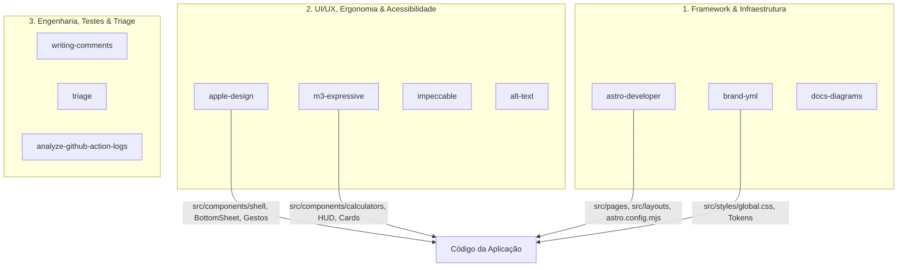
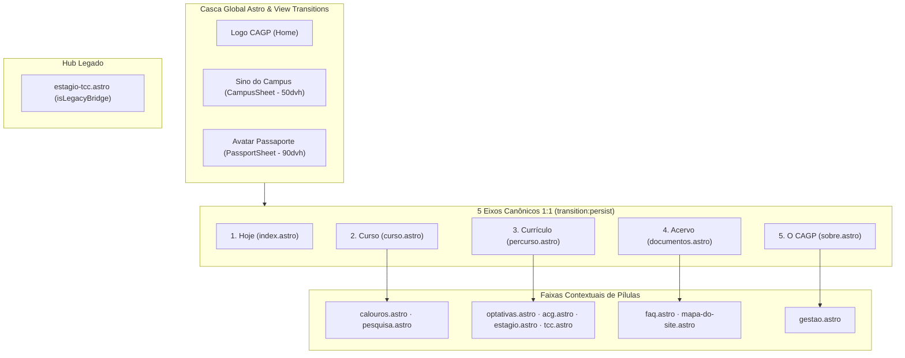
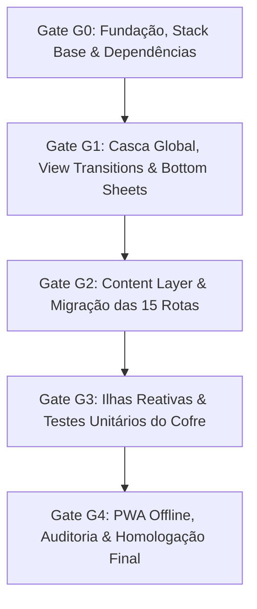

# AGENTS.md — Manual Operacional de Arquitetura, Governança e Execução do Super App CAGP UFMG (Astro 7 + Apple HIG)

**Repositório:** Portal Institucional & Super App Discente — Centro Acadêmico de Gestão Pública (CAGP FAFICH/UFMG)  
**Documento Canônico de Origem:** [`_designs/refatoracao_astro7_superapp_cagp.md`](file:///home/gsathler/Nextcloud/Projects/cagp/_designs/refatoracao_astro7_superapp_cagp.md) (Plano Arquitetural v3.0)  
**Documentos Relacionados:** [`_brand.yml`](file:///home/gsathler/Nextcloud/Projects/cagp/_brand.yml) • [`consolidated_review_report.md`](file:///home/gsathler/Nextcloud/Projects/cagp/consolidated_review_report.md) • [`concepts_brief.md`](file:///home/gsathler/Nextcloud/Projects/cagp/concepts_brief.md)  
**Motor de IA Alvo:** **Gemini 3.8 Flash (High Thinking)** no Google Antigravity  
**Status:** Manual Operacional Ativo para Execução por Agentes de IA (**Regra de Zero-Decisão**)

---

## 1. Princípios Inegociáveis e Diretrizes de Execução (Cláusulas Pétreas)

1. **Integridade Factual Absoluta (100% Zero Invenção / Zero Supressão):**
   - Todos os dados acadêmicos, regras regimentais (PPC 2020, Regulamento do Curso Versão `N-20229`, Regimento Interno do CAGP de `14/10/2024`, Resoluções CEPE/UFMG), cargas horárias (`3.000h` totais, `2.880h` Núcleo Específico, `120h` Formação Livre, `300h` Extensão Obrigatória, até `300h` AAC, `300h` Estágio Supervisionado A+B, `180h` TCC A+B), códigos e ementas das `27` disciplinas obrigatórias e `68` optativas, prazos normativos (`120 dias corridos` para protocolo de certificados de AAC — Art. 15, § 4º; final do `2º período letivo` para aproveitamento de estudos — Res. CEPE 06/2019), horários operacionais (`RU II Setorial`, linhas do Circular Interno, `Secretaria Sala F-2039` com Norma Guedes, `CEAG FAFICH` das 08h às 22h), e-mails institucionais (`coordgestaopublica@gmail.com`) e arquivos em `public/documentos/` são autênticos e preservados.
   - **Proibição Estrita:** Nenhum agente pode inventar dados, alterar cargas horárias, suprimir regras regimentais, modificar códigos de matérias ou alterar nomes reais dos PDFs oficiais.
   - Textos extensos e notas regulamentares são encapsulados no componente `<NormativeDetails>` com `<summary>` conciso.
2. **Decisões Arquiteturais Travadas (Locked Invariants):**
   - **Stack Oficial:** **Astro 7 (SSG Estático)** + **React 19 (TypeScript)** para ilhas interativas + **Tailwind CSS v4** via plugin `@tailwindcss/vite`.
   - **Simetria 1:1 dos 5 Eixos e 15 Rotas:** Exatamente 14 rotas ativas + 1 rota-ponte legada (`estagio-tcc.astro`). **Proibida a criação de rotas adicionais de página inteira** (Passaporte e Acessibilidade operam estritamente como Bottom Sheets modais globais).
   - **Astro View Transitions Nativas:** Casca global gerenciada por Astro `<ClientRouter />` com a barra inferior de navegação dos 5 eixos persistente (`transition:persist="main-bottom-nav"`).
   - **Cofre Discente em 9 Chaves Canônicas:** Persistência estritamente local em `localStorage`, validação estrita via schemas Zod e backup Base64 `CAGP1:...` com checksum CRC32.
   - **Operação Estática e 100% Offline (Custo Zero):** Hospedagem estática no GitHub Pages (`cagp-ufmg.github.io`). PWA com Service Worker precacheando chunks hashed do Vite e timeout anti-Lie-Fi de `2.5s`.
3. **Regra de Arbitragem em 3 Camadas de Design:**
   - **Camada 1 — Marca & Pele (Soberana: Brite Institucional / CAGP):** Paleta Borgonha `#8B1E2D` / Vinho `#9E2424`, Preto Candango `#0A0A0A`, Creme `#F7F5F0`, Branco `#FFFFFF`, bordas sólidas de `1px solid #DFDBD2`, opacidade 100%. Veta glassmorphism (`backdrop-filter: blur`) sob luz solar. Borda `2px` e sombra dura `2px 2px 0 #0A0A0A` exclusivamente em botões primários, aba ativa e modal em foco.
   - **Camada 2 — Ergonomia, Zonas de Toque & Navegação (`apple-design`):** Alvos de toque mínimos de `44×44px` (ideal `48×48px`), respeito a Safe Areas (`env(safe-area-inset-*)`), Bottom Sheets com detents nativos (`50dvh` e `90dvh`), `padding-bottom: calc(1rem + env(safe-area-inset-bottom))`, fontes `>= 16px` (`text-base`) nos formulários para impedir auto-zoom no iOS Safari e `touch-action: manipulation`.
   - **Camada 3 — Contenção, Densidade & Feedback Operacional (`m3-expressive`):** Proibição de *over-boxing* (máximo 4 elementos com borda 2px/sombra dura na 1ª dobra), controle segmentado 100% visível sem scroll e barras de progresso com metas explícitas.
4. **Regra da Execução Zero-Decisão:**
   - O agente implementador deve seguir as fases, comandos e contratos exatamente como especificados neste documento, sem improvisar nomes de arquivos, classes CSS, chaves de armazenamento ou regras de layout.

---

## 2. Governança e Blindagem para Gemini 3.8 Flash (High Thinking)

Para garantir máxima fidelidade, eliminar alucinações e prevenir a degradação de contexto durante a codificação pelo modelo **Gemini 3.8 Flash High Thinking**, as seguintes diretrizes são de cumprimento compulsório:

### 2.1. Diretriz de Modularidade Saudável & Liberdade de Complexidade de Detalhes
- **Liberdade para Detalhamento e Completude Visual:** Fica revogado qualquer teto rígido e artificial de 300 linhas de código por arquivo. Componentes `.astro`, `.tsx`, `.ts` e folhas `.css` têm total liberdade para crescer com a extensão que for necessária para acomodar riqueza de detalhes visuais, templates semânticos completos, microinterações, estados táteis, acessibilidade estrita (WCAG AAA) e SVGs cartográficos de alta fidelidade.
- **Princípio da Responsabilidade Única (Coesão Arquitetural):** Em vez de contagens cegas de linhas, a decomposição deve respeitar apenas fronteiras naturais de responsabilidade:
  - *Funções de Cálculo Puro, Schemas Zod e Cofre Discente* (ex.: `calculators.ts`, `studentVault.ts`): devem se manter focados para garantir testes unitários limpos e isolados.
  - *Componentes Visuais, Telas Ricas, Cascas Globais e SVGs Interativos* (ex.: `SuperAppHeader.astro`, `CurriculumSvgMap.tsx`, `index.astro`): podem ter 500 a 800+ linhas sem qualquer problema, evitando a fragmentação artificial em dezenas de microarquivos que prejudicam a legibilidade e a manutenibilidade do código.
- **Prioridade Absoluta:** O agente deve priorizar a excelência da experiência do usuário (UX), a profundidade de recursos e a paridade factual completa, sem jamais suprimir detalhes ou podar recursos por restrição de tamanho de arquivo.

### 2.2. Verificação em Loop Fechado Obrigatória
Nenhuma tarefa ou turno de agente é considerado completo sem a execução dos comandos de verificação automatizada no terminal:
1. `pnpm typecheck` (`tsc -b`): Validação rigorosa de tipos TypeScript (zero erros tolerados).
2. `pnpm test` (`vitest run`): Execução dos testes unitários de armazenamento, validação Zod e cálculo de horas.
3. `pnpm build`: Verificação de compilação estática do Astro sem avisos ou erros.

### 2.3. Anti-Alucinação de Fatos Acadêmicos
- O agente está terminantemente proibido de inferir ou inventar cargas horárias, nomes de matérias, salas ou normas.
- Qualquer dúvida factual deve ser resolvida lendo diretamente os arquivos de referência:
  - PPC 2020 e Regulamento: [`_referencias/`](file:///home/gsathler/Nextcloud/Projects/cagp/_referencias) e [`src/content/normas/`](file:///home/gsathler/Nextcloud/Projects/cagp/src/content/normas)
  - Disciplinas e Ementas: [`src/content/disciplinas/`](file:///home/gsathler/Nextcloud/Projects/cagp/src/content/disciplinas)
  - Identidade Visual e Cores: [`_brand.yml`](file:///home/gsathler/Nextcloud/Projects/cagp/_brand.yml)

---

## 3. Roteamento de Skills em 3 Níveis e Mapeamento de Diretórios

O ecossistema dispõe de skills especializadas em `.agents/skills/`. O agente deve ativar e consultar a skill correspondente ao contexto do arquivo e da tarefa:



### 3.1. Mapeamento Estrito de Skills por Local e Domínio

| Diretório / Arquivo | Domínio de Trabalho | Skills Obrigatórias (em `.agents/skills/`) | Regra de Ativação |
| :--- | :--- | :--- | :--- |
| `src/pages/**/*.astro`<br>`src/layouts/**/*.astro`<br>`astro.config.mjs` | Roteamento, View Transitions, Content Layer, Layouts | [`astro-developer`](file:///home/gsathler/Nextcloud/Projects/cagp/.agents/skills/astro-developer/SKILL.md)<br>[`writing-comments`](file:///home/gsathler/Nextcloud/Projects/cagp/.agents/skills/writing-comments/SKILL.md) | Consultar para sintaxe `.astro`, diretivas `client:*`, `<ClientRouter />` e boas práticas de tipagem Astro. |
| `src/components/shell/*`<br>`BottomSheet.tsx`<br>`BottomNav.astro` | Ergonomia Mobile, Gestos, Safe Areas, Modais, Anti-Zoom | [`apple-design`](file:///home/gsathler/Nextcloud/Projects/cagp/.agents/skills/apple-design/SKILL.md)<br>[`m3-expressive`](file:///home/gsathler/Nextcloud/Projects/cagp/.agents/skills/m3-expressive/SKILL.md) | Consultar `apple-design/references/hig/sheets.md`, `gestures.md`, `motion.md` e `tab-bars.md`. Alvos `>= 44px`. |
| `src/components/calculators/*`<br>`CurriculumGraph.tsx` | Ilhas Reativas React, HUD linear, microinterações | [`m3-expressive`](file:///home/gsathler/Nextcloud/Projects/cagp/.agents/skills/m3-expressive/SKILL.md)<br>[`impeccable`](file:///home/gsathler/Nextcloud/Projects/cagp/.agents/skills/impeccable/SKILL.md) | Consultar para contenção de caixas, feedback tátil amortecido e barras de progresso operacionais. |
| `src/styles/global.css`<br>`src/components/ui/*` | Tokens visuais, Tailwind v4 `@theme`, tipografia Brite | [`brand-yml`](file:///home/gsathler/Nextcloud/Projects/cagp/.agents/skills/brand-yml/SKILL.md)<br>[`impeccable`](file:///home/gsathler/Nextcloud/Projects/cagp/.agents/skills/impeccable/SKILL.md) | Garantir fidelidade de 100% aos tokens de `_brand.yml` e contraste WCAG AAA (`html[data-a11y-contrast="high"]`). |
| `src/content/**/*`<br>`src/content.config.ts` | Schemas Zod, catálogo de 27 obrigatórias e 68 optativas | [`astro-developer`](file:///home/gsathler/Nextcloud/Projects/cagp/.agents/skills/astro-developer/SKILL.md)<br>[`writing-comments`](file:///home/gsathler/Nextcloud/Projects/cagp/.agents/skills/writing-comments/SKILL.md) | Garantir validação estrita sem supressão factual de ementas ou créditos. |
| `tests/**/*.test.ts`<br>`src/lib/storage/*` | Testes unitários com Vitest, persistência do cofre, CRC32 | [`triage`](file:///home/gsathler/Nextcloud/Projects/cagp/.agents/skills/triage/SKILL.md) | Diagnóstico rápido de quebras de contrato ou falhas de regressão no cofre. |
| Imagens, SVGs e Gráficos | Acessibilidade visual, `fig-alt`, `aria-label` | [`alt-text`](file:///home/gsathler/Nextcloud/Projects/cagp/.agents/skills/alt-text/SKILL.md) | Auditoria de alt text e descrições dos 27 nós do grafo curricular. |
| `.github/workflows/*` | Pipeline de build e deploy no GitHub Pages | [`analyze-github-action-logs`](file:///home/gsathler/Nextcloud/Projects/cagp/.agents/skills/analyze-github-action-logs/SKILL.md) | Triagem de falhas de CI e validação da pasta de saída `dist/`. |
| `_designs/**/*.md` | Diagramas de arquitetura, fluxogramas | [`docs-diagrams`](file:///home/gsathler/Nextcloud/Projects/cagp/.agents/skills/docs-diagrams/SKILL.md) | Renderização limpa de blocos Mermaid `graph TD` / `flowchart LR`. |

*Nota sobre Skills Upstream:* As skills remanescentes do monorepo Astro/Next.js (`changeset`, `backport-pr`, `create-pr`, `dce-edge`, `flags`, `gate-tests`, `gh-stack`, `insight-error-page`, `merge`, `pr-status-triage`, `react-sync`, `react-vendoring`, `router-act`, `update-docs`, `v8-jit`, `astro-adversary-*`) são utilitários upstream e não devem ser invocadas na manutenção deste portal discente.

---

## 4. Arquitetura do Site: 15 Rotas, 5 Eixos e 5 Arquétipos

### 4.1. Mapeamento Canônico dos 5 Eixos e 15 Rotas



| Eixo | ID Canônico | Rótulo | Ícone | Rota Raiz | Rotas-Filhas Ativas no Eixo | Rotas Redirecionadas (Compatibilidade) |
| :--- | :--- | :--- | :--- | :--- | :--- | :--- |
| **1** | `axis-1` | `Hoje` | `bi-compass` | [`src/pages/index.astro`](file:///home/gsathler/Nextcloud/Projects/cagp/src/pages/index.astro) | — | [`/configuracoes`](file:///home/gsathler/Nextcloud/Projects/cagp/src/pages/configuracoes.astro) ➔ `/?openSettings=true` |
| **2** | `axis-2` | `Curso` | `bi-mortarboard` | [`src/pages/curso.astro`](file:///home/gsathler/Nextcloud/Projects/cagp/src/pages/curso.astro) | [`calouros.astro`](file:///home/gsathler/Nextcloud/Projects/cagp/src/pages/calouros.astro), [`pesquisa.astro`](file:///home/gsathler/Nextcloud/Projects/cagp/src/pages/pesquisa.astro) | — |
| **3** | `axis-3` | `Currículo` | `bi-diagram-3` | [`src/pages/percurso.astro`](file:///home/gsathler/Nextcloud/Projects/cagp/src/pages/percurso.astro) *(Central 3-em-1)* | [`acg.astro`](file:///home/gsathler/Nextcloud/Projects/cagp/src/pages/acg.astro), [`estagio.astro`](file:///home/gsathler/Nextcloud/Projects/cagp/src/pages/estagio.astro), [`tcc.astro`](file:///home/gsathler/Nextcloud/Projects/cagp/src/pages/tcc.astro) | [`/optativas`](file:///home/gsathler/Nextcloud/Projects/cagp/src/pages/optativas.astro) ➔ `/percurso#optativas`, [`/estagio-tcc`](file:///home/gsathler/Nextcloud/Projects/cagp/src/pages/estagio-tcc.astro) ➔ `/estagio` |
| **4** | `axis-4` | `Acervo` | `bi-folder2-open` | [`src/pages/documentos.astro`](file:///home/gsathler/Nextcloud/Projects/cagp/src/pages/documentos.astro) | [`faq.astro`](file:///home/gsathler/Nextcloud/Projects/cagp/src/pages/faq.astro) | [`/mapa-do-site`](file:///home/gsathler/Nextcloud/Projects/cagp/src/pages/mapa-do-site.astro) ➔ `/faq` |
| **5** | `axis-5` | `O CAGP` | `bi-people` | [`src/pages/sobre.astro`](file:///home/gsathler/Nextcloud/Projects/cagp/src/pages/sobre.astro) | [`gestao.astro`](file:///home/gsathler/Nextcloud/Projects/cagp/src/pages/gestao.astro) | — |

### 4.2. Matriz dos 5 Arquétipos de Página e Metas de 1ª Dobra (`360×640`)

Referência móvel: **`360×640px`** (área útil, descontadas a Topbar e a BottomNav de 64px).

| Arquétipo | Modo `impeccable` | Rotas Correspondentes | Metas de 1ª Dobra (`360×640`) |
| :--- | :--- | :--- | :--- |
| **A1 Hub** | `Operate` | `index.astro` | Saudação compacta + status do campus + 1º acesso de eixo em **`y <= 300px`**. |
| **A2 Ferramenta** | `Operate` | `acg.astro`, `estagio.astro`, `percurso.astro` | Topo do controle segmentado em **`y <= 200px`**; 1º controle interativo em **`y <= 300px`**. |
| **A3 Catálogo** | `Operate` | `documentos.astro`, `optativas.astro`, `mapa-do-site.astro` | Topo da barra em **`y <= 200px`**; campo de busca/filtro em **`y <= 300px`** (em `mapa-do-site`: 1º link em `y <= 300px`). |
| **A4 Guia** | `Read` | `curso.astro`, `calouros.astro`, `pesquisa.astro`, `tcc.astro`, `faq.astro`, `sobre.astro`, `gestao.astro` | Topo da barra em **`y <= 200px`**; 1º bloco substantivo em **`y <= 300px`**. |
| **A5 Hub Legado** | `Operate` | `estagio-tcc.astro` | Conteúdo preservado; 1º botão de direcionamento em **`y <= 300px`**. |

---

## 5. Contratos de Engenharia, Interfaces e Padrões Apple HIG

### 5.1. Contrato da Casca e Controle Segmentado (`<SegmentedControl>`)

Markup padronizado do controle segmentado de sub-views de cada rota:

```html
<nav class="cagp-workspace-bar" aria-label="Abas da página">
  <div class="cagp-workspace-tabs" role="tablist" data-tab-count="3">
    <button type="button" class="cagp-workspace-tab is-active" role="tab" id="ws-tab-v1" aria-controls="ws-panel-v1" aria-selected="true" tabindex="0" data-ws-tab="v1" data-ws-hash="#calculadora-horas">
      <span class="cagp-tab-label-full">Calculadora 600h</span>
      <span class="cagp-tab-label-short" aria-hidden="true">Calculadora</span>
    </button>
    <button type="button" class="cagp-workspace-tab" role="tab" id="ws-tab-v2" aria-controls="ws-panel-v2" aria-selected="false" tabindex="-1" data-ws-tab="v2" data-ws-hash="#guardiao-120-dias">
      <span class="cagp-tab-label-full">Guardião 120 Dias</span>
      <span class="cagp-tab-label-short" aria-hidden="true">120 dias</span>
    </button>
    <button type="button" class="cagp-workspace-tab" role="tab" id="ws-tab-v3" aria-controls="ws-panel-v3" aria-selected="false" tabindex="-1" data-ws-tab="v3" data-ws-hash="#guia-tramitacao">
      <span class="cagp-tab-label-full">Guia & Tramitação</span>
      <span class="cagp-tab-label-short" aria-hidden="true">Guia</span>
    </button>
  </div>
  <button type="button" class="cagp-workspace-viewall" aria-pressed="false" aria-label="Ver todas as abas" data-ws-tab="__all__" data-ws-hash="#visao-completa">
    <i class="bi bi-layout-text-sidebar" aria-hidden="true"></i>
  </button>
</nav>
```

**Regras Mandatórias de Interação:**
1. **100% Visível:** Proibido scroll horizontal na barra entre `280px` e `1440px`. Rótulos alternam automaticamente entre `.cagp-tab-label-full` (telas `>= 768px`) e `.cagp-tab-label-short` (telas `< 768px`).
2. **Botão "Ver Tudo":** Fica **fora do `tablist`**, tem dimensão mínima de `44×44px` e opera com `aria-pressed="true|false"`.
3. **Navegação por Teclado:** Setas (`ArrowLeft`/`ArrowRight`) alternam exclusivamente entre as abas do `tablist` com *roving tabindex*.

### 5.2. Contrato de Ergonomia Apple HIG (`BottomSheet.tsx`)
- **Detents Nativos:** `50dvh` (Medium) e `90dvh` (Large).
- **Grabber Handle:** Barra centralizada de `36×5px`, raio de borda `9999px`, cor `#DFDBD2`, com zona invisível de toque expandida para `44×24px`.
- **Prevenção de Conflito de Gestos:** O manipulador de arrasto vertical escuta exclusivamente na área do *grabber* com `touch-action: none`. O corpo do modal mantém `touch-action: pan-y` e rolagem nativa suave.
- **Safe Area Inferior:** O container do modal aplica obrigatoriamente:
  `padding-bottom: calc(1rem + env(safe-area-inset-bottom, 0px))`.

### 5.3. Prevenção de Auto-Zoom no iOS Safari
- Meta Viewport: `<meta name="viewport" content="width=device-width, initial-scale=1, viewport-fit=cover">`.
- **Proibição Estrita de `user-scalable=no`** (respeito a WCAG SC 1.4.4 e acessibilidade da Apple).
- Todo `<input>`, `<select>` e `<textarea>` deve ter `font-size: 16px` no mobile (`text-base`) para suprimir o auto-zoom do Safari ao focar no campo.
- `touch-action: manipulation` ativado no container principal para matar o atraso tátil de 300ms de duplo toque.

### 5.4. Hidratação Seletiva das Ilhas React
Para maximizar a velocidade de carregamento e o desempenho offline:

| Componente | Diretiva de Hidratação | Rationale Técnico |
| :--- | :---: | :--- |
| `BottomSheet.tsx` | `client:load` | Disponibilidade imediata para escutar cliques do Sino e Avatar. |
| `LinearHud.tsx` | `client:load` | Exibição instantânea do HUD no topo da Calculadora 600h. |
| `ExtensionForm.tsx` & `AacForm.tsx` | `client:idle` | Hidratação após a carga inicial de conteúdo estático. |
| `Guardian120d.tsx` | `client:visible` | Hidratação sob demanda ao rolar até o painel. |
| `CurriculumGraph.tsx` | `client:visible` | Nó SVG complexo; renderiza esqueleto estático e hidrata ao entrar na viewport. |
| `Art41Simulator.tsx` | `client:visible` | Simulador ativado quando a seção de estágio se torna visível. |

### 5.5. Tokens Tailwind CSS v4 (`src/styles/global.css`)

```css
@import "tailwindcss";

@theme {
  --color-cagp-burgundy: #8B1E2D;
  --color-cagp-red: #9E2424;
  --color-cagp-black: #0A0A0A;
  --color-cagp-cream: #F7F5F0;
  --color-cagp-surface: #FFFFFF;
  --color-cagp-border: #DFDBD2;
  --color-cagp-success: #15803D;
  --color-cagp-warning: #B45309;
  --color-cagp-danger: #DC2626;

  --font-display: 'Oswald', sans-serif;
  --font-body: 'Inter', sans-serif;
  --font-mono: 'JetBrains Mono', monospace;

  --shadow-cagp-hard: 2px 2px 0px #0A0A0A;
}
```

---

## 6. Contrato do Cofre Discente (`localStorage` & 9 Chaves Canônicas com Zod)

O módulo `src/lib/storage/studentVault.ts` governa a persistência local com validação defensiva e compatibilidade retroativa total:

| Chave Canônica | Schema Zod | Formato do Valor | Consumidores |
| :--- | :--- | :--- | :--- |
| **`cagp_calc_ext_aac_v1`** | `z.record(z.string(), z.number())` | Objeto com chaves `ext_*` e `aac_*` | `acg.astro`, `PassportSheet.tsx` |
| **`cagp_aac_120d_certs_v1`** | `z.array(CertSchema)` | Array de certificados com `{ id, title, mod, date, hours }` | `acg.astro`, `SuperAppHeader.astro` |
| **`cagp_notifications_prefs_v1`** | `z.object({ ru1815: z.boolean(), circular2230: z.boolean(), aac120d: z.boolean(), lastFired: z.number().optional() })` | Preferências de avisos do campus (< 600 bytes) | `CampusSheet.tsx`, `sw.js` |
| **`cagp_calouro_checklist_v1`** | `z.record(z.string(), z.boolean())` | Checklist de 30 dias com chaves `item_*` | `calouros.astro` |
| **`cagp_percurso_quiz_v1`** | `z.object({ answers: z.record(z.string(), z.string()), resultPath: z.string().optional() })` | Respostas e perfil do estudante | `percurso.astro` |
| **`cagp_minha_grade_v1`** | `z.object({ savedCourses: z.array(z.string()) })` | Códigos das optativas favoritadas | `optativas.astro`, `percurso.astro` |
| **`cagp_art41_checklist_v1`** | `z.record(z.string(), z.boolean())` | Checklist de elegibilidade com chaves `disp_*` | `estagio.astro` |
| **`cagp_a11y_prefs_v2`** | `z.object({ font: z.string(), contrast: z.string(), dyslexia: z.boolean(), motion: z.string() })` | Preferências de acessibilidade | `A11ySheet.tsx`, `BaseLayout.astro` |
| **`cagp_student_profile_v1`** | `z.object({ name: z.string(), period: z.string(), photoDataUrl: z.string().optional() })` | Identificação do Passaporte Discente | `PassportSheet.tsx`, `SuperAppHeader.astro` |

- **Backup Base64 com CRC32:** Formato `CAGP1:<payloadBase64>.<crc32Hex>`. Vetor de teste de verificação: `CRC32("123456789") === "cbf43926"`.
- **Restauração Segura:** `safeParse()` em cada chave; se uma chave estiver corrompida, apenas essa chave assume o valor padrão, preservando o restante do cofre intacto.

---

## 7. PWA, Service Worker Anti-Lie-Fi e Build Vite Hashing

### 7.1. Geração de Manifesto para Bundles Hashed do Vite
- O Vite gera chunks com nomes dinâmicos (ex.: `_astro/index.B8x19a.js`).
- O pipeline de compilação executa um script pós-build (`scripts/generate-sw-manifest.mjs`) que lê a pasta de saída `dist/`, extrai a lista exata de hashes gerados e injeta a matriz de precache no `public/sw.js`.
- O Service Worker garante precache completo de todo o código compilado, fontes e arquivos estáticos.

### 7.2. Timeout Anti-Lie-Fi (2.5 Segundos)
- O campus da UFMG possui conexões instáveis (*Lie-Fi*).
- O Service Worker aplica estratégia `NetworkFirst` com timeout estrito de **2.500 ms** em requisições de navegação.
- Se a rede não responder em 2.5s, o Service Worker corta a requisição e serve imediatamente o cache local, eliminando congelamentos e telas brancas.

---

## 8. Roteiro de Implementação e Matriz de Gates (G0 a G4)



### 8.1. Gate G0 — Fundação & Configuração da Stack Base
- [ ] Promover a base de `violet-velocity/` para a raiz do repositório.
- [ ] Configurar `package.json` com Astro 7, `@astrojs/react`, `@tailwindcss/vite`, `vitest`, `zod`, `typescript`.
- [ ] Configurar `astro.config.mjs` com `output: 'static'` e `outDir: './dist'`.
- [ ] Configurar `tsconfig.json` com path aliases (`@components/*`, `@lib/*`, etc.).
- [ ] Mapear tokens oficiais do `_brand.yml` em `src/styles/global.css`.
- [ ] Migrar a pasta de PDFs autênticos de `documentos/` para `public/documentos/`.
- **Critério de Saída G0:** Execução de `pnpm install` e `pnpm typecheck` com zero erros.

### 8.2. Gate G1 — Casca Global, View Transitions & Bottom Sheets
- [ ] Criar `src/layouts/BaseLayout.astro` com `<ClientRouter />` e meta viewport anti-zoom.
- [ ] Criar `src/components/shell/SuperAppHeader.astro` com alvos `>= 44×44px`.
- [ ] Criar `src/components/shell/BottomNav.astro` com `transition:persist="main-bottom-nav"`.
- [ ] Criar `src/components/shell/BottomSheet.tsx` com detents (`50dvh`/`90dvh`) e arrasto vertical.
- [ ] Criar `src/components/shell/PassportSheet.tsx` e `A11ySheet.tsx` (Bottom Sheets modais).
- [ ] Criar `src/components/ui/SegmentedControl.astro` e `NormativeDetails.astro`.
- **Critério de Saída G1:** Transição fluida entre eixos sem recarga da barra inferior e abertura de gavetas modais com resposta tátil elástica.

### 8.3. Gate G2 — Content Layer & Migração das 15 Rotas
- [ ] Configurar `src/content.config.ts` com schemas Zod para disciplinas e normas.
- [ ] Migrar as 27 obrigatórias e 68 optativas para coleções tipadas.
- [ ] Construir as 15 páginas estáticas em `src/pages/` respeitando os 5 eixos e metas de 1ª dobra (`y <= 300px` em `360×640`).
- **Critério de Saída G2:** Todas as 15 rotas compilam estaticamente sem erros e todas as sub-views cabem sem rolagem horizontal.

### 8.4. Gate G3 — Ilhas Reativas & Testes Unitários do Cofre
- [ ] Criar `src/lib/storage/studentVault.ts` e `backupVault.ts` com validação Zod e cálculo CRC32.
- [ ] Decompor e implementar a Calculadora 600h (`Calculator600h.tsx`, `LinearHud.tsx`, `ExtensionForm.tsx`, `AacForm.tsx`, `Guardian120d.tsx`).
- [ ] Implementar `CurriculumGraph.tsx` dos 27 nós com suporte a teclado (*roving tabindex*).
- [ ] Implementar `Art41Simulator.tsx` para dispensa de estágio.
- [ ] Criar bateria de testes unitários com Vitest em `tests/storage.test.ts`.
- **Critério de Saída G3:** `pnpm test` executa 100% verde validando as 9 chaves e a rotina de backup `CAGP1:...`.

### 8.5. Gate G4 — PWA Offline, Auditoria & Homologação Final
- [ ] Configurar `public/sw.js` com injeção automática de hashes pós-build (`scripts/generate-sw-manifest.mjs`).
- [ ] Validar operação 100% offline em modo avião simulado.
- [ ] Executar auditoria de acessibilidade AAA e alvos de toque.
- [ ] Arquivar arquivos legados do Quarto em `_legacy_quarto/` e remover pasta temporária `violet-velocity/`.
- [ ] Executar `pnpm build` gerando `dist/` pronto para o GitHub Pages.
- **Critério de Saída G4:** Homologação final com zero erros de build, zero erros de linter e PWA 100% operacional.
