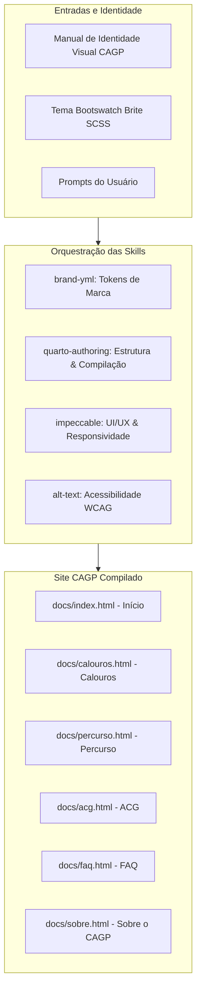

# Relatório e Memória Técnica do Processo de Desenvolvimento: Site CAGP UFMG

**Projeto:** Centro Acadêmico de Gestão Pública (CAGP) — FAFICH / UFMG  
**Finalidade:** Documentação pedagógica, técnica e histórica do processo de desenvolvimento do portal do CAGP utilizando Quarto CLI, orquestração de skills de IA, tema neo-brutalista Brite e conformidade de acessibilidade.  
**Data:** 21 de Outubro de 2026  

---

## Sumário
1. [Visão Geral e Contexto](#1-visão-geral-e-contexto)
2. [Estado Inicial do Repositório (Arquivos Pré-existentes)](#2-estado-inicial-do-repositório-arquivos-pré-existentes)
3. [Catálogo e Papel das Skills Utilizadas](#3-catálogo-e-papel-das-skills-utilizadas)
4. [Ciclo 1: Diagnóstico e Preflight de Plugins](#4-ciclo-1-diagnóstico-e-preflight-de-plugins)
5. [Ciclo 2: Planejamento Mestre e Criação do Mockup Completo](#5-ciclo-2-planejamento-mestre-e-criação-do-mockup-completo)
6. [Ciclo 3: Refinamento da Barra de Navegação e Migração para docs/](#6-ciclo-3-refinamento-da-barra-de-navegação-e-migração-para-docs)
7. [Ciclo 4: Diagnóstico de Engenharia do SVG e Correção de Exibição](#7-ciclo-4-diagnóstico-de-engenharia-do-svg-e-correção-de-exibição)
8. [Matriz Comparativa de Arquivos (Antes vs. Depois)](#8-matriz-comparativa-de-arquivos-antes-vs-depois)
9. [Instruções de Manutenção e Publicação](#9-instruções-de-manutenção-e-publicação)

---

## 1. Visão Geral e Contexto

O objetivo deste projeto foi conceber, planejar e implementar um mockup completo, moderno, responsivo e acessível para o novo site institucional do **Centro Acadêmico de Gestão Pública (CAGP)** da **Faculdade de Filosofia e Ciências Humanas (FAFICH)** da **Universidade Federal de Minas Gerais (UFMG)**.

O site foi estruturado para resolver um desafio central: fornecer um ambiente acolhedor e informativo para calouros e veteranos, orientando-os em relação ao **percurso curricular**, regras e prazos de **Atividades Complementares de Graduação (ACG)** e **dúvidas frequentes**.

Visualmente, o projeto articula duas forças de design:
1. **Identidade Visual Canônica do CAGP (v2.0):** Inspirada na escultura monumental *"Os Candangos (Dois Guerreiros)"* de Bruno Giorgi (1959), operando com uma paleta de alto contraste (Preto `#0A0A0A`, Branco `#FFFFFF` e Vermelho Institucional `#9E2424`).
2. **Tema Bootswatch Brite (Neo-Brutalismo):** Estética caracterizada por bordas sólidas de 2px, sombras duras de deslocamento (*hard shadows* de 3px a 7px), caixas bem demarcadas e micro-interações táteis de clique e hover. Como o tema *Brite* não existe nativamente no catálogo padrão do Quarto, foi necessária uma engenharia de transposição para SCSS customizado.



---

## 2. Estado Inicial do Repositório (Arquivos Pré-existentes)

Antes do início das intervenções solicitadas, a pasta do projeto continha um esqueleto básico e assets de identidade visual. A estrutura inicial era:

```text
/home/gsathler/Nextcloud/Projects/cagp/
├── .agents/
│   └── skills/
│       ├── alt-text/          # Diretrizes para escrita de textos alternativos acessíveis
│       ├── brand-yml/         # Especificação de marca para Quarto e Shiny
│       ├── impeccable/        # Princípios avançados de design de frontend e UX
│       └── quarto-authoring/  # Autoria, templates e compilação em Quarto
├── brite/
│   ├── bootstrap.css          # Compilado bruto do Bootstrap com tema Brite
│   ├── bootstrap.rtl.css      # Versão RTL (Right-to-Left)
│   ├── _bootswatch.scss       # Regras e mixins CSS específicas do tema Brite
│   └── _variables.scss        # Variáveis padrão do tema Brite (Bootstrap 5.3)
├── logos/
│   ├── 01_vertical_fundo_claro.svg
│   ├── 02_vertical_transparente_positivo.svg
│   ├── 03_vertical_fundo_escuro.svg
│   ├── 04_vertical_transparente_negativo.svg
│   ├── 05_horizontal_fundo_claro.svg
│   ├── 06_horizontal_transparente_positivo.svg
│   ├── 07_horizontal_fundo_escuro.svg
│   ├── 08_horizontal_transparente_negativo.svg
│   ├── 09_simbolo_fundo_claro.svg
│   ├── 10_simbolo_transparente_positivo.svg
│   ├── 11_simbolo_fundo_escuro.svg
│   └── 12_simbolo_transparente_negativo.svg
├── manual_de_identidade_visual_cagp_ufmg.md  # Manual canônico da marca (v2.0)
├── _quarto.yml               # Arquivo de configuração mínima do Quarto (20 linhas)
├── _variables.scss           # Rascunho inicial mesclando variáveis e regras Brite
├── about.qmd                 # Página padrão de exemplo criada pelo 'quarto create-project'
├── index.qmd                 # Página padrão de exemplo inicial
└── styles.css                # Folha de estilo vazia (apenas comentário inicial)
```

### Diagnóstico do Estado Inicial:
- O arquivo `_quarto.yml` configurava apenas um website genérico com Início e Sobre.
- Não existia o arquivo canônico de marca `_brand.yml`.
- A folha `_variables.scss` na raiz continha regras misturadas sem a devida separação que o motor SASS do Quarto exige (`/*-- scss:defaults --*/` e `/*-- scss:rules --*/`).
- O tema Brite original usava cores neon (como verde-limão `#a2e436`), divergindo da seriedade e do manual da entidade pública.
- Não havia nenhuma das páginas centrais requisitadas para acolhimento de calouros, percurso acadêmico e normas de ACG.

---

## 3. Catálogo e Papel das Skills Utilizadas

O desenvolvimento contou com o acionamento sinérgico de habilidades especializadas (*skills*). Cada uma desempenhou uma função estratégica no ciclo de vida do projeto:

| Skill | Localização | Para que serve? | Como foi aplicada neste projeto? |
| :--- | :--- | :--- | :--- |
| **`brand-yml`** | `.agents/skills/brand-yml/` | Criação e manutenção do arquivo padronizado `_brand.yml`, traduzindo manuais de identidade em especificações legíveis por máquina (cores semânticas, tipografias, pesos e variantes de logo). | Gerou o arquivo `_brand.yml` mapeando as cores canônicas (`#9E2424`, `#0A0A0A`, `#FFFFFF`), as fontes Google (`Oswald` e `Inter`) e vinculando os logotipos vetoriais. |
| **`quarto-authoring`** | `.agents/skills/quarto-authoring/` | Domínio de engenharia sobre o Quarto CLI: configuração de `_quarto.yml`, navegação responsiva (navbar, footer), tratamento de SCSS (`defaults` e `rules`), geração de HTML estático e formatação `.qmd`. | Estruturou o site multipáginas, resolveu a ausência nativa do tema Brite no Quarto adaptando-o via SCSS, configurou a busca integrada e determinou a saída estática. |
| **`impeccable`** | `.agents/skills/impeccable/` | Excelência em design de interface de usuário (UI), experiência do usuário (UX), sistemas de design (tokens, espaçamento), responsividade mobile-first e micro-interações táteis. | Desenvolveu o sistema visual neo-brutalista em `styles.css`: cards táteis com hover lift, botões com feedback de clique ativo, timeline vertical semestral e adaptação fluida para telas de celular. |
| **`alt-text`** | `.agents/skills/alt-text/` | Auditoria e redação de textos alternativos acessíveis para imagens, diagramas e elementos vetoriais, assegurando conformidade com normas WCAG e acessibilidade para leitores de tela. | Inspecionou e forneceu `fig-alt` e `aria-label` contextuais para todos os logotipos (explicando a referência a Os Candangos de Bruno Giorgi) e configurou suporte a `prefers-reduced-motion`. |
| **`plugin`** | Builtin do Antigravity | Gestão do ciclo de vida de extensões e plugins do ambiente do assistente. | Utilizada no comando inicial `/plugin` para inventariar extensões instaladas. |

---

## 4. Ciclo 1: Diagnóstico e Preflight de Plugins

### 4.1 Prompt do Usuário (Transcrição Literal)
```text
/plugin 
```

### 4.2 Análise e Ações Executadas
1. **Objetivo:** O usuário iniciou a interação disparando o comando `/plugin`.
2. **Leitura da Skill:** Leitura obrigatória do arquivo de instruções da skill `/home/gsathler/.gemini/antigravity/builtin/skills/plugin/SKILL.md`.
3. **Preflight e Inventário:** Execução do comando via chamada de procedimento remoto (RPC) ao Language Server local para identificar se haviam plugins globais ou de workspace ativos.
4. **Resultado:** Constatou-se que nenhum plugin externo estava instalado no ambiente. Apresentou-se ao usuário as opções de criação, instalação ou consolidação de extensões, deixando o assistente pronto para a solicitação de desenvolvimento.

---

## 5. Ciclo 2: Planejamento Mestre e Criação do Mockup Completo

### 5.1 Prompt do Usuário (Transcrição Literal)
```text
Crie um plano capaz de orquestrar as skills do projeto com objetivo para criar um mockup de site do Centro Academico de Gestão Pública através do Quarto do Centro academico de gestão publica (CAGP) utilizando como base o tema brite do bootstrap que não existe nativamente noquarto. Ademais o site precisa ser responsivo tanto para computador quando para mobile, ou seja adaptativo em diversas telas. Crie um plano com a /plan e va me perguntando para alinha adequadamente utilizando /grill-me . No mais o objetivo do site é ser um mockup para que no futuro seja um site do CAGP feito para orientar os calouros e os alunos ja exisrtente em relação ao percurso, regras de acg e quaisquer duvidas que depois levantaremos. Os elementos devem ter animações, e deve ser um site fluido mas ainda acessivel para todas as pessoas.
```

### 5.2 Desdobramento da Demanda
O usuário demandou um conjunto complexo de requisitos:
- **Orquestração de Skills:** Usar ativamente as skills presentes no projeto (`brand-yml`, `quarto-authoring`, `impeccable`, `alt-text`).
- **Tema Brite Customizado:** Incorporar o estilo neo-brutalista do tema Brite do Bootstrap, contornando a limitação de não existir nativamente no Quarto.
- **Responsividade Total:** Layout fluido que se adapte perfeitamente tanto a telas de desktop quanto a smartphones e tablets.
- **Metodologia `/plan` e `/grill-me`:** Criação de artefato de planejamento formal antes de qualquer código, seguido por entrevista guiada passo a passo para alinhamento de decisões.
- **Propósito do Conteúdo:** Servir como base para acolher calouros e veteranos, com seções dedicadas a percurso curricular, Atividades Complementares (ACG) e dúvidas frequentes.
- **Animações e Acessibilidade:** Movimentos fluidos e táteis sem violar acessibilidade (WCAG AA e preferência de movimento reduzido).

### 5.3 O Processo de Alinhamento via `/grill-me`

Conforme os protocolos do `/grill-me`, o assistente conduziu uma série de perguntas estruturadas (uma a uma, via ferramenta `ask_question`), fornecendo recomendações técnicas para cada bifurcação do design:

#### Pergunta 1: Calibração de Cores e Tema Brite
> **Pergunta:** *Como você deseja calibrar a paleta de cores do tema Brite com a Identidade Visual do CAGP?*  
> **Opção Escolhida pelo Usuário:** *(Recommended) Neo-brutalismo Institucional CAGP: Estrutura Brite com bordas marcantes (2px) e sombras duras, mas substituindo o verde limão neon do Brite pelo Vermelho Institucional CAGP (#9E2424 / #D32F2F) como cor primária de destaque sobre fundo claro/escuro.*

#### Pergunta 2: Arquitetura de Informação e Navegação
> **Pergunta:** *Qual arquitetura de informação e fluxo de navegação você prefere para o site?*  
> **Opção Escolhida pelo Usuário:** *(Recommended) Portal Modular com Ações Rápidas: Navbar clara (Início, Guia do Calouro, Percurso Curricular, ACG, Dúvidas Frequentes, Sobre) e Home com hero impactante de boas-vindas, cards de acesso rápido ("Sou Calouro", "Entender ACG", "Fluxo do Percurso") e avisos recentes.*

#### Pergunta 3: Estilo de Animações e Fluidez
> **Pergunta:** *Qual nível e estilo de animações e micro-interações você deseja para a fluidez do site?*  
> **Opção Escolhida pelo Usuário:** *(Recommended) Neo-brutalismo Tátil e Fluido: Cards com elevação suave em hover (offset de -3px e ampliação da sombra dura de 3px para 6px), botões táteis com feedback de clique, fade-in sutil ao carregar páginas, com suporte total a prefers-reduced-motion para acessibilidade.*

#### Pergunta 4: Apresentação de ACG e Percurso Curricular
> **Pergunta:** *Como você prefere apresentar os conteúdos mais técnicos de ACG e Percurso Curricular no mockup?*  
> **Opção Escolhida pelo Usuário:** *(Recommended) Tabela/Cards Categorizados de ACG + Linha do Tempo Visual do Percurso: Para ACG, tabela clara com filtros por categoria (Ensino, Pesquisa, Extensão, Vivência) e checklist de submissão; para o Percurso, visualização organizada por semestres (1º ao 8º) com destaques de pré-requisitos e dicas do CAGP.*

#### Pergunta 5: Modo de Cores / Alternância Claro-Escuro
> **Pergunta:** *Deseja suporte a alternância de tema Claro / Escuro (Dark Mode toggle) no navbar do Quarto?*  
> **Opção Escolhida pelo Usuário:** *Tema Claro Exclusivo com Alto Contraste: Foco em fundo claro limpo com tipografia preta, bordas de 2px e detalhes em vermelho, mantendo simplicidade e aderência direta ao estilo Brite clássico.*

### 5.4 Aprovação do Plano
Após a consolidação das respostas no documento de planejamento (`cagp_site_mockup_plan.md`), o usuário emitiu aprovação formal para execução:
```text
(Comments on artifact URI: file:///home/gsathler/.gemini/antigravity/brain/3fb221ca-a939-4180-97ee-8773a547caa7/cagp_site_mockup_plan.md - The user has approved this document.)
```

### 5.5 Execução Técnica Passo a Passo

#### 1. Criação do `_brand.yml` (`brand-yml`)
Com base no manual canônico, elaborou-se o arquivo de especificação da marca. Durante a primeira compilação, o validador do Quarto identificou que as propriedades `body-bg` e `body-color` não pertencem ao esquema estrito do `_brand.yml`, exigindo o uso de `background` e `foreground`. O arquivo final foi formatado como:

```yaml
meta:
  name: "Centro Acadêmico de Gestão Pública"
  link: "https://cagp-ufmg.github.io"

logo:
  small: "logos/10_simbolo_transparente_positivo.svg"
  medium: "logos/06_horizontal_transparente_positivo.svg"
  large: "logos/02_vertical_transparente_positivo.svg"

color:
  palette:
    cagp-red: "#9E2424"
    cagp-dark: "#0A0A0A"
    cagp-white: "#FFFFFF"
    cagp-gray-100: "#F8F9FA"
    cagp-gray-200: "#E9ECEF"
    cagp-gray-800: "#212529"
  foreground: cagp-dark
  background: cagp-white
  primary: cagp-red
  secondary: cagp-dark
  light: cagp-gray-100
  dark: cagp-dark

typography:
  fonts:
    - family: Oswald
      source: google
      weight: [500, 600, 700]
    - family: Inter
      source: google
      weight: [400, 500, 600, 700]
  base:
    family: Inter
    weight: 400
    size: 1rem
    line-height: 1.6
  headings:
    family: Oswald
    weight: 700
```

#### 2. Adaptação do Tema Brite em `_variables.scss` (`quarto-authoring`)
Para compatibilizar o tema Brite do Bootstrap com o Quarto:
- Importou-se as fontes Oswald e Inter via Google Fonts.
- Inseriu-se as variáveis institucionais do CAGP (`$primary: #9e2424`, `$dark: #0a0a0a`, `$headings-font-family: 'Oswald'`) sob `/*-- scss:defaults --*/`.
- Preservou-se sob `/*-- scss:rules --*/` os mixins e seletores do Brite (`--bs-border-width: 2px`, mixin `@mixin btn-shadow() { box-shadow: 3px 3px 0 0 #0a0a0a; }`, bordas escuras em tabelas, botões e accordions).

#### 3. Criação dos Componentes e Micro-interações em `styles.css` (`impeccable`)
Foi construída uma biblioteca de classes neo-brutalistas com elevação suave e foco em acessibilidade:
- `.cagp-card`: Borda sólida de 2px em `#0A0A0A`, cantos sutilmente arredondados (4px), sombra dura de 4px e transição cúbica de elevação para 7px em hover (`translate(-3px, -3px)`).
- `.cagp-btn`: Botão com efeito tátil de clique (`active: translate(2px, 2px)` e redução da sombra para 1px).
- `.cagp-timeline`: Linha do tempo visual semestral com conector vertical e marcadores numerados.
- `@media (prefers-reduced-motion: reduce)`: Diretiva de acessibilidade obrigatória que anula tempos de transição e transformações tridimensionais para usuários que sofrem de cinetose ou sensibilidade visual.

#### 4. Autoria do Conteúdo das Páginas (`quarto-authoring` + `alt-text`)
- **`index.qmd`:** Hero banner com tipografia de impacto, logotipo oficial, 3 cartões de navegação rápida e mural de informes recentes.
- **`calouros.qmd`:** Checklist dos primeiros 30 dias (acesso ao MinhaUFMG/SIGA, emissão de carteirinha, funcionamento dos dois RUs no campus Pampulha, configuração do Wi-Fi eduroam), localização da salinha do CAGP no pilotis da FAFICH e dicas de sobrevivência.
- **`percurso.qmd`:** Detalhamento dos 8 semestres recomendados de Gestão Pública, eixos de formação (Ciência Política, Economia, Direito Público, Métodos Quantitativos/Dados, Políticas Públicas), regras de estágio obrigatório/não-obrigatório e orientações estratégicas de matrícula.
- **`acg.qmd`:** Tabela completa categorizada em 4 Grupos (Ensino, Pesquisa, Extensão e Gestão/Representação), tetos de horas permitidos (exigência de 200h distribuídas em pelo menos 2 grupos), requisitos para validade dos certificados e passo a passo de abertura de processo via SEI-UFMG.
- **`faq.qmd`:** Perguntas frequentes estruturadas em accordion acessível do Bootstrap, solucionando dúvidas sobre trancamento parcial/total, dependência em pré-requisitos e emissão de documentos.
- **`sobre.qmd`:** História do CAGP na FAFICH, eixos de atuação política e estudantil e análise semiótica de *"Os Candangos"* de Bruno Giorgi (1959).
- Remoção do arquivo obsoleto `about.qmd`.

---

## 6. Ciclo 3: Refinamento da Barra de Navegação e Migração para docs/

### 6.1 Prompt do Usuário (Transcrição Literal)
```text
coloque a logo do centro acadêmico apenas e a sigla CAGP na barra de navegação, bole um plano sabendo que fiz algumas modificações como o render final agora está na pasta docs. Planeje e me pergunte e utilize as skills melhores da melhor forma dado contexto /plan /grill-me 
```

### 6.2 Análise e Diagnóstico das Mudanças Feitas pelo Usuário
Ao inspecionar o repositório (`git status` e `git diff`), identificou-se que:
1. O usuário alterou o `output-dir` em `_quarto.yml` de `_site` para `docs` (preparando o repositório para hospedagem direta no GitHub Pages).
2. O usuário criou um novo arquivo vetorial `13_horizontal_cagp_essencial.svg` dentro de `docs/logos/`. Como qualquer recompilação sobrescreveria `docs/`, o arquivo foi imediatamente resguardado na pasta fonte `logos/`.
3. O usuário desejava que a barra de navegação fosse simplificada: em vez do logotipo horizontal completo com subtítulo "Centro Acadêmico de Gestão Pública FAFICH UFMG", exibir apenas a marca e a sigla **"CAGP"**.

### 6.3 Alinhamento via `/grill-me`

#### Pergunta 1: Formato da Logo e Sigla
> **Pergunta:** *Como você prefere estruturar a logo e a sigla CAGP na barra de navegação?*  
> **Opção Escolhida pelo Usuário:** *Símbolo SVG + Texto HTML (logos/10_simbolo_transparente_positivo.svg + title: "CAGP"): Insere apenas o símbolo dos Candangos como imagem e a sigla "CAGP" como texto HTML estilizado com a fonte Oswald em negrito.*

#### Pergunta 2: Limpeza do Diretório Obsoleto
> **Pergunta:** *Como você migrou a compilação para a pasta docs/, deseja que removamos a pasta _site/ anterior para evitar duplicidade de arquivos?*  
> **Opção Escolhida pelo Usuário:** *(Recommended) Sim, remover a pasta _site/ antiga: Manter exclusivamente a pasta docs/ como o diretório oficial de saída para manter o repositório limpo.*

### 6.4 Aprovação e Execução
O plano (`cagp_navbar_and_docs_plan.md`) foi aprovado pelo usuário:
```text
(Comments on artifact URI: file:///home/gsathler/.gemini/antigravity/brain/3fb221ca-a939-4180-97ee-8773a547caa7/cagp_navbar_and_docs_plan.md - The user has approved this document.)
```

Execução:
1. Atualização do `_quarto.yml`:
   ```yaml
   website:
     title: "CAGP"
     navbar:
       title: "CAGP"
       logo: "logos/10_simbolo_transparente_positivo.svg"
       logo-alt: "Símbolo dos Candangos - CAGP UFMG"
   ```
2. Estilização em `styles.css` garantindo que `.navbar-title` receba Oswald Bold (700), tamanho 1.55rem e espaçamento harmonioso.
3. Remoção da pasta antiga `_site/` e compilação do projeto diretamente em `docs/`.

---

## 7. Ciclo 4: Diagnóstico de Engenharia do SVG e Correção de Exibição

### 7.1 Prompt do Usuário (Transcrição Literal)
```text
a logo não está sendo exibida na barra de navegação, o que pode ser?
```

### 7.2 Investigação Profunda e Causa Raiz
Ao analisar por que o símbolo `logos/10_simbolo_transparente_positivo.svg` não estava visível na barra de navegação renderizada, a investigação revelou um comportamento clássico de motores de renderização web (Chromium, Gecko e WebKit) em relação a SVGs dentro de containers Flexbox:

#### Causa 1: Colapso de Dimensões Intrínsecas do SVG (`0px × 0px`)
Na declaração original do arquivo SVG:
```xml
<svg xmlns="http://www.w3.org/2000/svg" viewBox="295 45 410 600" width="100%" height="100%">
```
Os atributos `width="100%"` e `height="100%"` informam que o SVG deve preencher 100% do elemento que o hospeda. No entanto, no CSS da navbar:
- O link pai `.navbar-brand-logo` era um item flexível (`display: inline-flex`).
- A imagem possuía apenas `max-height: 38px; width: auto;`, com `height` implícito como `auto`.
- **O Efeito:** Quando uma imagem não possui largura ou altura em pixels na tag `<svg>` e seu CSS é `height: auto` em um contexto flexbox de altura indefinida, ocorre uma dependência circular. O motor de layout não consegue determinar o tamanho concreto do elemento substituído e **colapsa sua altura para 0px e sua largura para 0px**.

#### Causa 2: Classes de Tema do Quarto (`light-content` vs `dark-content`)
O template do Quarto renderiza duas tags `` para cada logotipo na navbar:
```html


```
Em `body.quarto-light`, o Quarto injeta `body.quarto-light .dark-content { display: none !important; }`. Caso as regras de altura e visibilidade não estejam explícitas com alta especificidade sobre a classe `light-content`, a imagem pode ser suprimida ou permanecer oculta.

### 7.3 Solução de Engenharia Aplicada
1. **Atribuição de Dimensões Físicas no SVG:**  
   Substituiu-se os percentuais por coordenadas absolutas derivadas do próprio `viewBox`:
   ```xml
   <!-- Antes -->
   <svg xmlns="http://www.w3.org/2000/svg" viewBox="295 45 410 600" width="100%" height="100%">

   <!-- Depois -->
   <svg xmlns="http://www.w3.org/2000/svg" viewBox="295 45 410 600" width="410" height="600">
   ```
   Agora, qualquer navegador identifica imediatamente o tamanho intrínseco (proporção 410:600 = ~0.68).

2. **Fixação Estrita de Altura no CSS (`styles.css`):**
   ```css
   .navbar-brand-logo {
     display: inline-flex !important;
     align-items: center !important;
     line-height: 1;
   }

   .navbar-brand img,
   .navbar-logo {
     height: 40px !important;
     min-height: 40px !important;
     max-height: 40px !important;
     width: auto !important;
     min-width: 24px !important;
     display: inline-block !important;
     vertical-align: middle !important;
     object-fit: contain;
   }

   /* Garante visibilidade da classe light-content */
   body.quarto-light .navbar-logo.light-content,
   .navbar-logo.light-content {
     display: inline-block !important;
     visibility: visible !important;
     opacity: 1 !important;
   }
   ```

3. **Recompilação e Validação:**  
   O projeto foi recompilado com `/usr/share/positron/resources/app/quarto/bin/quarto render`, confirmando que o arquivo em `docs/logos/10_simbolo_transparente_positivo.svg` e a folha `docs/styles.css` resolveram a visualização. Instruiu-se o usuário a realizar um *Hard Refresh* (`Ctrl + F5` / `Cmd + Shift + R`) para superar o cache local do navegador.

---

## 8. Matriz Comparativa de Arquivos (Antes vs. Depois)

| Arquivo / Diretório | Estado Inicial | Estado Final Após as Demandas | Função no Sistema |
| :--- | :--- | :--- | :--- |
| `_brand.yml` | Inexistente | Criado em conformidade total com a especificação brand.yml e o manual CAGP. | Fonte única de verdade de cores, fontes e logotipos. |
| `_quarto.yml` | Genérico, sem metadados de saída, 2 páginas. | Configurado para `output-dir: docs`, 6 páginas, navbar limpa com logo dos Candangos + sigla CAGP, links sociais e rodapé institucional. | Maestro de compilação do Quarto Website. |
| `_variables.scss` | Rascunho não compatibilizado com paleta Brite neon. | Integrado com a paleta CAGP (`#9E2424`, `#0A0A0A`), Google Fonts Oswald/Inter e mixins neo-brutalistas. | Motor SCSS de estilização Bootstrap compilado pelo Quarto. |
| `styles.css` | Vazio (1 linha de comentário). | Folha com componentes neo-brutalistas (`.cagp-card`, `.cagp-btn`, `.cagp-timeline`, `.cagp-badge`), responsividade mobile e acessibilidade. | Ajustes finos de UI/UX, micro-interações e suporte a leitores de tela. |
| `index.qmd` | Texto padrão placeholder. | Landing page acolhedora, hero banner com Candangos, botões de ação rápida e destaques acadêmicos. | Hub principal de entrada do portal. |
| `calouros.qmd` | Inexistente | Guia de primeiros passos (SIGA, MinhaUFMG, RU, Carteirinha, mapa FAFICH, transporte). | Módulo de recepção e sobrevivência do calouro. |
| `percurso.qmd` | Inexistente | Linha do tempo visual do 1º ao 8º período, disciplinas obrigatórias vs optativas, estágios e dicas de matrícula. | Módulo de planejamento curricular. |
| `acg.qmd` | Inexistente | Tabela de atividades em 4 grupos, tetos de horas (200h exigidas), checklist de documentos e protocolo SEI-UFMG. | Guia de convalidação de horas complementares. |
| `faq.qmd` | Inexistente | Accordion acessível com respostas sobre trancamento, dependência, quebra de pré-requisitos e contato com CAGP. | Central de dúvidas frequentes. |
| `sobre.qmd` | Inexistente | História da representação estudantil, semiótica de *"Os Candangos"* de Bruno Giorgi e canais de contato. | Página institucional e estatutária. |
| `about.qmd` | Modelo genérico de criação inicial. | Removido para evitar redundância com `sobre.qmd`. | Excluído. |
| `logos/10_simbolo_transparente_positivo.svg` | SVG com `width="100%" height="100%"`. | SVG com `width="410" height="600"` (dimensões intrínsecas fixas). | Logo oficial da barra de navegação. |
| `logos/13_horizontal_cagp_essencial.svg` | Inexistente | Preservado na pasta fonte `logos/` após criação pelo usuário em `docs/`. | Ativo vetorial essencial de apoio. |
| `docs/` | Inexistente (era `_site/`). | Diretório oficial de distribuição estática, pronto para deploy no GitHub Pages. | Artefatos HTML, CSS, JS e SVG compilados. |
| `_site/` | Diretório de build anterior. | Removido para manter o repositório limpo e evitar arquivos órfãos. | Excluído. |

---

## 9. Instruções de Manutenção e Publicação

### 9.1 Pré-Visualização Local com Live-Reload
Para continuar desenvolvendo ou visualizando o site localmente com atualização instantânea ao salvar qualquer arquivo `.qmd` ou `.css`:
```bash
/usr/share/positron/resources/app/quarto/bin/quarto preview
```

### 9.2 Compilação Final de Produção
Para compilar todas as páginas e atualizar a pasta `docs/`:
```bash
/usr/share/positron/resources/app/quarto/bin/quarto render
```

### 9.3 Publicação no GitHub Pages
Como o diretório de saída está consolidado em `docs/`, para publicar o site:
1. Faça o commit e push das alterações para a branch principal (`main`):
   ```bash
   git add .
   git commit -m "feat: mockup responsivo do site CAGP com tema Brite e documentacao completa"
   git push origin main
   ```
2. No repositório do GitHub, acesse **Settings > Pages**.
3. Em **Build and deployment > Source**, selecione **Deploy from a branch**.
4. Em **Branch**, selecione a branch `main` e a pasta `/docs`.
5. Salve. O site entrará no ar no endereço configurado em `_quarto.yml` (`https://cagp-ufmg.github.io`).

---

*Documento gerado como registro pedagógico e de engenharia para o Centro Acadêmico de Gestão Pública (CAGP - FAFICH / UFMG).*
