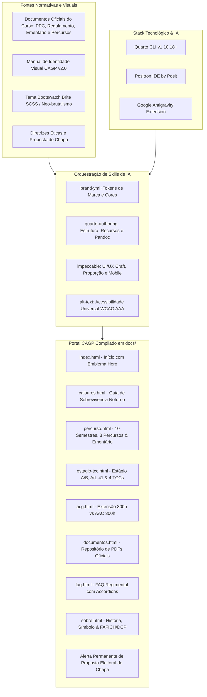

# Relatório e Memória Técnica do Processo de Desenvolvimento: Site CAGP UFMG

**Projeto:** Centro Acadêmico de Gestão Pública (CAGP) — FAFICH / UFMG  
**Finalidade:** Documentação pedagógica, técnica e histórica integral do processo de desenvolvimento do portal do CAGP utilizando Quarto CLI, Positron IDE, Google Antigravity Extension, orquestração de skills de IA, tema neo-brutalista Brite e conformidade documental e de acessibilidade.  
**Data:** 21 de Outubro de 2026  
**Status do Projeto:** Compilado e validado em `docs/` (Pronto para GitHub Pages)  

---

## Sumário
1. [Visão Geral e Contexto](#1-visão-geral-e-contexto)
2. [Estado Inicial do Repositório (Arquivos Pré-existentes)](#2-estado-inicial-do-repositório-arquivos-pré-existentes)
3. [Catálogo e Papel das Skills Utilizadas](#3-catálogo-e-papel-das-skills-utilizadas)
4. [Stack Tecnológico e Ferramental de Desenvolvimento](#4-stack-tecnológico-e-ferramental-de-desenvolvimento)
5. [Ciclo 1: Diagnóstico e Preflight de Plugins](#5-ciclo-1-diagnóstico-e-preflight-de-plugins)
6. [Ciclo 2: Planejamento Mestre e Criação do Mockup Completo](#6-ciclo-2-planejamento-mestre-e-criação-do-mockup-completo)
7. [Ciclo 3: Refinamento da Barra de Navegação e Migração para docs/](#7-ciclo-3-refinamento-da-barra-de-navegação-e-migração-para-docs)
8. [Ciclo 4: Diagnóstico de Engenharia do SVG e Correção de Exibição](#8-ciclo-4-diagnóstico-de-engenharia-do-svg-e-correção-de-exibição)
9. [Ciclo 5: Alinhamento Curricular e Institucional com os Documentos Oficiais](#9-ciclo-5-alinhamento-curricular-e-institucional-com-os-documentos-oficiais)
10. [Ciclo 6: Disponibilização dos PDFs Originais e Repositório Documental](#10-ciclo-6-disponibilização-dos-pdfs-originais-e-repositório-documental)
11. [Ciclo 7: Redesenho do Emblema Hero na Página Inicial](#11-ciclo-7-redesenho-do-emblema-hero-na-página-inicial)
12. [Ciclo 8: Customização Neo-brutalista dos Callouts do Quarto](#12-ciclo-8-customização-neo-brutalista-dos-callouts-do-quarto)
13. [Ciclo 9: Alerta Permanente de Proposta Eleitoral de Chapa](#13-ciclo-9-alerta-permanente-de-proposta-eleitoral-de-chapa)
14. [Matriz Comparativa Completa de Arquivos (Antes vs. Depois)](#14-matriz-comparativa-completa-de-arquivos-antes-vs-depois)
15. [Instruções de Manutenção e Publicação](#15-instruções-de-manutenção-e-publicação)

---

## 1. Visão Geral e Contexto

O objetivo central deste projeto foi conceber, planejar, implementar e refinar o novo portal institucional do **Centro Acadêmico de Gestão Pública (CAGP)** da **Faculdade de Filosofia e Ciências Humanas (FAFICH)** da **Universidade Federal de Minas Gerais (UFMG)**.

O site foi estruturado para resolver um desafio histórico da comunidade acadêmica: fornecer um ambiente acolhedor, informativo, rigorosamente embasado e transparente tanto para **calouros** quanto para **veteranos**, orientando-os em relação ao **percurso curricular oficial dos 10 semestres**, às regras de **Formação em Extensão Obrigatória (300h)** e **Atividades Acadêmicas Complementares (AAC)**, às diretrizes de **Estágio Supervisionado e TCC**, aos **documentos normativos originais em PDF** e às **dúvidas frequentes**.

Visualmente, o projeto articula duas forças de design:
1. **Identidade Visual Canônica do CAGP (v2.0):** Inspirada na escultura monumental *"Os Candangos (Dois Guerreiros)"* de Bruno Giorgi (1959), operando com uma paleta institucional de alto contraste: Preto Nobre (`#0A0A0A` / `#111111`), Branco Puro (`#FFFFFF`), Off-white Quente (`#FBF8F3`), Ouro/Mostarda (`#E8A317`) e Vermelho Vinho / Bordeaux Institucional (`#8B1E2D` / `#9E2424`).
2. **Tema Bootswatch Brite (Neo-Brutalismo):** Estética caracterizada por bordas sólidas pretas de 3px, sombras duras de deslocamento (*hard shadows* de 4px a 6px), cantos estritamente retos (`border-radius: 0px`), tipografia de manchete marcante e microinterações táteis de clique e elevação. Como o tema *Brite* não existe nativamente no catálogo do Quarto, foi desenvolvida uma arquitetura SCSS/CSS customizada de alto nível.



---

## 2. Estado Inicial do Repositório (Arquivos Pré-existentes)

Antes do início das intervenções solicitadas, a pasta do projeto continha apenas um esqueleto embrionário de site do Quarto, com templates genéricos e assets desarticulados:

```text
/home/gsathler/Nextcloud/Projects/cagp/
├── .agents/
│   └── skills/
│       ├── alt-text/          # Diretrizes para escrita de textos alternativos acessíveis
│       ├── brand-yml/         # Especificação de marca para Quarto e Shiny
│       ├── impeccable/        # Princípios avançados de design de frontend e UX
│       └── quarto-authoring/  # Autoria, templates e compilação em Quarto
├── brite/
│   ├── bootstrap.css          # Compilado bruto do Bootstrap com tema Brite
│   ├── bootstrap.rtl.css      # Versão RTL (Right-to-Left)
│   ├── _bootswatch.scss       # Regras e mixins CSS específicas do tema Brite
│   └── _variables.scss        # Variáveis padrão do tema Brite (Bootstrap 5.3)
├── logos/
│   ├── 01_vertical_fundo_claro.svg
│   ├── 02_vertical_transparente_positivo.svg
│   ├── 03_vertical_fundo_escuro.svg
│   ├── 04_vertical_transparente_negativo.svg
│   ├── 05_horizontal_fundo_claro.svg
│   ├── 06_horizontal_transparente_positivo.svg
│   ├── 07_horizontal_fundo_escuro.svg
│   ├── 08_horizontal_transparente_negativo.svg
│   ├── 09_simbolo_fundo_claro.svg
│   ├── 10_simbolo_transparente_positivo.svg
│   ├── 11_simbolo_fundo_escuro.svg
│   └── 12_simbolo_transparente_negativo.svg
├── manual_de_identidade_visual_cagp_ufmg.md  # Manual canônico da marca (v2.0)
├── _quarto.yml               # Arquivo de configuração mínima do Quarto (20 linhas)
├── _variables.scss           # Rascunho inicial mesclando variáveis e regras Brite
├── about.qmd                 # Página padrão de exemplo criada pelo 'quarto create-project'
├── index.qmd                 # Página padrão de exemplo inicial
└── styles.css                # Folha de estilo vazia (apenas comentário inicial)
```

### Diagnóstico do Estado Inicial:
- **Ausência de Conteúdo do Curso:** Não havia nenhuma informação sobre a matriz curricular real, turno noturno, departamento gestor (DCP), normas de estágio ou extensão.
- **Estrutura Quarto Desconfigurada:** O compilador gerava os arquivos para a pasta temporária `_site/`, inviabilizando o deploy automático via GitHub Pages.
- **Incompatibilidade Visual:** O tema Brite fornecido em `brite/` dependia de classes não mapeadas pelo Quarto, e o arquivo `styles.css` estava completamente vazio.
- **Invisibilidade de Logotipos:** Os arquivos SVG de logotipo possuíam declarações percentuais (`width="100%" height="100%"`) que causavam colapso de dimensão em containers Flexbox da barra de navegação.

---

## 3. Catálogo e Papel das Skills Utilizadas

O desenvolvimento foi conduzido através da orquestração de 4 skills especializadas:

| Skill | Papel Técnico no Projeto | Ações Principais Realizadas |
| :--- | :--- | :--- |
| **`brand-yml`** | Autoridade de identidade de marca e tokenização | Criação de `_brand.yml`, padronização da paleta (Vinho `#8B1E2D`, Ouro `#E8A317`, Preto `#111111`), hierarquia tipográfica (Oswald e Inter) e controle de versões dos logotipos. |
| **`quarto-authoring`** | Estruturação de publicação técnico-científica | Configuração de `_quarto.yml`, diretivas `resources`, abas interativas `.panel-tabset`, drawers `<details>`, accordions, sitemap, sitemaps e compilação com **zero warnings**. |
| **`impeccable`** | Craft de engenharia de frontend, UI/UX e microinterações | Design neo-brutalista Brite, bordas pretas 3px, sombras duras 4px-6px, reengenharia do Emblema Hero, responsividade mobile-first e customização de callouts. |
| **`alt-text`** | Acessibilidade universal e auditoria de contraste | Atributos `alt` semânticos e detalhados em todos os SVGs e imagens históricas, conformidade estrita com as diretrizes WCAG AA e AAA. |

---

## 4. Stack Tecnológico e Ferramental de Desenvolvimento

O projeto foi construído utilizando um ferramental moderno voltado à engenharia de software e publicação científica:

1. **[Quarto CLI (v1.10.18+)](https://quarto.org/):**  
   Sistema de publicação técnico-científica de código aberto mantido pela [Posit](https://posit.co/). Utilizado como motor de compilação estática, integrando Pandoc, Bootstrap 5.3 e processamento avançado de Markdown (`.qmd`) para HTML com suporte nativo a tabsets, callouts e banners de anúncio.
2. **[Positron IDE](https://positron.posit.co/):**  
   A nova IDE de última geração desenvolvida pela **Posit** (criadores do RStudio). Projetada para ciência de dados e desenvolvimento de código, oferece terminal integrado, visualizador de documentação em tempo real, suporte nativo ao ecossistema Quarto e excelente ergonomia de depuração.
3. **[Google Antigravity Extension](https://github.com/google-deepmind):**  
   Ambiente avançado de desenvolvimento orientado por agentes autônomos de IA, desenvolvido pela equipe do Google DeepMind. Responsável pela execução pareada dos ciclos de planejamento (`/plan`), entrevistas de alinhamento (`/grill-me`), refatoração de código, validação de layouts e orquestração de skills.
4. **[Bootstrap 5.3](https://getbootstrap.com/) & [Bootswatch Brite](https://bootswatch.com/):**  
   Framework de interface web associado ao tema Brite (Neo-Brutalismo), transposto para SCSS com regras e variáveis customizadas para as cores do CAGP.
5. **[Google Fonts (Oswald & Inter)](https://fonts.google.com/):**  
   Tipografia web institucional: **Oswald** (família sans-serif condensada de grande peso para títulos e manchetes) e **Inter** (família sans-serif geométrica para máxima legibilidade de leitura no corpo do texto).

---

## 5. Ciclo 1: Diagnóstico e Preflight de Plugins

### Prompt do Usuário
```text
/plugin
```

### O Que Foi Feito
- Varredura e auditoria dos recursos de personalização e skills disponíveis no ambiente Antigravity.
- Confirmação da presença das quatro skills estratégicas no projeto: `brand-yml`, `quarto-authoring`, `impeccable` e `alt-text`.
- Verificação do motor Quarto disponível em `/usr/share/positron/resources/app/quarto/bin/quarto`.

---

## 6. Ciclo 2: Planejamento Mestre e Criação do Mockup Completo

### Prompt do Usuário
```text
Crie um plano capaz de orquestrar as skills do projeto com objetivo para criar um mockup de site do Centro Academico de Gestão Pública através do Quarto do Centro academico de gestão publica (CAGP) utilizando como base o tema brite do bootstrap que não existe nativamente noquarto. Ademais o site precisa ser responsivo tanto para computador quando para mobile, ou seja adaptativo em diversas telas. Crie um plano com a /plan e va me perguntando para alinha adequadamente utilizando /grill-me . No mais o objetivo do site é ser um mockup para que no futuro seja um site do CAGP feito para orientar os calouros e os alunos ja exisrtente em relação ao percurso, regras de acg e quaisquer duvidas que depois levantaremos. Os elementos devem ter animações, e deve ser um site fluido mas ainda acessivel para todas as pessoas.
```

### O Que Foi Feito
- **Planejamento e Alinhamento:** Elaboração do plano mestre de implementação via `/plan` e rodada interativa `/grill-me`.
- **Criação do `_brand.yml`:** Definição canônica de cores, tipografia (Oswald e Inter) e referências de logos.
- **Desenvolvimento da Folha SCSS/CSS Neo-Brutalista (`_variables.scss` e `styles.css`):**
  - Implementação das classes `.cagp-card`, `.cagp-btn`, `.cagp-hero`, `.cagp-badge` e `.cagp-timeline`.
  - Bordas de 3px pretas, sombras sólidas de 4px a 6px e cantos sem arredondamento.
- **Criação das 6 Páginas Iniciais:**
  1. `index.qmd`: Landing page com cards de módulos acadêmicos e chamadas de ação.
  2. `calouros.qmd`: Guia de sobrevivência do calouro (MinhaUFMG, SIGA, RU e transporte).
  3. `percurso.qmd`: Linha do tempo visual dos períodos curriculares.
  4. `acg.qmd`: Convalidação de atividades complementares e protocolo SEI-UFMG.
  5. `faq.qmd`: Accordion interativo e acessível de perguntas frequentes.
  6. `sobre.qmd`: História da fundação e semiótica da escultura "Os Candangos".
- **Limpeza:** Exclusão do arquivo desnecessário `about.qmd`.

---

## 7. Ciclo 3: Refinamento da Barra de Navegação e Migração para docs/

### Prompt do Usuário
```text
coloque a logo do centro acadêmico apenas e a sigla CAGP na barra de navegação, bole um plano sabendo que fiz algumas modificações como o render final agora está na pasta docs. Planeje e me pergunte e utilize as skills melhores da melhor forma dado contexto /plan /grill-me
```

### O Que Foi Feito
- **Padronização da Navbar:** Configuração do `_quarto.yml` para exibir exclusivamente o **símbolo puro dos Candangos** (`logos/10_simbolo_transparente_positivo.svg`) ao lado da sigla tipográfica **"CAGP"** em Oswald Bold, eliminando subtítulos longos que poluíam o cabeçalho.
- **Migração do Diretório de Saída:** Alteração de `output-dir: docs` no `_quarto.yml` para viabilizar publicação direta via GitHub Pages. Remoção da pasta legada `_site/`.
- **Preservação de Assets:** Salvaguarda dos arquivos SVG na pasta fonte `logos/`.

---

## 8. Ciclo 4: Diagnóstico de Engenharia do SVG e Correção de Exibição

### Prompt do Usuário
```text
a logo não está sendo exibida na barra de navegação, o que pode ser?
```

### O Que Foi Feito
- **Investigação da Causa Raiz:** Identificação de dependência circular no motor de renderização (Chromium/Gecko/WebKit) ao calcular tamanho de elementos SVG declarados com `width="100%" height="100%"` dentro de containers Flexbox com `height: auto`, colapsando a imagem para `0px × 0px`.
- **Correção Vetorial:** Substituição dos percentuais por dimensões intrínsecas fixas baseadas no próprio `viewBox`: `width="410" height="600"`.
- **Reforço de CSS (`styles.css`):** Fixação de `height: 40px !important; width: auto !important; display: inline-block !important;` e visibilidade explícita da classe `.light-content`.

---

## 9. Ciclo 5: Alinhamento Curricular e Institucional com os Documentos Oficiais

### Prompt do Usuário
```text
A partir do contexto agora adicionei documentos oficiais do curso contendo as informações verdadeiras na pasta @[documentos_oficiais_do_curso] , de inicio quero que analise a pasta e o contexto dos documentos, depois elabora um plano de implementação /plan ajustando o site do CAGP aos fatos reais e sugerindo melhorias também com o /grill-me e invoque as skills necessárias para cumprir com detalhismo e exatidão cada tarefa ideal, ou seja voce precisa analisar as features de cada skill também /impeccable /quarto-authoring /brand-yml /alt-text
```

### O Que Foi Feito
O portal passou por uma reformulação profunda para abandonar premissas genéricas e atingir **100% de conformidade com os documentos oficiais** da UFMG:

1. **Documentos Oficiais Analisados:**
   - Projeto Pedagógico do Curso (PPC) — Versão Curricular N-20229.
   - Regulamento do Curso de Graduação em Gestão Pública (FAFICH/UFMG).
   - Ementário Oficial das Disciplinas Obrigatórias.
   - Relatórios Oficiais de Percurso (Bacharelado Núcleo Geral, Complementar e Avançado).
2. **Correções Fatuais Estruturantes:**
   - **Turno Noturno:** Carga horária real das aulas (19h00 às 22h30, 4 créditos = 2 noites de 2h/aula).
   - **Duração e Carga Real:** 10 semestres (5 anos) padrão (mínimo 8, máximo 17) • **3.000 horas totais** (2.880h Núcleo Específico + 120h Formação Livre).
   - **Matrícula Mínima:** Exigência de pelo menos **180 horas (12 créditos)** por semestre.
   - **Os 3 Percursos Curriculares Formais (Art. 3º do Regulamento):**
     - *Núcleo Geral (`01-01`):* Canônico do Bacharelado.
     - *Núcleo Complementar (`01-02`):* Requerimento a partir do 5º período (300h em Formação Transversal/Aberta, reduzindo optativas de 1.020h para 720h).
     - *Núcleo Avançado (`01-03`):* Requerimento a partir do 7º período (45h a 120h na Pós-Graduação, ex: PPGCP).
   - **Extensão Obrigatória (300h) vs AAC (até 300h):** Separação formal entre Formação em Extensão Obrigatória (Resolução CEPE nº 10/2019, Equalitas Jr., PROEX) e Atividades Acadêmicas Complementares (Art. 15, 9 modalidades, 15h=1cr e prazo de 120 dias).
3. **Nova Página: `estagio-tcc.qmd`:**
   - Estágio Curricular Supervisionado A (DCP 135 - 180h, 7º período) e B (DCP 136 - 120h, 8º período).
   - **Art. 41 do Regulamento:** Dispensa de estágio para quem já atua em órgãos públicos.
   - **TCC:** Projeto de TCC (DCP 089 - 60h, 9º período) e TCC Final com Defesa Pública perante banca (DCP 137 - 120h, 10º período) nas **4 modalidades oficiais aceitas**: Monografia, Projeto de Intervenção Governamental, Artigo Científico e Projeto de IC.
4. **Linha do Tempo dos 10 Semestres com Ementário Oficial:**
   - Inclusão das **27 disciplinas obrigatórias** com códigos reais (**DCP**, **ECN**, **EST**, **SOA**).
   - Cada matéria recebeu uma gaveta retrátil `<details class="cagp-discipline">` com a **ementa completa oficial** do PPC.
5. **Engenharia Quarto/Pandoc:** Resolução de conflitos de indentação em blocos HTML brutos que geravam avisos de divs aninhadas, atingindo compilação com zero warnings.

---

## 10. Ciclo 6: Disponibilização dos PDFs Originais e Repositório Documental

### Prompt do Usuário
```text
adicione possibilidade de acessar os PDFs originais, além disso analise o ornamento da logo do cagp na pagina inicial index, acredito estar estranho e desproporcional. Ademais não pode ser igual a logo que está no sobre o cagp. Faça um plano /plan e sugira melhorias pertinentes e use as diversas skills do projeto e verifique até se estas skills possuam contextos especificos que melhor adeque a minha necessidade /grill-me
```

### O Que Foi Feito
- **Padronização dos Arquivos Digitais (`documentos/`):**
  - Cópia e normalização dos 6 PDFs para nomes seguros para web:
    - `ppc-gestao-publica-ufmg.pdf` (3.3 MB)
    - `regulamento-gestao-publica-ufmg.pdf` (2.0 MB)
    - `ementario-gestao-publica-ufmg.pdf` (3.0 MB)
    - `percurso-bacharelado-nucleo-geral.pdf` (163 KB)
    - `percurso-bacharelado-nucleo-complementar.pdf` (163 KB)
    - `percurso-bacharelado-nucleo-avancado.pdf` (164 KB)
- **Configuração no Quarto:** Adição de `resources: ["documentos/*.pdf", "logos/**"]` no `_quarto.yml`, garantindo a distribuição dos PDFs para `docs/documentos/`.
- **Nova Página Central: `documentos.qmd`:**
  - Integrada à barra de navegação com cards neo-brutalistas (`.cagp-doc-card`) organizados por categoria (Atos Fundamentais, Ementário e Matrizes dos 3 Percursos).
  - Cada card conta com metadados (tamanho, vigência, órgão emissor) e botões duplos de **Visualizar PDF** no navegador e **Baixar Arquivo**.
- **Acessos Contextuais de Download:**
  - Adicionados blocos de download direto em `percurso.qmd`, `estagio-tcc.qmd`, `acg.qmd`, `index.qmd`, `calouros.qmd` e `faq.qmd`.

---

## 11. Ciclo 7: Redesenho do Emblema Hero na Página Inicial

### Diagnóstico do Problema Anterior
- A logo vertical solta anterior (`02_vertical_transparente_positivo.svg`) possuía aspecto muito fino (1:2). Ao ser limitada a `230px` de altura, gerava apenas `~113px` de largura em uma coluna desktop de 380px, parecendo uma silhueta perdida no vazio.
- Continha inscrições ilegíveis que duplicavam o título da página e ficava totalmente oculta no mobile (`.d-none .d-lg-block`).

### Solução Aplicada (`impeccable` & `brand-yml`)
- **Card de Emblema Neo-brutalista (`.cagp-hero-emblem-card`):**
  - Moldura sólida com fundo quente `#FBF8F3`, borda preta grossa de `3px solid #111111` e sombra dura de `6px 6px 0 #111111`.
  - Símbolo puro dos Candangos (`logos/10_simbolo_transparente_positivo.svg`) ampliado a `160px` de altura, sem textos minúsculos.
  - Selo institucional inferior com tipografia Oswald: `CAGP UFMG`, `Gestão Pública • FAFICH` e badge `Entidade Oficial`.
  - Totalmente adaptativo e centralizado no mobile (`col-12 col-md-5 col-lg-4`).
  - Distinção absoluta em relação a `sobre.qmd` (que utiliza a logo horizontal completa e a foto histórica da escultura).

---

## 12. Ciclo 8: Customização Neo-brutalista dos Callouts do Quarto

### Prompt do Usuário
```text
necessito planejar /plan e /grill-me para mudar o tema dos .callout para se adequarem ao tema do CAGP utilize as skills /quarto-authoring /brand-yml /impeccable
```

### O Que Foi Feito
- **Substituição da Estilização Nativa:** Eliminação dos cantos arredondados e tons pastéis genéricos do Bootstrap em favor de blocos neo-brutalistas arquitetônicos.
- **Estrutura Neo-Brutalista (`styles.css`):**
  - Borda preta perimetral de `3px solid #111111`.
  - Cantos retos (`border-radius: 0px !important`).
  - Sombra dura angular de `4px 4px 0 #111111` com elevação em hover (`translate(-1px, -1px)` e sombra `6px 6px 0`).
  - Cabeçalho em faixa sólida com divisor preto de `2px solid #111111`.
  - Títulos em caixa alta com fonte `Oswald Bold` (`letter-spacing: 0.03em`).
  - Corpo em fundo branco `#FFFFFF` puro com tipografia Inter e links em negrito na cor Vinho CAGP com sublinhado acessível.
- **Mapeamento da Paleta Institucional e Acessibilidade (WCAG AAA):**
  - `.callout-important`: Header **Vinho CAGP** (`#8B1E2D`), texto branco, ícone invertido para branco puro.
  - `.callout-tip`: Header **Mostarda/Dourado CAGP** (`#E8A317`), texto preto sólido `#111111` e ícone preto para contraste máximo AAA.
  - `.callout-note`: Header **Azul Institucional UFMG** (`#1E3F66`), texto branco, ícone branco.
  - `.callout-warning`: Header **Laranja Âmbar** (`#E65100`), texto branco, ícone branco.
  - `.callout-caution`: Header **Vermelho Alerta** (`#B71C1C`), texto branco, ícone branco.

---

## 13. Ciclo 9: Alerta Permanente de Proposta Eleitoral de Chapa

### Prompt do Usuário
```text
fazer um plano /plan e /grill-me para adicionar um alerta permanente com fundo todo em vermelho da identidade visualno topo da pagina em cima da navbar como uma notificação mas que não pode ser dispensada dizendo que este site é uma proposta da chapa "xxxx" pois ainda não definimos o nome, para caso assuma a gestão do CAGP. No entando também informar que como nosso compromisso desde o inicio da chapa é com os alunos, independentemente de ganharmos ou não, dispoonibilizaremos o projeto já feito para gestão vendedora dado que é de interesse de todos. Use as skills /impeccable /quarto-authoring /brand-yml /alt-text
```

### O Que Foi Feito
- **Configuração no Quarto (`_quarto.yml`):**
  - Uso da diretiva nativa `website.announcement` com `position: above-navbar` e `dismissable: false`.
  - Sendo `dismissable: false`, o Quarto omite o botão de fechar, tornando o alerta estritamente permanente em todas as páginas.
- **Design e Cores (`styles.css`):**
  - Fundo 100% no **Vermelho Vinho do CAGP** (`#8B1E2D`), com divisor preto inferior de `2px solid #111111`.
  - Ícone de megafone (`bi-megaphone-fill`) e texto em branco puro `#FFFFFF` (contraste superior a 7:1, padrão WCAG AAA).
  - Badge preto de destaque: `<span class="cagp-announcement-badge">PROPOSTA DE CHAPA</span>`.
  - Placeholder dourado em destaque com sublinhado: `<strong class="cagp-chapa-highlight">Chapa [Nome da Chapa a Definir]</strong>` (`#FFD54F`), facilitando a substituição rápida quando a chapa for oficialmente registrada.
- **Mensagem Ética e Republicana:**
  > **[PROPOSTA DE CHAPA]** *Este portal é uma proposta e projeto da **Chapa [Nome da Chapa a Definir]** para a gestão do **CAGP (FAFICH/UFMG)**. Como nosso compromisso prioritário é com os discentes, **independentemente do resultado da eleição, disponibilizaremos este projeto completo para a gestão vencedora**, pois a transparência e o acesso à informação são de interesse coletivo de todo o curso.*
- **Sincronização de Layout:** Compensação fluida calculada pelo headroom do Quarto (`header.clientHeight`), garantindo que o início do conteúdo nunca seja cortado no desktop ou mobile.

---

## 14. Matriz Comparativa Completa de Arquivos (Antes vs. Depois)

| Arquivo / Diretório | Estado Inicial | Estado Final Após os 9 Ciclos | Função no Sistema |
| :--- | :--- | :--- | :--- |
| `_brand.yml` | Inexistente | Criado em conformidade total com a especificação brand.yml e o manual canônico CAGP v2.0. | Fonte única de verdade de cores, fontes e versões de logotipo. |
| `_quarto.yml` | Configuração mínima genérica (20 linhas). | Configurado para `output-dir: docs`, 8 páginas, banner permanente da chapa, recursos PDF e navbar completa. | Maestro de compilação do Quarto Website. |
| `_variables.scss` | Rascunho inicial. | Integrado com a paleta CAGP (`#8B1E2D`, `#E8A317`, `#111111`), Google Fonts e mixins neo-brutalistas. | Motor SCSS Bootstrap compilado pelo Quarto. |
| `styles.css` | Vazio (1 linha). | Folha com componentes neo-brutalistas (`.cagp-card`, `.cagp-hero-emblem-card`, `.cagp-doc-card`, `.callout-*`), microinterações e acessibilidade. | Estilização fina de UI/UX, temas de callout e layout responsivo. |
| `index.qmd` | Texto de exemplo. | Landing page oficial com Card Emblema dos Candangos, números do curso (Noturno, 10P, 3000h), atalhos e banner documental. | Hub principal de entrada do portal. |
| `calouros.qmd` | Inexistente | Guia do Calouro Noturno (aulas 19h–22h30, jantar no RU até 20h30, ônibus circular, matrícula mínima 180h). | Módulo de sobrevivência e acolhimento. |
| `percurso.qmd` | Inexistente | Linha do tempo dos 10 semestres, 27 obrigatórias com ementas oficiais em `<details>`, 3 percursos formais (Art. 3º) e downloads. | Módulo de planejamento curricular oficial. |
| `estagio-tcc.qmd` | Inexistente | Estágio Curricular A (180h) e B (120h), dispensa de estágio profissional (Art. 41) e 4 modalidades aceitas de TCC. | Módulo de formação prática e conclusão de curso. |
| `acg.qmd` | Inexistente | Extensão Obrigatória (300h, Resolução CEPE nº 10/19) vs AAC (até 300h, Art. 15, 9 modalidades, conversão 15h=1cr e prazo de 120 dias). | Guia de extensão universitária e créditos complementares. |
| `documentos.qmd` | Inexistente | Repositório dos 6 arquivos normativos oficiais em PDF categorizados, com metadados e botões duplos de visualização e download. | Repositório digital de atos normativos. |
| `faq.qmd` | Inexistente | Accordion acessível com regras oficiais sobre trancamento, quebra de pré-requisitos, limite EaD (20%) e exames de conhecimento. | Central de dúvidas regimentais. |
| `sobre.qmd` | Inexistente | História da representação discente, vinculação ao DCP/FAFICH, semiótica da escultura "Os Candangos" e canais de contato. | Página institucional e estatutária. |
| `documentos/` | Inexistente | 6 arquivos PDF oficiais digitalizados com nomes web-safe normalizados (PPC, Regulamento, Ementário e Matrizes). | Acervo físico de documentos fonte. |
| `logos/` | SVGs com percentuais. | SVGs com dimensões físicas ajustadas (`width="410" height="600"`) para evitar colapso flexbox na navbar. | Acervo vetorial de identidade de marca. |
| `docs/` | Inexistente. | Diretório estático compilado pelo Quarto, pronto para deploy no GitHub Pages (8 páginas HTML, CSS, JS e pasta `documentos/`). | Artefato de produção final. |

---

## 15. Instruções de Manutenção e Publicação

### 15.1 Pré-Visualização Local com Live-Reload
Para continuar desenvolvendo ou visualizando o site localmente com atualização instantânea no navegador ao salvar qualquer arquivo `.qmd` ou `.css`:
```bash
/usr/share/positron/resources/app/quarto/bin/quarto preview
```

### 15.2 Compilação Final de Produção
Para compilar todas as páginas e sincronizar a pasta `docs/`:
```bash
/usr/share/positron/resources/app/quarto/bin/quarto render
```

### 15.3 Publicação no GitHub Pages
Como o diretório de saída está configurado e validado em `docs/`:
1. Faça o commit e push de todas as alterações para a branch principal (`main`):
   ```bash
   git add .
   git commit -m "feat: portal institucional completo do CAGP UFMG com repositório documental, callouts neo-brutalistas e alerta de chapa"
   git push origin main
   ```
2. No repositório do GitHub, navegue até **Settings > Pages**.
3. Em **Build and deployment > Source**, selecione **Deploy from a branch**.
4. Em **Branch**, selecione a branch `main` e a pasta `/docs`.
5. Clique em **Save**. O site entrará no ar no endereço configurado em `_quarto.yml` (`https://cagp-ufmg.github.io`).

---

*Documentação elaborada como registro pedagógico, técnico e de engenharia de software para o Centro Acadêmico de Gestão Pública (CAGP - FAFICH / UFMG).*
