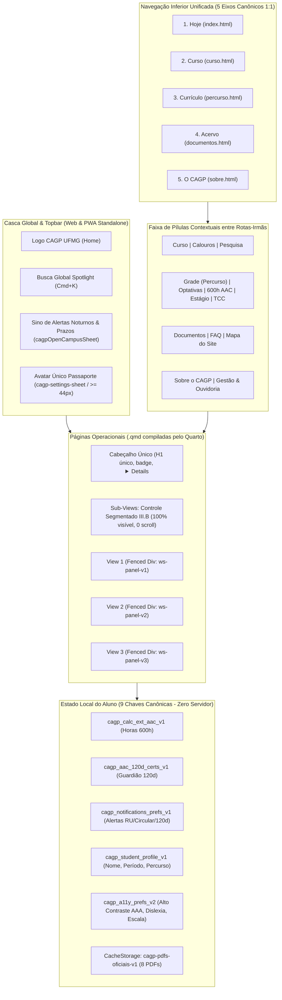
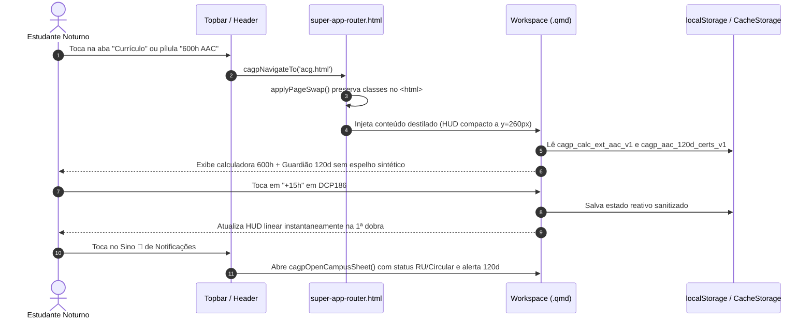
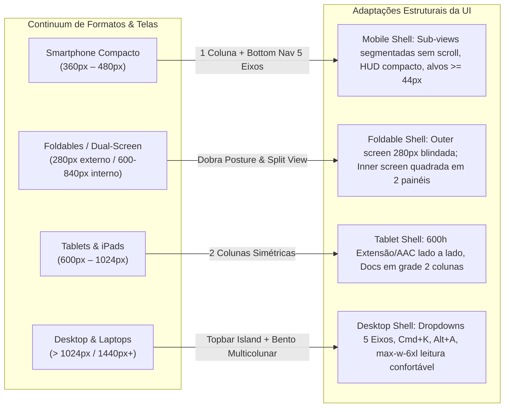

# Super App CAGP UFMG — Modernização de Usabilidade, Navegação e Casca Mobile

* **Author:** EGM Draft Assistant & Gestão CAGP UFMG
* **Status:** Proposed (Em Elaboração Seção a Seção via `/egm-draft`)
* **Date:** 2026-10-29
* **Documento de Origem:** [concepts_brief.md](file:///home/gsathler/Nextcloud/Projects/cagp/_designs/concepts_brief.md)
* **Evidências Empíricas:** [diagnostico_auditoria.md](file:///home/gsathler/Nextcloud/Projects/cagp/_designs/diagnostico_auditoria.md)

---

## Overview

O **Super App CAGP UFMG** é a plataforma acadêmica progressiva (PWA estático compilado via Quarto 1.9) do Centro Acadêmico de Gestão Pública da UFMG. O sistema oferece a estudantes do Bacharelado Noturno acesso a 14 rotas acadêmicas, simuladores de integralização curricular (600h Extensão/AAC, Estágio 300h, TCC 180h), monitoramento de prazos decadenciais (Guardião de 120 Dias), cofre offline de 8 PDFs normativos via Service Worker e sincronização local sem servidor através de 9 chaves de `localStorage` e backup Base64 (`CAGP1:...`).

Este projeto executa uma reestruturação de usabilidade móvel focada em sanar o corte horizontal crônico em telas móveis (`360px` a `412px`), eliminar o consumo excessivo da primeira dobra de visualização (`y < 300px`), erradicar o sobre-encaixotamento visual (*over-boxing*) através do estilo **Brite Institucional Refinado**, unificar a navegação Web Mobile e PWA Standalone na **Simetria 1:1 dos 5 Eixos Canônicos**, e **decomissionar a funcionalidade quebrada e obsoleta de espelho documental sintético** em [acg.qmd](file:///home/gsathler/Nextcloud/Projects/cagp/acg.qmd), redirecionando os estudantes com clareza aos formulários oficiais autênticos (PDF e DOCX) do Colegiado.

---

## The Problem

A auditoria diagnóstica empírica em navegadores móveis e desktop evidenciou cinco falhas graves de experiência e engenharia:

1. **Oclusão Crônica das Sub-Views Móveis (`.cagp-workspace-bar`):** Em todas as 14 rotas a `360px`, `112px` de paddings e bordas aninhadas reduzem a largura útil para `248px`, cortando as abas secundárias fora da tela (`0` abas inteiras visíveis no primeiro carregamento).
2. **Conteúdo Acionável Enterrado Fora da 1ª Dobra:** Em [documentos.qmd](file:///home/gsathler/Nextcloud/Projects/cagp/documentos.qmd) e [acg.qmd](file:///home/gsathler/Nextcloud/Projects/cagp/acg.qmd), o estudante precisa rolar entre `1.332px` e `2.272px` antes de tocar no primeiro PDF ou controle da calculadora, devido a banners abertos por padrão, breadcrumbs prolixos e empilhamento triplo redundante de títulos (`H1` + `H2` + `H3`).
3. **Funcionalidade Obsoleta e Quebrada de Espelho em [acg.qmd](file:///home/gsathler/Nextcloud/Projects/cagp/acg.qmd):** Um botão de "Gerar Resumo para Formulário N-20229" aciona `window.print()` sem isolamento DOM, imprimindo 9 páginas desordenadas com botões da calculadora vazando, truncando 78,5% do texto em uma `<textarea rows="5">` e gerando confusão documental com códigos legados incompatíveis com o Colegiado.
4. **Saturação Visual (*Over-Boxing*) e Falhas de Acessibilidade:** Uso excessivo de bordas pretas `2px` e sombras duras (`2px 2px 0`) sobre 4 a 5 camadas de wrappers, gerando cansaço visual em telas móveis, além de 5 falhas diretas de contraste WCAG AA e vazamento de texto amarelo `#FFFF00` sobre cards brancos no modo Alto Contraste.
5. **Navegação Fragmentada e Armadilha no PWA Standalone:** Ao instalar o PWA na tela inicial do celular, a barra superior oculta o menu e a barra inferior duplica o botão `Passaporte`, deixando 10 das 14 rotas inacessíveis a partir da navegação global.

---

## Goals

* **Goal 1 (Decomissionamento do Espelho):** Remover integralmente a funcionalidade de espelho sintético em [acg.qmd](file:///home/gsathler/Nextcloud/Projects/cagp/acg.qmd) e [styles.css](file:///home/gsathler/Nextcloud/Projects/cagp/styles.css) (eliminando `#cagp-n20229-print-sheet`, botões de disparo, modal, textarea truncada e ~200 linhas de código legado), direcionando o estudante diretamente aos links dos formulários oficiais autênticos (PDF/DOCX) da Sala F-2039.
* **Goal 2 (1ª Dobra Móvel Útil):** Trazer a primeira ação real em [documentos.qmd](file:///home/gsathler/Nextcloud/Projects/cagp/documentos.qmd), [acg.qmd](file:///home/gsathler/Nextcloud/Projects/cagp/acg.qmd) e [percurso.qmd](file:///home/gsathler/Nextcloud/Projects/cagp/percurso.qmd) para **`y < 300px`** em viewports móveis de `360px`, compactando o banner superior `#quarto-announcement` no mobile e adotando a Regra do Cabeçalho Único (Single-Header).
* **Goal 3 (Zero Corte de Sub-Views):** Adotar Controle Segmentado (Hipótese III.B) para `.cagp-workspace-bar`, garantindo que 100% das sub-views fiquem visíveis simultaneamente sem rolagem horizontal nem corte entre `360px` e `1440px`.
* **Goal 4 (Descompressão Visual & WCAG AA/AAA):** Implementar a linguagem visual **Brite Institucional Refinado (Hipótese IV.A)**, preservando a identidade tipográfica `Oswald` e bordas estruturais `1px`, reservando borda `2px` e sombra aos botões primários, sanando as 5 falhas WCAG AA e blindando o Alto Contraste AAA (`#000000`/`#FFFF00`).
* **Goal 5 (Navegação Simétrica dos 5 Eixos):** Unificar a barra inferior Web Mobile e PWA Standalone em **5 Eixos Canônicos 1:1** (`Hoje | Curso | Currículo | Acervo | O CAGP`) com faixa de pílulas contextuais entre páginas irmãs, Avatar único no topo direito (`>= 44×44px` com trava de 2 toques na limpeza) e Sino de Notificações acoplado a `cagpOpenCampusSheet()` + `cagp_notifications_prefs_v1`.

---

## Non-Goals

* **Non-Goal 1 (Sem Espelho Sintético):** Não reimplementar nem manter rotinas client-side de montagem de espelho N-20229; formulários e processos devem ser preenchidos nos documentos oficiais fornecidos pelo Colegiado.
* **Non-Goal 2 (Zero Supressão Factual):** Nenhum artigo regimental, carga horária, ementa, telefone, e-mail (`coordgestaopublica@gmail.com`), sala (`F-2039`, `F-2033`) ou link de download será removido; textos longos são preservados através de revelação progressiva (`<details>`).
* **Non-Goal 3 (Zero Quebra de Estado `localStorage`):** Não alterar o schema nem criar novas chaves fora das 9 chaves canônicas existentes, mantendo compatibilidade retroativa total com backups Base64 `CAGP1:...`.
* **Non-Goal 4 (Sem Backend ou Dependências Externas):** O Super App permanece estático, compilado via Quarto CLI e 100% autônomo offline em Service Worker no subsolo da FAFICH.

---

## Open Questions

* Nenhum bloqueio arquitetural em aberto. As 5 decisões de direção foram pactuadas e aprovadas no protocolo de validação `/grill-me`.

---

## Critical User Journeys (CUJs)

### CUJ 1: Calouro Acessa Documentos e Normas no Celular (360px)
* **Given**: O estudante acessa `documentos.html` em uma tela de entrada Android (`360×740px`) no subsolo da FAFICH.
* **When**: A página é renderizada.
* **Then**: O campo de busca de documentos e o status offline (8/8 PDFs) estão visíveis imediatamente na 1ª dobra (`y ≈ 240px`), sem rolagem preliminar. Todas as 3 abas secundárias (`Acervo`, `Formulários`, `Guia DRCA`) estão 100% visíveis no controle segmentado sem corte lateral.

### CUJ 2: Simulação e Integralização de 600h (Extensão & AAC)
* **Given**: O discente acessa `acg.html` no celular para planejar sua colação de grau.
* **When**: A rota carrega.
* **Then**: O discente visualiza o HUD compacto com o termômetro de Extensão (300h) e AAC (300h) no topo e a primeira disciplina prática (`DCP 195`) na 1ª dobra. O botão quebrado de espelho foi removido; no lugar, o discente encontra atalhos diretos e instruções claras para baixar os formulários oficiais N-20229 (PDF/DOCX) da Sala F-2039.

### CUJ 3: Navegação Global no PWA Standalone (Tela Inicial)
* **Given**: O estudante instalou o Super App no Android/iOS (`display: standalone`).
* **When**: Navega pelas abas inferiores ou toca no topo.
* **Then**: A barra inferior exibe coerentemente os 5 Eixos (`Hoje | Curso | Currículo | Acervo | O CAGP`), permitindo alcançar todas as 14 rotas sem telas órfãs. O Avatar do Passaporte está unificado exclusivamente no canto superior direito (`44×44px`), e o Sino de Alertas exibe avisos do campus (RU II, Circular) e prazos de 120 dias em 1 toque.


---

## Technical Plan (Architecture)

### 1. Diagrama de Arquitetura da Casca do Super App



### 2. Fluxo de Interação e Transição SPA



### 3. Detalhamento dos 5 Pilares Arquiteturais

#### Pilar 1: Remoção e Decomissionamento do Espelho Sintético em `acg.qmd` & `styles.css`
* **Exclusão no DOM de [acg.qmd](file:///home/gsathler/Nextcloud/Projects/cagp/acg.qmd):**
  - Remover botões `#btn-gerar-resumo-n20229` e `#btn-gerar-resumo-n20229-bottom`.
  - Remover o container órfão `<div id="cagp-n20229-print-sheet" ...>` ([acg.qmd#L1160](file:///home/gsathler/Nextcloud/Projects/cagp/acg.qmd#L1160)).
  - Remover as rotinas JS `openResumoN20229Modal()`, `buildResumoN20229Data()`, `renderMirrorHtml()`, `syncPrintSheet()` e `<textarea id="cagp-n20229-sei-textarea">` ([acg.qmd#L1780-L2058](file:///home/gsathler/Nextcloud/Projects/cagp/acg.qmd#L1780-L2058)).
* **Limpeza de Estilos de Impressão em [styles.css](file:///home/gsathler/Nextcloud/Projects/cagp/styles.css):**
  - Remover as regras poluídas de `@media print` ([styles.css#L9618-L9653](file:///home/gsathler/Nextcloud/Projects/cagp/styles.css#L9618-L9653)) que forçavam `.cagp-workspace-view[hidden] { display: block !important }`.
  - Restabelecer folha `@media print` genérica limpa que apenas oculta navegações globais (`header`, `nav`, `footer`) e imprime a visualização ativa de forma natural caso o usuário acione `Ctrl+P`.
* **Redirecionamento Institucional:**
  - Em [acg.qmd](file:///home/gsathler/Nextcloud/Projects/cagp/acg.qmd), a Aba 3 (*"Guia & Tramitação"*) passa a ser o ponto focal oficial de orientação processual, contendo links diretos para baixar o formulário oficial N-20229 em PDF e DOCX editável, com checklist dos anexos necessários para protocolar na Secretaria do Colegiado (Sala F-2039) ou enviar para `coordgestaopublica@gmail.com`.

#### Pilar 2: Destilação da 1ª Dobra Móvel (`y < 300px`) e Template Single-Header
* **Banner de Campanha (`#quarto-announcement`):**
  - Configurar CSS e JS em `_includes/super-app-header.html` para que em viewports `< 768px` o banner inicie compacto em 1 linha (`36px`), expansível mediante toque no botão `[COMPACTAR ▲]`.
* **Regra do Cabeçalho Único (Single-Header):**
  - Eliminar o empilhamento triplo de títulos (`H1` + Markdown `## H2` + `.cagp-tool-header > h3`).
  - No `<header class="cagp-workspace-header">`, exibir o único `<h1>` da rota com badge semântico e subtítulo compacto.
  - Em `< 768px`, ocultar breadcrumbs redundantes (`.cagp-breadcrumbs`), recuperando até 48px verticais.
  - Textos explicativos e notas normativas extensas são encapsulados em `<details class="cagp-normative-details">` com `<summary>` autoexplicativo, garantindo **Zero Supressão Factual** sem ocupar a tela no primeiro carregamento.
* **Migração para Quarto Fenced Divs:**
  - Substituir tags `<div>` abertas e fechadas em blocos `{=html}` separados por Fenced Divs Pandoc simétricas:
    `::: {#ws-panel-v1 .cagp-workspace-view role="tabpanel" aria-labelledby="ws-tab-v1" data-ws-view="v1"}`.
* **Otimizações Específicas por Página:**
  - Em [documentos.qmd](file:///home/gsathler/Nextcloud/Projects/cagp/documentos.qmd): substituir o bloco `#cagp-spotify-vault` (256px de altura) por uma **Faixa Inline de Status Offline (`44px`)** (`"✓ 8/8 PDFs essenciais disponíveis sem internet • [Verificar]"`), movendo-a para dentro das views aplicáveis e corrigindo a assinatura da chamada `window.cagpActivateWorkspaceView('v2', { scroll: false })` na busca instantânea.
  - Em [acg.qmd](file:///home/gsathler/Nextcloud/Projects/cagp/acg.qmd): condensar o dashboard de horas (420px) em um **HUD Linear Compacto (`64px`)** com duas barras proporcionais (`Extensão: 0/300h` | `AAC: 0/300h`) fixadas acima da lista de matérias, trazendo a primeira matéria prática (`DCP 195`) para `y ≈ 260px`.
  - Em [percurso.qmd](file:///home/gsathler/Nextcloud/Projects/cagp/percurso.qmd): recolher o callout de 145 palavras em `<details>` de 1 linha, trazendo os filtros da grade para `y ≈ 250px`.

#### Pilar 3: Controle Segmentado de Sub-Views (Hipótese III.B — 100% Visível, 0 Scroll)
* **Arquitetura da Barra `.cagp-workspace-bar`:**
  - Eliminar paddings aninhados de `112px` que causavam o estrangulamento para `248px` em telas de `360px`.
  - Estruturar a barra como um **Controle Segmentado (`grid` ou `flex`)** sem scroll horizontal: em telas móveis, 2 ou 3 abas dividem proporcionalmente a largura útil (`min-height: 40px` a `44px`), garantindo que 100% das sub-views fiquem visíveis imediatamente.
  - Rótulos encurtados de forma concisa e sem perda de sentido (ex.: em Documentos: `Acervo (8 PDFs)` | `Formulários` | `Guia DRCA`; em Extensão/AAC: `Calculadora` | `Prazo 120d` | `Tramitação`).
  - Preservar rigorosamente os seletores e atributos do contrato do roteador SPA:
    `.cagp-workspace-bar`, `.cagp-workspace-tab[data-ws-tab]`, `.cagp-workspace-tab.is-active`, `.cagp-workspace-view[data-ws-view]` e `window.cagpActivateWorkspaceView(tabKey, opts)`.

#### Pilar 4: Linguagem Visual Brite Institucional Refinado (Hipótese IV.A) & Acessibilidade
* **Pipeline Oficial Brand em `_quarto.yml`:**
  - Declarar explicitamente em [_quarto.yml](file:///home/gsathler/Nextcloud/Projects/cagp/_quarto.yml#L29-L31):
    ```yaml
    format:
      html:
        brand: _brand.yml
        theme:
          - brand
          - _variables.scss
        css:
          - styles.css
    ```
  - Remover a importação duplicada `@import url('https://fonts.googleapis.com/...')` em [styles.css#L7](file:///home/gsathler/Nextcloud/Projects/cagp/styles.css#L7), delegando o carregamento otimizado de fontes ao Quarto CLI via `_brand.yml`.
* **Refinamento de Contenção e Fim do Over-Boxing:**
  - Preservar o caráter universitário do tema Brite (`Oswald` em caixa-alta nos títulos principais, Borgonha `#8B1E2D` / `#9E2424` como acento primário e bordas estruturais de `1px solid #DFDBD2` ou `#0A0A0A`).
  - Restringir a borda `2px solid #0A0A0A` e sombra deslocada (`2px 2px 0 #0A0A0A`) **exclusivamente aos botões de ação primária (`.cagp-btn-primary`)** e modais ativos.
  - Substituir caixas aninhadas secundárias por agrupamentos de lista com divisores suaves `1px` (`hairlines`), eliminando a sensação de "caixas dentro de caixas".
* **Correções WCAG AA e Hardening do Alto Contraste AAA:**
  - Recalibrar as 5 cores com contraste falho:
    1. `.cagp-a11y-btn-done`: `#16A34A` → `#15803D` (contraste `5.02:1` sobre branco).
    2. SVG `"✓ Aberto"`: `#059669` → `#047857` (contraste `5.48:1`).
    3. `#btn-calc-reset`: `#6B7280` → `#374151` (contraste `9.32:1`).
    4. SVG aresta ativa: `#E8A317` → `#B45309` (contraste `5.02:1`).
    5. `.cagp-app-logo-bu`: `#D97706` → `#B45309` (contraste `5.02:1`).
  - Ajustar o seletor `html[data-a11y-contrast="high"]` para incluir explicitamente `.cagp-workspace-header`, `.cagp-tool-box`, `.cagp-calc-row`, `.cagp-doc-card` e nós SVG, forçando fundo `#000000`, bordas `2px solid #FFFF00` e eliminando o vazamento de texto amarelo sobre fundo branco.
  - Roving tabindex no grafo SVG (`percurso.qmd`) para reduzir paradas de foco de 27 para 1 landmark controlável por setas do teclado.
  - Alvos de toque em botões de cabeçalho e navegação padronizados para `>= 44×44px`.

#### Pilar 5: Navegação Simétrica 1:1 dos 5 Eixos Canônicos (Hipótese V.A) & Hardening de Estado
* **Fonte Única de Taxonomia (`window.CAGP_TAXONOMY_V1`):**
  - Declarar um dicionário estrutural compartilhado entre `super-app-header.html`, `super-app-router.html` e `pwa-install.html`, mapeando cada uma das 14 rotas para seu respectivo Eixo Canônico:
    1. `axis-1` (Início & Bússola): `index.html` (rótulo: `Hoje`, ícone: `bi-compass`)
    2. `axis-2` (Curso & Pesquisa): `curso.html`, `calouros.html`, `pesquisa.html` (rótulo: `Curso`, ícone: `bi-mortarboard`)
    3. `axis-3` (Currículo & Horas): `percurso.html`, `optativas.html`, `acg.html`, `estagio.html`, `tcc.html` (rótulo: `Currículo`, ícone: `bi-diagram-3`)
    4. `axis-4` (Acervo & Ajuda): `documentos.html`, `faq.html`, `mapa-do-site.html` (rótulo: `Acervo`, ícone: `bi-folder2-open`)
    5. `axis-5` (O CAGP & Governança): `sobre.html`, `gestao.html` (rótulo: `O CAGP`, ícone: `bi-people`)
  - A rota-ponte legada `estagio-tcc.html` permanece em `_quarto.yml` como redirecionamento de compatibilidade (`legacyBridge: true`, `noindex`), fora da contagem das 14 rotas ativas.
* **Unificação da Barra Inferior (Web Mobile + PWA Standalone):**
  - Ambas as barras inferiores (`#cagp-mobile-nav` e `#cagp-superapp-tabbar`) exibem exatamente os mesmos 5 slots dos 5 Eixos (`Hoje | Curso | Currículo | Acervo | O CAGP`).
  - Fim da armadilha do PWA Standalone: nenhuma rota fica órfã de menu ao instalar o PWA na tela inicial.
  - Nas rotas-filhas de cada eixo, uma faixa contextual compacta de pílulas irmãs no topo (`.cagp-axis-pill-strip`) permite alternar em 1 toque entre rotas do mesmo eixo (ex.: no Eixo 3: `Grade • Optativas • 600h AAC • Estágio • TCC`).
* **Avatar Único do Passaporte no Topo Direito:**
  - Remover o botão `#cagp-stab-ajustes` da 5ª aba de `#cagp-superapp-tabbar`.
  - Fixar o gatilho do Passaporte exclusivamente no canto superior direito (`#cagp-header-profile-btn` / `#cagp-topbar-profile-btn`, `44×44px`).
  - No botão destrutivo `#cagp-clear-vault-btn` ([pwa-install.html#L1453](file:///home/gsathler/Nextcloud/Projects/cagp/_includes/pwa-install.html#L1453)), exigir confirmação em 2 toques com temporizador de 4 segundos antes de apagar o cofre discente.
* **Sino de Notificações no Cabeçalho (`window.cagpOpenCampusSheet`):**
  - Reativar o acionador `.cagp-header-live-btn` na topbar móvel e desktop, abrindo o bottom sheet consolidado do campus:
    - Status do Bandejão RU II Setorial (17h30–19h00);
    - Alerta do último ônibus Circular Noturno (22h45);
    - Alertas de vencimento iminente de certificados do Guardião de 120 Dias (`cagpGet120dSummary()`);
    - Toggles diretos salvos na chave existente `cagp_notifications_prefs_v1`.
* **Hardening de Segurança e Integridade das 9 Chaves:**
  - Em [pwa-install.html#L986](file:///home/gsathler/Nextcloud/Projects/cagp/_includes/pwa-install.html#L986), remover o ramo `else totalHours += val`, garantindo que apenas chaves `ext_*` e `aac_*` sejam somadas e prevenindo corrupção matemática caso novos metadados sejam inseridos.
  - Sanitização via `escapeHtml()` em todas as strings de usuário antes de interpolações no DOM em `renderGuardiao120d()` e no Passaporte.
  - Poda FIFO estrita (máximo de 25 registros lidos/dispensados) em `cagp_notifications_prefs_v1` para garantir que o payload de backup Base64 `CAGP1:...` não ultrapasse o teto de 65 KB de mensagens coladas no WhatsApp.
  - Cancelamento explícito do timer de `220ms` em `closeSheet()` e `openSheet()` ([super-app-header.html#L498](file:///home/gsathler/Nextcloud/Projects/cagp/_includes/super-app-header.html#L498)) para evitar fechamento acidental de sheets durante navegações SPA rápidas.


### 4. Arquitetura Adaptativa Multiformato (Smartphones, Foldables, Tablets e Desktop)

Para garantir experiência consistente em toda a diversidade de dispositivos utilizados por discentes e docentes da UFMG, a arquitetura visual e estrutural opera sob um continuum responsivo de quatro classes de tela fundamentado nas diretrizes do Apple HIG e Material 3 Adaptive Layouts:



#### Matriz de Comportamento Responsivo por Componente

| Componente | Smartphone Compacto (`360px`–`480px`) | Foldable (`280px` dobrado / `~700px` desdobrado) | Tablet (`768px`–`1024px`) | Desktop Expandido (`1280px`–`1440px+`) |
| :--- | :--- | :--- | :--- | :--- |
| **Navegação Primária** | Barra Inferior de 5 Abas (`#cagp-mobile-nav`) fixa no rodapé. | Dobrado: Barra Inferior; Desdobrado: Bottom Nav ampla ou Topbar adaptativa. | Topbar expandida no topo; Bottom Nav oculta em modo paisagem (`>= 992px`). | Barra Superior `#cagp-superapp-header` com dropdowns dos 5 Eixos; Bottom Nav `display: none !important`. |
| **Sub-Views (`.cagp-workspace-bar`)** | **Controle Segmentado III.B** (100% visível, 0 scroll, 2–3 abas em grade/flex). | Dobrado: Segmentado vertical/compacto; Desdobrado: Abas lineares amplas. | Abas horizontais alinhadas à esquerda com ícones e rótulos completos. | Abas horizontais no estilo desktop, com badges normativos e alinhamento à esquerda. |
| **Calculadora 600h (`acg.qmd`)** | HUD linear compacto no topo (`64px`); matérias em lista de 1 coluna. | Dobrado: 1 coluna; Desdobrado: Coluna de Extensão (300h) lado a lado com AAC (300h). | **2 Colunas Simétricas** (`col-md-6`): Extensão à esquerda, AAC à direita. | 2 Colunas amplas com termômetros integrados e visualização simultânea das 13 categorias. |
| **Cofre & Acervo (`documentos.qmd`)** | Faixa offline inline (`44px`) + campo de busca + lista de 1 coluna. | Desdobrado: Filtros no painel esquerdo e PDFs no painel direito. | Grade de 2 colunas para documentos e formulários administrativos. | Grade responsiva de 3 colunas para os 8 PDFs e lista agrupada de formulários com tags. |
| **Home "Campus Hoje" (`index.qmd`)** | Bento grid empilhado em 2 colunas compactas. | Desdobrado: Grid 3 colunas com status do campus e passaporte em destaque. | Bento grid de 3 a 4 colunas aproveitando a área do tablet. | Grid panorâmico de 4 colunas com status do RU II/Circular, métricas discentes e acessos diretos. |
| **Atalhos & Acessibilidade** | Painel `#cagp-a11y-panel` via botão no menu/topbar. | Suporte a toque duplo e alvos de toque mínimos de `44×44px`. | Toque e caneta stylus; suporte a teclados externos físicos. | Atalhos de teclado globais nativos: `⌘K` / `Ctrl+K` (Spotlight) e `Alt+A` (Acessibilidade). |

#### Salvaguardas Específicas para Telas Estreitas (Foldables Externos a `280px`–`320px`)
- **Prevenção de Quebra por Palavras Longas:** Aplicação de `overflow-wrap: anywhere; word-break: break-word; hyphens: auto;` em títulos de matérias, ementas e nomes de colegiado, impedindo que termos como *"Interinstitucionais"* provoquem overflow horizontal em telas dobradas estreitas.
- **Controles Touch Fluidos:** Botões de incremento e decremento da calculadora (`-15h` e `+15h`) usam `min-width: 44px; min-height: 44px;` com `touch-action: manipulation;` para evitar zoom acidental no duplo toque e garantir precisão ergonômica.


---

## Alternatives Considered

### Alternativa A: Manter e Redesenhar o Espelho N-20229 via A4 Client-Side ou Biblioteca PDF (Hipóteses I.C e I.D)

* **Prós:** Ofereceria uma folha de rosto preliminar gerada pelo próprio navegador antes de o estudante abrir os formulários oficiais.
* **Contras:** 
  1. A inclusão de bibliotecas como `jsPDF`, `html2pdf.js` ou `pdfmake` adicionaria entre `350 KB` e `750 KB` de JavaScript ao bundle offline, além de `~150 KB` de fontes Unicode para suportar acentuação e símbolos normativos (`§`, `º`, `•`).
  2. A geração via `html2canvas` rasteriza o texto, tornando o documento ilegível para ferramentas de busca e processamento de texto no SEI da UFMG.
  3. `window.print()` falha silenciosamente nas WebViews embutidas do Instagram e WhatsApp, e downloads `blob:` são instáveis no iOS Standalone.
  4. O formulário oficial da FAFICH ([requerimento-atividade-integralizadora-credito-v20229.pdf](file:///home/gsathler/Nextcloud/Projects/cagp/documentos/requerimento-atividade-integralizadora-credito-v20229.pdf)) é individual por atividade/certificado; manter um espelho agregado sintético gerava confusão protocolar na Secretaria do Colegiado (Sala F-2039).
* **Razão para Rejeição:** Decisão explícita do usuário no `/grill-me` de **remover integralmente a funcionalidade de espelho**, eliminando mais de 200 linhas de código legado frágil e direcionando os estudantes aos formulários oficiais autênticos (PDF e DOCX) já hospedados no portal.

---

### Alternativa B: Sub-Views com Abas Full-Bleed Adesivas com Scroll (Hipótese III.A) ou Trilho com Peek (Hipótese III.C)

* **Prós:** Permitia acomodar títulos mais longos em uma única linha horizontal com indicador deslizante.
* **Contras:**
  1. Em telas compactas (`360px` a `412px`), abas com rolagem horizontal escondem partes das opções para fora da tela. Usuários com menor destreza motora ou em situações de pressa não percebem a affordance de arrastar horizontalmente.
  2. O gesto de swipe horizontal das abas frequentemente entra em conflito com o scroll vertical da página ou o gesto nativo de voltar do sistema operacional móvel.
* **Razão para Rejeição:** Aprovada a **Hipótese III.B (Controle Segmentado)**: garante **100% das sub-views visíveis simultaneamente sem rolagem horizontal (`0` scroll)** em qualquer viewport entre `360px` e `1440px`.

---

### Alternativa C: Super App Tonal Clean sem Bordas Estruturais (Hipótese IV.B)

* **Prós:** Máxima semelhança com aplicativos corporativos nativos modernos (iOS HIG e Material 3 puro), com superfícies brancas sobre fundo cinza claro.
* **Contras:**
  1. Diluía a identidade visual e o peso institucional acadêmico característico do Centro Acadêmico de Gestão Pública da UFMG.
  2. Em projetores de baixa qualidade das salas da FAFICH ou sob incidência solar no campus, contrastes puramente tonais perdem definição caso não haja um filete estrutural mínimo de `1px`.
* **Razão para Rejeição:** Aprovada a **Hipótese IV.A (Brite Institucional Refinado)**: preserva a tipografia de autoridade `Oswald` em caixa-alta e bordas estruturais de `1px`, enquanto resolve 100% do *over-boxing* ao eliminar caixas aninhadas redundantes e restringir bordas `2px` e sombras duras exclusivamente aos botões de ação primária.

---

### Alternativa D: Barra Inferior Orientada a Tarefas Frequentes com 5ª Aba "Todos" (Hipótese V.B)

* **Prós:** Mantinha a Calculadora 600h (`acg.html`) acessível a 1 toque direto na barra inferior mobile e oferecia um atalho agregador para as demais rotas.
* **Contras:**
  1. Quebrava a simetria com os 5 Eixos Canônicos presentes nos breadcrumbs das páginas, no menu do Desktop e no Mapa do Site, gerando dissonância cognitiva (uma página de Estágio ou TCC ficava destacada sob uma aba chamada "Horas 600h").
  2. Sub-rotas como Calouros e Pesquisa ficavam ocultas sob o ícone "Hoje".
* **Razão para Rejeição:** Aprovada a **Hipótese V.A (Simetria 1:1 dos 5 Eixos Canônicos)**: alinhamento 1:1 rigoroso entre Mobile e Desktop (`Hoje | Curso | Currículo | Acervo | O CAGP`), resolvendo a transição entre rotas-irmãs através de uma faixa contextual compacta no topo de cada eixo.


---

## Detailed Implementation Plan

Esta seção descreve todas as intervenções planejadas por arquivo, os objetivos de cada modificação e o plano rigoroso de validação automatizada.

### 1. Lista Unificada de Arquivos a Criar e Modificar

| Caminho Relativo do Arquivo | Operação | Escopo / Responsabilidade Arquitetural |
| :--- | :--- | :--- |
| [_quarto.yml](file:///home/gsathler/Nextcloud/Projects/cagp/_quarto.yml) | Modificar | Formalização de `_brand.yml` como fonte primária de tokens, encadeamento com `_variables.scss` e isolamento da rota-ponte legada `estagio-tcc.qmd`. |
| [_brand.yml](file:///home/gsathler/Nextcloud/Projects/cagp/_brand.yml) | Modificar | Calibração de tokens canônicos: tipografia `Oswald` + `Inter`, paleta institucional e contraste acessível WCAG AA/AAA. |
| [_variables.scss](file:///home/gsathler/Nextcloud/Projects/cagp/_variables.scss) | Modificar | Aplicação da estética Brite Institucional Refinado (bordas `1px`, sombras `2px` restritas a CTAs primários, tipografia adaptativa). |
| [styles.css](file:///home/gsathler/Nextcloud/Projects/cagp/styles.css) | Modificar | Remoção de `@import` duplicado de fontes; implementação do Controle Segmentado III.B; remoção de `@media print` poluído do espelho; blindagem do Alto Contraste AAA (`#000`/`#FF0`); regras multiformato (Foldables `280px`, Tablet `col-md-6`, Desktop); alvos de toque `>= 44px`. |
| [_includes/super-app-header.html](file:///home/gsathler/Nextcloud/Projects/cagp/_includes/super-app-header.html) | Modificar | Fonte Única de Taxonomia (`window.CAGP_TAXONOMY_V1`); banner `#quarto-announcement` compacto (`36px`) no mobile; reativação do Sino de Alertas (`cagpOpenCampusSheet`); unificação do avatar único (`44×44px`); correção de cancelamento de timer em `closeSheet()`. |
| [_includes/super-app-router.html](file:///home/gsathler/Nextcloud/Projects/cagp/_includes/super-app-router.html) | Modificar | Consumo de `window.CAGP_TAXONOMY_V1` para rotas e eixos; sincronização de abas ativas; garantia de preservação de classes de acessibilidade/standalone no elemento `<html>` durante o swap de páginas. |
| [_includes/pwa-install.html](file:///home/gsathler/Nextcloud/Projects/cagp/_includes/pwa-install.html) | Modificar | Unificação das barras inferiores (`#cagp-mobile-nav` e `#cagp-superapp-tabbar`) nos 5 Eixos Canônicos; remoção do botão duplicado `#cagp-stab-ajustes`; confirmação em 2 toques no `#cagp-clear-vault-btn`; remoção da soma de chaves desconhecidas em `refreshVaultData()`; sanitização via `escapeHtml()`; poda FIFO (&le; 25 itens) em `cagp_notifications_prefs_v1`. |
| [acg.qmd](file:///home/gsathler/Nextcloud/Projects/cagp/acg.qmd) | Modificar | **Decomissionamento integral do Espelho N-20229** (remoção de `#cagp-n20229-print-sheet`, botões de resumo, modal, textarea e rotinas JS legadas); HUD linear compacto de 64px para Extensão/AAC; Quarto Fenced Divs; textos normativos em `<details>`; links oficiais diretos para download dos formulários oficiais da Sala F-2039. |
| [documentos.qmd](file:///home/gsathler/Nextcloud/Projects/cagp/documentos.qmd) | Modificar | Substituição do bloco `#cagp-spotify-vault` por faixa inline de 44px de status offline; Quarto Fenced Divs; correção da assinatura de chamada `cagpActivateWorkspaceView('v2', { scroll: false })` no filtro de busca; correção de IDs DOM órfãos. |
| [percurso.qmd](file:///home/gsathler/Nextcloud/Projects/cagp/percurso.qmd) | Modificar | Encapsulamento de callout de 145 palavras em `<details>`; Regra do Cabeçalho Único; correção de foco por roving tabindex no grafo SVG para eliminar armadilha de 27 paradas de teclado. |
| [index.qmd](file:///home/gsathler/Nextcloud/Projects/cagp/index.qmd) | Modificar | Destilação da 1ª dobra; bento grid adaptativo (2 colunas no mobile, 3–4 no tablet/desktop); links diretos aos 5 Eixos Canônicos. |
| [sw.js](file:///home/gsathler/Nextcloud/Projects/cagp/sw.js) | Modificar | Inclusão de `requerimento-atividade-integralizadora-credito-v20229.pdf` no cache `OFFICIAL_PDFS`; timeout `AbortController` de 3500ms no Network-First contra *lie-fi* no subsolo da FAFICH. |
| `tests/playwright_audit.spec.mjs` | Criar | Suíte automatizada de testes E2E Playwright validando layout em `360px`, `412px`, `768px`, `1440px`, zero overflow horizontal, 1ª dobra `y < 300px`, contraste WCAG AA/AAA e persistência das 9 chaves. |

---

### 2. Racional e Especificação Detalhada por Arquivo

#### 1. [_quarto.yml](file:///home/gsathler/Nextcloud/Projects/cagp/_quarto.yml)
* **Objetivo:** Estabelecer `_brand.yml` como autoridade de tokens no Quarto 1.9 e encadeá-lo formalmente com o SCSS customizado.
* **Alterações:**
  - Em `format.html`: declarar `brand: _brand.yml` e alterar `theme` para lista explícita `[brand, _variables.scss]`.
  - Manter `resources: ["sw.js", "manifest.webmanifest", ...]` e a compilação de todas as rotas ativas.

#### 2. [_brand.yml](file:///home/gsathler/Nextcloud/Projects/cagp/_brand.yml)
* **Objetivo:** Alinhar os tokens institucionais CAGP e garantir conformidade de contraste WCAG AA/AAA na raiz do projeto.
* **Alterações:**
  - Recalibrar a paleta de cores para garantir que verdes, âmbares e vermelhos alcancem as razões mínimas de contraste exigidas: `#15803D` (sucesso/verde), `#B45309` (alerta/âmbar), `#8B1E2D` / `#9E2424` (primário Borgonha institucional).
  - Garantir o mapeamento de fontes: `Oswald` (display/títulos) e `Inter` (corpo/dados) e `JetBrains Mono` (código/matrícula/horas).

#### 3. [_variables.scss](file:///home/gsathler/Nextcloud/Projects/cagp/_variables.scss)
* **Objetivo:** Aplicar a estética **Brite Institucional Refinado (Hipótese IV.A)**.
* **Alterações:**
  - Reduzir a largura padrão de bordas de componentes genéricos de `2px` para `1px solid #DFDBD2`.
  - Restringir a mixin `@mixin btn-shadow` e o deslocamento rígido de sombra `2px 2px 0 #0A0A0A` exclusivamente aos botões primários (`.btn-primary`, `.cagp-btn-primary`).
  - Desativar sombras duras em `.card`, `.alert` e `.badge`, substituindo-as por superfícies limpas com divisores sutis.

#### 4. [styles.css](file:///home/gsathler/Nextcloud/Projects/cagp/styles.css)
* **Objetivo:** Implementar as correções de layout, responsividade multiformato, acessibilidade e limpeza de CSS morto.
* **Alterações:**
  - Remover a linha `@import url('https://fonts.googleapis.com/...');` na linha 7 (eliminando requisição duplicada e bloqueante de rede).
  - Reestruturar `.cagp-workspace-bar`: remover margens e paddings de 112px; implantar o **Controle Segmentado III.B** em grade compacta sem rolagem horizontal no mobile (`< 768px`), com transição para abas alinhadas à esquerda no tablet/desktop (`>= 768px`).
  - **Excluir o bloco `@media print` de linhas 9618–9653** que forçava a exibição de todas as views ocultas do espelho N-20229, substituindo-o por regras limpas que apenas ocultam cabeçalhos e menus no `window.print()` padrão.
  - Blindar o modo `html[data-a11y-contrast="high"]`: forçar fundo `#000000` e bordas `2px solid #FFFF00` em `.cagp-workspace-header`, `.cagp-tool-box`, `.cagp-calc-row`, `.cagp-doc-card` e nós SVG.
  - Incluir regras de salvaguarda para Foldables em tela externa dobrada (`@media (max-width: 320px)`: `overflow-wrap: anywhere; hyphens: auto`).
  - Garantir tamanho mínimo de `44×44px` para todos os botões de controle (`.cagp-topbar-tool-btn`, `#cagp-topbar-profile-btn`, `.cagp-nav-search-btn`, `.cagp-header-live-btn`).

#### 5. [_includes/super-app-header.html](file:///home/gsathler/Nextcloud/Projects/cagp/_includes/super-app-header.html)
* **Objetivo:** Centralizar a taxonomia dos 5 Eixos, habilitar o Sino de Notificações, gerenciar o avatar único e compactar o topo no mobile.
* **Alterações:**
  - Declarar `window.CAGP_TAXONOMY_V1` como objeto global canônico mapeando as 14 rotas para os 5 Eixos.
  - Ajustar o banner `#quarto-announcement`: em viewports `< 768px`, iniciar compacto (`36px`) com botão `[COMPACTAR ▲]`.
  - Reativar `.cagp-header-live-btn` com ícone de sino 🔔 e contador numérico semântico, chamando `window.cagpOpenCampusSheet()`.
  - Posicionar o Avatar do Passaporte exclusivamente no canto superior direito (`#cagp-header-profile-btn` / `#cagp-topbar-profile-btn`).
  - No gerenciador de Bottom Sheet (`openSheet` / `closeSheet`), armazenar e cancelar `closeTimerId` (`clearTimeout`) para evitar o bug de fechamento acidental de sheets abertos em `< 220ms`.

#### 6. [_includes/super-app-router.html](file:///home/gsathler/Nextcloud/Projects/cagp/_includes/super-app-router.html)
* **Objetivo:** Integrar o roteador SPA com a taxonomia unificada e evitar perdas de estado de acessibilidade.
* **Alterações:**
  - Refatorar `resolveMobileTabId`, `ROUTE_META` e `ROUTE_PATH_LABELS` para consumir diretamente `window.CAGP_TAXONOMY_V1`.
  - Em `applyPageSwap()`, garantir que classes dinâmicas como `cagp-high-contrast`, `cagp-dyslexia` e `cagp-is-standalone` residam no elemento `document.documentElement` (`<html>`), impedindo que a sobrescrita de `document.body.className` invalide as preferências do aluno ao trocar de página.

#### 7. [_includes/pwa-install.html](file:///home/gsathler/Nextcloud/Projects/cagp/_includes/pwa-install.html)
* **Objetivo:** Unificar a barra inferior nos 5 Eixos Canônicos, blindar o cofre local contra corrupção e adicionar confirmação de exclusão.
* **Alterações:**
  - Atualizar o markup de `#cagp-mobile-nav` e `#cagp-superapp-tabbar` para conter exatamente os mesmos 5 slots: `Hoje` (`index.html`), `Curso` (`curso.html`), `Currículo` (`percurso.html`), `Acervo` (`documentos.html`) e `O CAGP` (`sobre.html`).
  - Remover a aba duplicada `#cagp-stab-ajustes` (`Passaporte`).
  - Em `refreshVaultData()`, remover a linha vulnerável `else totalHours += val`, garantindo que apenas propriedades prefixadas por `ext_` e `aac_` somem horas da calculadora.
  - Em `#cagp-clear-vault-btn`, implementar fluxo de confirmação em 2 toques: primeiro clique altera o rótulo para *"Toque novamente em 4s para confirmar limpeza total"* com temporizador de reversão automática caso não haja segundo clique.
  - Adicionar sanitização com `escapeHtml()` nas funções de renderização do Passaporte e Guardião.
  - Implementar poda FIFO automática (&le; 25 entradas) em `cagp_notifications_prefs_v1` para impedir que o backup Base64 `CAGP1:...` ultrapasse os 65 KB do WhatsApp.

#### 8. [acg.qmd](file:///home/gsathler/Nextcloud/Projects/cagp/acg.qmd)
* **Objetivo:** Decomissionar completamente o espelho sintético e destilar a 1ª dobra da calculadora 600h.
* **Alterações:**
  - **Excluir:** `#cagp-n20229-print-sheet`, botões `#btn-gerar-resumo-n20229` (topo e base), `<textarea id="cagp-n20229-sei-textarea">` e as funções `openResumoN20229Modal()`, `buildResumoN20229Data()`, `renderMirrorHtml()` e `syncPrintSheet()`.
  - Converter o dashboard de 420px de altura em um **HUD linear compacto (`64px`)** com duas barras lado a lado (`Extensão: 0/300h` | `AAC: 0/300h`), posicionando a primeira disciplina prática (`DCP 195`) em `y ≈ 260px`.
  - Migrar os containers `.cagp-workspace-view` para Quarto Fenced Divs (`::: {#ws-panel-v1 ...}`).
  - Na Aba 3 ("Guia & Tramitação"), reforçar os links diretos para os formulários oficiais autênticos N-20229 em PDF e DOCX com checklist protocolar para a Sala F-2039.
  - Adicionar limpeza de listeners no evento `cagp:navigated` para evitar vazamentos de memória após navegação SPA.

#### 9. [documentos.qmd](file:///home/gsathler/Nextcloud/Projects/cagp/documentos.qmd)
* **Objetivo:** Destilar a 1ª dobra para `y < 250px` e sanar bugs de acoplamento do filtro.
* **Alterações:**
  - Substituir a caixa de 256px `#cagp-spotify-vault` por uma **Faixa Inline de Status Offline (`44px`)** (`"✓ 8/8 PDFs disponíveis sem internet"`).
  - Corrigir a chamada de ativação automática de aba na busca em tempo real: alterar `window.cagpActivateWorkspaceView(document, 'v2', false)` para `window.cagpActivateWorkspaceView('v2', { scroll: false })`.
  - Migrar os painéis para Quarto Fenced Divs.
  - Corrigir os IDs DOM órfãos identificados nas linhas 834–863.

#### 10. [percurso.qmd](file:///home/gsathler/Nextcloud/Projects/cagp/percurso.qmd)
* **Objetivo:** Otimizar a 1ª dobra e eliminar a armadilha de foco de teclado no grafo interativo.
* **Alterações:**
  - Encapsular o callout explicativo de 145 palavras em `<details class="cagp-normative-details">` com sumário autoexplicativo, trazendo os seletores de percurso para `y ≈ 250px`.
  - No `<svg id="cagp-grafo-svg">`, implementar roving tabindex (`tabindex="0"` apenas no nó ativo e `tabindex="-1"` nos demais), permitindo navegar pelos 27 nós via setas do teclado em 1 única parada de Tab.

#### 11. [index.qmd](file:///home/gsathler/Nextcloud/Projects/cagp/index.qmd)
* **Objetivo:** Aplicar a densidade do Benchmark A (`1000361583.jpg`) na Home.
* **Alterações:**
  - Compactar o hero com saudação discente e status dinâmico do campus (RU II / Circular).
  - Estruturar o bento grid adaptativo em 2 colunas no mobile e 4 colunas no desktop, com atalhos diretos e claros para os 5 Eixos Canônicos.

#### 12. [sw.js](file:///home/gsathler/Nextcloud/Projects/cagp/sw.js)
* **Objetivo:** Garantir resiliência offline e proteger o app contra conexões zumbis (*lie-fi*).
* **Alterações:**
  - Adicionar `'documentos/requerimento-atividade-integralizadora-credito-v20229.pdf'` à lista `OFFICIAL_PDFS` no cache `cagp-pdfs-oficiais-v1`.
  - Adicionar tratamento com `.catch()` gracioso para requisições de PDFs que não estejam no cache, retornando página offline amigável.
  - Implementar timeout via `AbortController` de `3500ms` na estratégia Network-First de HTML/CSS/JS para garantir queda instantânea para o cache em caso de *lie-fi* na rede Eduroam.

---

### 3. Verification Plan (Plano de Testes e Validação Automatizada)

O plano de verificação combina testes automatizados via Playwright com verificações empíricas manuais de conformidade:

#### A. Compilação e Integridade Quarto
- **Comando:** `/usr/share/positron/resources/app/quarto/bin/quarto render` (ou `quarto render`).
- **Critério de Sucesso:** Código de saída 0, geração completa do diretório `docs/`, zero erros de sintaxe nas Fenced Divs e compilação do SCSS sem advertências.

#### B. Suíte Automatizada Playwright (`tests/playwright_audit.spec.mjs`)
1. **Verificação de Viewports Móveis (`360×740px` e `412×915px`):**
   - Medir a coordenada `y` do primeiro elemento interativo em `documentos.html`, `acg.html` e `percurso.html`: deve ser **estritamente `< 300px`**.
   - Medir `scrollWidth` vs. `clientWidth` de `.cagp-workspace-bar`: `scrollWidth === clientWidth` (zero overflow horizontal, 100% das abas visíveis no controle segmentado).
2. **Verificação de Viewports Desktop e Multiformato (`768px`, `1024px`, `1440px`):**
   - Em `1440px`: barra inferior `#cagp-mobile-nav` deve ter `display: none`; cabeçalho superior `#cagp-superapp-header` deve estar visível com links dos 5 Eixos; calculadora 600h deve exibir Extensão e AAC lado a lado em 2 colunas.
   - Em `280px` (Foldable externo simulado): nenhum texto ou container deve transbordar a viewport lateralmente (`body.scrollWidth === 280`).
3. **Verificação da Remoção do Espelho em `acg.html`:**
   - Confirmar que `#cagp-n20229-print-sheet` e botões de gerar espelho **não existem no DOM**.
   - Disparar `page.emulateMedia({ media: 'print' })` e capturar `page.pdf()`: verificar que o documento impresso gera conteúdo limpo sem vazamento de botões da calculadora.
4. **Verificação de Acessibilidade e Contraste WCAG 2.2 AA/AAA:**
   - Executar varredura automatizada com `axe-core`: zero violações críticas de contraste de cor nas 14 rotas.
   - Ativar `html[data-a11y-contrast="high"]` e verificar que nenhum elemento com texto `#FFFF00` possui fundo claro/branco.
   - Todos os botões interativos de cabeçalho e navegação devem ter `boundingBox().width >= 44` e `height >= 44`.
5. **Verificação do Contrato das 9 Chaves de `localStorage`:**
   - Simular preenchimento da calculadora de 600h: confirmar que os dados continuam sendo gravados e recuperados de `cagp_calc_ext_aac_v1`.
   - Testar importação de código Base64 `CAGP1:...`: confirmar que o Passaporte restaura com sucesso sem quebras.
   - Confirmar que `#cagp-clear-vault-btn` exige dois cliques para apagar os dados.
