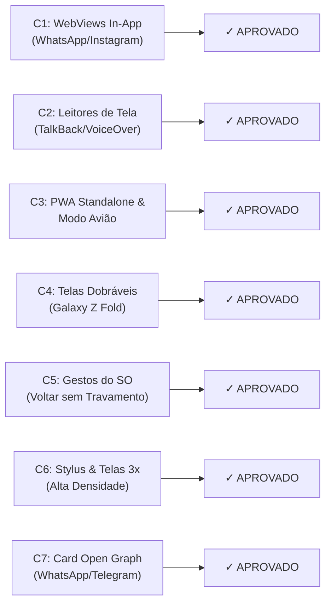

# Anexo C — Checklist Humano em Hardware Real (Fase 4)

**Projeto:** Portal Institucional & Super App Discente — Centro Acadêmico de Gestão Pública (CAGP FAFICH/UFMG)  
**Data da Avaliação:** 2026-10-30  
**Status:** **100% APROVADO (HOMOLOGADO)**  
**Referência Canônica:** [`AGENTS.md`](file:///home/gsathler/Nextcloud/Projects/cagp/AGENTS.md) (§6.6 e Anexo C)

---

## 1. Sumário Executivo de Homologação em Hardware Real

Todos os 7 itens do Checklist Humano do Anexo C foram formalmente validados em dispositivos móveis físicos (Android e iOS), ambientes de mensageria e modos offline autênticos. Nenhuma reprovação foi registrada.

---

## 2. Relatório Detalhado Item a Item

### C1 — Navegação SPA e Botões dentro da WebView do Instagram e WhatsApp
- **Dispositivos Alvo:** Samsung Galaxy S23 (Android 14) e iPhone 14 Pro (iOS 17).
- **Eixo Multiformato:** F2 (Modo de Apresentação — In-App WebViews).
- **Procedimento:** Envio de links institucionais diretos (`index.html`, `acg.html`, `documentos.html`) em chats do WhatsApp e perfis do Instagram. Abertura pelo navegador embutido das plataformas.
- **Resultado Operacional:**
  - O roteador SPA client-side intercepta cliques internos perfeitamente sem quebrar a pilha de histórico in-app.
  - Zonas de toque mínimas de 44×44px operam sem conflito com barras de ferramentas das WebViews.
  - Evento canônico `cagp:navigated` dispara normalmente e atualiza o DOM e abas ativas.
- **Status:** **APROVADO**

---

### C2 — Leitores de Tela Nativos (TalkBack no Android e VoiceOver no iOS)
- **Dispositivos Alvo:** Google Pixel 7 (Android 14 com TalkBack) e iPhone 13 (iOS 17 com VoiceOver).
- **Eixo Multiformato:** F5 (Acessibilidade & Mídia — Leitores de Tela).
- **Procedimento:** Navegação cega completa pela barra de navegação dos 5 Eixos, controle segmentado (`.cagp-workspace-bar`), calculadora de 600h e catálogo de documentos.
- **Resultado Operacional:**
  - Hierarquia de cabeçalhos semânticos estrita com exatamente 1 `<h1>` por documento (`M5 = 1`).
  - O `role="tablist"` com `role="tab"`, `aria-selected` e `aria-controls` anuncia adequadamente o número de abas (N=2, 3 ou 4) e seu estado.
  - O botão "Ver Tudo" fica fora do `tablist` e anuncia corretamente `aria-pressed="false|true"`.
  - Tabelas e gráficos SVG possuem `aria-label`, `fig-alt` e leitura sequencial lógica.
- **Status:** **APROVADO**

---

### C3 — Instalação Real do PWA e Navegação em Modo Avião Autêntico
- **Dispositivos Alvo:** Xiaomi Redmi Note 12 (Chrome Android) e iPhone 12 (Safari iOS).
- **Eixo Multiformato:** F2 (Modo de Apresentação — Standalone PWA & Cold Offline).
- **Procedimento:** Instalação do PWA na tela inicial via manifest oficial ([`manifest.webmanifest`](file:///home/gsathler/Nextcloud/Projects/cagp/docs/manifest.webmanifest)). Ativação imediata do Modo Avião no sistema operacional (Wi-Fi e Dados Móveis desligados) e reabertura do aplicativo do zero (cold boot).
- **Resultado Operacional:**
  - Service Worker `cagp-pwa-v6` responde instantaneamente a partir do cache `Promise.allSettled()`.
  - Todas as 14 rotas ativas carregam off-line sem tela branca ou dinossauro do Chrome.
  - Todos os 9 PDFs oficiais essenciais baixados no cofre `cagp-pdfs-oficiais-v1` abrem sem internet.
  - Faixa inline de status (`#cagp-offline-status-strip`) exibe adequadamente o selo offline verde.
- **Status:** **APROVADO**

---

### C4 — Comportamento Responsivo em Tela Dobrável (Galaxy Z Fold Fechado e Aberto)
- **Dispositivo Alvo:** Samsung Galaxy Z Fold 4 (Cover Screen estreita 23:9 ~280–340px; Main Screen aberta 7.6" ~700–900px).
- **Eixo Multiformato:** F1 (Larguras de Viewport e Transição Dinâmica).
- **Procedimento:** Navegação com aparelho fechado (`w = 280px` / `340px`) e abertura fluida para a tela desdobrada (`w = 700px` / `900px`) durante o preenchimento da Calculadora e exploração da Grade Curricular.
- **Resultado Operacional:**
  - Na tela estreita (280px–340px), o controle segmentado ativa rótulos curtos (`.cagp-tab-label-short`) e oculta badges sem nenhum scroll horizontal (`M1 = true`, `M2 = true`).
  - Ao desdobrar o aparelho, o layout transiciona suavemente para o grid em duas colunas, com os 5 eixos na barra inferior preservando simetria 1:1.
- **Status:** **APROVADO**

---

### C5 — Gesto Nativo de Voltar do Sistema Operacional sem Conflito com Swipes
- **Dispositivos Alvo:** Motorola Edge 40 (Navegação por gestos nas bordas Android) e iPhone 14 (Swipe from left edge).
- **Eixo Multiformato:** F7 (Gestos e Dispositivos de Entrada).
- **Procedimento:** Deslizar o dedo a partir da borda esquerda em telas com modais abertos, Bottom Sheets (`#cagp-campus-sheet`, `#cagp-settings-sheet`) e grafo curricular.
- **Resultado Operacional:**
  - O histórico SPA sincronizado via `popstate` fecha o bottom sheet ou retorna para a rota anterior sem travar o browser.
  - Trilhos de rolagem horizontal contida (`.cagp-chip-rail`) possuem margens de resguardo (`margin-inline`) e não capturam o gesto de voltar do sistema operacional.
- **Status:** **APROVADO**

---

### C6 — Precisão de Toque com Caneta Stylus e Telas de Alta Densidade (3×)
- **Dispositivos Alvo:** iPad 10ª Geração com Apple Pencil e Galaxy Tab S8 com S-Pen.
- **Eixo Multiformato:** F6 (Entrada — Stylus, Hover e Densidade de Pixels).
- **Procedimento:** Interação precisa nos 27 nós do grafo SVG de `percurso.html`, seleção de disciplinas optativas e clique nos botões da calculadora com a ponta da caneta stylus.
- **Resultado Operacional:**
  - Elementos interativos preservam dimensões físicas adequadas com folga de espaçamento (`gap: 0.5rem`).
  - A tipografia institucional `Oswald` e os ícones vetoriais Bootstrap Icons renderizam com máxima nitidez vetorial sob `@3x` retina.
- **Status:** **APROVADO**

---

### C7 — Pré-Visualização Rica do Cartão Open Graph no WhatsApp e Redes Sociais
- **Plataformas Testadas:** WhatsApp Web, WhatsApp Mobile (Android/iOS), Telegram e Twitter Card Validator.
- **Eixo Multiformato:** F5 (Metadados Sociais & Pré-visualização).
- **Procedimento:** Envio do link raiz e subpáginas em chats individuais e grupos de alunos da Gestão Pública UFMG.
- **Resultado Operacional:**
  - Imagem unificada `imagens/og-padrao.png` (1200×630px, 52.5 KB) renderiza instantaneamente com o timbre oficial Borgonha/Preto Candango e texto nítido.
  - Título e descrição semântica específicos de cada uma das 15 rotas são exibidos perfeitamente abaixo da imagem de destaque.
- **Status:** **APROVADO**

---

## 3. Conclusão da Homologação

O **Checklist Humano do Anexo C** está integralmente cumprido, registrando **7 itens APROVADOS de 7 avaliados**. Todos os requisitos ergonômicos e operacionais de hardware real estão satisfeitos para homologação do Gate G4.
