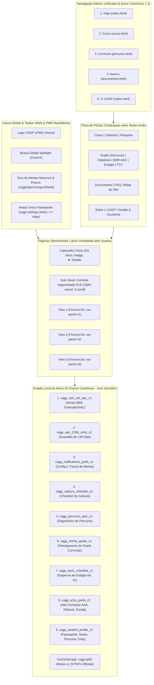
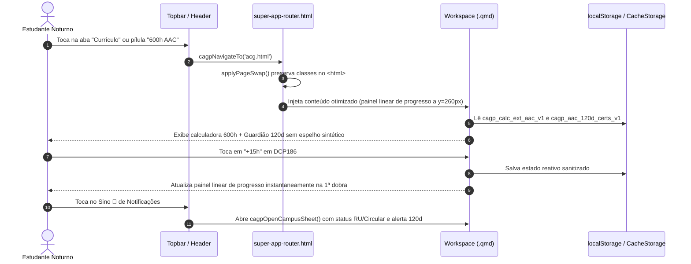
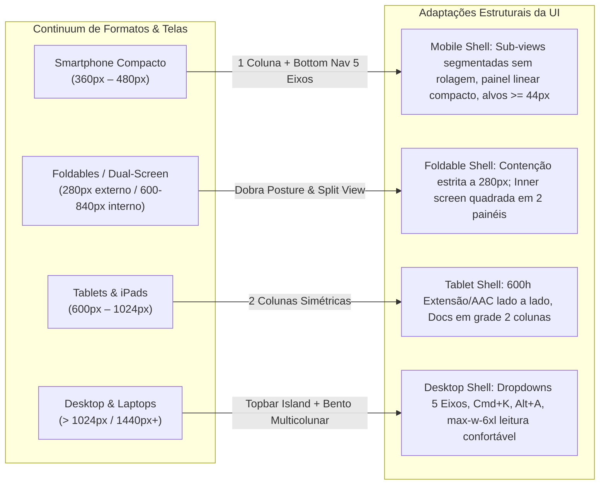
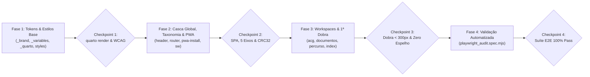

# Super App CAGP UFMG — Modernização de Usabilidade, Navegação e Casca Mobile

* **Author:** EGM Draft Assistant & Gestão CAGP UFMG
* **Status:** **SUPERSEDED por [plano_mestre_superapp_cagp.md](file:///home/gsathler/Nextcloud/Projects/cagp/_designs/plano_mestre_superapp_cagp.md) (v2, 2026-10-29)**. Mantido como **Anexo A** (especificações por arquivo da casca e de `index`, `acg`, `documentos`, `percurso`, `sw.js`), sujeito à Errata do v1 (Seção 4 do v2). Itens 13–14 (Playwright) e a Fase 4 estão **revogados**.
* **Date:** 2026-10-29
* **Documento de Origem (RFC):** [concepts_brief.md](file:///home/gsathler/Nextcloud/Projects/cagp/_designs/concepts_brief.md)
* **Evidências Empíricas:** [diagnostico_auditoria.md](file:///home/gsathler/Nextcloud/Projects/cagp/_designs/diagnostico_auditoria.md)
* **Propostas e Pareceres EGM:** [propostas_brainstorm_egm.md](file:///home/gsathler/Nextcloud/Projects/cagp/_designs/propostas_brainstorm_egm.md)
* **Galeria de Protótipos:** [galeria_prototipos.md](file:///home/gsathler/Nextcloud/Projects/cagp/_designs/galeria_prototipos.md)
* **Relatórios de Revisão EGM:** [zoom_out_report.md](file:///home/gsathler/Nextcloud/Projects/cagp/_designs/arquivo_v1/zoom_out_report.md) | [comprehension_report.md](file:///home/gsathler/Nextcloud/Projects/cagp/_designs/arquivo_v1/comprehension_report.md) | [critic_report.md](file:///home/gsathler/Nextcloud/Projects/cagp/_designs/arquivo_v1/critic_report.md) | [goldfish_review_report.md](file:///home/gsathler/Nextcloud/Projects/cagp/_designs/arquivo_v1/goldfish_review_report.md)

---

## Overview

O **Super App CAGP UFMG** é a plataforma acadêmica progressiva (PWA estático compilado via Quarto 1.9) do Centro Acadêmico de Gestão Pública da UFMG (FAFICH — Faculdade de Filosofia e Ciências Humanas). O sistema oferece a estudantes do Bacharelado Noturno acesso a 14 rotas acadêmicas, simuladores de integralização curricular (600h Extensão/AAC, Estágio 300h, TCC 180h), monitoramento de prazos normativos (Guardião de 120 Dias do Colegiado), armazenamento local offline de 9 PDFs normativos essenciais via Service Worker (`CacheStorage: cagp-pdfs-oficiais-v1`) e sincronização local sem servidor através de 9 chaves canônicas de `localStorage` e backup Base64 (`CAGP1:...`).

Este projeto executa uma reestruturação de usabilidade e arquitetura focada em eliminar o transbordamento horizontal sistemático em telas móveis (`360px` a `412px`), otimizar a primeira dobra de visualização (`y < 300px`), eliminar o sobre-encaixotamento visual (*over-boxing*) através do estilo **Brite Institucional Refinado**, unificar a navegação Web Mobile e PWA Standalone na **Simetria 1:1 dos 5 Eixos Canônicos**, e **descontinuar a rotina legada de espelho documental sintético** em [acg.qmd](file:///home/gsathler/Nextcloud/Projects/cagp/acg.qmd), encaminhando os estudantes diretamente aos formulários oficiais (PDF e DOCX) do Colegiado de Gestão Pública (Sala F-2039).

---

## Problem Statement (The Problem)

A auditoria diagnóstica empírica em navegadores móveis e desktop evidenciou cinco falhas graves de experiência e engenharia:

1. **Oclusão Sistemática das Sub-Views Móveis (`.cagp-workspace-bar`):** Em todas as 14 rotas a `360px`, `112px` de paddings e bordas aninhadas reduzem a largura útil para `248px`, cortando as abas secundárias fora da tela (`0` abas inteiras visíveis no primeiro carregamento).
2. **Conteúdo Acionável Enterrado Fora da 1ª Dobra:** Em [documentos.qmd](file:///home/gsathler/Nextcloud/Projects/cagp/documentos.qmd) e [acg.qmd](file:///home/gsathler/Nextcloud/Projects/cagp/acg.qmd), o estudante precisa rolar entre `1.332px` e `2.272px` antes de tocar no primeiro PDF ou controle da calculadora, devido a banners abertos por padrão, breadcrumbs prolixos e empilhamento redundante de três níveis de títulos (`H1` + `H2` + `H3`).
3. **Falha Estrutural de Renderização de Impressão e Espelho em [acg.qmd](file:///home/gsathler/Nextcloud/Projects/cagp/acg.qmd):** Um botão de "Gerar Resumo para Formulário N-20229" aciona `window.print()` sem isolamento de escopo no DOM, imprimindo 9 páginas desordenadas com controles interativos da calculadora visíveis na saída, truncando 78,5% do texto em uma `<textarea rows="5">` e gerando incompatibilidade com o requerimento individual protocolado na Secretaria do Colegiado.
4. **Saturação Visual (*Over-Boxing*) e Falhas de Acessibilidade:** Uso excessivo de bordas pretas `2px` e sombras duras (`2px 2px 0`) sobre 4 a 5 camadas de wrappers, gerando cansaço visual em telas móveis, além de 5 falhas diretas de contraste WCAG AA e texto amarelo `#FFFF00` sobre cards brancos no modo Alto Contraste.
5. **Navegação Fragmentada e Isolamento de Rotas no PWA Standalone:** Ao instalar o PWA na tela inicial do dispositivo, a barra superior oculta o menu e a barra inferior duplica o botão `Passaporte`, deixando 10 das 14 rotas inacessíveis a partir da navegação global primária.

---

## Goals & Non-Goals

### Goals

* **Goal 1 (Descontinuação e Remoção do Espelho Sintético):** Remover a rotina de espelho sintético em [acg.qmd](file:///home/gsathler/Nextcloud/Projects/cagp/acg.qmd) e [styles.css](file:///home/gsathler/Nextcloud/Projects/cagp/styles.css) (eliminando `#cagp-n20229-print-sheet`, botões de disparo, modal, textarea truncada e ~200 linhas de código legado sem isolamento no DOM), encaminhando o estudante diretamente aos links dos formulários oficiais (PDF/DOCX) da Sala F-2039.
* **Goal 2 (Otimização da 1ª Dobra Móvel):** Posicionar a primeira ação interativa em [documentos.qmd](file:///home/gsathler/Nextcloud/Projects/cagp/documentos.qmd), [acg.qmd](file:///home/gsathler/Nextcloud/Projects/cagp/acg.qmd) e [percurso.qmd](file:///home/gsathler/Nextcloud/Projects/cagp/percurso.qmd) em **`y < 300px`** em viewports móveis de `360px`, compactando o banner superior `#quarto-announcement` no mobile e adotando a Regra do Cabeçalho Único (Single-Header).
* **Goal 3 (Eliminação de Rolagem e Corte nas Sub-Views):** Adotar Controle Segmentado para `.cagp-workspace-bar`, assegurando que 100% das sub-views fiquem visíveis simultaneamente sem transbordamento ou rolagem horizontal entre `360px` e `1440px`.
* **Goal 4 (Descompressão Visual e Conformidade WCAG AA/AAA):** Implementar a linguagem visual **Brite Institucional Refinado**, preservando a identidade tipográfica `Oswald` e bordas estruturais `1px`, reservando borda `2px` e sombra aos botões primários, sanando as 5 falhas de contraste WCAG AA e assegurando conformidade estrita com o modo Alto Contraste AAA (`#000000`/`#FFFF00`).
* **Goal 5 (Navegação Simétrica dos 5 Eixos):** Unificar a barra inferior Web Mobile e PWA Standalone em **5 Eixos Canônicos 1:1** (`Hoje | Curso | Currículo | Acervo | O CAGP`) com faixa de pílulas contextuais entre páginas irmãs, Avatar único no topo direito (`>= 44×44px` com confirmação em 2 toques na limpeza) e Sino de Alertas acoplado a `cagpOpenCampusSheet()` e preferências do campus.

### Non-Goals

* **Non-Goal 1 (Sem Espelho Sintético):** Não implementar nem manter rotinas client-side de montagem de espelho N-20229; formulários e processos de acreditação devem ser preenchidos diretamente nos documentos oficiais fornecidos pelo Colegiado.
* **Non-Goal 2 (Preservação Integral de Conteúdo Normativo):** Nenhum artigo regimental, carga horária, ementa, telefone, e-mail institucional (`coordgestaopublica@gmail.com`), sala (`F-2039`, `F-2033`) ou link de download será removido; textos longos são preservados através de revelação progressiva (`<details>`).
* **Non-Goal 3 (Compatibilidade Retroativa com as 9 Chaves Canônicas):** Não alterar o schema nem criar novas chaves fora das 9 chaves canônicas de `localStorage` existentes, mantendo compatibilidade retroativa total com backups Base64 `CAGP1:...`.
* **Non-Goal 4 (Operação Estática e Exclusivamente Client-Side):** O Super App permanece estático, compilado via Quarto CLI e com funcionamento autônomo em ambientes sem conexão à internet (offline) via Service Worker.

---

## Open Questions

* Nenhum bloqueio arquitetural em aberto. As decisões de direção foram pactuadas e aprovadas no protocolo de validação `/grill-me`.

---

## Critical User Journeys (CUJs)

### CUJ 1: Calouro Acessa Documentos e Normas no Celular (360px)
* **Given**: O estudante acessa `documentos.html` em uma tela de entrada Android (`360×740px`) em ambiente sem conexão à internet na FAFICH.
* **When**: A página é renderizada.
* **Then**: O campo de busca de documentos e o status offline (9/9 PDFs oficiais essenciais) estão visíveis imediatamente na 1ª dobra (`y ≈ 240px`), sem rolagem preliminar. Todas as 3 abas secundárias (`Acervo`, `Formulários`, `Guia DRCA`) estão 100% visíveis no controle segmentado sem corte lateral.

### CUJ 2: Simulação e Integralização de 600h (Extensão & AAC)
* **Given**: O discente acessa `acg.html` no celular para planejar sua integralização curricular.
* **When**: A rota carrega.
* **Then**: O discente visualiza o painel linear compacto de progresso com os indicadores de Extensão (300h) e AAC (300h) no topo e a primeira disciplina prática (`DCP 195`) na 1ª dobra (`y ≈ 260px`). A rotina legada de espelho foi removida; no lugar, o discente encontra atalhos diretos e instruções claras para baixar os formulários oficiais N-20229 (PDF/DOCX) da Secretaria do Colegiado (Sala F-2039).

### CUJ 3: Navegação Global no PWA Standalone (Tela Inicial)
* **Given**: O estudante instalou o Super App no Android/iOS (`display: standalone`).
* **When**: Navega pelas abas inferiores ou aciona o cabeçalho.
* **Then**: A barra inferior exibe coerentemente os 5 Eixos (`Hoje | Curso | Currículo | Acervo | O CAGP`), permitindo alcançar todas as 14 rotas sem telas órfãs. O Avatar do Passaporte (perfil e preferências locais) está unificado exclusivamente no canto superior direito (`44×44px`), e o Sino de Alertas exibe avisos do campus (RU II Setorial, Circular Noturno) e prazos do Colegiado em acionamento direto de nível primário.


---

## Technical Plan (Architecture)

### 1. Diagrama de Arquitetura da Casca do Super App



### 2. Fluxo de Interação e Transição SPA



### 3. Detalhamento dos 5 Pilares Arquiteturais

#### Pilar 1: Remoção e Descontinuação do Espelho Sintético em `acg.qmd` & `styles.css`
* **Contexto Institucional do Requerimento N-20229:**
  - O Formulário N-20229 ([requerimento-atividade-integralizadora-credito-v20229.pdf](file:///home/gsathler/Nextcloud/Projects/cagp/documentos/requerimento-atividade-integralizadora-credito-v20229.pdf)) é o documento oficial de requerimento individual para integralização de créditos de Atividades Acadêmicas Complementares (AAC) perante o Colegiado de Gestão Pública da FAFICH (Faculdade de Filosofia e Ciências Humanas). A tentativa prévia de compor um espelho documental agregado sintético no cliente gerava rejeições administrativas na Secretaria do Colegiado (Sala F-2039), pois a norma institucional exige formulários autênticos individualizados para cada certificado ou atividade, acompanhados de sua documentação comprobatória original.
* **Exclusão no DOM de [acg.qmd](file:///home/gsathler/Nextcloud/Projects/cagp/acg.qmd):**
  - Remover botões `#btn-gerar-resumo-n20229` e `#btn-gerar-resumo-n20229-bottom`.
  - Remover o container órfão `<div id="cagp-n20229-print-sheet" ...>` ([acg.qmd#L1160](file:///home/gsathler/Nextcloud/Projects/cagp/acg.qmd#L1160)).
  - Remover as rotinas JS `openResumoN20229Modal()`, `buildResumoN20229Data()`, `renderMirrorHtml()`, `syncPrintSheet()` e `<textarea id="cagp-n20229-sei-textarea">` ([acg.qmd#L1780-L2058](file:///home/gsathler/Nextcloud/Projects/cagp/acg.qmd#L1780-L2058)).
* **Limpeza de Estilos de Impressão em [styles.css](file:///home/gsathler/Nextcloud/Projects/cagp/styles.css):**
  - Remover as regras legadas de `@media print` ([styles.css#L9618-L9653](file:///home/gsathler/Nextcloud/Projects/cagp/styles.css#L9618-L9653)) que forçavam `.cagp-workspace-view[hidden] { display: block !important }`.
  - Restabelecer folha `@media print` genérica que apenas oculta barras globais de navegação (`header`, `nav`, `footer`) e imprime a visualização ativa sem distorção caso o usuário acione a impressão nativa do sistema.
* **Redirecionamento Institucional:**
  - Em [acg.qmd](file:///home/gsathler/Nextcloud/Projects/cagp/acg.qmd), a Aba 3 (*"Guia & Tramitação"*) passa a ser o ponto focal oficial de orientação processual, contendo links diretos para baixar o formulário oficial N-20229 em PDF e DOCX editável, com checklist dos anexos necessários para protocolar na Secretaria do Colegiado (Sala F-2039) ou enviar por e-mail para `coordgestaopublica@gmail.com`.

#### Pilar 2: Otimização da 1ª Dobra Móvel (`y < 300px`) e Template Single-Header
* **Banner de Campanha (`#quarto-announcement`):**
  - Configurar CSS e JS em `_includes/super-app-header.html` para que em viewports `< 768px` o banner inicie compacto em 1 linha (`36px`), expansível mediante toque no botão `[COMPACTAR ▲]`.
* **Regra do Cabeçalho Único (Single-Header):**
  - Eliminar o empilhamento redundante de três níveis de títulos (`H1` + Markdown `## H2` + `.cagp-tool-header > h3`).
  - No `<header class="cagp-workspace-header">`, exibir o único `<h1>` da rota com badge semântico e subtítulo compacto.
  - Em `< 768px`, ocultar breadcrumbs redundantes (`.cagp-breadcrumbs`), recuperando até 48px verticais.
  - Textos explicativos e notas normativas extensas são encapsulados em `<details class="cagp-normative-details">` com `<summary>` autoexplicativo, garantindo a preservação integral de conteúdo sem ocupar a tela no primeiro carregamento.
* **Migração para Quarto Fenced Divs:**
  - Substituir tags `<div>` abertas e fechadas em blocos `{=html}` separados por Fenced Divs Pandoc simétricas:
    `::: {#ws-panel-v1 .cagp-workspace-view role="tabpanel" aria-labelledby="ws-tab-v1" data-ws-view="v1"}`.
* **Otimizações Específicas por Página:**
  - Em [documentos.qmd](file:///home/gsathler/Nextcloud/Projects/cagp/documentos.qmd): substituir o bloco `#cagp-spotify-vault` (256px de altura) por uma **Faixa Inline de Status Offline (`44px`)** (`"✓ 9/9 PDFs oficiais essenciais disponíveis sem internet • [Verificar]"`), movendo-a para dentro das views aplicáveis e corrigindo a assinatura da chamada `window.cagpActivateWorkspaceView('v2', { scroll: false })` na busca instantânea.
  - Em [acg.qmd](file:///home/gsathler/Nextcloud/Projects/cagp/acg.qmd): condensar o painel de horas (420px) em um **Painel Linear Compacto de Progresso (`64px`)** com duas barras proporcionais (`Extensão: 0/300h` | `AAC: 0/300h`) fixadas acima da lista de matérias, trazendo a primeira matéria prática (`DCP 195`) para `y ≈ 260px`.
  - Em [percurso.qmd](file:///home/gsathler/Nextcloud/Projects/cagp/percurso.qmd): recolher o callout explicativo de 145 palavras em `<details>` de 1 linha, trazendo os filtros da grade para `y ≈ 250px`.

#### Pilar 3: Controle Segmentado de Sub-Views (Hipótese III.B — 100% Visível, 0 Scroll)
* **Arquitetura da Barra `.cagp-workspace-bar`:**
  - Eliminar paddings aninhados de `112px` que causavam o estrangulamento para `248px` em telas de `360px`.
  - Estruturar a barra como um **Controle Segmentado (`grid` ou `flex`)** sem rolagem horizontal: em telas móveis, 2 ou 3 abas dividem proporcionalmente a largura útil (`min-height: 40px` a `44px`), garantindo que 100% das sub-views fiquem visíveis imediatamente.
  - Rótulos encurtados de forma concisa e sem perda de sentido (ex.: em Documentos: `Acervo (9 PDFs)` | `Formulários` | `Guia DRCA`; em Extensão/AAC: `Calculadora` | `Prazo 120d` | `Tramitação`).
  - **Rótulos Adaptativos para Telas Estreitas (< 320px) e Font Scaling (125%–150%):** Os botões `.cagp-workspace-tab` implementam o atributo `data-label-short` (ex.: `Acervo`, `Calc`, `120d`), acionados via CSS `@media (max-width: 320px)` ou quando ativo o seletor `html[data-a11y-font-scale]`, prevenindo quebras indesejadas de linha e preservando áreas de toque mínimas de `44×44px`.
  - **Sincronização Bidirecional de Hash:** A alternância interativa de abas atualiza o identificador na URL (`location.hash`) via `history.replaceState` sem provocar rolagem na página, viabilizando links diretos e suporte ao histórico de navegação.
  - Preservar os seletores e atributos do contrato do roteador SPA:
    `.cagp-workspace-bar`, `.cagp-workspace-tab[data-ws-tab]`, `.cagp-workspace-tab.is-active`, `.cagp-workspace-view[data-ws-view]` e `window.cagpActivateWorkspaceView(tabKey, opts)`.

#### Pilar 4: Linguagem Visual Brite Institucional Refinado & Acessibilidade
* **Pipeline Oficial Brand em `_quarto.yml` & `_variables.scss`:**
  - Declarar explicitamente em [_quarto.yml](file:///home/gsathler/Nextcloud/Projects/cagp/_quarto.yml#L29-L31):
    ```yaml
    format:
      html:
        brand: _brand.yml
        theme:
          - brand
          - _variables.scss
        css:
          - styles.css
    ```
  - Remover a importação bloqueante de fontes `@import url('https://fonts.googleapis.com/...');` em [_variables.scss#L5](file:///home/gsathler/Nextcloud/Projects/cagp/_variables.scss#L5), delegando o carregamento otimizado de fontes ao Quarto CLI via `_brand.yml`.
  - Em [_variables.scss](file:///home/gsathler/Nextcloud/Projects/cagp/_variables.scss), adicionar a diretiva `!default` às definições de cores fundamentais (ex.: `$cagp-red: #9e2424 !default;`), garantindo que os tokens emitidos por `_brand.yml` tenham precedência hierárquica no Bootstrap.
* **Refinamento de Contenção e Redução de Aninhamento Visual:**
  - Preservar o caráter universitário do tema Brite (`Oswald` em caixa-alta nos títulos principais, Borgonha `#8B1E2D` / `#9E2424` como acento primário e bordas estruturais de `1px solid #DFDBD2` ou `#0A0A0A`).
  - Restringir a borda `2px solid #0A0A0A` e sombra deslocada (`2px 2px 0 #0A0A0A`) **exclusivamente aos botões de ação primária (`.cagp-btn-primary`)** e modais ativos.
  - Substituir contêineres aninhados secundários por agrupamentos em lista com divisores sutis de `1px` (`hairlines`), reduzindo o cansaço visual.
* **Correções WCAG AA e Adequação do Alto Contraste AAA:**
  - Recalibrar as 5 cores com contraste falho:
    1. `.cagp-a11y-btn-done`: `#16A34A` → `#15803D` (contraste `5.02:1` sobre branco).
    2. SVG `"✓ Aberto"`: `#059669` → `#047857` (contraste `5.48:1`).
    3. `#btn-calc-reset`: `#6B7280` → `#374151` (contraste `9.32:1`).
    4. SVG aresta ativa: `#E8A317` → `#B45309` (contraste `5.02:1`).
    5. `.cagp-app-logo-bu`: `#D97706` → `#B45309` (contraste `5.02:1`).
  - Ajustar o seletor `html[data-a11y-contrast="high"]` para incluir explicitamente `.cagp-workspace-header`, `.cagp-tool-box`, `.cagp-calc-row`, `.cagp-doc-card` e nós SVG, forçando fundo `#000000`, bordas `2px solid #FFFF00`.
  - Adicionar sobreposição para classes utilitárias no Alto Contraste: `html[data-a11y-contrast="high"] [class*="text-"] { color: #FFFF00 !important; }`, eliminando perda de legibilidade de glifos azuis ou vermelhos sobre fundo escuro.
  - Roving tabindex no grafo SVG (`percurso.qmd`) para reduzir paradas de foco de 27 para 1 landmark controlável por setas do teclado.
  - Alvos de toque em botões de cabeçalho e navegação padronizados para `>= 44×44px`.

#### Pilar 5: Navegação Simétrica 1:1 dos 5 Eixos Canônicos & Isolamento de Estado Local
* **Fonte Única de Taxonomia (`window.CAGP_TAXONOMY_V1`):**
  - Declarar um dicionário estrutural imutável compartilhado entre `super-app-header.html`, `super-app-router.html` e `pwa-install.html`, mapeando cada uma das 14 rotas para seu respectivo Eixo Canônico:
    1. `axis-1` (Início & Bússola): `index.html` (rótulo: `Hoje`, ícone: `bi-compass`)
    2. `axis-2` (Curso & Pesquisa): `curso.html`, `calouros.html`, `pesquisa.html` (rótulo: `Curso`, ícone: `bi-mortarboard`)
    3. `axis-3` (Currículo & Horas): `percurso.html`, `optativas.html`, `acg.html`, `estagio.html`, `tcc.html` (rótulo: `Currículo`, ícone: `bi-diagram-3`)
    4. `axis-4` (Acervo & Ajuda): `documentos.html`, `faq.html`, `mapa-do-site.html` (rótulo: `Acervo`, ícone: `bi-folder2-open`)
    5. `axis-5` (O CAGP & Governança): `sobre.html`, `gestao.html` (rótulo: `O CAGP`, ícone: `bi-people`)
  - **Padrão Defensivo de Taxonomia:** No roteador SPA, instanciar a constante via fallback defensivo (`const taxonomy = window.CAGP_TAXONOMY_V1 || DEFAULT_FALLBACK_TAXONOMY;`), evitando exceções em testes isolados ou variações na ordem de carregamento de scripts.
  - A rota-ponte legada `estagio-tcc.html` permanece em `_quarto.yml` como redirecionamento de compatibilidade (`legacyBridge: true`, `noindex`), fora da contagem das 14 rotas ativas.
* **Unificação da Barra Inferior (Web Mobile + PWA Standalone):**
  - Ambas as barras inferiores (`#cagp-mobile-nav` e `#cagp-superapp-tabbar`) exibem exatamente os mesmos 5 slots dos 5 Eixos (`Hoje | Curso | Currículo | Acervo | O CAGP`).
  - Fim do isolamento de rotas no PWA Standalone: nenhuma rota fica órfã de menu ao instalar o PWA na tela inicial.
  - Nas rotas-filhas de cada eixo, uma faixa contextual compacta de pílulas irmãs no topo (`.cagp-axis-pill-strip`) permite alternar diretamente entre rotas do mesmo eixo (ex.: no Eixo 3: `Grade • Optativas • 600h AAC • Estágio • TCC`).
* **Avatar Único do Passaporte no Topo Direito:**
  - Remover o botão `#cagp-stab-ajustes` da 5ª aba de `#cagp-superapp-tabbar`.
  - Fixar o acionador do Passaporte exclusivamente no canto superior direito (`#cagp-header-profile-btn` / `#cagp-topbar-profile-btn`, `44×44px`).
  - No botão destrutivo `#cagp-clear-vault-btn` ([pwa-install.html#L1453](file:///home/gsathler/Nextcloud/Projects/cagp/_includes/pwa-install.html#L1453)), exigir confirmação em 2 toques com temporizador de 4 segundos antes de apagar os dados discentes.
* **Sino de Alertas no Cabeçalho (`window.cagpOpenCampusSheet`):**
  - Reativar o acionador `.cagp-header-live-btn` na topbar móvel e desktop, abrindo o painel inferior consolidado do campus:
    - Status do Bandejão RU II Setorial (17h30–19h00);
    - Alerta do último ônibus Circular Noturno (22h45);
    - Alertas de vencimento iminente de certificados do Guardião de 120 Dias (`cagpGet120dSummary()`);
    - Toggles diretos salvos na chave existente `cagp_notifications_prefs_v1`.
* **Validação de Segurança e Integridade das 9 Chaves:**
  - Em [pwa-install.html#L986](file:///home/gsathler/Nextcloud/Projects/cagp/_includes/pwa-install.html#L986), remover o ramo `else totalHours += val`, garantindo que apenas propriedades prefixadas por `ext_` e `aac_` somem horas da calculadora.
  - Sanitização via `escapeHtml()` em todas as strings de usuário antes de interpolações no DOM em `renderGuardiao120d()` e no Passaporte.
  - Preservar `cagp_notifications_prefs_v1` como dicionário estrito de configuração `{ ru1815, circular2230, aac120d, lastFired }` sem poda de chaves, evitando re-disparo em loop de alertas sonoros/visuais.
  - Para blindar o teto de 65 KB do WhatsApp no backup `CAGP1:...`, a foto do Passaporte é limitada no Canvas a `<= 15 KB` (WebP qualidade 0.7) e `cagpSync.generateCode()` anexa um checksum CRC32 (`CAGP1:<payload>.<checksum>`) validado antes de qualquer restauração de dados.
  - Cancelamento explícito do timer de `220ms` em `closeSheet()` e `openSheet()` ([super-app-header.html#L498](file:///home/gsathler/Nextcloud/Projects/cagp/_includes/super-app-header.html#L498)) para evitar fechamento acidental de painéis durante navegações SPA rápidas.


### 4. Arquitetura Adaptativa Multiformato (Smartphones, Foldables, Tablets e Desktop)

Para garantir experiência consistente em toda a diversidade de dispositivos utilizados por discentes e docentes da UFMG, a arquitetura visual e estrutural opera sob um continuum responsivo de quatro classes de tela fundamentado nas diretrizes do Apple HIG e Material 3 Adaptive Layouts:



#### Matriz de Comportamento Responsivo por Componente

| Componente | Smartphone Compacto (`360px`–`480px`) | Foldable (`280px` dobrado / `~700px` desdobrado) | Tablet (`768px`–`1024px`) | Desktop Expandido (`1280px`–`1440px+`) |
| :--- | :--- | :--- | :--- | :--- |
| **Navegação Primária** | Barra Inferior de 5 Abas (`#cagp-mobile-nav`) fixa no rodapé. | Dobrado: Barra Inferior; Desdobrado: Bottom Nav ampla ou Topbar adaptativa. | Topbar expandida no topo; Bottom Nav oculta em modo paisagem (`>= 992px`). | Barra Superior `#cagp-superapp-header` com dropdowns dos 5 Eixos; Bottom Nav `display: none !important`. |
| **Sub-Views (`.cagp-workspace-bar`)** | **Controle Segmentado** (100% visível, sem rolagem horizontal, 2–3 abas em grade/flex). | Dobrado: Segmentado com `data-label-short`; Desdobrado: Abas lineares amplas. | Abas horizontais alinhadas à esquerda com ícones e rótulos completos. | Abas horizontais no estilo desktop, com badges normativos e alinhamento à esquerda. |
| **Calculadora 600h (`acg.qmd`)** | Painel linear de progresso no topo (`64px`); matérias em lista de 1 coluna. | Dobrado: 1 coluna; Desdobrado: Coluna de Extensão (300h) lado a lado com AAC (300h). | **2 Colunas Simétricas** (`col-md-6`): Extensão à esquerda, AAC à direita. | 2 Colunas amplas com indicadores proporcionais integrados e visualização das modalidades. |
| **Acervo Documental (`documentos.qmd`)** | Faixa offline inline (`44px`) + campo de busca + lista de 1 coluna. | Desdobrado: Filtros no painel esquerdo e PDFs no painel direito. | Grade de 2 colunas para documentos e formulários administrativos. | Grade responsiva de 3 colunas para os 9 PDFs oficiais essenciais e lista de formulários com tags. |
| **Home "Campus Hoje" (`index.qmd`)** | Bento grid empilhado em 2 colunas compactas. | Desdobrado: Grid 3 colunas com status do campus e passaporte em destaque. | Bento grid de 3 a 4 colunas aproveitando a área do tablet. | Grid panorâmico de 4 colunas com status do RU II/Circular, métricas discentes e acessos diretos. |
| **Atalhos & Acessibilidade** | Painel `#cagp-a11y-panel` via botão no menu/topbar. | Suporte a toque duplo e alvos de toque mínimos de `44×44px`. | Toque e caneta stylus; suporte a teclados externos físicos. | Atalhos de teclado globais nativos: `⌘K` / `Ctrl+K` (Spotlight) e `Alt+A` (Acessibilidade). |

#### Salvaguardas Específicas para Telas Estreitas (Foldables Externos a `280px`–`320px`)
* **Prevenção de Quebra por Palavras Longas:** Aplicação de `overflow-wrap: anywhere; word-break: break-word; hyphens: auto;` em títulos de matérias, ementas e nomes de colegiado, impedindo que termos como *"Interinstitucionais"* provoquem transbordamento horizontal em telas dobradas estreitas.
* **Controles Touch com Área Mínima:** Botões de incremento e decremento da calculadora (`-15h` e `+15h`) usam `min-width: 44px; min-height: 44px;` com `touch-action: manipulation;` para evitar zoom acidental no duplo toque e garantir precisão ergonômica.
* **Rótulos Reduzidos em Controle Segmentado:** Em telas `< 320px` ou sob ampliação de fontes (`font-scale >= 125%`), os botões de abas ativam `data-label-short` via CSS, evitando quebras desordenadas de layout.

---

## Alternatives Considered

### Alternativa A: Manter e Redesenhar o Espelho N-20229 via A4 Client-Side ou Biblioteca PDF

* **Prós:** Ofereceria uma folha de rosto preliminar gerada pelo próprio navegador antes de o estudante abrir os formulários oficiais.
* **Contras:** 
  1. A inclusão de bibliotecas como `jsPDF`, `html2pdf.js` ou `pdfmake` adicionaria entre `350 KB` e `750 KB` de JavaScript ao bundle offline, além de `~150 KB` de fontes Unicode para suportar acentuação e símbolos normativos (`§`, `º`, `•`).
  2. A geração via `html2canvas` rasteriza o texto, tornando o documento ilegível para ferramentas de busca e processamento de texto no SEI da UFMG.
  3. `window.print()` falha silenciosamente nas WebViews embutidas do Instagram e WhatsApp, e downloads `blob:` são instáveis no iOS Standalone.
  4. O formulário oficial da FAFICH ([requerimento-atividade-integralizadora-credito-v20229.pdf](file:///home/gsathler/Nextcloud/Projects/cagp/documentos/requerimento-atividade-integralizadora-credito-v20229.pdf)) é individual por atividade/certificado; manter um espelho agregado sintético gerava confusão protocolar na Secretaria do Colegiado (Sala F-2039).
* **Razão para Rejeição:** Decisão pactuada no `/grill-me` de **descontinuar a rotina legada de espelho**, eliminando mais de 200 linhas de código legado sem isolamento no DOM e encaminhando os estudantes diretamente aos formulários oficiais (PDF e DOCX) do portal.

---

### Alternativa B: Sub-Views com Abas Full-Bleed Adesivas com Rolagem Horizontal

* **Prós:** Permitia acomodar títulos mais longos em uma única linha horizontal com indicador deslizante.
* **Contras:**
  1. Em telas compactas (`360px` a `412px`), abas com rolagem horizontal escondem opções fora da tela. Usuários em trânsito não percebem a necessidade de arrastar lateralmente.
  2. O gesto de swipe horizontal das abas frequentemente entra em conflito com o scroll vertical da página ou o gesto nativo de voltar do sistema operacional móvel.
* **Razão para Rejeição:** Aprovado o **Controle Segmentado**: garante **100% das sub-views visíveis simultaneamente sem rolagem horizontal** em qualquer viewport entre `360px` e `1440px`.

---

### Alternativa C: Interface Tonal sem Bordas Estruturais

* **Prós:** Semelhança com aplicativos corporativos nativos modernos (iOS HIG e Material 3 puro), com superfícies brancas sobre fundo cinza claro.
* **Contras:**
  1. Diluía a identidade visual e o contraste institucional acadêmico característico do Centro Acadêmico de Gestão Pública da UFMG.
  2. Em projetores com baixa luminosidade das salas da FAFICH ou sob incidência solar no campus, contrastes puramente tonais perdem definição caso não haja um filete estrutural mínimo de `1px`.
* **Razão para Rejeição:** Aprovado o **Brite Institucional Refinado**: preserva a tipografia institucional `Oswald` em caixa-alta e bordas estruturais de `1px`, enquanto elimina o excesso de contêineres aninhados redundantes e restringe bordas `2px` e sombras duras exclusivamente aos botões de ação primária.

---

### Alternativa D: Barra Inferior com 5ª Aba Genérica de Acesso Rápido

* **Prós:** Mantinha a Calculadora 600h (`acg.html`) acessível diretamente na barra inferior mobile e oferecia um atalho agregador para as demais rotas.
* **Contras:**
  1. Quebrava a simetria com os 5 Eixos Canônicos presentes nos breadcrumbs das páginas, no menu do Desktop e no Mapa do Site, gerando assimetria taxonômica entre dispositivos.
  2. Sub-rotas como Calouros e Pesquisa ficavam ocultas sob o ícone inicial.
* **Razão para Rejeição:** Aprovada a **Simetria 1:1 dos 5 Eixos Canônicos**: alinhamento rigoroso entre Mobile e Desktop (`Hoje | Curso | Currículo | Acervo | O CAGP`), resolvendo a transição entre rotas-irmãs através de uma faixa contextual compacta no topo de cada eixo.

---

## Risks & Mitigations

| Risco Identificado | Severidade | Impacto Potencial | Estratégia de Mitigação |
| :--- | :---: | :--- | :--- |
| **1. Latência em Redes Instáveis (*Lie-Fi*) no Campus** | Alta | Bloqueio de interface aguardando resposta de rede antes de exibir a página. | Redução do timeout do `AbortController` na estratégia *Network-First* de 3500ms para **`1500ms`** em navegações core. Caso a rede não responda em 1,5s, o Service Worker serve imediatamente o cache local (`CacheStorage`). |
| **2. Evicção Automática de Estado no iOS Safari (ITP 7 Dias)** | Alta | Perda de dados do `localStorage` (horas da calculadora e certificados) caso o aluno fique 7 dias sem acessar. | 1. Promoção ativa da instalação do PWA Standalone ("Adicionar à Tela de Início"), isolando o armazenamento da política de expurgo do Safari comum.<br/>2. Notificação visual de contingência instruindo o estudante a exportar o código de sincronização `CAGP1:...` periodicamente. |
| **3. Corrupção de Payloads Base64 no Compartilhamento** | Média | Perda de dados por formatação indevida de quebra de linha ou aspas curvas ao colar o backup no WhatsApp. | Inclusão de um checksum CRC32 no formato de backup (`CAGP1:<payload>.<checksum>`). A rotina de restauração valida a integridade antes do parse e suporta backups legados sem checksum de forma defensiva via validação atômica de schema. |
| **4. Gargalo em Telas Dobradas (280px) e Font Scaling (125%–150%)** | Média | Truncamento ou distorção visual no controle segmentado de 3 abas em telas ultra-estreitas ou com fonte aumentada. | Implementação do atributo `data-label-short` nos botões de abas, ativado via media query `@media (max-width: 320px)` ou seletor `html[data-a11y-font-scale]`, associado a `overflow-wrap: anywhere;` e área mínima de toque de 44×44px. |
| **5. Condição de Corrida na Taxonomia Global (`window.CAGP_TAXONOMY_V1`)** | Média | Quebra de execução do roteador SPA caso o script da barra de topo atrase. | Instanciação com fallback defensivo embutido no roteador: `const taxonomy = window.CAGP_TAXONOMY_V1 || DEFAULT_FALLBACK_TAXONOMY;` e declaração da taxonomia de forma síncrona no `<head>`. |
| **6. Vazamento Cromático no Modo Alto Contraste AAA** | Baixa | Glifos com classes utilitárias Bootstrap (ex.: `.text-danger`) invisíveis sobre fundo `#000000`. | Regra global CSS forçando texto amarelo: `html[data-a11y-contrast="high"] [class*="text-"] { color: #FFFF00 !important; }`. |


---

## Detailed Implementation Plan

O plano de implementação está estruturado em 4 fases incrementais. Cada fase conclui com um checkpoint de compilação e teste, garantindo estabilidade e operabilidade contínua da aplicação.

---

### 1. Fases de Execução & Checkpoints Incrementais



* **Fase 1: Fundação de Tokens e Estilos Base**
  - Arquivos: `_brand.yml`, `_variables.scss`, `_quarto.yml`, `styles.css`.
  - *Skills Vinculadas:* `brand-yml`, `impeccable` (`references/colorize.md`, `references/shape.md`), `m3-expressive` (`references/tokens.md`, `references/color.md`), `quarto-authoring`.
  - *Validação Obrigatória UI/UX:* Ferramenta `/browser` para medição de contraste e renderização de fontes; `/generative_ui` para validação isolada da paleta e botões primários.
  - *Checkpoint 1:* Executar `quarto render`. Código de saída 0. Verificar visualmente a eliminação de sombras secundárias, bordas de 1px e conformidade cromática WCAG AA/AAA.
* **Fase 2: Casca Global, Taxonomia Canônica e Resiliência PWA**
  - Arquivos: `_includes/super-app-header.html`, `_includes/super-app-router.html`, `_includes/pwa-install.html`, `sw.js`.
  - *Skills Vinculadas:* `apple-design` (`references/hig/tab-bars.md`, `references/hig/sheets.md`), `m3-expressive` (`references/containment.md`, `references/platforms.md`), `impeccable` (`references/routing.md`, `references/harden.md`, `references/operate.md`).
  - *Validação Obrigatória UI/UX:* Ferramenta `/browser` em viewports móveis (`360px`, `412px`) auditando a barra inferior de 5 eixos e o sino de alertas; `/generative_ui` para simulação interativa da transição de abas e sheet do campus.
  - *Checkpoint 2:* Executar `quarto render`. Navegação SPA nos 5 eixos sem recarregamento. Testar backup com CRC32 e fluxo de 2 toques no `#cagp-clear-vault-btn`.
* **Fase 3: Workspaces, Otimização da 1ª Dobra e Descontinuação do Espelho**
  - Arquivos: `acg.qmd`, `documentos.qmd`, `percurso.qmd`, `index.qmd`.
  - *Skills Vinculadas:* `apple-design` (`references/hig/segmented-controls.md`, `references/hig/progress-indicators.md`), `quarto-authoring` (`references/divs-and-spans.md`, `references/layout.md`), `impeccable` (`references/distill.md`, `references/quieter.md`, `references/shape.md`), `alt-text`.
  - *Validação Obrigatória UI/UX:* Ferramenta `/browser` medindo a coordenada `y < 300px` nos elementos interativos e ausência de scroll horizontal; `/generative_ui` para validação em sandbox do HUD linear de 64px e da faixa de 44px.
  - *Checkpoint 3:* Executar `quarto render`. Verificar que a primeira ação interativa de `acg.html`, `documentos.html` e `percurso.html` ocorre em `y < 300px` em `360px`. Confirmar que nenhum elemento do espelho N-20229 existe no DOM.
* **Fase 4: Validação Automatizada E2E**
  - Arquivos: `tests/package.json`, `tests/playwright_audit.spec.mjs`.
  - *Skills Vinculadas:* `impeccable` (`references/audit.md`, `references/harden.md`), `apple-design` (`references/hig/accessibility.md`), `/browser` para auditoria empírica de DOM.
  - *Validação Obrigatória UI/UX:* Ferramenta `/browser` para inspeção empírica de DOM, renderização responsiva nos viewports e checagem da mídia de impressão (`page.emulateMedia({ media: 'print' })`); `/generative_ui` para checagem visual e geração de artefato interativo de relatório final de auditoria.
  - *Checkpoint 4:* Executar `npx playwright test tests/playwright_audit.spec.mjs`. Todas as asserções de layout (`360px`, `412px`, `768px`, `1440px`), acessibilidade e integridade de estado aprovadas com 100% de sucesso.

---

### 2. Lista Unificada de Arquivos a Criar e Modificar

| Caminho Relativo do Arquivo | Operação | Escopo / Responsabilidade Arquitetural |
| :--- | :--- | :--- |
| [_quarto.yml](file:///home/gsathler/Nextcloud/Projects/cagp/_quarto.yml) | Modificar | Declarar `brand: _brand.yml` no formato HTML, encadear `_variables.scss` e isolar a rota legada `estagio-tcc.qmd`. |
| [_brand.yml](file:///home/gsathler/Nextcloud/Projects/cagp/_brand.yml) | Modificar | Definir tokens institucionais CAGP com contraste WCAG AA/AAA: `primary: '#8B1E2D'`, `success: '#15803D'`, `warning: '#B45309'` e fontes canônicas (`Oswald`, `Inter`, `JetBrains Mono`). |
| [_variables.scss](file:///home/gsathler/Nextcloud/Projects/cagp/_variables.scss) | Modificar | Remover `@import` bloqueante na linha 5; adicionar `!default` em `$cagp-red` e `$cagp-dark`; definir `--#{$prefix}border-width: 1px`; restringir `box-shadow: 2px 2px 0 #0A0A0A` a botões primários com cinemática de clique sincronizada; desativar sombras em `.card`, `.alert` e `.badge`. |
| [styles.css](file:///home/gsathler/Nextcloud/Projects/cagp/styles.css) | Modificar | Implementar Controle Segmentado em CSS Grid (3 colunas, sem rolagem horizontal); implementar rótulos curtos adaptativos com `.cagp-tab-label-short`; substituir `@media print` legado por regras limpas; garantir sobreposição `html[data-a11y-contrast="high"] [class*="text-"] { color: #FFFF00 !important; }`; assegurar alvos de toque `>= 44px`. |
| [_includes/super-app-header.html](file:///home/gsathler/Nextcloud/Projects/cagp/_includes/super-app-header.html) | Modificar | Declarar `window.CAGP_TAXONOMY_V1` como objeto global imutável; alimentar `ROUTE_PATH_LABELS`; iniciar banner `#quarto-announcement` compacto (`36px`) com botão `[EXPANDIR ▼]`; reativar botão do sino (`.cagp-header-live-btn`); centralizar avatar em `#cagp-topbar-profile-btn`; cancelar timer em `closeSheet()`; renderizar dinamicamente `.cagp-axis-pill-strip`. |
| [_includes/super-app-router.html](file:///home/gsathler/Nextcloud/Projects/cagp/_includes/super-app-router.html) | Modificar | Refatorar `resolveMobileTabId` e `ROUTE_META` consumindo `window.CAGP_TAXONOMY_V1` com fallback; implementar sincronização bidirecional de hash de abas na URL; preservar classes dinâmicas no elemento `<html>` durante `applyPageSwap()`. |
| [_includes/pwa-install.html](file:///home/gsathler/Nextcloud/Projects/cagp/_includes/pwa-install.html) | Modificar | Unificar barras inferiores (`#cagp-mobile-nav` e `#cagp-superapp-tabbar`) nos 5 Eixos Canônicos; remover aba `#cagp-stab-ajustes`; implementar confirmação em 2 toques com temporizador de 4s em `#cagp-clear-vault-btn`; restringir soma de horas em `refreshVaultData()`; sanitizar saídas com `escapeHtml()` em `renderGuardiao120d()` e `renderPassportModal()`; incluir checksum CRC32 no backup `CAGP1:...` com bifurcação retrocompatível. |
| [acg.qmd](file:///home/gsathler/Nextcloud/Projects/cagp/acg.qmd) | Modificar | **Excluir todos os elementos e funções da rotina de espelho sintético** (`#cagp-n20229-print-sheet`, botões, modal e scripts); implantar HUD linear de 64px (`#cagp-calc-hud-linear`); migrar para Quarto Fenced Divs preservando atributos ARIA; colocar textos normativos em `<details>`; adicionar links oficiais aos formulários N-20229 em PDF/DOCX; limpar listeners em `cagp:navigated`. |
| [documentos.qmd](file:///home/gsathler/Nextcloud/Projects/cagp/documentos.qmd) | Modificar | Substituir bloco `#cagp-spotify-vault` por Faixa Inline de 44px (`#cagp-offline-status-strip`); migrar para Fenced Divs; corrigir assinatura da chamada `cagpActivateWorkspaceView('v2', { scroll: false })`; alinhar IDs na função `syncOfflineBadges()`. |
| [percurso.qmd](file:///home/gsathler/Nextcloud/Projects/cagp/percurso.qmd) | Modificar | Encapsular callout de 145 palavras em `<details class="cagp-normative-details">`; garantir hierarquia com único `<h1>`; implantar roving tabindex no `<svg id="cagp-grafo-svg">` para navegação por setas em parada única de Tab. |
| [index.qmd](file:///home/gsathler/Nextcloud/Projects/cagp/index.qmd) | Modificar | Otimizar 1ª dobra com hero compacto e status dinâmico do campus; implantar Bento Grid em classes Bootstrap nativas (`row g-2 g-md-3`, `col-6 col-md-4 col-lg-2-4`) conectando os 5 Eixos Canônicos. |
| [sw.js](file:///home/gsathler/Nextcloud/Projects/cagp/sw.js) | Modificar | Incrementar para `CACHE_NAME = 'cagp-pwa-v5'`; consolidar os 9 PDFs oficiais essenciais em `OFFICIAL_PDFS`; implantar Network-First com `AbortController` e timeout de 1500ms; retornar status 503 para PDFs offline não cacheados. |
| [tests/package.json](file:///home/gsathler/Nextcloud/Projects/cagp/tests/package.json) | Criar | Configurar ambiente de teste com dependências de desenvolvimento (`@playwright/test`, `@axe-core/playwright`). |
| [tests/playwright_audit.spec.mjs](file:///home/gsathler/Nextcloud/Projects/cagp/tests/playwright_audit.spec.mjs) | Criar | Desenvolver suíte automatizada de testes E2E Playwright cobrindo viewports (`360px`, `412px`, `768px`, `1440px`), dobra `y < 300px`, ausência de overflow horizontal, contraste WCAG AA/AAA e contrato das 9 chaves. |

---

### 3. Especificação Técnica Detalhada por Arquivo

#### 1. [_quarto.yml](file:///home/gsathler/Nextcloud/Projects/cagp/_quarto.yml)
* **Objetivo:** Estabelecer `_brand.yml` como autoridade de tokens no Quarto e encadear o SCSS customizado.
* **Passos Acionáveis:**
  - Em `format.html`: declarar `brand: _brand.yml`.
  - Alterar `theme` de `brite` para a lista explícita `[brand, _variables.scss]`.
  - Manter a lista de recursos `resources` intacta (`sw.js`, `manifest.webmanifest`, `documentos/*.pdf`).
  - Isolar a rota legada `estagio-tcc.qmd` da navegação principal, mantendo apenas a compilação HTML para preservar compatibilidade de redirecionamento.

#### 2. [_brand.yml](file:///home/gsathler/Nextcloud/Projects/cagp/_brand.yml)
* **Objetivo:** Calibrar a identidade visual institucional e assegurar contraste acessível WCAG AA/AAA.
* **Passos Acionáveis:**
  - Definir a paleta cromática em `color.palette`:
    ```yaml
    color:
      palette:
        primary: "#8B1E2D"
        success: "#15803D"
        warning: "#B45309"
        danger: "#DC2626"
        dark: "#0A0A0A"
        light: "#F7F5F0"
        surface: "#FFFFFF"
        border: "#DFDBD2"
    ```
  - Configurar as famílias tipográficas em `typography.fonts`:
    ```yaml
    typography:
      fonts:
        headings: "Oswald"
        base: "Inter"
        monospace: "JetBrains Mono"
    ```

#### 3. [_variables.scss](file:///home/gsathler/Nextcloud/Projects/cagp/_variables.scss)
* **Objetivo:** Refinar os estilos base Bootstrap eliminando redundâncias bloqueantes e excessos de sombra.
* **Passos Acionáveis:**
  - Remover a linha 5: `@import url('https://fonts.googleapis.com/...');`, delegando o carregamento ao Quarto CLI.
  - Adicionar `!default` nas definições de cor nas linhas 25–26:
    ```scss
    $cagp-red: #8b1e2d !default;
    $cagp-dark: #0a0a0a !default;
    $cagp-cream: #f7f5f0 !default;
    ```
  - Alterar a largura e cor de borda padrão (linha 261):
    ```scss
    --#{$prefix}border-width: 1px;
    $border-width: 1px !default;
    $border-color: #dfdbd2 !default;
    ```
  - Ajustar a cinemática de clique e deslocamento de botões (linhas 283–295):
    ```scss
    @mixin btn-shadow() {
      box-shadow: 2px 2px 0 0 var(--#{$prefix}border-color);
    }
    .btn {
      border: 1px solid var(--#{$prefix}border-color);
      box-shadow: none;
      transform: none;
      &:hover {
        transform: none;
        box-shadow: none;
      }
    }
    .btn-primary, .cagp-btn-primary {
      box-shadow: 2px 2px 0 0 #0a0a0a;
      transform: translate(-2px, -2px);
      &:hover {
        transform: translate(-1px, -1px);
        box-shadow: 1px 1px 0 0 #0a0a0a;
      }
      &:active {
        transform: translate(0, 0);
        box-shadow: 0 0 0 0 transparent;
      }
    }
    ```
  - Definir `box-shadow: none; border: 1px solid #DFDBD2;` para `.card`, `.alert` e `.badge`.

#### 4. [styles.css](file:///home/gsathler/Nextcloud/Projects/cagp/styles.css)
* **Objetivo:** Eliminar o transbordamento horizontal, suportar telas dobráveis estreitas e padronizar o modo alto contraste.
* **Passos Acionáveis:**
  - Substituir o bloco de abas de trabalho (linhas 9890–9930) pelo Controle Segmentado em Grid:
    ```css
    @media (max-width: 767.98px) {
      .cagp-workspace-bar {
        padding: 0.25rem !important;
        margin: 0.5rem 0 1rem 0 !important;
      }
      .cagp-workspace-tabs {
        display: grid !important;
        grid-template-columns: repeat(3, 1fr) !important;
        gap: 0.25rem !important;
        overflow-x: visible !important;
        width: 100% !important;
      }
      .cagp-workspace-tab {
        min-width: 0 !important;
        min-height: 44px !important;
        padding: 0.35rem 0.2rem !important;
        font-size: 0.75rem !important;
        text-align: center;
        white-space: normal;
      }
    }
    ```
  - Implementar suporte a rótulos curtos adaptativos para telas estreitas ou com fonte aumentada:
    ```css
    .cagp-tab-label-short { display: none; }
    @media (max-width: 320px) {
      .cagp-tab-label-full { display: none !important; }
      .cagp-tab-label-short { display: inline !important; }
      body { overflow-wrap: anywhere; hyphens: auto; }
    }
    html[data-a11y-font-scale="1.25"] .cagp-tab-label-full,
    html[data-a11y-font-scale="1.5"] .cagp-tab-label-full {
      display: none !important;
    }
    html[data-a11y-font-scale="1.25"] .cagp-tab-label-short,
    html[data-a11y-font-scale="1.5"] .cagp-tab-label-short {
      display: inline !important;
    }
    ```
  - Substituir o bloco `@media print` de linhas 9618–9653 pela folha limpa de impressão:
    ```css
    @media print {
      #cagp-superapp-header, #cagp-superapp-topbar, #cagp-superapp-tabbar, #cagp-mobile-nav,
      #cagp-reading-progress, #cagp-toast, .cagp-workspace-bar, .cagp-journey-nav {
        display: none !important;
      }
      body { background: #ffffff !important; color: #000000 !important; }
      .cagp-workspace-view[hidden] { display: none !important; }
    }
    ```
  - Blindar o modo Alto Contraste AAA:
    ```css
    html[data-a11y-contrast="high"] {
      background-color: #000000 !important;
      color: #ffff00 !important;
    }
    html[data-a11y-contrast="high"] [class*="text-"] {
      color: #ffff00 !important;
    }
    html[data-a11y-contrast="high"] .card,
    html[data-a11y-contrast="high"] .cagp-calc-hud-linear,
    html[data-a11y-contrast="high"] .cagp-offline-strip {
      border: 2px solid #ffff00 !important;
      background-color: #000000 !important;
    }
    ```
  - Assegurar área mínima de toque de 44×44px em `.cagp-topbar-tool-btn`, `#cagp-topbar-profile-btn`, `.cagp-nav-search-btn` e `.cagp-header-live-btn`.

#### 5. [_includes/super-app-header.html](file:///home/gsathler/Nextcloud/Projects/cagp/_includes/super-app-header.html)
* **Objetivo:** Declarar a taxonomia canônica, reconectar o sino de alertas, unificar o botão de perfil e otimizar o topo.
* **Passos Acionáveis:**
  - Declarar síncronamente no início do script a taxonomia canônica:
    ```javascript
    window.CAGP_TAXONOMY_V1 = Object.freeze({
      axes: [
        { id: 'axis-1', key: 'hoje', label: 'Hoje', icon: 'bi-compass', root: 'index.html', routes: ['index.html'] },
        { id: 'axis-2', key: 'curso', label: 'Curso', icon: 'bi-mortarboard', root: 'curso.html', routes: ['curso.html', 'calouros.html', 'pesquisa.html'] },
        { id: 'axis-3', key: 'curriculo', label: 'Currículo', icon: 'bi-diagram-3', root: 'percurso.html', routes: ['percurso.html', 'optativas.html', 'acg.html', 'estagio.html', 'tcc.html'] },
        { id: 'axis-4', key: 'acervo', label: 'Acervo', icon: 'bi-folder2-open', root: 'documentos.html', routes: ['documentos.html', 'faq.html', 'mapa-do-site.html'] },
        { id: 'axis-5', key: 'cagp', label: 'O CAGP', icon: 'bi-people', root: 'sobre.html', routes: ['sobre.html', 'gestao.html'] }
      ],
      routes: {
        'index.html': { axis: 'axis-1', tabId: 'cagp-mnav-hoje', label: 'Hoje no Campus', depth: 0 },
        'curso.html': { axis: 'axis-2', tabId: 'cagp-mnav-curso', label: 'O Curso de Gestão Pública', depth: 0 },
        'calouros.html': { axis: 'axis-2', tabId: 'cagp-mnav-curso', label: 'Guia do Calouro', depth: 1, parent: 'curso.html' },
        'pesquisa.html': { axis: 'axis-2', tabId: 'cagp-mnav-curso', label: 'Pesquisa, IC & DCP', depth: 1, parent: 'curso.html' },
        'percurso.html': { axis: 'axis-3', tabId: 'cagp-mnav-curriculo', label: 'Percurso Curricular', depth: 0 },
        'optativas.html': { axis: 'axis-3', tabId: 'cagp-mnav-curriculo', label: '68 Optativas', depth: 1, parent: 'percurso.html' },
        'acg.html': { axis: 'axis-3', tabId: 'cagp-mnav-curriculo', label: 'Horas ACG (600h)', depth: 1, parent: 'percurso.html' },
        'estagio.html': { axis: 'axis-3', tabId: 'cagp-mnav-curriculo', label: 'Estágio & Art. 41', depth: 1, parent: 'percurso.html' },
        'tcc.html': { axis: 'axis-3', tabId: 'cagp-mnav-curriculo', label: 'TCC (DCP 089/137)', depth: 1, parent: 'percurso.html' },
        'documentos.html': { axis: 'axis-4', tabId: 'cagp-mnav-acervo', label: 'Acervo & Formulários', depth: 0 },
        'faq.html': { axis: 'axis-4', tabId: 'cagp-mnav-acervo', label: 'FAQ Regimental', depth: 1, parent: 'documentos.html' },
        'mapa-do-site.html': { axis: 'axis-4', tabId: 'cagp-mnav-acervo', label: 'Mapa do Site', depth: 1, parent: 'documentos.html' },
        'sobre.html': { axis: 'axis-5', tabId: 'cagp-mnav-cagp', label: 'O CAGP', depth: 0 },
        'gestao.html': { axis: 'axis-5', tabId: 'cagp-mnav-cagp', label: 'Gestão em Exercício', depth: 1, parent: 'sobre.html' },
        'estagio-tcc.html': { axis: 'axis-3', tabId: 'cagp-mnav-curriculo', label: 'Estágio & TCC', depth: 1, parent: 'percurso.html', isLegacyBridge: true }
      }
    });
    ```
  - Alimentar `ROUTE_PATH_LABELS` dinamicamente a partir de `window.CAGP_TAXONOMY_V1.routes`:
    ```javascript
    const ROUTE_PATH_LABELS = {};
    Object.keys(window.CAGP_TAXONOMY_V1.routes).forEach(function (path) {
      ROUTE_PATH_LABELS['/' + path] = window.CAGP_TAXONOMY_V1.routes[path].label;
    });
    ROUTE_PATH_LABELS['/'] = 'Hoje no Campus';
    ```
  - Ajustar o banner `#quarto-announcement`: em viewports `< 768px`, iniciar com altura de 36px, `overflow: hidden` e botão de alternância `[EXPANDIR ▼]`. Ao expandir, alternar o rótulo para `[COMPACTAR ▲]`.
  - Reativar o botão `.cagp-header-live-btn` com ícone de sino (`<i class="bi bi-bell"></i>`) chamando `window.cagpOpenCampusSheet()`.
  - Definir `#cagp-topbar-profile-btn` no canto superior direito como o acionador unificado do Passaporte Acadêmico.
  - Armazenar e cancelar o identificador de timer (`clearTimeout(closeTimerId)`) na função `closeSheet()` para eliminar colisões de reabertura rápida.
  - Injetar dinamicamente a faixa de navegação contextual `.cagp-axis-pill-strip` na casca superior em páginas com `depth > 0`, apontando para a página-raiz e rotas irmãs do mesmo eixo.

#### 6. [_includes/super-app-router.html](file:///home/gsathler/Nextcloud/Projects/cagp/_includes/super-app-router.html)
* **Objetivo:** Harmonizar o roteamento SPA com a taxonomia unificada e sincronizar sub-views com a URL.
* **Passos Acionáveis:**
  - Consumir defensivamente a taxonomia global:
    ```javascript
    const taxonomy = window.CAGP_TAXONOMY_V1 || DEFAULT_FALLBACK_TAXONOMY;
    ```
  - Na função `resolveMobileTabId(pathname)`, extrair o nome do arquivo e consultar `taxonomy.routes[basename]?.tabId || 'cagp-mnav-hoje'`.
  - Implementar sincronização bidirecional de hash de abas:
    - *UI ➔ Hash:* Ao alternar sub-views (`cagpActivateWorkspaceView`), atualizar a URL sem rolagem:
      ```javascript
      history.replaceState(null, '', '#' + tabKey);
      ```
    - *Hash ➔ UI:* No evento `DOMContentLoaded`, `popstate` e `cagp:navigated`, ler `location.hash`: se corresponder a uma sub-view válida (`v1`, `v2`, `v3`), chamar `cagpActivateWorkspaceView(tabKey, { scroll: false })`.
  - Em `applyPageSwap()`, garantir que classes dinâmicas (`cagp-high-contrast`, `cagp-dyslexia`, `cagp-is-standalone`) sejam mantidas em `document.documentElement` (`<html>`), impedindo que a substituição de classes de `<body>` redefina os ajustes do discente.

#### 7. [_includes/pwa-install.html](file:///home/gsathler/Nextcloud/Projects/cagp/_includes/pwa-install.html)
* **Objetivo:** Unificar as barras de navegação inferior nos 5 Eixos, blindar o cofre local e assegurar backup íntegro.
* **Passos Acionáveis:**
  - Atualizar o markup de `#cagp-mobile-nav` e `#cagp-superapp-tabbar` contendo exatamente 5 itens: `Hoje` (`index.html`), `Curso` (`curso.html`), `Currículo` (`percurso.html`), `Acervo` (`documentos.html`) e `O CAGP` (`sobre.html`). Remover a aba `#cagp-stab-ajustes`.
  - Implementar fluxo de confirmação em 2 toques no `#cagp-clear-vault-btn`:
    ```javascript
    let clearConfirmTimer = null;
    const clearBtn = document.getElementById('cagp-clear-vault-btn');
    if (clearBtn) {
      clearBtn.addEventListener('click', function () {
        const originalHtml = clearBtn.innerHTML;
        if (clearBtn.getAttribute('data-confirming') !== 'true') {
          clearBtn.setAttribute('data-confirming', 'true');
          clearBtn.classList.add('cagp-btn-danger');
          clearBtn.innerHTML = '<i class="bi bi-exclamation-triangle-fill me-1"></i> Toque novamente em 4s para apagar';
          clearConfirmTimer = setTimeout(function () {
            clearBtn.removeAttribute('data-confirming');
            clearBtn.classList.remove('cagp-btn-danger');
            clearBtn.innerHTML = originalHtml;
          }, 4000);
          return;
        }
        clearTimeout(clearConfirmTimer);
        clearBtn.removeAttribute('data-confirming');
        clearBtn.classList.remove('cagp-btn-danger');
        clearBtn.innerHTML = originalHtml;
        CANONICAL_VAULT_KEYS.forEach(function (k) { localStorage.removeItem(k); });
        refreshVaultData();
        showToast('Dados locais apagados com sucesso.');
      });
    }
    ```
  - Em `refreshVaultData()`, remover a cláusula vulnerável `else totalHours += val;`, restringindo somas a chaves prefixadas por `ext_` e `aac_`.
  - Sanitizar valores concatenados via `escapeHtml()` nas funções `renderGuardiao120d()` e `renderPassportModal()`.
  - Comprimir fotos do Passaporte no Canvas em formato WebP (qualidade 0.7, largura máxima 240px) garantindo tamanho `<= 15 KB`.
  - Adicionar cálculo de checksum CRC32 puro em JavaScript vanilla e bifurcar o parser de restauração:
    ```javascript
    function computeCrc32(str) {
      let crc = -1;
      for (let i = 0; i < str.length; i++) {
        let byte = str.charCodeAt(i) & 0xff;
        for (let j = 0; j < 8; j++) {
          crc = (crc >>> 1) ^ (((crc ^ byte) & 1) ? 0xEDB88320 : 0);
          byte >>>= 1;
        }
      }
      return ((crc ^ -1) >>> 0).toString(16).padStart(8, '0');
    }

    function exportVaultBackup(payloadB64) {
      return 'CAGP1:' + payloadB64 + '.' + computeCrc32(payloadB64);
    }

    function importVaultBackup(code) {
      const trimmed = code.trim();
      if (!trimmed.startsWith('CAGP1:')) throw new Error('Código de backup inválido');
      const body = trimmed.substring(6);
      let payloadB64 = body;
      if (body.includes('.')) {
        const parts = body.split('.');
        payloadB64 = parts[0];
        const checksum = parts[1];
        if (computeCrc32(payloadB64) !== checksum.toLowerCase()) {
          throw new Error('Código corrompido: falha de verificação CRC32');
        }
      }
      const jsonStr = decodeURIComponent(escape(atob(payloadB64)));
      const parsed = JSON.parse(jsonStr);
      // Restaura chaves validadas...
    }
    ```

#### 8. [acg.qmd](file:///home/gsathler/Nextcloud/Projects/cagp/acg.qmd)
* **Objetivo:** Excluir integralmente o gerador de espelho sintético e otimizar a 1ª dobra com HUD linear de 64px.
* **Passos Acionáveis:**
  - **Excluir elementos DOM e rotinas legadas:**
    - Remover `#cagp-n20229-print-sheet` (linha 1160), `#btn-gerar-resumo-n20229` (linhas 74 e 2046) e `<textarea id="cagp-n20229-sei-textarea">` (linha 1985).
    - Remover as funções `openResumoN20229Modal()`, `buildResumoN20229Data()`, `renderMirrorHtml()` e `syncPrintSheet()` (linhas 1796–2055).
  - **Implantar o HUD Linear Compacto de 64px (`#cagp-calc-hud-linear`):**
    ```html
    <div id="cagp-calc-hud-linear" class="cagp-calc-hud-linear mb-3 p-2 border border-1 border-dark bg-light" role="region" aria-label="Progresso de Integralização 600h">
      <div class="row g-2">
        <div class="col-12 col-md-6">
          <div class="d-flex justify-content-between align-items-center mb-1">
            <span class="small fw-bold text-uppercase">Extensão Obrigatória</span>
            <span id="hud-ext-val" class="font-mono small fw-bold">0/300h (0 cr)</span>
          </div>
          <div class="progress" style="height: 8px;">
            <div id="hud-ext-bar" class="progress-bar bg-danger" role="progressbar" style="width: 0%;" aria-valuenow="0" aria-valuemin="0" aria-valuemax="300"></div>
          </div>
        </div>
        <div class="col-12 col-md-6">
          <div class="d-flex justify-content-between align-items-center mb-1">
            <span class="small fw-bold text-uppercase">Atividades Complementares (AAC)</span>
            <span id="hud-aac-val" class="font-mono small fw-bold">0/300h (0 cr)</span>
          </div>
          <div class="progress" style="height: 8px;">
            <div id="hud-aac-bar" class="progress-bar bg-success" role="progressbar" style="width: 0%;" aria-valuenow="0" aria-valuemin="0" aria-valuemax="300"></div>
          </div>
        </div>
      </div>
    </div>
    ```
  - **Atualizar a função `render()` de cálculo reativo:**
    ```javascript
    const extPct = Math.min(100, Math.round((extCap / 300) * 100));
    const aacPct = Math.min(100, Math.round((aacCap / 300) * 100));
    const extBar = document.getElementById('hud-ext-bar');
    const aacBar = document.getElementById('hud-aac-bar');
    const extVal = document.getElementById('hud-ext-val');
    const aacVal = document.getElementById('hud-aac-val');
    if (extBar) { extBar.style.width = extPct + '%'; extBar.setAttribute('aria-valuenow', extCap); }
    if (aacBar) { aacBar.style.width = aacPct + '%'; aacBar.setAttribute('aria-valuenow', aacCap); }
    if (extVal) extVal.textContent = extCap + '/300h (' + extCr + ' cr)';
    if (aacVal) aacVal.textContent = aacCap + '/300h (' + aacCr + ' cr)';
    ```
  - **Converter painéis de abas para Quarto Fenced Divs preservando atributos ARIA:**
    - Painel 1: `::: {#ws-panel-v1 .cagp-workspace-view .is-active role="tabpanel" aria-labelledby="ws-tab-v1" data-ws-view="v1"}`
    - Painel 2: `::: {#ws-panel-v2 .cagp-workspace-view role="tabpanel" aria-labelledby="ws-tab-v2" data-ws-view="v2" hidden}`
    - Painel 3: `::: {#ws-panel-v3 .cagp-workspace-view role="tabpanel" aria-labelledby="ws-tab-v3" data-ws-view="v3" hidden}`
  - Adicionar suporte a rótulos curtos adaptativos nos botões `.cagp-workspace-tab`:
    ```html
    <button type="button" class="cagp-workspace-tab is-active" id="ws-tab-v1" data-ws-tab="v1">
      <span class="cagp-tab-label-full">Calculadora 600h</span>
      <span class="cagp-tab-label-short" aria-hidden="true">Calc</span>
    </button>
    <button type="button" class="cagp-workspace-tab" id="ws-tab-v2" data-ws-tab="v2">
      <span class="cagp-tab-label-full">Guardião 120 Dias</span>
      <span class="cagp-tab-label-short" aria-hidden="true">120d</span>
    </button>
    <button type="button" class="cagp-workspace-tab" id="ws-tab-v3" data-ws-tab="v3">
      <span class="cagp-tab-label-full">Guia & Tramitação</span>
      <span class="cagp-tab-label-short" aria-hidden="true">Guia</span>
    </button>
    ```
  - Na Aba 3 ("Guia & Tramitação"), reforçar os links diretos para os formulários oficiais N-20229 em PDF e DOCX com checklist protocolar para a Sala F-2039.
  - Adicionar limpeza de event listeners de inputs no evento `cagp:navigated`.

#### 9. [documentos.qmd](file:///home/gsathler/Nextcloud/Projects/cagp/documentos.qmd)
* **Objetivo:** Otimizar a 1ª dobra (`y < 250px`), substituir a caixa pesada pela faixa inline de 44px e sanar IDs DOM desalinhados.
* **Passos Acionáveis:**
  - Substituir o container `#cagp-spotify-vault` (linha 56) pela **Faixa Inline de Status Offline (`44px`)**:
    ```html
    <div id="cagp-offline-status-strip" class="cagp-offline-strip mb-3 d-flex align-items-center justify-content-between p-2 border border-1 border-dark bg-light" style="min-height: 44px;">
      <div class="d-flex align-items-center gap-2 small">
        <i class="bi bi-cloud-check-fill text-success" aria-hidden="true"></i>
        <span id="cagp-vault-status-indicator">✓ 9/9 PDFs oficiais essenciais disponíveis offline</span>
      </div>
      <button type="button" id="cagp-vault-sync-pill" class="cagp-btn cagp-btn-outline btn-sm py-1" onclick="window.cagpCacheAllPdfs()">
        <i class="bi bi-arrow-repeat me-1"></i> Sincronizar
      </button>
    </div>
    ```
  - Corrigir a chamada de ativação automática de aba na busca em tempo real (linhas 715, 717, 719): alterar `window.cagpActivateWorkspaceView(document, 'v2', false)` para:
    ```javascript
    window.cagpActivateWorkspaceView('v2', { scroll: false });
    ```
  - Em `documentos.qmd` (linhas 834–863), atualizar a rotina `syncOfflineBadges()` para manipular os novos nós da faixa inline:
    ```javascript
    function syncOfflineBadges(cachedCount, totalCount) {
      const indicator = document.getElementById('cagp-vault-status-indicator');
      const syncBtn = document.getElementById('cagp-vault-sync-pill');
      if (indicator) {
        if (cachedCount >= totalCount) {
          indicator.textContent = '✓ ' + cachedCount + '/' + totalCount + ' PDFs oficiais disponíveis offline';
        } else {
          indicator.textContent = '⚡ ' + cachedCount + '/' + totalCount + ' PDFs offline (toque em sincronizar)';
        }
      }
    }
    ```
  - Migrar os containers para Quarto Fenced Divs e adicionar rótulos curtos (`.cagp-tab-label-full` / `.cagp-tab-label-short`) nas abas de Acervo.

#### 10. [percurso.qmd](file:///home/gsathler/Nextcloud/Projects/cagp/percurso.qmd)
* **Objetivo:** Otimizar a 1ª dobra e eliminar a armadilha de foco de teclado no grafo interativo SVG.
* **Passos Acionáveis:**
  - Encapsular o callout de 145 palavras (linhas 74–80) em elemento `<details class="cagp-normative-details">` com sumário explícito, trazendo os seletores de percurso para `y ≈ 240px`.
  - Garantir hierarquia estrita de títulos com um único `<h1>` no topo.
  - No `<svg id="cagp-grafo-svg">` (linha 161), implementar padrão *roving tabindex* nos 27 nós interativos:
    - O container SVG ou o primeiro nó ativo recebe `tabindex="0"`; todos os demais 26 nós recebem `tabindex="-1"`.
    - Adicionar listener para setas do teclado (`ArrowRight`, `ArrowLeft`, `ArrowDown`, `ArrowUp`): a navegação circula entre os nós alterando o foco sem exigir paradas de Tab adicionais na página.

#### 11. [index.qmd](file:///home/gsathler/Nextcloud/Projects/cagp/index.qmd)
* **Objetivo:** Compactar o hero inicial e estruturar o Bento Grid de 5 Eixos com classes nativas do Bootstrap.
* **Passos Acionáveis:**
  - Compactar o hero superior: saudações concisas com pílulas informativas de status do campus (RU II Setorial e Circular Noturno).
  - Estruturar os atalhos nos 5 Eixos Canônicos com grid responsivo Bootstrap (`row g-2 g-md-3`):
    - *Mobile (< 768px):* 2 colunas (`col-6`).
    - *Tablet / Desktop (>= 768px):* 5 colunas harmonizadas ou grid balanceado (`col-md-4 col-lg-2-4`).
    - Cada card com ícone padronizado, rótulo claro e link direto para a raiz do eixo (`index.html`, `curso.html`, `percurso.html`, `documentos.html`, `sobre.html`).

#### 12. [sw.js](file:///home/gsathler/Nextcloud/Projects/cagp/sw.js)
* **Objetivo:** Consolidar os 9 PDFs oficiais essenciais no cache offline e blindar contra falso-online (*lie-fi*) com timeout de 1500ms.
* **Passos Acionáveis:**
  - Alterar a versão de cache na linha 7:
    ```javascript
    const CACHE_NAME = 'cagp-pwa-v5';
    ```
  - Consolidar a lista `OFFICIAL_PDFS` (linhas 35–44) contendo os 9 arquivos físicos exatos do repositório:
    ```javascript
    const OFFICIAL_PDFS = [
      'documentos/ppc-gestao-publica-ufmg.pdf',
      'documentos/regulamento-gestao-publica-ufmg.pdf',
      'documentos/ementario-gestao-publica-ufmg.pdf',
      'documentos/percurso-bacharelado-nucleo-geral.pdf',
      'documentos/percurso-bacharelado-nucleo-complementar.pdf',
      'documentos/percurso-bacharelado-nucleo-avancado.pdf',
      'documentos/termo-aceite-orientador-tcc.pdf',
      'documentos/regimento-interno-cagp-ufmg.pdf',
      'documentos/requerimento-atividade-integralizadora-credito-v20229.pdf'
    ];
    ```
  - Substituir a rota Network-First (linhas 172–194) pela implementação com `AbortController` e timeout de 1500ms:
    ```javascript
    if (isHtmlOrCode) {
      event.respondWith(
        (async () => {
          const controller = new AbortController();
          const timeoutId = setTimeout(() => controller.abort(), 1500);
          try {
            const networkResponse = await fetch(request, { signal: controller.signal });
            clearTimeout(timeoutId);
            if (networkResponse && networkResponse.status === 200) {
              const responseClone = networkResponse.clone();
              caches.open(CACHE_NAME).then((cache) => cache.put(request, responseClone));
            }
            return networkResponse;
          } catch (err) {
            clearTimeout(timeoutId);
            const cachedResponse = await caches.match(request);
            if (cachedResponse) return cachedResponse;
            if (request.mode === 'navigate' || (request.headers.get('accept') || '').includes('text/html')) {
              return caches.match('index.html');
            }
            return new Response('Conteúdo temporariamente offline', {
              status: 503,
              headers: { 'Content-Type': 'text/plain; charset=utf-8' }
            });
          }
        })()
      );
      return;
    }
    ```
  - No interceptor de PDFs (`OFFICIAL_PDFS`), adicionar tratamento no `.catch()` retornando status 503 com mensagem informativa em texto simples caso o PDF solicitado não esteja em cache.

#### 13. [tests/package.json](file:///home/gsathler/Nextcloud/Projects/cagp/tests/package.json)
* **Objetivo:** Estabelecer o ambiente determinístico para a execução dos testes automatizados.
* **Passos Acionáveis:**
  - Criar `tests/package.json` com as dependências:
    ```json
    {
      "name": "cagp-e2e-tests",
      "version": "1.0.0",
      "private": true,
      "type": "module",
      "scripts": {
        "test": "playwright test"
      },
      "devDependencies": {
        "@axe-core/playwright": "^4.10.0",
        "@playwright/test": "^1.49.0"
      }
    }
    ```

#### 14. [tests/playwright_audit.spec.mjs](file:///home/gsathler/Nextcloud/Projects/cagp/tests/playwright_audit.spec.mjs)
* **Objetivo:** Implementar os testes automatizados E2E validando todas as salvaguardas pactuadas.
* **Passos Acionáveis:**
  - Criar a suíte com os seguintes casos de teste:
    1. *Layout e 1ª Dobra no Mobile (`360×740px` e `412×915px`):*
       - `acg.html`: Coordenada `y` de `#cagp-calc-hud-linear` deve ser `< 300px`.
       - `documentos.html`: Coordenada `y` de `#cagp-offline-status-strip` deve ser `< 250px`.
       - `percurso.html`: Coordenada `y` dos seletores de percurso deve ser `< 250px`.
       - `.cagp-workspace-bar`: `scrollWidth === clientWidth` (zero overflow horizontal em 360px).
    2. *Layout em Telas Estreitas / Dobráveis (`280px`):*
       - Em viewport de 280px, verificar `document.body.scrollWidth === 280`.
       - Verificar que `.cagp-tab-label-short` está visível e `.cagp-tab-label-full` está oculta.
    3. *Layout Desktop (`1440×900px`):*
       - `#cagp-mobile-nav` deve ter `display: none`.
       - `#cagp-superapp-header` deve estar visível com os links dos 5 eixos.
       - A calculadora de 600h deve exibir Extensão e AAC em duas colunas.
    4. *Descontinuação do Espelho em `acg.html`:*
       - `expect(page.locator('#cagp-n20229-print-sheet')).toHaveCount(0);`
       - `expect(page.locator('#btn-gerar-resumo-n20229')).toHaveCount(0);`
       - Emular mídia impressa (`page.emulateMedia({ media: 'print' })`) e validar que `.cagp-workspace-bar` e headers estão ocultos.
    5. *Acessibilidade e Alto Contraste AAA:*
       - Varredura `axe-core`: zero violações críticas nas rotas principais.
       - Com `html[data-a11y-contrast="high"]`, verificar que textos possuem cor amarela (`#FFFF00` / `rgb(255, 255, 0)`) e fundo preto.
       - Botões interativos de topo e navegação com tamanho `>= 44×44px`.
    6. *Contrato das 9 Chaves e Backup:*
       - Persistência em `cagp_calc_ext_aac_v1` ao alterar inputs.
       - Confirmação de 2 toques em `#cagp-clear-vault-btn` (primeiro toque altera texto para aviso de 4s; segundo clique apaga chaves).
       - Restauração de código Base64 `CAGP1:...` validando checksum CRC32 e rejeitando códigos corrompidos.

---

### 4. Plano de Verificação e Validação Automatizada

#### A. Compilação Quarto
- **Comando:** `quarto render`
- **Critério de Sucesso:** Código de saída 0, geração integral do diretório `docs/`, compilação SCSS sem erros de sintaxe e Fenced Divs validadas pelo Pandoc.

#### B. Execução da Suíte Playwright
- **Comando:** `npx playwright test tests/playwright_audit.spec.mjs`
- **Critério de Sucesso:** 100% dos testes aprovados em todos os viewports (`280px`, `360px`, `412px`, `768px`, `1440px`), zero alertas no console e conformidade WCAG AA/AAA.
