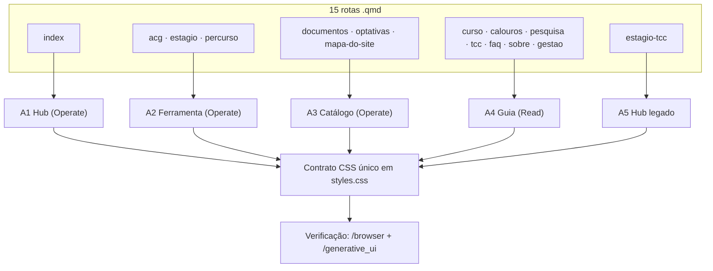
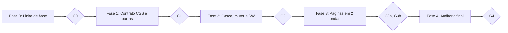

# Super App CAGP UFMG — Plano Mestre v2

* **Author:** Gestão CAGP UFMG & Assistente de Design (`/grill-me` + revisão `/egm` de 2026-10-29)
* **Status:** Draft v2.1 — revisado por 6 lentes `/egm` (design, zoom-out, codebase, estrutura, compreensão, prontidão); aguardando aprovação da Gestão CAGP
* **Date:** 2026-10-29
* **Substitui:** [modernizacao_superapp_cagp.md](file:///home/gsathler/Nextcloud/Projects/cagp/_designs/modernizacao_superapp_cagp.md) (v1). Precedência na §6.3.
* **Decisões travadas herdadas:** [concepts_brief.md](file:///home/gsathler/Nextcloud/Projects/cagp/_designs/concepts_brief.md)
* **Evidências empíricas de origem:** [diagnostico_auditoria.md](file:///home/gsathler/Nextcloud/Projects/cagp/_designs/diagnostico_auditoria.md)
* **Revisões do v1 (arquivadas):** [arquivo_v1/](file:///home/gsathler/Nextcloud/Projects/cagp/_designs/arquivo_v1)

---

## 1. Overview

O **Super App CAGP UFMG** é um PWA estático (Quarto) do Centro Acadêmico de Gestão Pública (CAGP) da FAFICH/UFMG, com **15 rotas = 14 ativas + 1 hub legado** (`estagio-tcc`). Atende estudantes do Bacharelado noturno, majoritariamente em Android de entrada e rede instável.

O v1 especificou a casca global e 4 páginas (`index`, `acg`, `documentos`, `percurso`). O v2:

1. estende as decisões travadas às **15 rotas**, agrupadas em **5 arquétipos de página**;
2. amplia "formato" de 4 larguras para **7 eixos** (§6.8), verificados em **3 camadas** (152 células exatas);
3. substitui o Playwright por **`/browser`** (medição empírica) e **`/generative_ui`** (protótipo e relatório final);
4. substitui "skills por fase" por **roteamento de skills** com tarefas únicas e caminhos validados (§6.7);
5. é um **delta sobre o working tree**, que já contém boa parte do v1 (§6.4).

### 1.1 Glossário

| Termo | Significado |
| :--- | :--- |
| CAGP / FAFICH / UFMG | Centro Acadêmico de Gestão Pública / Faculdade de Filosofia e Ciências Humanas / Universidade Federal de Minas Gerais |
| DCP | Departamento de Ciência Política (disciplinas `DCP 089`, `DCP 135`…) |
| DRCA | Departamento de Registro e Controle Acadêmico (UFMG) |
| AAC / ACG | Atividades Acadêmicas Complementares. O curso diz AAC; a rota (`acg`) e alguns rótulos dizem ACG. **É o mesmo tema.** |
| Extensão / "600h" | 300h de Extensão + 300h de AAC, a integralizar |
| N-20229 | Código de versão do PPC/Regulamento do curso. O "Requerimento N-20229" é o formulário oficial (PDF) de crédito de atividade integralizadora |
| Guardião de 120 Dias | Ferramenta de `acg` que monitora o prazo de 120 dias corridos para protocolar certificados |
| Art. 41 | Regra de dispensa de Estágio Supervisionado (300h = `DCP 135` 180h + `DCP 136` 120h) |
| TCE / TCC / IC | Termo de Compromisso de Estágio / Trabalho de Conclusão de Curso / Iniciação Científica |
| RU II, RREO, FUMP | Restaurante Universitário II / Relatório Resumido da Execução Orçamentária / Fundação Universitária Mendes Pimentel (assistência estudantil) |
| Espelho | Folha-resumo sintética do N-20229 gerada no navegador; **removida** (decisão travada) |
| Brite | Tema Bootswatch usado como base visual do Quarto |
| PWA *standalone* | Site instalado na tela inicial, aberto sem barra do navegador |
| WebView | Navegador embutido em outro app (Instagram, WhatsApp) |
| *lie-fi* | Rede que parece conectada mas não entrega dados |
| Service Worker (SW) | Script do navegador que serve cache offline (`sw.js`) |
| Sub-view | Aba interna de uma página (`.cagp-workspace-view`) |
| N | Quantidade de sub-views reais de uma página, **sem** contar "Ver Tudo" |
| Ledger | Tabela item-a-item do estado atual (feito / parcial / pendente) com comando de verificação (§6.4) |
| Gate | Ponto de parada ao fim de uma fase (§9.1) |

### 1.2 Decisões travadas (não reabertas)

| Decisão | Significado |
| :--- | :--- |
| Sem espelho N-20229 | Nenhum gerador client-side; links diretos para os formulários oficiais |
| Controle Segmentado | Sub-views 100% visíveis, sem rolagem horizontal |
| Brite Institucional Refinado | Oswald em caixa-alta, bordas `1px`; borda `2px` + sombra dura só em ação primária, aba ativa e modal |
| 5 Eixos 1:1 | Mesmos 5 itens (`Hoje · Curso · Currículo · Acervo · O CAGP`) na barra inferior mobile, PWA e menu desktop |
| Zero Supressão Factual | Nenhum dado normativo (ementas, artigos, telefones, e-mails, salas, cargas) é removido ou resumido; texto longo vai para `<details>` |
| 9 chaves `localStorage` | Única superfície de backup `CAGP1:...` (tabela na §6.6) |
| Estático e offline | Sem servidor; funciona sem internet via SW |

### 1.3 Convenções de siglas

`A1–A5` arquétipos · `Camada A/B/C` profundidade de verificação · `Anexo A/B/C` anexos do documento · `F1–F7` eixos de formato · `M1–M8` métricas · `T01–T10` tarefas · `G0–G4` gates · `Fase 0–4` fases · `v1`/`v2` versões do plano (nunca confundir com `vN` de sub-view, sempre escrito `ws-panel-vN` ou "sub-view N") · `E1–E12` itens da errata.

### 1.4 Ferramentas e agentes

* **Skills:** pastas em `.agents/skills/<nome>/` (`SKILL.md` + `references/`); o agente lê antes da tarefa. `impeccable` tem 4 modos (Operate, Read, Persuade, Experience); o arquétipo da página determina o modo.
* **`/browser`:** subagente que controla um navegador real, executa JS na página e devolve resultados.
* **`/generative_ui`:** skill que gera artefatos HTML interativos autocontidos ([SKILL.md](file:///home/gsathler/.gemini/antigravity/builtin/skills/generative_ui/SKILL.md)).
* **`/egm-*`:** subagentes de revisão por lente; usam as skills do modo correspondente.
* **Aprovador humano:** a Gestão CAGP (mantenedor do repositório) registra `aprovado` em `_designs/evidencias_v2/gates.md`.

---

## 2. Problem Statement (The Problem)

A revisão `/egm` e a leitura do código mostraram lacunas no v1:

1. **Cobertura parcial.** 10 das 15 rotas (`curso`, `calouros`, `pesquisa`, `optativas`, `estagio`, `tcc`, `faq`, `sobre`, `gestao`, `mapa-do-site`) não têm regra de sub-views, 1ª dobra e contenção; a 15ª (`estagio-tcc`) é um hub com conteúdo.
2. **Premissa de 3 abas.** O v1 usa `repeat(3, 1fr)`. No código: `curso` e `calouros` têm **N=4**; `index`, `pesquisa`, `percurso`, `acg`, `documentos`, `sobre`, `gestao` têm N=3; `optativas`, `estagio`, `tcc`, `faq`, `mapa-do-site` têm N=2. Todas têm "Ver Tudo" (`__all__`).
3. **Metas de 1ª dobra aritmeticamente inviáveis** com Ver Tudo em linha separada e cabeçalhos de 3–5 badges + subtítulo de 3–4 linhas (§6.5.1).
4. **Formatos limitados a 4 larguras.** Sem PWA standalone, WebView, orientação, preferências, mídia de saída, entrada, gestos e animações.
5. **Playwright.** Decisão desta rodada: `/browser` + `/generative_ui`.
6. **Ledger do v1 desconhecido e `PRODUCT.md`/`DESIGN.md`/`AGENTS.md`/`RELATORIO.md`/`.impeccable/` ausentes do disco.**
7. **Caminhos de skills inválidos no v1** (exemplos na errata E5) e os *modes* do `impeccable` ignorados.
8. **Bugs reais que o v1 não cobre:** `popstate` do router pode prender o botão Voltar; `cagpRouteProgress.done()` não existe; escala de fonte 125%/150% é código morto; viewport standalone bloqueia zoom; `cagp_a11y_prefs` legada ainda é gravada; contagem "8 PDFs" vs "9 PDFs" divergente; DOCX do TCC é link externo (falha offline).
9. **Artefatos de teste na saída publicada:** `docs/tests/node_modules`.

---

## 3. Goals & Non-Goals

### 3.1 Goals

* **Goal 1 (Site inteiro):** As 15 rotas seguem regras explícitas de cabeçalho único, sub-views, 1ª dobra, contenção e impressão (§6.5, §6.6).
* **Goal 2 (Multiformato):** Verificação rota × formato em 3 camadas com 152 células exatas (§6.8).
* **Goal 3 (Sem Playwright):** `/browser` mede com script versionado; `/generative_ui` entrega 1 protótipo e o relatório final (§6.9).
* **Goal 4 (Roteamento de skills):** Cada tarefa tem skill + referência com caminho validado por script (§6.7).
* **Goal 5 (Delta rastreável):** Ledger com comando de verificação por item (§6.4).

### 3.2 Non-Goals

* **Non-Goal 1 (Sem reabertura):** Decisões da §1.2 não são reabertas.
* **Non-Goal 2 (Sem tema escuro):** Apenas comportamento defensivo (`color-scheme: light`; critério F4 na §6.8.3).
* **Non-Goal 3 (Sem Playwright):** Nenhuma suíte, `package.json` de teste ou dependência Node de teste.
* **Non-Goal 4 (Sem automação de hardware real):** VoiceOver, TalkBack, WebView do Instagram/WhatsApp, caneta e densidade real vão ao Anexo C.
* **Non-Goal 5 (Sem alteração de conteúdo normativo):** Exceção autorizada: corrigir inconsistências numéricas visíveis (ex.: "8 PDFs" → "9 PDFs", T04).
* **Non-Goal 6 (Sem novos níveis de fonte):** A UI tem 4 níveis (`data-a11y-font` = `sm|md|lg|xl`, 90–130%). 125%/150% não serão criados; F4 testa `lg`, `xl` e zoom 200%.

---

## 4. Open Questions

Nenhum bloqueio; valores padrão adotados:

| # | Questão | Padrão adotado | Quem reverte |
| :-: | :--- | :--- | :--- |
| OQ-1 | `/browser` não emula um recurso (standalone, offline, throttling, toque) | Fallback documentado na Fase 0; sem fallback → Anexo C | Gestão CAGP |
| OQ-2 | Hospedar DOCX local? `tcc.qmd` aponta o DOCX para o portal da FAFICH (falha offline) e `acg` só tem PDF do N-20229 | Manter link externo com rótulo "(requer internet)" e PDF local; Gestão pode fornecer os DOCX para `documentos/` | Gestão CAGP |
| OQ-3 | Imagem Open Graph por rota ou única | Uma imagem padrão `imagens/og-padrao.png` (1200×630, `< 300 KB`, derivada de `logos/cagp/`) + `title`/`description` por rota | Gestão CAGP |

---

## 5. Critical User Journeys (CUJs)

Os [CUJs 1 a 3 do v1](file:///home/gsathler/Nextcloud/Projects/cagp/_designs/modernizacao_superapp_cagp.md) continuam válidos (Calouro em `documentos` offline; calculadora 600h; PWA standalone com 5 Eixos).

### CUJ 4: Calouro abre um guia com fonte ampliada e Alto Contraste
* **Given**: Android `360×640px` útil, `data-a11y-font="xl"` (130%) e Alto Contraste, em `calouros.html`.
* **When**: A página carrega.
* **Then**: As 4 sub-views (`Checklist · Rotina · FAFICH · FUMP`) estão visíveis em grade 2×2 + botão Ver Tudo `44×44px` na mesma faixa, sem rolagem horizontal; o primeiro item do checklist está em `y < 340px`; alvos `>= 44×44px`; texto `#FFFF00` sobre `#000000`. Verificado por: células C `font-xl` e `contrast` (Camada B, `calouros`).

### CUJ 5: Estudante abre o link recebido no WhatsApp
* **Given**: Link aberto na WebView do WhatsApp ou Instagram.
* **When**: A página carrega.
* **Then**: A navegação dos 5 Eixos funciona; não existe botão que chame `window.print()` (`grep` na Fase 0 = 0 ocorrências); a pré-visualização do link mostra título, descrição e imagem. Verificado por: critério OG (F5) e Anexo C1 e C7.

### CUJ 6: Estudante usa tablet em Split View
* **Given**: Janela `507×800`.
* **When**: Abre `documentos.html` e redimensiona a janela.
* **Then**: Vale a faixa `320–767px` (1 coluna, barra inferior); ao passar de `768px` as abas ganham rótulos completos sem recarregar. Verificado por: células C `507×800` e `1024×768` (`documentos`).

---

## 6. Technical Plan (Architecture)

### 6.1 Arquitetura herdada (Anexo A)

Especificações por arquivo da casca, `index`, `acg`, `documentos`, `percurso` e `sw.js` estão em [modernizacao_superapp_cagp.md](file:///home/gsathler/Nextcloud/Projects/cagp/_designs/modernizacao_superapp_cagp.md) (v1: *Technical Plan › §3 Detalhamento dos 5 Pilares* e *Detailed Implementation Plan › §3 Especificação Técnica Detalhada por Arquivo*). Este plano não as repete; só corrige (§6.3) e estende.

### 6.2 Modelo de trabalho por arquétipo



Todo arquétipo consome **um único contrato CSS** (§6.5). Nenhuma página recebe CSS próprio para o que o contrato cobre.

### 6.3 Precedência v1/v2 e Errata do v1

**Cláusula:** em qualquer divergência vale o v2. Do v1 vale apenas o código e os passos por arquivo de *Detailed Implementation Plan › §3*, com as correções abaixo. **Ignorar do v1:** Fases 1–4 e seus checkpoints, "Skills Vinculadas", Risks, Alternatives, itens 13–14 (Playwright).

| ID | Onde no v1 | Correção |
| :-: | :--- | :--- |
| E1 | `repeat(3, 1fr)` (styles.css) | Grade por N com `data-tab-count` + Ver Tudo fora do `tablist` na mesma faixa (§6.5.2). O CSS atual já tem `repeat(3, …)` e `[data-ws-tab="__all__"]` em `1 / -1` (styles.css ≈ `9944-9980`): substituir. |
| E2 | `data-label-short` só `<320px` ou `font-scale` | Rótulo curto em **toda** largura `< 768px` (§6.5.3). |
| E3 | Rótulos de `documentos` (`Acervo (9 PDFs)`…) | Usar os rótulos reais do código (`Atos`, `Formulários`, `Mudança Percurso`; curtos `Atos`, `Formulários`, `DRCA`). |
| E4 | Fase 4 e itens 13–14 (Playwright) | Revogados. Arquivos reais a remover: `tests/audit_fase1_browser.cjs`, `tests/audit_fase2_browser.cjs`, `tests/package-lock.json`, `tests/node_modules/`, `tests/test-results/`, `docs/tests/`. |
| E5 | Referências de skills com `references/` em `impeccable`; "m3-expressive/references/containment.md"; "impeccable/references/routing.md" (menu de comandos, não SPA) | Caminhos corretos na §6.7. Grafados aqui sem crases de propósito: **não coloque crases nesses dois caminhos**, o Passo 0 os acusaria. |
| E6 | `@media print` | Mantém "imprime a sub-view ativa". Dica `.cagp-print-hint` **visível só na tela**. Ocultar também: banner (`#quarto-announcement`), `.cagp-skip-links`, painéis `#cagp-a11y-*`, `.cagp-axis-pill-strip`, `#cagp-route-progress-bar`. |
| E7 | `data-a11y-font-scale="1.25"/"1.5"` | Atributo real: `data-a11y-font` (`sm|md|lg|xl`). Remover o CSS morto (styles.css ≈ `10016-10024`) e a leitura morta no router (≈ `260`, `278`). |
| E8 | "Implementar hash bidirecional" | Já existe (`cagpActivateWorkspaceView` com `updateHash`, `cagpSyncWorkspaceFromHash`, `hashchange` em `super-app-header.html`). Pendência real: `data-ws-hash` ausente nos botões `__all__` de `index`, `optativas`, `faq`, `sobre`, `mapa-do-site`, `gestao`. |
| E9 | `estagio-tcc` "redirecionamento de compatibilidade" | É um hub com conteúdo normativo (Zero Supressão): **manter conteúdo** e `data-cagp-redirect`; acrescentar `noindex`. Sem `<meta refresh>` (a SPA não o executa). |
| E10 | `$cagp-red: #9e2424` e `#8b1e2d` no mesmo v1 | Primário único: **`#8B1E2D`**. |
| E11 | Matriz responsiva do v1 (tablet de 2 colunas 768–1024) | Tabela de breakpoints da §6.5.5 prevalece. |
| E12 | SW: "implantar `AbortController` 1500ms e 503" | Já existem (`sw.js`, `CACHE_NAME 'cagp-pwa-v5'`). Pendências reais na T04. |

### 6.4 Ledger de estado atual

Verificado por **leitura de código** em 2026-10-29. A Fase 0 reconfirma cada linha com o comando da coluna "Verificação" e grava `_designs/evidencias_v2/fase0/ledger.md` (uma linha por item). `feito` = comando passa; `parcial` = presente mas alguma métrica falha; `pendente` = ausente.

| Item | Estado lido | Verificação |
| :--- | :--- | :--- |
| `CAGP_TAXONOMY_V1` em [super-app-header.html](file:///home/gsathler/Nextcloud/Projects/cagp/_includes/super-app-header.html) | feito | `grep -c CAGP_TAXONOMY_V1` ≥ 1 |
| `.cagp-axis-pill-strip` dinâmico (depth > 0) | feito | `grep -c cagp-axis-pill-strip` ≥ 1 |
| Banner compacto (`cagpToggleChapaBanner`, `.is-compact`) | parcial (confirmar altura `36px`) | `/browser` M3 no banner |
| Hash de sub-views (header) | parcial (falta `data-ws-hash` em `__all__`, E8) | `grep -L 'data-ws-hash.*__all__\|__all__.*data-ws-hash' *.qmd` |
| Taxonomia em [super-app-router.html](file:///home/gsathler/Nextcloud/Projects/cagp/_includes/super-app-router.html) | parcial: `DEFAULT_FALLBACK_TAXONOMY` e `ROUTE_META` divergem (T04) | leitura |
| [pwa-install.html](file:///home/gsathler/Nextcloud/Projects/cagp/_includes/pwa-install.html): barras unificadas, 2 toques, CRC32, `escapeHtml` | pendente (0 ocorrências de `CAGP_TAXONOMY_V1`) | `grep -c` |
| [acg.qmd](file:///home/gsathler/Nextcloud/Projects/cagp/acg.qmd): espelho removido, `#cagp-calc-hud-linear`, Fenced Divs com ARIA | feito | `grep -c n20229-print-sheet` = 0 |
| [documentos.qmd](file:///home/gsathler/Nextcloud/Projects/cagp/documentos.qmd): `#cagp-offline-status-strip`, Fenced Divs | feito | `grep -c cagp-offline-status-strip` ≥ 1 |
| [percurso.qmd](file:///home/gsathler/Nextcloud/Projects/cagp/percurso.qmd), [index.qmd](file:///home/gsathler/Nextcloud/Projects/cagp/index.qmd): ids `ws-tab-vN`, spans full/short, Fenced Div | parcial (faltam `<details>` do callout e roving tabindex em `percurso`; Bento já usa `row-cols-lg-5`) | `grep` |
| 10 demais `.qmd` (`curso`, `calouros`, `pesquisa`, `optativas`, `estagio`, `tcc`, `faq`, `sobre`, `gestao`, `mapa-do-site`) | pendente: spans simples (sem full/short), sem `ws-tab-vN`, painéis HTML crus, `__all__` dentro do `tablist` | `grep -c cagp-tab-label-short` = 0 |
| [sw.js](file:///home/gsathler/Nextcloud/Projects/cagp/sw.js): `cagp-pwa-v5`, timeout 1500ms, 503 para PDF | feito | `grep -n "1500\|503\|pwa-v5"` |
| [_quarto.yml](file:///home/gsathler/Nextcloud/Projects/cagp/_quarto.yml): `brand`, `theme: [brand, _variables.scss]` | feito; sem `open-graph`/`twitter-card` | `grep` |
| `styles.css`: `@media print` (≈ `9643`), `.cagp-workspace-bar` (≈ `9881`) | parcial: grade de 3 colunas e bordas `2px` + sombra dura em abas inativas (≈ `10057`) | localizar **por conteúdo**, não por linha |
| `_designs/arquivo_v1/*` e SUPERSEDED no v1 | feito | `ls _designs/arquivo_v1` |
| `PRODUCT.md`, `DESIGN.md`, `AGENTS.md`, `RELATORIO.md`, `.impeccable/` | ausentes do disco | `git cat-file -e HEAD:<arquivo>` |

### 6.5 Especificação por arquétipo

#### 6.5.1 Matriz de arquétipos e metas de 1ª dobra

Referência de medição: **`360×640`** (viewport útil de Chrome Android, já descontada a barra do navegador). Barra inferior ocupa ≈ `64px`.

| Arq. | Modo `impeccable` | Rotas | Metas (`360×640`) |
| :-: | :-: | :--- | :--- |
| A1 Hub | Operate | `index` | 1º acesso de eixo em `y <= 300` |
| A2 Ferramenta | Operate | `acg`, `estagio`, `percurso` | topo da barra de sub-views `<= 200`; 1º controle interativo `<= 300` |
| A3 Catálogo | Operate | `documentos`, `optativas`, `mapa-do-site` | topo da barra `<= 200`; campo de busca/filtro `<= 300` (exceção `mapa-do-site`: 1º link `<= 300`, sem campo de busca) |
| A4 Guia | Read | `curso`, `calouros`, `pesquisa`, `tcc`, `faq`, `sobre`, `gestao` | topo da barra `<= 200`; 1º bloco substantivo `<= 300` |
| A5 Hub legado | — | `estagio-tcc` | conteúdo preservado; 1º botão `<= 300` |

Relaxamento: em N=4 com grade 2×2 (`< 320px` ou `data-a11y-font="lg|xl"`), 1º controle `<= 340`.

Para cumprir `<= 200`: abaixo de `768px`, **badges e subtítulo** do `.cagp-workspace-header` vão para um `<details class="cagp-normative-details">` com `<summary>` ("Sobre esta página"). Nada é removido do DOM. Breadcrumbs ficam ocultos.

#### 6.5.2 Controle Segmentado por N

Estrutura (todas as 15 rotas; **o `.cagp-workspace-bar` é a grade**):

```html
<div class="cagp-workspace-bar">
  <div class="cagp-workspace-tabs" role="tablist" data-tab-count="3">
    <button type="button" class="cagp-workspace-tab is-active" role="tab" id="ws-tab-v1" aria-controls="ws-panel-v1" aria-selected="true" tabindex="0" data-ws-tab="v1" data-ws-hash="#calculadora-horas">
      <span class="cagp-tab-label-full">Calculadora 600h</span>
      <span class="cagp-tab-label-short" aria-hidden="true">Calculadora</span>
    </button>
    <!-- ... demais sub-views (tabindex="-1" nas inativas) ... -->
  </div>
  <button type="button" class="cagp-workspace-viewall" aria-pressed="false" aria-label="Ver tudo" data-ws-tab="__all__" data-ws-hash="#visao-completa"><i class="bi bi-layout-text-sidebar" aria-hidden="true"></i></button>
</div>
```

```css
.cagp-workspace-bar { display: grid; grid-template-columns: minmax(0, 1fr) 44px; gap: .25rem; padding: .25rem; border: 1px solid #DFDBD2; }
.cagp-workspace-bar-label { display: none; }
.cagp-workspace-tabs { display: grid; grid-template-columns: repeat(var(--cagp-n, 3), minmax(0, 1fr)); gap: .25rem; overflow: visible; }
.cagp-workspace-tabs[data-tab-count="2"] { --cagp-n: 2; }
.cagp-workspace-tabs[data-tab-count="3"] { --cagp-n: 3; }
.cagp-workspace-tabs[data-tab-count="4"] { --cagp-n: 4; }
.cagp-workspace-tab { min-width: 0; min-height: 44px; padding: .35rem .2rem; font-size: .72rem; text-align: center; overflow-wrap: anywhere; hyphens: auto; border: 1px solid #DFDBD2; box-shadow: none; touch-action: manipulation; }
.cagp-workspace-tab.is-active { border: 2px solid #0A0A0A; box-shadow: 2px 2px 0 #0A0A0A; }
.cagp-workspace-viewall { min-width: 44px; min-height: 44px; }
.cagp-tab-label-full { display: none; }
.cagp-tab-label-short { display: inline; }
.cagp-workspace-tab-badge, .cagp-ws-badge { display: none; }
@media (max-width: 319.98px) { .cagp-workspace-tabs[data-tab-count="4"] { --cagp-n: 2; } .cagp-workspace-tab { font-size: .6875rem; } }
html[data-a11y-font="lg"] .cagp-workspace-tabs[data-tab-count="4"],
html[data-a11y-font="xl"] .cagp-workspace-tabs[data-tab-count="4"] { --cagp-n: 2; }
@media (min-width: 768px) {
  .cagp-workspace-bar { grid-template-columns: minmax(0, 1fr) auto; }
  .cagp-workspace-tabs { display: flex; flex-wrap: wrap; }
  .cagp-tab-label-full { display: inline; } .cagp-tab-label-short { display: none; }
  .cagp-workspace-tab-badge, .cagp-ws-badge { display: inline-block; }
}
```

* Sem `:has()` (WebViews Android antigas): N vem do atributo `data-tab-count`, emitido estático em cada `.qmd`.
* O nome acessível é o texto visível (o rótulo oculto usa `display: none`); **sem `aria-label` nas abas** (WCAG 2.5.3).
* "Ver Tudo" **sai do `tablist`**, não usa `role="tab"` nem `.cagp-workspace-tab`; o router (T02) o trata explicitamente: clique, `aria-pressed`, hash `#visao-completa`; setas ←/→ circulam só entre abas reais; roving tabindex (`tabindex="-1"` nas inativas).
* Seletores do contrato do roteador preservados: `.cagp-workspace-bar`, `.cagp-workspace-tab[data-ws-tab]`, `.cagp-workspace-tab.is-active`, `.cagp-workspace-view[data-ws-view]`, `window.cagpActivateWorkspaceView(tabKey, opts)` (opções reais: `container`, `updateHash`; a opção `scroll` é ignorada, não usar).
* Remover as regras `!important` conflitantes do bloco móvel antigo (styles.css ≈ `9909-9980`) e o `dispatchEvent('resize')` a cada troca de sub-view (`super-app-header.html` ≈ `726-728`; disparar só para o grafo SVG de `percurso`, com evento próprio).

#### 6.5.3 Rótulos completos e curtos

Limite de caracteres do rótulo curto: N=2 → 14; N=3 → 11; N=4 → 9. O prefixo numérico (`1.`) e os badges só aparecem `>= 768px`. Rótulos completos ficam como estão no código. Curtos:

| Rota (N) | Curtos, na ordem das sub-views |
| :--- | :--- |
| `index` (3) | Hoje · Apps · CAGP (já no código) |
| `curso` (4) | Visão · Egressos · Colegiado · Ingresso |
| `calouros` (4) | Checklist · Rotina · FAFICH · FUMP |
| `pesquisa` (3) | Núcleos · Iniciação · Imersão |
| `percurso` (3) | Grafo · Ementas · Percursos (já no código) |
| `optativas` (2) | Catálogo · Formação Livre |
| `acg` (3) | Calculadora · 120 dias · Guia |
| `estagio` (2) | Art. 41 · Tutorial |
| `tcc` (2) | Modalidades · Termo e Banca |
| `documentos` (3) | Atos · Formulários · DRCA |
| `faq` (2) | Perguntas · Acessibilidade |
| `sobre` (3) | Princípios · Governança · Esferas |
| `gestao` (3) | Organograma · Equipe · Contas |
| `mapa-do-site` (2) | Árvore · Atalhos |

#### 6.5.4 Regras comuns

1. **Cabeçalho único:** 1 `<h1>` visível por rota; sem `##` repetindo o título; sem `<h3>` duplicado em `.cagp-tool-header`.
2. **Texto longo** (`> 60 palavras` antes do 1º controle) → `<details class="cagp-normative-details">`. O `<summary>` usa as primeiras 8 palavras do título/primeira frase **originais**; nunca texto inventado.
3. **Contenção:** borda estrutural `1px solid #DFDBD2`; borda `2px` e sombra dura `2px 2px 0 #0A0A0A` só em `.cagp-btn-primary`, aba ativa e modal aberto. Reescrever a base atual (abas inativas e cabeçalho com borda `2px` + sombra dura, styles.css ≈ `9912`, `10057`).
4. **Painéis:** nas rotas já migradas (`acg`, `documentos`, `percurso`, `index`) manter Fenced Divs `::: {#ws-panel-vN .cagp-workspace-view role="tabpanel" aria-labelledby="ws-tab-vN" data-ws-view="vN" hidden="true"}` (a 1ª sub-view **não** leva `hidden`). Nas outras 10 rotas, **não converter**: acrescentar apenas `id`, `role="tabpanel"`, `aria-labelledby` ao `<div>` HTML cru existente (menos risco de desbalanceamento). Manter o wrapper `.cagp-workspace-deck` onde existe (`index`, `mapa-do-site`).
5. **Sem JS:** `<noscript><style>.cagp-workspace-view[hidden]{display:block!important}</style></noscript>` em `_includes/pwa-meta.html`.
6. **Impressão:** conforme E6.
7. **Alvos de toque** `>= 44×44px`, `touch-action: manipulation`; corrigir os conhecidos abaixo disso: `.cagp-header-live-btn` (`min-height: 36px`), botões `btn-sm` em `documentos.qmd` ("Sincronizar") e no sheet do header.
8. **Palavras longas:** `overflow-wrap: anywhere; hyphens: auto` em títulos, ementas e nomes de colegiado.

#### 6.5.5 Breakpoints

| Faixa | Layout |
| :--- | :--- |
| `< 320px` | Mobile; N=4 em 2×2; fonte da aba `.6875rem` |
| `320–767.98px` | Mobile: barra inferior, rótulos curtos, N em 1 linha (2×2 se `data-a11y-font` = `lg`/`xl` e N=4). Foldable aberto (`~700px`) usa esta faixa |
| `768–991.98px` | Tablet retrato: rótulos completos, **barra inferior mantida**, 2 colunas em listas e grades |
| `>= 992px` | Desktop: barra superior com dropdowns dos 5 Eixos, barra inferior oculta |

### 6.6 Especificação por página

Estado das chaves `localStorage` (tabela única):

| Chave | Status | No backup? | Observação |
| :--- | :-: | :-: | :--- |
| `cagp_calc_ext_aac_v1` | canônica | sim | `acg` |
| `cagp_aac_120d_certs_v1` | canônica | sim | `acg` |
| `cagp_notifications_prefs_v1` | canônica | sim | sino do campus |
| `cagp_calouro_checklist_v1` | canônica | sim | `calouros` |
| `cagp_percurso_quiz_v1` | canônica | sim | `percurso` |
| `cagp_minha_grade_v1` | canônica | sim | `percurso`, `optativas` |
| `cagp_art41_checklist_v1` | canônica | sim | `estagio` |
| `cagp_a11y_prefs_v2` | canônica | sim | `accessibility.html` |
| `cagp_student_profile_v1` | canônica | sim | Passaporte |
| `cagp_onboard_v1_dismissed` | efêmera de UI | não | não é apagada por "Limpar dados" |
| `cagp_a11y_prefs` | **legada, ainda gravada** (`accessibility.html`, `savePrefs`) | não | T05: parar de gravar; manter só leitura de fallback (`pwa-meta.html`) |
| `cagp_percurso_quiz_resultado`, `cagp_calouros_checklist`, `cagp_acg_total_horas` | legadas, só leitura de fallback (`pwa-install.html`) | não | sem migração nova; "Limpar dados" remove também as 4 legadas |

Desvios por rota (o que o arquétipo não cobre):

| Rota | Arq. | N | Desvios e tarefas |
| :--- | :-: | :-: | :--- |
| `index` | A1 | 3 | Hero compacto; pílulas RU II e Circular; Bento já usa `row-cols-lg-5` (**não criar `col-lg-2-4`**); completar `data-ws-hash` em `__all__` |
| `acg` | A2 | 3 | v1 item `acg.qmd`; aba 3: PDF local do N-20229 + DOCX conforme OQ-2 + checklist protocolar (Sala F-2039); limpar listeners em `cagp:navigated` |
| `estagio` | A2 | 2 | Simulador Art. 41 com 1º controle `<= 300`; tutorial TCE em `<details>`; lista de modelos conforme `documentos/` |
| `percurso` | A2 | 3 | v1 item `percurso.qmd`: callout de 145 palavras em `<details>`; roving tabindex no grafo SVG; as 28 `<details>` de ementas mantidas |
| `documentos` | A3 | 3 | v1 item `documentos.qmd` com E3; busca: chamar `window.cagpActivateWorkspaceView('v2')` no contrato real (E-sem `scroll`) |
| `optativas` | A3 | 2 | 68 `<details>` recolhidos; filtro/busca no topo; lista 1 coluna `< 768`, 2 colunas `768+`, 3 colunas `1280+` |
| `mapa-do-site` | A3 | 2 | Contagem "14 Páginas" (hoje fixa no HTML) conferida contra `CAGP_TAXONOMY_V1` por `grep` no G3b; árvore estática gerada no build (não depende de JS) |
| `curso` | A4 | 4 | `fig-alt` nos gráficos (skill `alt-text`); tabela de salários com `overflow-x: auto` **só no contêiner da tabela** |
| `calouros` | A4 | 4 | Checklist `<= 340` (2×2) ou `<= 300`; links `tel:` |
| `pesquisa` | A4 | 3 | Núcleos em lista; IC (90h AAC) com link a `acg.html#calculadora-horas` (conferir o hash real do manifest: `acg.html#calculadora`) |
| `tcc` | A4 | 2 | Termo de Aceite: PDF local; DOCX externo conforme OQ-2 |
| `faq` | A4 | 2 | Perguntas em `<details>`; preservar o âncora `faq.html#acessibilidade` (usado no rodapé de `_quarto.yml`) |
| `sobre` | A4 | 3 | Artigos 1º–8º e 20–45 integrais em `<details>`; 7 `<details>` existentes ganham `<summary>` curto |
| `gestao` | A4 | 3 | Organograma em lista hierárquica **só se** a fonte textual existir no `.qmd`; senão manter a imagem com `fig-alt` |
| `estagio-tcc` | A5 | 0 | Conforme E9; `noindex` via `include-in-header` no front matter; flag `isLegacyBridge` (nome da taxonomia) fora da contagem "14" e dos 5 Eixos |

Textos novos (resumos de `<details>`, `fig-alt`, `.cagp-print-hint`) seguem a regra da §6.5.4 item 2; `fig-alt` descreve o dado já presente na página, sem acrescentar fatos.

### 6.7 Roteamento de skills

Caminhos relativos a `.agents/skills/`. **Regra de precedência:** ler a referência da **tarefa** (§6.7.2); o nível por modo (§6.7.1) fornece só a base. Antes de editar UI, ler `impeccable/reference/craft-floor.md` e rodar `impeccable context` (launcher: `.agents/skills/impeccable/scripts/impeccable context`, na raiz do projeto).

#### 6.7.1 Passo 0 — validação de caminhos (Fase 0 e G4)

Script versionado `_designs/evidencias_v2/passo0.sh`:

```bash
#!/usr/bin/env bash
set -euo pipefail
root="$(git rev-parse --show-toplevel)"
plan="$root/_designs/plano_mestre_superapp_cagp.md"
paths="$(grep -o '`\(impeccable\|apple-design\|m3-expressive\|quarto-authoring\|brand-yml\|alt-text\)/[^`]*\.md`' "$plan" | tr -d '`' | sort -u)"
[ "$(printf '%s\n' "$paths" | wc -l)" -ge 40 ] || { echo "POUCOS CAMINHOS"; exit 1; }
bad=0
while read -r p; do [ -f "$root/.agents/skills/$p" ] || { echo "AUSENTE: $p"; bad=1; }; done <<< "$paths"
exit $bad
```

Critério: código de saída `0`.

#### 6.7.2 Modo por arquétipo (base)

| Arq. | Modo e base | Tarefas |
| :-: | :--- | :--- |
| Casca global | Operate: `impeccable/reference/mode-operate.md` | T01, T04, T05, T06, T08, T09 |
| A1 / A2 / A3 | Operate: `impeccable/reference/mode-operate.md`, `impeccable/reference/layout.md` | T01, T02, T03, T05, T07, T08 |
| A4 | Read: `impeccable/reference/mode-read.md`, `impeccable/reference/typeset.md` | T01, T02, T03, T05, T10 |
| A5 | `impeccable/reference/harden.md` | T09 |

#### 6.7.3 Tarefas (fonte única de roteamento)

| ID | Tarefa (antigas) | Fase | Skill → referência |
| :-: | :--- | :-: | :--- |
| T01 | Tokens, `!default`, contenção, bordas | 1 | `brand-yml/references/quarto.md`, `brand-yml/references/brand-yml-spec.md`; `impeccable/reference/colorize.md`, `impeccable/reference/quieter.md`; `m3-expressive/references/tokens.md`, `m3-expressive/references/color.md`, `m3-expressive/references/shape.md`, `m3-expressive/references/components/containment.md` |
| T02 | Barra de sub-views por N, rótulos, Ver Tudo, migração das 15 rotas | 1 | `apple-design/references/hig/segmented-controls.md`; `impeccable/reference/layout.md`, `impeccable/reference/adapt.md`; `m3-expressive/references/components/navigation.md` |
| T03 | Cabeçalho único, `<details>`, painéis ARIA | 1, 3 | `impeccable/reference/typeset.md`, `impeccable/reference/distill.md`; `quarto-authoring/references/divs-and-spans.md`; `apple-design/references/hig/disclosure-controls.md` |
| T04 | Casca, PWA e SW (banner, barra inferior, Avatar, sino, SW, CRC32, 2 toques, router) | 2 | `apple-design/references/hig/tab-bars.md`, `apple-design/references/hig/sheets.md`, `apple-design/references/hig/alerts.md`, `apple-design/references/hig/notifications.md`, `apple-design/references/hig/privacy.md`, `apple-design/references/hig/loading.md`; `m3-expressive/references/platforms.md`, `m3-expressive/references/components/bars.md`, `m3-expressive/references/components/feedback.md`; `impeccable/reference/harden.md`, `impeccable/reference/optimize.md` |
| T05 | A11y e preferências (Alto Contraste, dislexia, fonte, leitor de tela, dark defensivo, zoom) | 1, 2 | `apple-design/references/hig/accessibility.md`, `apple-design/references/hig/inclusion.md`, `apple-design/references/hig/voiceover.md`, `apple-design/references/hig/dark-mode.md`; `impeccable/reference/audit.md` |
| T06 | Movimento e gestos | 1, 2 | `apple-design/references/hig/motion.md`, `apple-design/references/hig/gestures.md`; `m3-expressive/references/motion.md`, `m3-expressive/references/transitions.md`, `m3-expressive/references/interaction.md`; `impeccable/reference/animate.md` |
| T07 | Reflow foldable, tablet e Split View | 1 | `apple-design/references/hig/designing-for-iphone-duo.md`, `apple-design/references/hig/designing-for-ipados.md`, `apple-design/references/hig/multitasking.md`, `apple-design/references/hig/split-views.md`; `m3-expressive/references/layout.md` |
| T08 | Teclado, ponteiro e foco | 1, 2 | `apple-design/references/hig/keyboards.md`, `apple-design/references/hig/pointing-devices.md`, `apple-design/references/hig/focus-and-selection.md` |
| T09 | Impressão, Open Graph e WebView | 1, 2 | `apple-design/references/hig/printing.md`, `apple-design/references/hig/web-views.md`, `apple-design/references/hig/collaboration-and-sharing.md`; `quarto-authoring/references/yaml-front-matter.md`; `impeccable/reference/polish.md` |
| T10 | Texto alternativo | 3 | `alt-text/references/quarto.md`, `quarto-authoring/references/figures.md` |

Gates de revisão (não são tarefas): `impeccable/reference/audit.md`, `impeccable/reference/critique.md`, `impeccable/reference/polish.md`. Lentes `/egm`: usam as referências do modo da página.

### 6.8 Formatos e matriz de verificação

#### 6.8.1 Eixos de formato

| Eixo | Valores | Como é verificado |
| :-: | :--- | :--- |
| F1 Largura (altura) | `280×653`, `360×640`, `412×915`, `700×900` (foldable aberto), `507×800` (Split View), `768×1024`, `1024×768`, `1440×900` | `/browser` com emulação de dispositivo |
| F2 Modo | `web`; `standalone` (via `sessionStorage['cagp_force_app_mode']='true'`); `offline`; WebView (Anexo C) | `/browser`; WebView humano |
| F3 Orientação | retrato; paisagem `640×360`; janela redimensionada ao vivo | `/browser` |
| F4 Preferências | `contrast` (Alto Contraste), `dyslexia`, `font-lg`, `font-xl`, `reduced-motion`, `dark` (defensivo), `zoom200` (escala de dispositivo `2`) | `/browser` (ativadas via `localStorage` `cagp_a11y_prefs_v2` + recarga, ou atributos em `<html>`) |
| F5 Mídia de saída | `print`, Open Graph, leitor de tela | `/browser` + HTML gerado; leitor humano (C2) |
| F6 Entrada | teclado, mouse; toque, caneta e densidade real (C6) | `/browser`; humano |
| F7 Gestos e animações | zoom permitido, sem captura de deslize horizontal, duração das transições, `prefers-reduced-motion` | `/browser` + `grep` |

#### 6.8.2 Três camadas (152 células exatas)

Geradas por `_designs/evidencias_v2/gerar_matriz.py` em `matriz_celulas.csv` (colunas: `id,camada,rota,largura,altura,modo,prefs`). Regra:

| Camada | Rotas | Células por rota | Total |
| :-: | :--- | :--- | :-: |
| **A** | as 15 | `web/none` em `280×653`, `360×640`, `768×1024`, `1440×900` = **4** | 60 |
| **B** | `calouros`, `faq`, `estagio`, `optativas` | `360×640 web` com prefs `contrast`, `dyslexia`, `font-xl`, `reduced-motion`, `dark`, `print` (6) + `700×900 none` (1) + `640×360 none` (1) = **8** | 32 |
| **C** | `index`, `acg`, `documentos`, `percurso` | `360×640 web` com prefs `contrast`, `dyslexia`, `font-xl`, `reduced-motion`, `dark`, `print`, `zoom200`, `keyboard` (8) + `standalone/none` (1) + `offline/none` (1) + `412×915`, `700×900`, `507×800`, `1024×768` (4) + `640×360` (1) = **15** | 60 |

Total = **152**. Célula = `rota × largura × altura × modo × prefs` e produz 1 linha de `findings.jsonl`.

#### 6.8.3 Métricas e critérios

O `/browser` **cola e executa verbatim** `_designs/evidencias_v2/audit.js` (criado na Fase 0 a partir de `tests/audit_fase*_browser.cjs`, antes de apagá-los) e devolve a saída bruta. Seletores fixos no script.

| ID | Métrica | Aprovado quando |
| :-: | :--- | :--- |
| M1 | `scrollWidth <= innerWidth` em `documentElement` | verdadeiro |
| M2 | Cada `.cagp-workspace-tab` e `.cagp-workspace-viewall`: `0 <= left` e `right <= innerWidth`; `.cagp-workspace-bar.scrollWidth == clientWidth` | verdadeiro |
| M3 | `{bar_top, first_ctrl}` (`rect.top` da barra e do 1º controle interativo da sub-view ativa) | dentro da meta da §6.5.1 (só `360×640`; em outras larguras só registrar) |
| M4 | Alvos `button, summary, [role=tab], [role=button], input, select, textarea, a:not(p a):not(li a):not(td a)` **visíveis** com `width < 44` ou `height < 44` | `0` |
| M5 | `h1` **visíveis** | `1` |
| M6 | Erros de console (exceto falhas de rede em `offline`) | `0` |
| M7 | `[{sel, fg, bg, ratio}]` para as 5 correções do v1 (`.cagp-a11y-btn-done`, SVG "✓ Aberto", `#btn-calc-reset`, aresta ativa do SVG, `.cagp-app-logo-bu`); elemento ausente = N/A; luminância relativa WCAG 2.x | `ratio >= 4.5`; em `contrast`: texto `rgb(255,255,0)` sobre `rgb(0,0,0)` |
| M8 | `{n, els}`: elementos na 1ª dobra com `border-width >= 2px` ou sombra com deslocamento | `n <= 4`; **não se aplica em `contrast`** (o Alto Contraste força borda `2px`) |

Critérios F2–F7 (além de M1–M8):

| Eixo | Critério |
| :-: | :--- |
| F2 `standalone` | barra inferior com 5 itens; `#cagp-stab-ajustes` ausente; Avatar `44×44` no topo direito |
| F2 `offline` | página responde `200` via cache; `site_libs` carregados; após instalar e ir offline **sem navegar antes** (cold-offline) |
| F4 `reduced-motion` | toda `transition-duration` e `animation-duration` computada `<= 0.01ms` |
| F4 `dark` | M1, M2, M5 aprovados e `getComputedStyle(documentElement).colorScheme === 'light'` |
| F4 `font-lg/xl` | M1, M2, M4 aprovados; N=4 em 2×2 |
| F5 `print` | `@media print` oculta `#cagp-superapp-header`, `.cagp-workspace-bar`, banner e `.cagp-print-hint`; só a sub-view ativa visível |
| F5 Open Graph | HTML gerado tem `og:title`, `og:description`, `og:image` (URL absoluta) e `twitter:card` não vazios |
| F6 teclado | Tab percorre a barra (roving tabindex) e `:focus-visible` tem contorno `>= 2px` |
| F7 | `<meta viewport>` com `maximum-scale >= 5` (inclusive standalone); nenhum `touchmove` com `preventDefault` em multitoque; transições `<= 200ms` sem `reduced-motion` |

### 6.9 Protocolo `/browser` e `/generative_ui`

#### 6.9.1 Invocação do `/browser`

Servidor: `quarto render && (python3 -m http.server 8080 -d docs &)`. Prompt (substituindo as chaves pela linha do CSV):

```text
Abra http://localhost:8080/{rota}.html com emulação de dispositivo {largura}x{altura} (modo={modo}; prefs={prefs}).
Ative o modo e as preferências conforme _designs/evidencias_v2/fase0/capacidades.md. Aguarde networkidle.
Cole e execute VERBATIM o conteúdo de _designs/evidencias_v2/audit.js no console da página.
Devolva SOMENTE a saída JSON bruta do script. Se não conseguir ativar {modo} ou {prefs}, devolva {"nao_suportado":"<motivo>"} sem inventar valores.
```

O agente-pai (não o `/browser`) acrescenta a linha ao `findings.jsonl`. Capturas (`.png`, sem conversão) só em falha e 1 por rota na Camada A em `360×640`; `*.png` fica no `.gitignore`.

#### 6.9.2 Registro de evidência

* Pastas: `_designs/evidencias_v2/{fase0,fase1,fase2,fase3a,fase3b,fase4}/`.
* Linha de exemplo:

```json
{"fase":"fase1","camada":"A","rota":"calouros","largura":360,"altura":640,"modo":"web","prefs":"none","audit_sha":"<sha1 de audit.js>","M1":true,"M2":true,"M3":{"bar_top":188,"first_ctrl":262},"M4":0,"M5":1,"M6":0,"M7":[],"M8":{"n":3,"els":["..."]},"resultado":"aprovado"}
```

* `resultado` ∈ `aprovado | reprovado | nao_suportado`. Linha reprovada é executada **3 vezes**; vale a maioria.
* `nao_suportado` só é aceito se mapeado no Anexo C.

#### 6.9.3 Papéis do `/generative_ui`

Seguir o SKILL.md (HTML autocontido, Tailwind do `gstatic`, sem CDN, fonte `>= 12px`, `UserFacing: true`, artefato próprio para conteúdo `> 500px`).

| Artefato | Quando | Conteúdo |
| :--- | :--- | :--- |
| **Protótipo do Controle Segmentado** (1) | Fase 1, antes de aplicar a migração | N=2/3/4 × `280`/`360`/`412` × fonte `md`/`xl`, com Ver Tudo e rótulos curtos; a Gestão CAGP aprova (registra em `gates.md`) |
| **Painel de falhas** (opcional) | Só se um gate reprovar | Linhas reprovadas com miniaturas `png` (`<= 40 KB`) |
| **Relatório final** (1) | G4 | Mapa de calor rota × formato (aprovado, reprovado, `nao_suportado`), filtro por eixo, Anexo C |

---

## 7. Alternatives Considered

### Alternativa A: Uma especificação completa por página (15 documentos)
* **Prós:** Detalhe máximo por rota.
* **Contras:** 10 das 15 páginas compartilham a mesma estrutura; 15 documentos divergiriam com o tempo.
* **Razão para Rejeição:** Adotados 5 arquétipos + desvios por rota (§6.6).

### Alternativa B: Manter o v1 e criar planos separados para as demais páginas
* **Prós:** Menor reescrita.
* **Contras:** Mantém as lacunas de formatos, roteamento e verificação; duplica riscos.
* **Razão para Rejeição:** Um plano mestre com precedência explícita (§6.3).

### Alternativa C: Matriz completa rota × todos os eixos
* **Prós:** Cobertura exaustiva.
* **Contras:** Centenas de capturas, inviável para `/browser`.
* **Razão para Rejeição:** 3 camadas com 152 células exatas (§6.8.2).

### Alternativa D: Playwright mínimo como regressão
* **Prós:** Regressão determinística e sem agente.
* **Contras:** Decisão desta rodada de abandonar Playwright; dependência Node.
* **Razão para Rejeição:** Non-Goal 3. Risco assumido: R1.

### Alternativa E: Grade fixa de 3 colunas e "Ver Tudo" como 4º/5º segmento
* **Prós:** Menos CSS.
* **Contras:** Falha em `curso` e `calouros` (N=4); empurra a 1ª dobra.
* **Razão para Rejeição:** Grade por N + Ver Tudo em coluna fixa de `44px` na mesma faixa (§6.5.2).

---

## 8. Risks & Mitigations

| # | Risco Identificado | Severidade | Impacto Potencial | Estratégia de Mitigação |
| :-: | :--- | :-: | :--- | :--- |
| R1 | Sem regressão automatizada após remover Playwright | Alta | Regressões silenciosas em publicações | `audit.js` versionado; smoke de M1, M2, M5 colado no console em `index`, `acg`, `calouros` **antes de cada release maior**; Camada A completa a cada mudança de CSS/casca |
| R2 | `/browser` não emula recurso necessário | Alta | Gate sem evidência | Teste de capacidades na Fase 0 com fallback ou item no Anexo C (OQ-1) |
| R3 | Working tree sujo (≈ 42 arquivos modificados, deleções de contexto) | Alta | Perda de trabalho ao restaurar/apagar | Fase 0: commit de segurança em branch antes de qualquer remoção |
| R4 | Migração mecânica das barras de 15 `.qmd` quebra marcação | Alta | Sub-views inacessíveis | Script auditável + revisão de diff + M2/M5 por rota; fallback `noscript` (§6.5.4 item 5) |
| R5 | Router: `popstate` prende o botão Voltar; `cagpRouteProgress.done()` inexistente | Alta | Navegação presa; recarga completa por exceção | T04: guardar `currentPath`; trocar por `.finish()`; teste G2 `A#visao-completa → B → Voltar` |
| R6 | SW: `site_libs` fora do pré-cache; PDFs Cache-First sem expiração | Alta | Páginas sem estilo offline; norma desatualizada | T04: pré-cache tolerante a falha; PDFs com *stale-while-revalidate* e nome de cache versionado; teste cold-offline |
| R7 | Viewport standalone bloqueia zoom | Média | Falha WCAG 1.4.4 | T05/T06: `maximum-scale=5`; remover `preventDefault` multitoque |
| R8 | Volume de 152 células executadas por agente | Média | Custo e variabilidade | Camadas; JSON como evidência; imagens só em falha; maioria em 3 execuções |
| R9 | `/generative_ui` sem acesso a arquivos do site (CSP) | Baixa | Protótipo divergente | Artefatos autocontidos; um único protótipo e um relatório |
| R10 | `docs/tests/node_modules` publicado | Média | Lixo na publicação | Fase 0 remove; G4 confirma |
| R11 | Contagem de PDFs divergente ("8" × "9") | Média | Informação factual inconsistente | T04: constante única (`OFFICIAL_PDFS.length`); `grep` no G3b |
| R12 | DOCX externo falha offline | Baixa | Download indisponível sem internet | OQ-2: rótulo "(requer internet)" |
| R13 | `cagp_a11y_prefs` legada ainda gravada | Média | Dupla escrita e dados órfãos | T05: parar de gravar; "Limpar dados" remove legadas |
| R14 | `data-a11y-motion` gravado como `reduced`, lido como `reduce` | Baixa | Movimento reduzido não restaurado no 1º paint | T05: padronizar valor em `accessibility.html` e `pwa-meta.html` |

---

## 9. Detailed Implementation Plan

### 9.1 Fases e gates



**Definição de gate:** ponto de parada ao fim da fase. Passa quando: (1) `quarto render` termina com código `0`; (2) o critério da tabela abaixo é atendido com **zero linhas `reprovado`** nas células exigidas; (3) o aprovador humano registra `aprovado` em `gates.md` (quando indicado). Se reprovar, a fase não avança e as linhas reprovadas são corrigidas e re-medidas.

| Gate | Células exigidas | Critério adicional |
| :-: | :--- | :--- |
| G0 | Camada A inteira (baseline) | Ledger fechado; capacidades registradas; `render` da base com código `0` (se falhar, registrar `fase0/render_erro.txt` e corrigir o mínimo antes de seguir) |
| G1 | Camada A de `acg` (N=3), `calouros` (N=4), `estagio` (N=2) | M7 em `index`, `acg`, `documentos`; protótipo aprovado (humano) |
| G2 | Camada A de `index`, `acg`, `documentos`; células C `standalone` e `offline` | Fluxo `A#visao-completa → B → Voltar`; 2 toques em `#cagp-clear-vault-btn`; backup: `CRC32("123456789") = cbf43926` e restauração rejeita código corrompido; **cold-offline**; latência artificial `> 1500ms` serve cache em `<= 1700ms`; `M6 = 0` |
| G3a | Camada C completa de `index`, `acg`, `documentos`, `percurso` | M3 dentro da meta; `grep n20229-print-sheet` = 0 |
| G3b | Camada A das 11 demais rotas; Camada B completa | `grep` de textos "N PDFs" consistente com `OFFICIAL_PDFS.length`; conferência de fatos (`check_fatos.sh`) |
| G4 | Camadas A + B + C (152) | Passo 0 com código `0`; `docs/` sem `tests/` nem `node_modules`; Anexo C sem `FAIL`; relatório final gerado |

#### Fase 0: Linha de base

* **Arquivos:** `_designs/evidencias_v2/**`; remoções.
* **Skills:** `impeccable/reference/doctor.md` (diagnóstico do contexto).
* **Itens:**
  1. `git status > _designs/evidencias_v2/fase0/git_status.txt`.
  2. Commit de segurança: `git switch -c plano-v2-base && git add -A && git commit -m "wip: baseline antes do plano v2"` (alternativa: `git stash -u`).
  3. Para cada `PRODUCT.md DESIGN.md AGENTS.md RELATORIO.md .impeccable`: `git cat-file -e HEAD:<f>`; restaurar os existentes com `git checkout HEAD -- <f>`; os ausentes do HEAD: plano B `/impeccable init` e `/impeccable document`. Rodar `.agents/skills/impeccable/scripts/impeccable context`.
  4. Criar `audit.js` (a partir de `tests/audit_fase1_browser.cjs` e `tests/audit_fase2_browser.cjs`), `passo0.sh`, `gerar_matriz.py`, `check_fatos.sh` (extrai telefones, e-mails, salas `F-20xx`, `Art. N` e texto visível de cada `.qmd`; `diff` contra o `HEAD` deve ter zero remoções) e `matriz_celulas.csv`.
  5. Executar `passo0.sh`.
  6. `quarto render` da base.
  7. **Teste de capacidades do `/browser`** → `fase0/capacidades.md` (colunas: capacidade, método, fallback, item do Anexo C): executar JS e devolver JSON; emulação de dispositivo (inclusive `280px`); `print`; `prefers-reduced-motion` e `prefers-color-scheme`; escala de dispositivo `2` (zoom 200%); ativar preferências via `localStorage` `cagp_a11y_prefs_v2`; standalone via `sessionStorage['cagp_force_app_mode']`; offline e latência; toque; teclado.
  8. `rm -rf tests docs/tests` (somente após o item 4).
  9. `grep` de levantamento: `window.print`, `touchstart|touchmove|swipe`, as 4 chaves legadas, textos "N PDFs", `data-ws-hash` em `__all__`.
  10. Fechar o ledger (§6.4) e rodar a Camada A de baseline.
* **Gate G0.**

#### Fase 1: Contrato CSS e barras de sub-views

* **Arquivos:** `styles.css`, `_brand.yml`, `_variables.scss`, `_quarto.yml`, `_includes/pwa-meta.html`, as 14 `.qmd` com barra (apenas a barra).
* **Skills:** T01, T02, T03, T05, T06, T07, T08, T09.
* **Itens:**
  1. Tokens e correções de contraste do v1 (Pilar 4) com primário `#8B1E2D` (E10).
  2. Contrato CSS da §6.5.2; reescrever abas inativas e cabeçalho (1px, sem sombra); remover `!important` do bloco móvel antigo; remover CSS morto de `data-a11y-font-scale` (E7).
  3. Cabeçalho compacto `< 768px` (badges e subtítulo em `<details>`).
  4. Migração mecânica da barra nas 14 `.qmd` (script com diff revisável): `data-tab-count`, spans full/short, `id="ws-tab-vN"`, `aria-controls`, `role="tabpanel"`, Ver Tudo fora do `tablist`, `data-ws-hash` em `__all__`.
  5. `@media print` (E6); `.cagp-print-hint`; `<noscript>`; `color-scheme: light`.
  6. `pwa-meta.html`: `maximum-scale=5` no standalone; padronizar `data-a11y-motion`.
  7. Protótipo do Controle Segmentado (`/generative_ui`).
  8. Alvos `>= 44px` conhecidos (§6.5.4 item 7).
* **Gate G1.**

#### Fase 2: Casca, router e Service Worker

* **Arquivos:** `_includes/super-app-header.html`, `_includes/super-app-router.html`, `_includes/pwa-install.html`, `_includes/pwa-meta.html`, `_includes/accessibility.html`, `sw.js`, `_quarto.yml`.
* **Skills:** T04, T05, T06, T08, T09.
* **Itens:**
  1. Router (T02/T04): tratar `.cagp-workspace-viewall`; roving tabindex; setas só entre abas; guardar `currentPath` e só sincronizar o workspace no `popstate` se o `pathname` coincidir; trocar `cagpRouteProgress.done()` por `.finish()`; derivar `ROUTE_META` de `CAGP_TAXONOMY_V1` (um único fallback); preservar classes dinâmicas em `<html>`.
  2. Header: sino (`.cagp-header-live-btn`), Avatar único `44×44`, cancelar timer em `closeSheet()`/`openSheet()`, remover `dispatchEvent('resize')` por troca de sub-view.
  3. `pwa-install.html`: unificar barras inferiores nos 5 Eixos; remover `#cagp-stab-ajustes`; 2 toques (4s); restringir soma a chaves `ext_`/`aac_`; `escapeHtml`; CRC32 e restauração com *whitelist* das 9 chaves (parse por chave em `try/catch`; rejeitar tudo se uma falhar; vetor `CRC32("123456789") = cbf43926`); consumir `CAGP_TAXONOMY_V1` com fallback; "Limpar dados" remove também as 4 legadas.
  4. `accessibility.html`: parar de gravar `cagp_a11y_prefs`; padronizar `reduced`.
  5. `sw.js`: pré-cache tolerante a falha por URL incluindo `site_libs/**`; PDFs *stale-while-revalidate* (ou nome de cache versionado por release); manter 1500ms e 503; subir `CACHE_NAME` para `cagp-pwa-v6`.
  6. Open Graph: `website.open-graph: true`, `twitter-card: true`, `website.image` (`imagens/og-padrao.png`, OQ-3) e `title`/`description` no front matter das 15 rotas.
  7. `estagio-tcc.qmd`: `noindex` via `include-in-header` (E9).
* **Gate G2.**

#### Fase 3: Páginas em 2 ondas

* **Arquivos:** os 15 `.qmd` conforme §6.6.
* **Skills:** T03, T10, T05.
* **Itens:** cada onda: implementar os desvios da §6.6; `/browser` nas células exigidas.

| Onda | Rotas | Gate |
| :-: | :--- | :-: |
| 3a (crítica) | `acg`, `documentos`, `percurso`, `index` | G3a |
| 3b (demais) | `estagio`, `optativas`, `mapa-do-site`, `curso`, `calouros`, `pesquisa`, `tcc`, `faq`, `sobre`, `gestao`, `estagio-tcc` | G3b |

#### Fase 4: Auditoria final e documentação

* **Arquivos:** [_designs/README.md](file:///home/gsathler/Nextcloud/Projects/cagp/_designs/README.md), [README.md](file:///home/gsathler/Nextcloud/Projects/cagp/README.md).
* **Skills:** revisão: `impeccable/reference/audit.md`, `impeccable/reference/critique.md`, `impeccable/reference/polish.md`.
* **Itens:** Camadas A + B + C completas; `passo0.sh`; confirmar `docs/` limpo; relatório final `/generative_ui`; Anexo C executado; README com a nova verificação (seção "Verificação" do README do projeto; o `memorial-tecnico.md` fica fora do gate).
* **Gate G4.**

### 9.2 Lista de arquivos

| Arquivo | Operação | Escopo |
| :--- | :-: | :--- |
| [plano_mestre_superapp_cagp.md](file:///home/gsathler/Nextcloud/Projects/cagp/_designs/plano_mestre_superapp_cagp.md) | Criar (feito) | Este documento |
| [modernizacao_superapp_cagp.md](file:///home/gsathler/Nextcloud/Projects/cagp/_designs/modernizacao_superapp_cagp.md), `_designs/arquivo_v1/*`, `_designs/README.md` | Verificar (feito) | SUPERSEDED, 7 relatórios arquivados e README atualizados |
| `_designs/evidencias_v2/**` | Criar | `audit.js`, `passo0.sh`, `gerar_matriz.py`, `check_fatos.sh`, `matriz_celulas.csv`, `gates.md`, `findings.jsonl` por fase, `fase0/ledger.md`, `fase0/capacidades.md` |
| `PRODUCT.md`, `DESIGN.md`, `AGENTS.md`, `RELATORIO.md`, `.impeccable/**` | Restaurar do `HEAD` se existirem | Fase 0 |
| `tests/**`, `docs/tests/**` | Excluir | Fase 0 (E4) |
| [_quarto.yml](file:///home/gsathler/Nextcloud/Projects/cagp/_quarto.yml), [_brand.yml](file:///home/gsathler/Nextcloud/Projects/cagp/_brand.yml), [_variables.scss](file:///home/gsathler/Nextcloud/Projects/cagp/_variables.scss), [styles.css](file:///home/gsathler/Nextcloud/Projects/cagp/styles.css) | Modificar | Fases 1 e 2 |
| [_includes/super-app-header.html](file:///home/gsathler/Nextcloud/Projects/cagp/_includes/super-app-header.html), [super-app-router.html](file:///home/gsathler/Nextcloud/Projects/cagp/_includes/super-app-router.html), [pwa-install.html](file:///home/gsathler/Nextcloud/Projects/cagp/_includes/pwa-install.html), [pwa-meta.html](file:///home/gsathler/Nextcloud/Projects/cagp/_includes/pwa-meta.html), [accessibility.html](file:///home/gsathler/Nextcloud/Projects/cagp/_includes/accessibility.html) | Modificar | Fases 1 e 2 |
| [sw.js](file:///home/gsathler/Nextcloud/Projects/cagp/sw.js) | Modificar | Fase 2 |
| `imagens/og-padrao.png` | Criar | Fase 2 (OQ-3) |
| 15 `.qmd` ([index](file:///home/gsathler/Nextcloud/Projects/cagp/index.qmd), [curso](file:///home/gsathler/Nextcloud/Projects/cagp/curso.qmd), [calouros](file:///home/gsathler/Nextcloud/Projects/cagp/calouros.qmd), [pesquisa](file:///home/gsathler/Nextcloud/Projects/cagp/pesquisa.qmd), [percurso](file:///home/gsathler/Nextcloud/Projects/cagp/percurso.qmd), [optativas](file:///home/gsathler/Nextcloud/Projects/cagp/optativas.qmd), [acg](file:///home/gsathler/Nextcloud/Projects/cagp/acg.qmd), [estagio](file:///home/gsathler/Nextcloud/Projects/cagp/estagio.qmd), [tcc](file:///home/gsathler/Nextcloud/Projects/cagp/tcc.qmd), [documentos](file:///home/gsathler/Nextcloud/Projects/cagp/documentos.qmd), [faq](file:///home/gsathler/Nextcloud/Projects/cagp/faq.qmd), [sobre](file:///home/gsathler/Nextcloud/Projects/cagp/sobre.qmd), [gestao](file:///home/gsathler/Nextcloud/Projects/cagp/gestao.qmd), [mapa-do-site](file:///home/gsathler/Nextcloud/Projects/cagp/mapa-do-site.qmd), [estagio-tcc](file:///home/gsathler/Nextcloud/Projects/cagp/estagio-tcc.qmd)) | Modificar | Fases 1 (barra), 2 (front matter) e 3 |

### 9.3 Verificação

| Etapa | Comando ou agente | Critério |
| :--- | :--- | :--- |
| Compilação | `quarto render` | Código de saída `0` |
| Caminhos de skills | `_designs/evidencias_v2/passo0.sh` | Código de saída `0` |
| Medição | `/browser` com `audit.js` (§6.9.1) | Zero linhas `reprovado` nas células do gate |
| Fatos | `_designs/evidencias_v2/check_fatos.sh` | Zero remoções factuais |
| Relatório | `/generative_ui` | Relatório final em G4 |

---

## Anexo A — Plano v1 (herdado)

[modernizacao_superapp_cagp.md](file:///home/gsathler/Nextcloud/Projects/cagp/_designs/modernizacao_superapp_cagp.md), somente *Detailed Implementation Plan › §3* e *Technical Plan › §3*, com a precedência e a errata da §6.3.

---

## Anexo B — Mapa de rotas e eixos

| Eixo | Rotas |
| :-: | :--- |
| 1 Hoje | `index` |
| 2 Curso | `curso`, `calouros`, `pesquisa` |
| 3 Currículo | `percurso`, `optativas`, `acg`, `estagio`, `tcc` |
| 4 Acervo | `documentos`, `faq`, `mapa-do-site` |
| 5 O CAGP | `sobre`, `gestao` |
| — Hub legado | `estagio-tcc` |

---

## Anexo C — Checklist humano (hardware real)

Executar ao fim das Fases 2 e 4; registrar em `_designs/evidencias_v2/anexo_c.md`. Qualquer `FAIL` bloqueia o G4.

| # | Verificação | Dispositivo | Eixo coberto |
| :-: | :--- | :--- | :-: |
| C1 | Navegação e botões na WebView do Instagram e do WhatsApp | Android e iPhone | F2 |
| C2 | Leitor de tela: VoiceOver e TalkBack (abas, `<details>`, Ver Tudo) | iPhone e Android | F5 |
| C3 | Instalação do PWA e uso offline real | Android (Chrome) e iPhone (Safari) | F2 |
| C4 | Foldable real (dobrado e aberto) | Galaxy Z Fold/Flip ou equivalente | F1 |
| C5 | Gesto de voltar do SO e conflito com deslize | Android e iPhone | F7 |
| C6 | Caneta e densidade `3×` | Tablet com caneta | F6 |
| C7 | Pré-visualização do link no WhatsApp | Qualquer aparelho | F5 |
