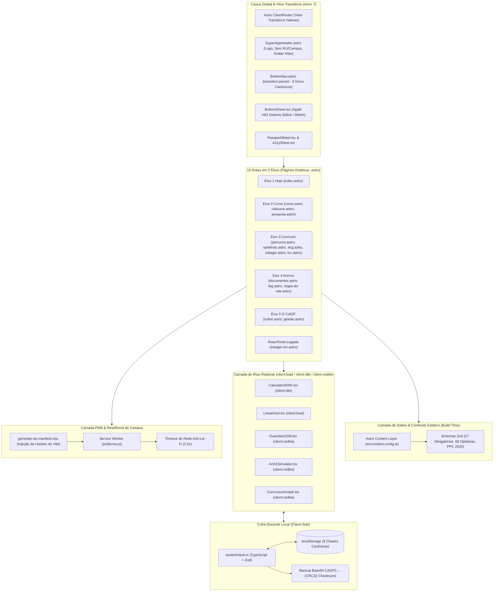

# Refatoração Integral do Super App CAGP: Quarto para Astro 7, React, Tailwind & Apple HIG

* **Author:** Antigravity & EGM Design Engine
* **Status:** Approved (Com Resoluções de Review do EGM Synthesizer)
* **Date:** 2026-10-30
* **Repository Target:** [CAGP UFMG Super App](file:///home/gsathler/Nextcloud/Projects/cagp)
* **Base Template:** [violet-velocity/](file:///home/gsathler/Nextcloud/Projects/cagp/violet-velocity) (Astro 7.4.4 + `@astrojs/react` + Tailwind CSS v4)
* **Target Engine / LLM:** Gemini 3.8 Flash (High Thinking) no Google Antigravity
* **Manual Operacional:** [AGENTS.md](file:///home/gsathler/Nextcloud/Projects/cagp/AGENTS.md)
* **Predecessor RFC:** [concepts_brief.md](file:///home/gsathler/Nextcloud/Projects/cagp/concepts_brief.md)
* **Relatório de Auditoria:** [consolidated_review_report.md](file:///home/gsathler/Nextcloud/Projects/cagp/consolidated_review_report.md)

--------------------------------------------------------------------------------

## 1. Visão Geral (Overview)

O portal institucional e aplicativo discente do Centro Acadêmico de Gestão Pública (CAGP FAFICH/UFMG) será integralmente refatorado, substituindo o gerador estático documental **Quarto** pelo framework moderno **Astro 7**, utilizando ilhas reativas em **React (TypeScript)** e estilização atômica com **Tailwind CSS v4**.

A motivação central é sanar a dívida técnica estrutural acumulada pelo Quarto, que foi projetado para artigos científicos e relatórios Pandoc, mas foi empurrado para além de seus limites com um roteador SPA manual em JavaScript puro ([super-app-router.html](file:///home/gsathler/Nextcloud/Projects/cagp/_includes/super-app-router.html)), injeções de DOM fraturadas e arquivos monolíticos de até 144 KB misturando marcação, prosa e scripts (`percurso.qmd`, `acg.qmd`).

Essa estrutura legada gera gargalos severos para agentes autônomos de IA (especialmente **Gemini 3.8 Flash High Thinking**) devido à saturação de contexto e ausência de verificação estática de tipos, além de limitar a experiência do usuário móvel. A nova arquitetura entrega um PWA estático de alto desempenho no **GitHub Pages (custo zero)**, operação **100% offline**, ergonomia mobile aderente ao **Apple Human Interface Guidelines (HIG 2026)** e respeito rigoroso à identidade visual **Brite Institucional Refinado**.

---

## 2. Diagnóstico do Problema (The Problem)

1. **Arquivos Monolíticos e Perda de Contexto para Modelos LLM:** Arquivos como `percurso.qmd` (144 KB) e `acg.qmd` (102 KB) concentram mais de 3.000 linhas de código misturando marcação Quarto, blocos SVG crus, templates HTML embutidos e scripts imperativos com dezenas de `document.querySelector`. Agentes de IA que operam sobre esses arquivos sofrem degradação de atenção, risco de corrupção de manipuladores de eventos e incapacidade de validar sintaxe e tipos em tempo real.
2. **Fragilidade do Roteador SPA Legado:** Para evitar recargas bruscas de página no PWA, o portal implementou uma rotina em `super-app-router.html` que intercepta cliques em links `<a>`, faz `fetch()` do HTML da próxima rota, extrai o container `<main id="quarto-document-content">` e sobrescreve o nó no DOM reexecutando scripts embutidos manualmente. Esse mecanismo gera *flicker*, quebra de listeners e comportamentos instáveis no histórico do navegador (`popstate`).
3. **Ergonomia Mobile Pré-Moderna:**
   - Telas móveis sofrem com o zoom automático indesejado no iOS Safari causado por campos com tipografia menor que `16px`;
   - O atraso tátil de duplo toque (300ms) reduz a sensação de fluidez;
   - As gavetas e modais utilizam caixas flutuantes centralizadas do Bootstrap em vez de *bottom sheets* com física de molas e gestos de arrasto naturais;
   - Alvos de toque inferiores a `44×44px` prejudicam a precisão em mobilidade.
4. **Acoplamento entre Conteúdo Normativo e Código de Interface:** Qualquer correção pontual em ementas ou artigos estatutários exige editar arquivos de interface complexos, aumentando a probabilidade de regressão acidental em ferramentas críticas.

---

## 3. Metas e Critérios de Sucesso (Goals)

*   **Meta 1 (Migração 100% Estática para Astro 7):** Migrar as 15 rotas acadêmicas e os 5 eixos canônicos (`Hoje · Curso · Currículo · Acervo · O CAGP`) para Astro 7, mantendo hospedagem com custo zero no GitHub Pages (`cagp-ufmg.github.io`).
*   **Meta 2 (Navegação Instantânea via Astro `<ClientRouter />`):** Adotar View Transitions nativas com persistência da barra inferior de navegação (`transition:persist="main-bottom-nav"`) e animações direcionais suaves de transição entre páginas.
*   **Meta 3 (Modularidade Atômica < 300 Linhas):** Decompor 100% das ferramentas dinâmicas (Calculadora 600h, Guardião 120 Dias, Simulador Art. 41 e Grafo Curricular) em componentes React TypeScript com no máximo 300 linhas por arquivo, blindando o Gemini 3.8 Flash High Thinking contra saturação de contexto.
*   **Meta 4 (Ergonomia Apple HIG Mobile-First):**
    - Bottom sheets modais com *grabber handle* e 2 detents nativos (`50dvh` medium e `90dvh` large) e descarte por arrasto vertical (*drag-to-dismiss*);
    - Alvos de toque `>= 44×44px` (ideal `48×48px`) em todos os elementos clicáveis;
    - Inputs com fonte mínima de `16px` (`text-base`) para impedir auto-zoom no iOS Safari sem uso de `user-scalable=no`;
    - `touch-action: manipulation` e física de molas amortecidas (`cubic-bezier(0.32, 0.72, 0, 1)`).
*   **Meta 5 (PWA Offline Resiliente a Lie-Fi & Manifest Hashing):** Service Worker com cache prévio de páginas e assets estáticos hashed do Vite via script de injeção pós-build, operando com timeout de rede de **2.5 segundos** antes de servir o cache local no campus da UFMG.
*   **Meta 6 (Integridade Factual Absoluta - Zero Supressão):**
    - Preservação estrita das 3.000h curriculares (PPC 2020), 27 obrigatórias, 68 optativas com ementas, prazos normativos de 120 dias de AAC e regras do Art. 41 de estágio;
    - Preservação do contrato das 9 chaves canônicas de `localStorage` e backup Base64 `CAGP1:...` com checksum CRC32.

---

## 4. Limites de Escopo (Non-Goals)

*   **Não-Objetivo 1 (Zero Backend Ativo):** Não introduzir servidores Node.js, contêineres Docker, bancos de dados pagos (Supabase, PostgreSQL, Firebase) ou dependência de planos corporativos de nuvem. A aplicação continua estática e client-side.
*   **Não-Objetivo 2 (Zero Violação de Acessibilidade):** Não desabilitar o zoom de acessibilidade do usuário com `user-scalable=no` ou `maximum-scale=1.0` (conformidade WCAG SC 1.4.4).
*   **Não-Objetivo 3 (Zero Glassmorphism Difuso):** Não aplicar fundos borrados (`backdrop-filter: blur`) que degradem o contraste sob sol direto no pátio da FAFICH; manter superfícies 100% sólidas.
*   **Não-Objetivo 4 (Zero Alteração de Regras Fatuais):** Não inventar, alterar ou suprimir qualquer regra acadêmica, artigo estatutário, e-mail institucional ou link de PDF oficial.
*   **Não-Objetivo 5 (Não Criar 16ª Rota):** Passaporte Discente e Painel de Acessibilidade operam estritamente como Bottom Sheets modais (`PassportSheet.tsx` e `A11ySheet.tsx`), preservando rigorosamente a contagem de 14 rotas ativas + 1 rota-ponte = 15 rotas canônicas.

---

## 5. Jornadas Críticas do Usuário (Critical User Journeys)

### CUJ 1: Calouro Consultando Checklist de Sobrevivência no Corredor da FAFICH
*   **Given (Contexto):** Um calouro do curso noturno de Gestão Pública acabou de chegar à FAFICH, com conexão Wi-Fi fraca/inexistente no subsolo do prédio.
*   **When (Ação):** Abre o Super App no celular, acessa a rota `Curso -> Calouros` e toca no checklist "30 Primeiros Dias".
*   **Then (Resultado):** A página carrega instantaneamente do cache local via Service Worker (sem tela em branco). O checklist responde imediatamente ao toque com micro-press tátil (`active:scale-[0.98]`), salva o estado do item na chave `cagp_calouro_checklist_v1` do `localStorage` e exibe o progresso em HUD compacto sem saltar o scroll da tela.

### CUJ 2: Discente do 6º Período Calculando Horas de Extensão e AAC
*   **Given (Contexto):** O estudante deseja calcular se já completou as 300h obrigatórias de Extensão e até 300h de AAC antes do protocolo no Colegiado.
*   **When (Ação):** Acessa `Currículo -> Extensão & AAC (acg)` e insere 90h em "Empresa Júnior" e 120h em "Projeto de Pesquisa".
*   **Then (Resultado):** O campo de entrada não dispara zoom automático na tela do iPhone (fonte `>= 16px`). A barra HUD linear superior atualiza instantaneamente as metas com preenchimento em Borgonha `#8B1E2D`, valida os limites máximos de cada modalidade via Zod e persiste os valores na chave `cagp_calc_ext_aac_v1` de forma transparente.

### CUJ 3: Discente Consultando e Filtrando Optativas em Tela Móvel
*   **Given (Contexto):** O estudante está na fila do RU II e precisa escolher optativas de 60h ofertadas pelo DCP.
*   **When (Ação):** Acessa `Currículo -> Optativas` e clica no botão "Filtros".
*   **Then (Resultado):** Uma bottom sheet modal desliza do fundo da tela ancorando em *medium detent* (`50dvh`), com *grabber handle* tátil. O estudante seleciona o filtro "DCP" e arrasta a folha para baixo para descartá-la. A lista de disciplinas filtra instantaneamente sem recarregar a página e sem travar a interface.

### CUJ 4: Navegação por Eixos com Barra Inferior Contínua
*   **Given (Contexto):** O discente está navegando entre o mural diário (`Hoje`) e o acervo normativo (`Acervo`).
*   **When (Ação):** Toca no ícone `Acervo` na barra inferior de navegação.
*   **Then (Resultado):** A barra inferior permanece 100% fixa e contínua sem nenhum piscar de tela (garantida por `transition:persist`). O conteúdo da página executa uma transição direcional suave da direita para a esquerda. Ao focar no primeiro documento, a rota está pronta para interação em menos de 100ms.

---

## 6. Arquitetura de Sistemas & Engenharia (Technical Plan)

### 6.1. Diagrama Arquitetural de Alto Nível



### 6.2. Estrutura de Diretórios Atômica (< 300 Linhas)

```text
src/
├── layouts/
│   └── BaseLayout.astro            # Shell principal, ClientRouter, PWA meta, Viewport cover (~160 linhas)
├── components/
│   ├── shell/
│   │   ├── SuperAppHeader.astro    # Barra superior, Sino de Alertas, Gatilho Passaporte (~140 linhas)
│   │   ├── BottomNav.astro         # 5 eixos persistentes com transition:persist (~120 linhas)
│   │   ├── BottomSheet.tsx         # Modal Apple HIG com detents (50dvh/90dvh), drag handle (~210 linhas)
│   │   ├── PassportSheet.tsx       # Bottom Sheet do Passaporte Discente (~180 linhas)
│   │   ├── CampusSheet.tsx         # Bottom Sheet do Status do Campus e RU II (~150 linhas)
│   │   └── A11ySheet.tsx           # Bottom Sheet de Ajustes de Acessibilidade (~160 linhas)
│   ├── calculators/
│   │   ├── Calculator600h.tsx      # Orquestrador da Calculadora 600h (~110 linhas)
│   │   ├── LinearHud.tsx           # HUD linear fixo com meta 300h Ext + 300h AAC (~80 linhas)
│   │   ├── ExtensionForm.tsx       # Formulário específico de Extensão 300h (~170 linhas)
│   │   ├── AacForm.tsx             # Formulário específico de AAC 300h (~190 linhas)
│   │   └── Guardian120d.tsx        # Guardião dos 120 dias e prazos decadenciais (~220 linhas)
│   ├── curriculum/
│   │   ├── CurriculumGraph.tsx     # Grafo SVG dos 27 nós com roving tabindex (~140 linhas)
│   │   ├── CourseNode.tsx          # Renderização individual de nó do grafo (~80 linhas)
│   │   ├── curriculumData.ts       # Coordenadas estáticas e pré-requisitos (~90 linhas)
│   │   ├── CourseDetailModal.tsx   # Painel de ementa e pré-requisitos (~130 linhas)
│   │   └── Art41Simulator.tsx      # Simulador de Dispensa de Estágio Art. 41 (~180 linhas)
│   └── ui/
│       ├── SegmentedControl.astro  # Controle segmentado 100% visível sem scroll (~90 linhas)
│       └── NormativeDetails.astro  # Detalhes progressivos para normas regimentais (~70 linhas)
├── content/
│   ├── disciplinas/                # 27 obrigatórias + 68 optativas (arquivos de dados puros)
│   └── normas/                     # PPC 2020, Regulamento N-20229, Regimento Interno
├── content.config.ts               # Schemas Zod de validação para disciplinas e normas (~95 linhas)
├── lib/
│   ├── storage/
│   │   ├── studentVault.ts         # Leitura, escrita e validação Zod das 9 chaves (~190 linhas)
│   │   ├── backupVault.ts          # Serialização/deserialização Base64 CAGP1:... + CRC32 (~130 linhas)
│   │   └── notificationsStore.ts   # Preferências de notificações do RU II e Circular (~90 linhas)
│   ├── gestures/
│   │   └── pointerGestures.ts      # Manipuladores táteis nativos (< 3KB) para swipe e drag (~140 linhas)
│   └── a11y/
│       └── a11yPreferences.ts      # Alto contraste AAA e detecção de reduced motion (~85 linhas)
├── pages/
│   ├── index.astro                 # Eixo 1: Hoje
│   ├── curso.astro                 # Eixo 2: Visão Geral do Curso
│   ├── calouros.astro              # Eixo 2: Guia do Calouro & Sobrevivência
│   ├── pesquisa.astro              # Eixo 2: Núcleos de Pesquisa & Extensão
│   ├── percurso.astro              # Eixo 3: Grafo Curricular & Percursos
│   ├── optativas.astro             # Eixo 3: Catálogo de 68 Optativas
│   ├── acg.astro                   # Eixo 3: Extensão Obrigatória & AAC (Calculadora 600h)
│   ├── estagio.astro               # Eixo 3: Estágio Supervisionado & Art. 41
│   ├── tcc.astro                   # Eixo 3: Monografia e Artigo Científico
│   ├── documentos.astro            # Eixo 4: Atos, Regulamentos e Formulários
│   ├── faq.astro                   # Eixo 4: Dúvidas Regimentais Frequentes
│   ├── mapa-do-site.astro          # Eixo 4: Árvore Estrutural do Portal (14 ativas)
│   ├── sobre.astro                 # Eixo 5: Princípios e Estatuto do CAGP
│   ├── gestao.astro                # Eixo 5: Gestão, Equipe e Prestação de Contas
│   └── estagio-tcc.astro           # Rota-Ponte Legada (Redirecionamento Informativo)
├── styles/
│   └── global.css                  # Mapeamento Tailwind v4 dos tokens Brite Institucional (~220 linhas)
public/
├── documentos/                     # PDFs e formulários autênticos preservados
├── sw.js                           # Service Worker PWA com injeção pós-build
└── manifest.webmanifest            # Manifesto PWA
scripts/
└── generate-sw-manifest.mjs        # Varredura de dist/ e injeção de hashes no sw.js
tests/
└── storage.test.ts                 # Testes unitários com Vitest das 9 chaves e CRC32
```

### 6.3. Ergonomia Apple HIG & Mecânica de Bottom Sheets

O componente `BottomSheet.tsx` adota estritamente:
1. **Detents Dinâmicos:** `50dvh` (Medium) e `90dvh` (Large).
2. **Isolamento de Gestos:** O manipulador de arrasto vertical escuta exclusivamente na barra *grabber handle* (`.cagp-sheet-grabber`) configurada com `touch-action: none`. O corpo do modal opera com `touch-action: pan-y` e rolagem nativa suave.
3. **Safe Area:** `padding-bottom: calc(1rem + env(safe-area-inset-bottom, 0px))`.
4. **Prevenção de Auto-Zoom:** Inputs com classe `text-base` (`font-size: 16px` no mobile) e `touch-action: manipulation` global.

### 6.4. Tokens Tailwind CSS v4 (`src/styles/global.css`)

```css
@import "tailwindcss";

@theme {
  --color-cagp-burgundy: #8B1E2D;
  --color-cagp-red: #9E2424;
  --color-cagp-black: #0A0A0A;
  --color-cagp-cream: #F7F5F0;
  --color-cagp-surface: #FFFFFF;
  --color-cagp-border: #DFDBD2;
  --color-cagp-success: #15803D;
  --color-cagp-warning: #B45309;
  --color-cagp-danger: #DC2626;

  --font-display: 'Oswald', sans-serif;
  --font-body: 'Inter', sans-serif;
  --font-mono: 'JetBrains Mono', monospace;

  --shadow-cagp-hard: 2px 2px 0px #0A0A0A;
}
```

### 6.5. Contrato do Cofre Discente (9 Chaves Canônicas & Schemas Zod)

```typescript
// src/lib/storage/studentVault.ts
export const NotificationPrefsSchema = z.object({
  ru1815: z.boolean(),
  circular2230: z.boolean(),
  aac120d: z.boolean(),
  lastFired: z.number().optional()
});

export const StudentProfileSchema = z.object({
  name: z.string(),
  period: z.string(),
  photoDataUrl: z.string().optional()
});
```

---

## 7. Plano Passo a Passo de Implementação (Detailed Implementation Plan)

### 7.1. Fase 0: Inicialização da Stack Astro 7 e Configuração Base (Gate G0)
1. `package.json`: Configurar dependências (`astro@^7.4.4`, `@astrojs/react`, `@tailwindcss/vite`, `react@^19.0.0`, `react-dom@^19.0.0`, `zod`, `typescript`, `vitest`, `@types/node`). Scripts: `"dev"`, `"build"`, `"preview"`, `"typecheck": "tsc -b"`, `"test": "vitest run"`.
2. `astro.config.mjs`: `output: 'static'`, `outDir: './dist'`, plugins `@tailwindcss/vite()` e `react()`.
3. `tsconfig.json`: `"astro/tsconfigs/strict"` com path aliases.
4. `src/styles/global.css`: Mapeamento de tokens Tailwind v4 e regras anti-zoom.
5. `src/content.config.ts`: Schemas Zod das disciplinas e normas.
6. Mover `documentos/` para `public/documentos/`.
*Critério de Saída G0:* `pnpm install` e `pnpm typecheck` executam com zero erros.

### 7.2. Fase 1: Casca Global, Roteamento e Padrões Apple HIG (Gate G1)
1. `src/layouts/BaseLayout.astro`: `<ClientRouter />`, meta viewport e Safe Areas.
2. `src/components/shell/SuperAppHeader.astro`: Topbar compacta com alvos `>= 44×44px`.
3. `src/components/shell/BottomNav.astro`: 5 eixos com `transition:persist="main-bottom-nav"`.
4. `src/components/shell/BottomSheet.tsx`: Modal Apple HIG com detents `50dvh`/`90dvh` (`client:load`).
5. `src/components/shell/PassportSheet.tsx`, `CampusSheet.tsx` e `A11ySheet.tsx`: Bottom Sheets globais.
6. `src/components/ui/SegmentedControl.astro` e `NormativeDetails.astro`.
*Critério de Saída G1:* Transição contínua sem piscar de tela entre abas e modais responsivos.

### 7.3. Fase 2: Content Layer e Migração das 15 Rotas (Gate G2)
1. `src/content/disciplinas/`: 27 obrigatórias + 68 optativas tipadas com Zod.
2. `src/content/normas/`: Textos regimentais e PPC 2020.
3. 15 Páginas em `src/pages/` respeitando as metas da 1ª dobra (`y <= 300px` em `360×640`).
*Critério de Saída G2:* As 15 rotas compilam estaticamente sem erros.

### 7.4. Fase 3: Ilhas Reativas e Contrato do Cofre Discente (Gate G3)
1. `src/lib/storage/studentVault.ts` e `backupVault.ts`: Persistência das 9 chaves e CRC32.
2. `src/components/calculators/`: `Calculator600h.tsx`, `LinearHud.tsx` (`client:load`), `ExtensionForm.tsx` (`client:idle`), `AacForm.tsx` (`client:idle`), `Guardian120d.tsx` (`client:visible`).
3. `src/components/curriculum/`: `CurriculumGraph.tsx` (`client:visible`), `CourseNode.tsx`, `curriculumData.ts`, `Art41Simulator.tsx` (`client:visible`).
4. `tests/storage.test.ts`: Bateria de testes com Vitest para o cofre e algoritmo CRC32.
*Critério de Saída G3:* `pnpm test` executa 100% verde validando o cofre discente.

### 7.5. Fase 4: PWA Offline, Auditoria e Homologação (Gate G4)
1. `scripts/generate-sw-manifest.mjs`: Injeção de hashes do Vite em `public/sw.js` pós-build.
2. `public/sw.js`: Timeout de 2.5s anti-Lie-Fi e precache dos bundles.
3. Arquivamento de legados Quarto em `_legacy_quarto/` e remoção de `violet-velocity/`.
4. Execução de `pnpm build` gerando `dist/` estático.
*Critério de Saída G4:* Homologação total com build estático limpo, testes verdes e PWA 100% offline.
