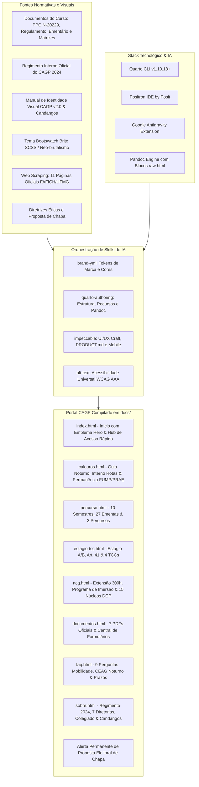

# Relatório e Memória Técnica do Processo de Desenvolvimento: Site CAGP UFMG

**Projeto:** Centro Acadêmico de Gestão Pública (CAGP) — FAFICH / UFMG  
**Finalidade:** Documentação pedagógica, técnica e histórica integral do processo de desenvolvimento do portal do CAGP utilizando Quarto CLI, Positron IDE, Google Antigravity Extension, orquestração de skills de IA, tema neo-brutalista Brite e conformidade documental e de acessibilidade.  
**Data:** 22 de Outubro de 2026  
**Status do Projeto:** Compilado e validado em `docs/` (Pronto para GitHub Pages)  

---

## Sumário
1. [Visão Geral e Contexto](#1-visão-geral-e-contexto)
2. [Estado Inicial do Repositório (Arquivos Pré-existentes)](#2-estado-inicial-do-repositório-arquivos-pré-existentes)
3. [Catálogo e Papel das Skills Utilizadas](#3-catálogo-e-papel-das-skills-utilizadas)
4. [Stack Tecnológico e Ferramental de Desenvolvimento](#4-stack-tecnológico-e-ferramental-de-desenvolvimento)
5. [Ciclo 1: Diagnóstico e Preflight de Plugins](#5-ciclo-1-diagnóstico-e-preflight-de-plugins)
6. [Ciclo 2: Planejamento Mestre e Criação do Mockup Completo](#6-ciclo-2-planejamento-mestre-e-criação-do-mockup-completo)
7. [Ciclo 3: Refinamento da Barra de Navegação e Migração para docs/](#7-ciclo-3-refinamento-da-barra-de-navegação-e-migração-para-docs)
8. [Ciclo 4: Diagnóstico de Engenharia do SVG e Correção de Exibição](#8-ciclo-4-diagnóstico-de-engenharia-do-svg-e-correção-de-exibição)
9. [Ciclo 5: Alinhamento Curricular e Institucional com os Documentos Oficiais](#9-ciclo-5-alinhamento-curricular-e-institucional-com-os-documentos-oficiais)
10. [Ciclo 6: Disponibilização dos PDFs Originais e Repositório Documental](#10-ciclo-6-disponibilização-dos-pdfs-originais-e-repositório-documental)
11. [Ciclo 7: Redesenho do Emblema Hero na Página Inicial](#11-ciclo-7-redesenho-do-emblema-hero-na-página-inicial)
12. [Ciclo 8: Customização Neo-brutalista dos Callouts do Quarto](#12-ciclo-8-customização-neo-brutalista-dos-callouts-do-quarto)
13. [Ciclo 9: Alerta Permanente de Proposta Eleitoral de Chapa](#13-ciclo-9-alerta-permanente-de-proposta-eleitoral-de-chapa)
14. [Ciclo 10: Incorporação do Regimento Interno e Governança do CAGP](#14-ciclo-10-incorporação-do-regimento-interno-e-governança-do-cagp)
15. [Ciclo 11: Web Scraping Institucional e Arquitetura Híbrida de Serviços](#15-ciclo-11-web-scraping-institucional-e-arquitetura-híbrida-de-serviços)
16. [Ciclo 12: Inicialização do Impeccable (PRODUCT.md) e Atualização da Memória Técnica](#16-ciclo-12-inicialização-do-impeccable-productmd-e-atualização-da-memória-técnica)
17. [Ciclo 13: Reorganização de Arquivos e Pastas](#17-ciclo-13-reorganização-de-arquivos-e-pastas)
18. [Matriz Comparativa Completa de Arquivos (Antes vs. Depois)](#18-matriz-comparativa-completa-de-arquivos-antes-vs-depois)
19. [Instruções de Manutenção e Publicação](#19-instruções-de-manutenção-e-publicação)

---

## 1. Visão Geral e Contexto

O objetivo central deste projeto foi conceber, planejar, implementar e refinar o novo portal institucional do **Centro Acadêmico de Gestão Pública (CAGP)** da **Faculdade de Filosofia e Ciências Humanas (FAFICH)** da **Universidade Federal de Minas Gerais (UFMG)**.

O site foi estruturado para resolver um desafio histórico da comunidade acadêmica: fornecer um ambiente acolhedor, informativo, rigorosamente embasado e transparente tanto para **calouros** quanto para **veteranos**, orientando-os em relação ao **percurso curricular oficial dos 10 semestres**, às regras de **Formação em Extensão Obrigatória (300h)** e **Atividades Acadêmicas Complementares (AAC)**, às diretrizes de **Estágio Supervisionado e TCC**, aos **documentos normativos originais em PDF** e às **dúvidas frequentes**.

Visualmente, o projeto articula duas forças de design:
1. **Identidade Visual Canônica do CAGP (v2.0):** Inspirada na escultura monumental *"Os Candangos (Dois Guerreiros)"* de Bruno Giorgi (1959), operando com uma paleta institucional de alto contraste: Preto Nobre (`#0A0A0A` / `#111111`), Branco Puro (`#FFFFFF`), Off-white Quente (`#FBF8F3`), Ouro/Mostarda (`#E8A317`) e Vermelho Vinho / Bordeaux Institucional (`#8B1E2D` / `#9E2424`).
2. **Tema Bootswatch Brite (Neo-Brutalismo):** Estética caracterizada por bordas sólidas pretas de 3px, sombras duras de deslocamento (*hard shadows* de 4px a 6px), cantos estritamente retos (`border-radius: 0px`), tipografia de manchete marcante e microinterações táteis de clique e elevação. Como o tema *Brite* não existe nativamente no catálogo do Quarto, foi desenvolvida uma arquitetura SCSS/CSS customizada de alto nível.



---

## 2. Estado Inicial do Repositório (Arquivos Pré-existentes)

Antes do início das intervenções solicitadas, a pasta do projeto continha apenas um esqueleto embrionário de site do Quarto, com templates genéricos e assets desarticulados:

```text
/home/gsathler/Nextcloud/Projects/cagp/
├── .agents/
│   └── skills/
│       ├── alt-text/          # Diretrizes para escrita de textos alternativos acessíveis
│       ├── brand-yml/         # Especificação de marca para Quarto e Shiny
│       ├── impeccable/        # Princípios avançados de design de frontend e UX
│       └── quarto-authoring/  # Autoria, templates e compilação em Quarto
├── brite/
│   ├── bootstrap.css          # Compilado bruto do Bootstrap com tema Brite
│   ├── bootstrap.rtl.css      # Versão RTL (Right-to-Left)
│   ├── _bootswatch.scss       # Regras e mixins CSS específicas do tema Brite
│   └── _variables.scss        # Variáveis padrão do tema Brite (Bootstrap 5.3)
├── logos/
│   ├── 01_vertical_fundo_claro.svg
│   ├── 02_vertical_transparente_positivo.svg
│   ├── 03_vertical_fundo_escuro.svg
│   ├── 04_vertical_transparente_negativo.svg
│   ├── 05_horizontal_fundo_claro.svg
│   ├── 06_horizontal_transparente_positivo.svg
│   ├── 07_horizontal_fundo_escuro.svg
│   ├── 08_horizontal_transparente_negativo.svg
│   ├── 09_simbolo_fundo_claro.svg
│   ├── 10_simbolo_transparente_positivo.svg
│   ├── 11_simbolo_fundo_escuro.svg
│   └── 12_simbolo_transparente_negativo.svg
├── manual_de_identidade_visual_cagp_ufmg.md  # Manual canônico da marca (v2.0)
├── _quarto.yml               # Arquivo de configuração mínima do Quarto (20 linhas)
├── _variables.scss           # Rascunho inicial mesclando variáveis e regras Brite
├── about.qmd                 # Página padrão de exemplo criada pelo 'quarto create-project'
├── index.qmd                 # Página padrão de exemplo inicial
└── styles.css                # Folha de estilo vazia (apenas comentário inicial)
```

### Diagnóstico do Estado Inicial:
- **Ausência de Conteúdo do Curso:** Não havia nenhuma informação sobre a matriz curricular real, turno noturno, departamento gestor (DCP), normas de estágio ou extensão.
- **Estrutura Quarto Desconfigurada:** O compilador gerava os arquivos para a pasta temporária `_site/`, inviabilizando o deploy automático via GitHub Pages.
- **Incompatibilidade Visual:** O tema Brite fornecido em `brite/` dependia de classes não mapeadas pelo Quarto, e o arquivo `styles.css` estava completamente vazio.
- **Invisibilidade de Logotipos:** Os arquivos SVG de logotipo possuíam declarações percentuais (`width="100%" height="100%"`) que causavam colapso de dimensão em containers Flexbox da barra de navegação.

---

## 3. Catálogo e Papel das Skills Utilizadas

O desenvolvimento foi conduzido através da orquestração de 4 skills especializadas:

| Skill | Papel Técnico no Projeto | Ações Principais Realizadas |
| :--- | :--- | :--- |
| **`brand-yml`** | Autoridade de identidade de marca e tokenização | Criação de `_brand.yml`, padronização da paleta (Vinho `#8B1E2D`, Ouro `#E8A317`, Preto `#111111`), hierarquia tipográfica (Oswald e Inter) e controle de versões dos logotipos. |
| **`quarto-authoring`** | Estruturação de publicação técnico-científica | Configuração de `_quarto.yml`, diretivas `resources`, abas interativas `.panel-tabset`, drawers `<details>`, accordions, sitemap, sitemaps e compilação com **zero warnings**. |
| **`impeccable`** | Craft de engenharia de frontend, UI/UX e microinterações | Design neo-brutalista Brite, bordas pretas 3px, sombras duras 4px-6px, reengenharia do Emblema Hero, responsividade mobile-first e customização de callouts. |
| **`alt-text`** | Acessibilidade universal e auditoria de contraste | Atributos `alt` semânticos e detalhados em todos os SVGs e imagens históricas, conformidade estrita com as diretrizes WCAG AA e AAA. |

---

## 4. Stack Tecnológico e Ferramental de Desenvolvimento

O projeto foi construído utilizando um ferramental moderno voltado à engenharia de software e publicação científica:

1. **[Quarto CLI (v1.10.18+)](https://quarto.org/):**  
   Sistema de publicação técnico-científica de código aberto mantido pela [Posit](https://posit.co/). Utilizado como motor de compilação estática, integrando Pandoc, Bootstrap 5.3 e processamento avançado de Markdown (`.qmd`) para HTML com suporte nativo a tabsets, callouts e banners de anúncio.
2. **[Positron IDE](https://positron.posit.co/):**  
   A nova IDE de última geração desenvolvida pela **Posit** (criadores do RStudio). Projetada para ciência de dados e desenvolvimento de código, oferece terminal integrado, visualizador de documentação em tempo real, suporte nativo ao ecossistema Quarto e excelente ergonomia de depuração.
3. **[Google Antigravity Extension](https://github.com/google-deepmind):**  
   Ambiente avançado de desenvolvimento orientado por agentes autônomos de IA, desenvolvido pela equipe do Google DeepMind. Responsável pela execução pareada dos ciclos de planejamento (`/plan`), entrevistas de alinhamento (`/grill-me`), refatoração de código, validação de layouts e orquestração de skills.
4. **[Bootstrap 5.3](https://getbootstrap.com/) & [Bootswatch Brite](https://bootswatch.com/):**  
   Framework de interface web associado ao tema Brite (Neo-Brutalismo), transposto para SCSS com regras e variáveis customizadas para as cores do CAGP.
5. **[Google Fonts (Oswald & Inter)](https://fonts.google.com/):**  
   Tipografia web institucional: **Oswald** (família sans-serif condensada de grande peso para títulos e manchetes) e **Inter** (família sans-serif geométrica para máxima legibilidade de leitura no corpo do texto).

---

## 5. Ciclo 1: Diagnóstico e Preflight de Plugins

### Prompt do Usuário
```text
/plugin
```

### O Que Foi Feito
- Varredura e auditoria dos recursos de personalização e skills disponíveis no ambiente Antigravity.
- Confirmação da presença das quatro skills estratégicas no projeto: `brand-yml`, `quarto-authoring`, `impeccable` e `alt-text`.
- Verificação do motor Quarto disponível em `/usr/share/positron/resources/app/quarto/bin/quarto`.

---

## 6. Ciclo 2: Planejamento Mestre e Criação do Mockup Completo

### Prompt do Usuário
```text
Crie um plano capaz de orquestrar as skills do projeto com objetivo para criar um mockup de site do Centro Academico de Gestão Pública através do Quarto do Centro academico de gestão publica (CAGP) utilizando como base o tema brite do bootstrap que não existe nativamente noquarto. Ademais o site precisa ser responsivo tanto para computador quando para mobile, ou seja adaptativo em diversas telas. Crie um plano com a /plan e va me perguntando para alinha adequadamente utilizando /grill-me . No mais o objetivo do site é ser um mockup para que no futuro seja um site do CAGP feito para orientar os calouros e os alunos ja exisrtente em relação ao percurso, regras de acg e quaisquer duvidas que depois levantaremos. Os elementos devem ter animações, e deve ser um site fluido mas ainda acessivel para todas as pessoas.
```

### O Que Foi Feito
- **Planejamento e Alinhamento:** Elaboração do plano mestre de implementação via `/plan` e rodada interativa `/grill-me`.
- **Criação do `_brand.yml`:** Definição canônica de cores, tipografia (Oswald e Inter) e referências de logos.
- **Desenvolvimento da Folha SCSS/CSS Neo-Brutalista (`_variables.scss` e `styles.css`):**
  - Implementação das classes `.cagp-card`, `.cagp-btn`, `.cagp-hero`, `.cagp-badge` e `.cagp-timeline`.
  - Bordas de 3px pretas, sombras sólidas de 4px a 6px e cantos sem arredondamento.
- **Criação das 6 Páginas Iniciais:**
  1. `index.qmd`: Landing page com cards de módulos acadêmicos e chamadas de ação.
  2. `calouros.qmd`: Guia de sobrevivência do calouro (MinhaUFMG, SIGA, RU e transporte).
  3. `percurso.qmd`: Linha do tempo visual dos períodos curriculares.
  4. `acg.qmd`: Convalidação de atividades complementares e protocolo SEI-UFMG.
  5. `faq.qmd`: Accordion interativo e acessível de perguntas frequentes.
  6. `sobre.qmd`: História da fundação e semiótica da escultura "Os Candangos".
- **Limpeza:** Exclusão do arquivo desnecessário `about.qmd`.

---

## 7. Ciclo 3: Refinamento da Barra de Navegação e Migração para docs/

### Prompt do Usuário
```text
coloque a logo do centro acadêmico apenas e a sigla CAGP na barra de navegação, bole um plano sabendo que fiz algumas modificações como o render final agora está na pasta docs. Planeje e me pergunte e utilize as skills melhores da melhor forma dado contexto /plan /grill-me
```

### O Que Foi Feito
- **Padronização da Navbar:** Configuração do `_quarto.yml` para exibir exclusivamente o **símbolo puro dos Candangos** (`logos/10_simbolo_transparente_positivo.svg`) ao lado da sigla tipográfica **"CAGP"** em Oswald Bold, eliminando subtítulos longos que poluíam o cabeçalho.
- **Migração do Diretório de Saída:** Alteração de `output-dir: docs` no `_quarto.yml` para viabilizar publicação direta via GitHub Pages. Remoção da pasta legada `_site/`.
- **Preservação de Assets:** Salvaguarda dos arquivos SVG na pasta fonte `logos/`.

---

## 8. Ciclo 4: Diagnóstico de Engenharia do SVG e Correção de Exibição

### Prompt do Usuário
```text
a logo não está sendo exibida na barra de navegação, o que pode ser?
```

### O Que Foi Feito
- **Investigação da Causa Raiz:** Identificação de dependência circular no motor de renderização (Chromium/Gecko/WebKit) ao calcular tamanho de elementos SVG declarados com `width="100%" height="100%"` dentro de containers Flexbox com `height: auto`, colapsando a imagem para `0px × 0px`.
- **Correção Vetorial:** Substituição dos percentuais por dimensões intrínsecas fixas baseadas no próprio `viewBox`: `width="410" height="600"`.
- **Reforço de CSS (`styles.css`):** Fixação de `height: 40px !important; width: auto !important; display: inline-block !important;` e visibilidade explícita da classe `.light-content`.

---

## 9. Ciclo 5: Alinhamento Curricular e Institucional com os Documentos Oficiais

### Prompt do Usuário
```text
A partir do contexto agora adicionei documentos oficiais do curso contendo as informações verdadeiras na pasta @[documentos_oficiais_do_curso] , de inicio quero que analise a pasta e o contexto dos documentos, depois elabora um plano de implementação /plan ajustando o site do CAGP aos fatos reais e sugerindo melhorias também com o /grill-me e invoque as skills necessárias para cumprir com detalhismo e exatidão cada tarefa ideal, ou seja voce precisa analisar as features de cada skill também /impeccable /quarto-authoring /brand-yml /alt-text
```

### O Que Foi Feito
O portal passou por uma reformulação profunda para abandonar premissas genéricas e atingir **100% de conformidade com os documentos oficiais** da UFMG:

1. **Documentos Oficiais Analisados:**
   - Projeto Pedagógico do Curso (PPC) — Versão Curricular N-20229.
   - Regulamento do Curso de Graduação em Gestão Pública (FAFICH/UFMG).
   - Ementário Oficial das Disciplinas Obrigatórias.
   - Relatórios Oficiais de Percurso (Bacharelado Núcleo Geral, Complementar e Avançado).
2. **Correções Fatuais Estruturantes:**
   - **Turno Noturno:** Carga horária real das aulas (19h00 às 22h30, 4 créditos = 2 noites de 2h/aula).
   - **Duração e Carga Real:** 10 semestres (5 anos) padrão (mínimo 8, máximo 17) • **3.000 horas totais** (2.880h Núcleo Específico + 120h Formação Livre).
   - **Matrícula Mínima:** Exigência de pelo menos **180 horas (12 créditos)** por semestre.
   - **Os 3 Percursos Curriculares Formais (Art. 3º do Regulamento):**
     - *Núcleo Geral (`01-01`):* Canônico do Bacharelado.
     - *Núcleo Complementar (`01-02`):* Requerimento a partir do 5º período (300h em Formação Transversal/Aberta, reduzindo optativas de 1.020h para 720h).
     - *Núcleo Avançado (`01-03`):* Requerimento a partir do 7º período (45h a 120h na Pós-Graduação, ex: PPGCP).
   - **Extensão Obrigatória (300h) vs AAC (até 300h):** Separação formal entre Formação em Extensão Obrigatória (Resolução CEPE nº 10/2019, Equalitas Jr., PROEX) e Atividades Acadêmicas Complementares (Art. 15, 9 modalidades, 15h=1cr e prazo de 120 dias).
3. **Nova Página: `estagio-tcc.qmd`:**
   - Estágio Curricular Supervisionado A (DCP 135 - 180h, 7º período) e B (DCP 136 - 120h, 8º período).
   - **Art. 41 do Regulamento:** Dispensa de estágio para quem já atua em órgãos públicos.
   - **TCC:** Projeto de TCC (DCP 089 - 60h, 9º período) e TCC Final com Defesa Pública perante banca (DCP 137 - 120h, 10º período) nas **4 modalidades oficiais aceitas**: Monografia, Projeto de Intervenção Governamental, Artigo Científico e Projeto de IC.
4. **Linha do Tempo dos 10 Semestres com Ementário Oficial:**
   - Inclusão das **27 disciplinas obrigatórias** com códigos reais (**DCP**, **ECN**, **EST**, **SOA**).
   - Cada matéria recebeu uma gaveta retrátil `<details class="cagp-discipline">` com a **ementa completa oficial** do PPC.
5. **Engenharia Quarto/Pandoc:** Resolução de conflitos de indentação em blocos HTML brutos que geravam avisos de divs aninhadas, atingindo compilação com zero warnings.

---

## 10. Ciclo 6: Disponibilização dos PDFs Originais e Repositório Documental

### Prompt do Usuário
```text
adicione possibilidade de acessar os PDFs originais, além disso analise o ornamento da logo do cagp na pagina inicial index, acredito estar estranho e desproporcional. Ademais não pode ser igual a logo que está no sobre o cagp. Faça um plano /plan e sugira melhorias pertinentes e use as diversas skills do projeto e verifique até se estas skills possuam contextos especificos que melhor adeque a minha necessidade /grill-me
```

### O Que Foi Feito
- **Padronização dos Arquivos Digitais (`documentos/`):**
  - Cópia e normalização dos 6 PDFs para nomes seguros para web:
    - `ppc-gestao-publica-ufmg.pdf` (3.3 MB)
    - `regulamento-gestao-publica-ufmg.pdf` (2.0 MB)
    - `ementario-gestao-publica-ufmg.pdf` (3.0 MB)
    - `percurso-bacharelado-nucleo-geral.pdf` (163 KB)
    - `percurso-bacharelado-nucleo-complementar.pdf` (163 KB)
    - `percurso-bacharelado-nucleo-avancado.pdf` (164 KB)
- **Configuração no Quarto:** Adição de `resources: ["documentos/*.pdf", "logos/**"]` no `_quarto.yml`, garantindo a distribuição dos PDFs para `docs/documentos/`.
- **Nova Página Central: `documentos.qmd`:**
  - Integrada à barra de navegação com cards neo-brutalistas (`.cagp-doc-card`) organizados por categoria (Atos Fundamentais, Ementário e Matrizes dos 3 Percursos).
  - Cada card conta com metadados (tamanho, vigência, órgão emissor) e botões duplos de **Visualizar PDF** no navegador e **Baixar Arquivo**.
- **Acessos Contextuais de Download:**
  - Adicionados blocos de download direto em `percurso.qmd`, `estagio-tcc.qmd`, `acg.qmd`, `index.qmd`, `calouros.qmd` e `faq.qmd`.

---

## 11. Ciclo 7: Redesenho do Emblema Hero na Página Inicial

### Diagnóstico do Problema Anterior
- A logo vertical solta anterior (`02_vertical_transparente_positivo.svg`) possuía aspecto muito fino (1:2). Ao ser limitada a `230px` de altura, gerava apenas `~113px` de largura em uma coluna desktop de 380px, parecendo uma silhueta perdida no vazio.
- Continha inscrições ilegíveis que duplicavam o título da página e ficava totalmente oculta no mobile (`.d-none .d-lg-block`).

### Solução Aplicada (`impeccable` & `brand-yml`)
- **Card de Emblema Neo-brutalista (`.cagp-hero-emblem-card`):**
  - Moldura sólida com fundo quente `#FBF8F3`, borda preta grossa de `3px solid #111111` e sombra dura de `6px 6px 0 #111111`.
  - Símbolo puro dos Candangos (`logos/10_simbolo_transparente_positivo.svg`) ampliado a `160px` de altura, sem textos minúsculos.
  - Selo institucional inferior com tipografia Oswald: `CAGP UFMG`, `Gestão Pública • FAFICH` e badge `Entidade Oficial`.
  - Totalmente adaptativo e centralizado no mobile (`col-12 col-md-5 col-lg-4`).
  - Distinção absoluta em relação a `sobre.qmd` (que utiliza a logo horizontal completa e a foto histórica da escultura).

---

## 12. Ciclo 8: Customização Neo-brutalista dos Callouts do Quarto

### Prompt do Usuário
```text
necessito planejar /plan e /grill-me para mudar o tema dos .callout para se adequarem ao tema do CAGP utilize as skills /quarto-authoring /brand-yml /impeccable
```

### O Que Foi Feito
- **Substituição da Estilização Nativa:** Eliminação dos cantos arredondados e tons pastéis genéricos do Bootstrap em favor de blocos neo-brutalistas arquitetônicos.
- **Estrutura Neo-Brutalista (`styles.css`):**
  - Borda preta perimetral de `3px solid #111111`.
  - Cantos retos (`border-radius: 0px !important`).
  - Sombra dura angular de `4px 4px 0 #111111` com elevação em hover (`translate(-1px, -1px)` e sombra `6px 6px 0`).
  - Cabeçalho em faixa sólida com divisor preto de `2px solid #111111`.
  - Títulos em caixa alta com fonte `Oswald Bold` (`letter-spacing: 0.03em`).
  - Corpo em fundo branco `#FFFFFF` puro com tipografia Inter e links em negrito na cor Vinho CAGP com sublinhado acessível.
- **Mapeamento da Paleta Institucional e Acessibilidade (WCAG AAA):**
  - `.callout-important`: Header **Vinho CAGP** (`#8B1E2D`), texto branco, ícone invertido para branco puro.
  - `.callout-tip`: Header **Mostarda/Dourado CAGP** (`#E8A317`), texto preto sólido `#111111` e ícone preto para contraste máximo AAA.
  - `.callout-note`: Header **Azul Institucional UFMG** (`#1E3F66`), texto branco, ícone branco.
  - `.callout-warning`: Header **Laranja Âmbar** (`#E65100`), texto branco, ícone branco.
  - `.callout-caution`: Header **Vermelho Alerta** (`#B71C1C`), texto branco, ícone branco.

---

## 13. Ciclo 9: Alerta Permanente de Proposta Eleitoral de Chapa

### Prompt do Usuário
```text
fazer um plano /plan e /grill-me para adicionar um alerta permanente com fundo todo em vermelho da identidade visualno topo da pagina em cima da navbar como uma notificação mas que não pode ser dispensada dizendo que este site é uma proposta da chapa "xxxx" pois ainda não definimos o nome, para caso assuma a gestão do CAGP. No entando também informar que como nosso compromisso desde o inicio da chapa é com os alunos, independentemente de ganharmos ou não, dispoonibilizaremos o projeto já feito para gestão vendedora dado que é de interesse de todos. Use as skills /impeccable /quarto-authoring /brand-yml /alt-text
```

### O Que Foi Feito
- **Configuração no Quarto (`_quarto.yml`):**
  - Uso da diretiva nativa `website.announcement` com `position: above-navbar` e `dismissable: false`.
  - Sendo `dismissable: false`, o Quarto omite o botão de fechar, tornando o alerta estritamente permanente em todas as páginas.
- **Design e Cores (`styles.css`):**
  - Fundo 100% no **Vermelho Vinho do CAGP** (`#8B1E2D`), com divisor preto inferior de `2px solid #111111`.
  - Ícone de megafone (`bi-megaphone-fill`) e texto em branco puro `#FFFFFF` (contraste superior a 7:1, padrão WCAG AAA).
  - Badge preto de destaque: `<span class="cagp-announcement-badge">PROPOSTA DE CHAPA</span>`.
  - Placeholder dourado em destaque com sublinhado: `<strong class="cagp-chapa-highlight">Chapa [Nome da Chapa a Definir]</strong>` (`#FFD54F`), facilitando a substituição rápida quando a chapa for oficialmente registrada.
- **Mensagem Ética e Republicana:**
  > **[PROPOSTA DE CHAPA]** *Este portal é uma proposta e projeto da **Chapa [Nome da Chapa a Definir]** para a gestão do **CAGP (FAFICH/UFMG)**. Como nosso compromisso prioritário é com os discentes, **independentemente do resultado da eleição, disponibilizaremos este projeto completo para a gestão vencedora**, pois a transparência e o acesso à informação são de interesse coletivo de todo o curso.*
- **Sincronização de Layout:** Compensação fluida calculada pelo headroom do Quarto (`header.clientHeight`), garantindo que o início do conteúdo nunca seja cortado no desktop ou mobile.

---

## 14. Ciclo 10: Incorporação do Regimento Interno e Governança do CAGP

### Prompt do Usuário
```text
eu adicionei na pasta de documentos o @[documentos_oficiais_do_curso/regimento_interno_do_centro_acad_mico_de_gest_o_p_blica_cagp.md] de como o CAGP funciona juntamente do PDF original do Regimento Interno @[documentos_oficiais_do_curso/pdfs_originais/regimento_interno_do_centro_acad_mico_de_gest_o_p_blica_cagp.pdf] . Elabore um plano /plan e /grill-me para colocar as informações veridicas do CAGO no site e adicoionar o documnento oficial no repositorio. Ademais se atente que precisei fazer uma mudança na hora de colocar certos codigos em html que precisam de serem em um bloco  html para renderizar de acorsdo no Quarto. Lembre de utilizar a skills corretas e md certos delas

```{=html}

```
```

### O Que Foi Feito
- **Inclusão do Documento PDF Oficial (`documentos/`):**
  - Cópia e normalização do arquivo original `regimento_interno_do_centro_acad_mico_de_gest_o_p_blica_cagp.pdf` (307 KB) para `documentos/regimento-interno-cagp-ufmg.pdf`.
  - O documento é o ato formal aprovado em Assembleia Geral no dia **14 de outubro de 2024**, revogando o Estatuto de 2010 e o Regimento de 2021.
- **Destaque Soberano no Repositório (`documentos.qmd`):**
  - Criação da seção de destaque no topo da página: *"📜 Atos Institucionais da Representação Discente"*.
  - Envelopamento do card documental em bloco ````{=html} ... ```` para compilação 100% limpa no Quarto/Pandoc.
  - Disponibilização dos botões oficiais de visualização e download direto.
- **Reestruturação Factual Completa da Página "Sobre o CAGP" (`sobre.qmd`):**
  - **Definição Jurídica e Institucional:** Entidade civil sem fins lucrativos, de representação de todos os matriculados em Gestão Pública (FAFICH/UFMG), expressamente suprapartidária e autônoma perante governos, DA e DCE (Arts. 3º, 4º e 7º).
  - **Princípios da Administração Pública (Art. 8º):** Legalidade, Impessoalidade, Moralidade, Publicidade, Eficiência, Transparência Ativa e manutenção do CNPJ.
  - **Instâncias de Deliberação e Fiscalização:**
    - *Assembleia Geral (Arts. 35 a 40):* Instância máxima; ordinária anual e extraordinária (requerida pela gestão, Junta ou 5 alunos); quórum qualificado de 2/3 para decisões estatutárias.
    - *Junta Eleitoral Permanente (Arts. 20 a 23):* 3 discentes independentes eleitos em assembleia, vedada a presença de integrantes da gestão atual ou candidatos, responsável pela lisura, condução do pleito e debate eleitoral obrigatório.
  - **As 7 Diretorias Executivas (Arts. 24 a 34):**
    - Apresentação em cards neo-brutalistas com organograma e gavetas retráteis (`<details><summary>`) para as competências regimentais: DIPRE (Presidência), DIJUR (Assuntos Jurídicos), DIFI (Financeira), DIAC (Acadêmica), DIAP (Articulação e Política), DICULT (Cultura e Calouradas) e DIMAC (Marketing e Comunicação).
    - Exigência de chapa com no mínimo 8 membros (Art. 25).
    - *Linha Sucessória da Presidência (Art. 26):* Vice-Presidência ➔ DIJUR ➔ DIFI ➔ Dissolução e novas eleições pela Junta Eleitoral.
  - **Democracia Discente & Processo Eleitoral (Arts. 41 a 45):** Voto direto e secreto, debate obrigatório (mín. 24h antes) e mandato de 1 ano com 1 reeleição consecutiva permitida.
- **Solução Técnica de Renderização Quarto:**
  - Isolamento estrito de todos os blocos com marcação HTML complexa dentro de ````{=html} ... ````, eliminando conflitos de fechamento de tags do Pandoc.

---

## 15. Ciclo 11: Web Scraping Institucional e Arquitetura Híbrida de Serviços

### Prompt do Usuário
```text
faça um plano /plan e /grill-me de analisar todos os sites que voce tem acesso e fazer um webscrapping para decidir o que é melhor colocar de informação no site do cagpo e o que é melhor deixar de acesso rapido apenas 

https://internorotas.com/
https://www.fafich.ufmg.br/gestaopublica/
https://www.fafich.ufmg.br/gestaopublica/?page_id=188
https://www.fafich.ufmg.br/gestaopublica/?page_id=207
https://www.fafich.ufmg.br/gestaopublica/?page_id=214
https://www.fafich.ufmg.br/gestaopublica/?page_id=236
https://www.fafich.ufmg.br/gestaopublica/?page_id=237
https://www.fafich.ufmg.br/gestaopublica/?page_id=239
https://www.fafich.ufmg.br/gestaopublica/?page_id=275
https://www.fafich.ufmg.br/gestaopublica/?page_id=278
https://www.ufmg.br/viverufmg/mobilidade-academica/
```

### O Que Foi Feito
- **Web Scraping das 11 URLs Oficiais:** Script em Python automatizado no scratch directory para extração limpa e estruturada do conteúdo institucional da FAFICH e UFMG.
- **Implementação da Arquitetura Híbrida (Conteúdo Denso vs. Acesso Rápido):**
  - **Hub de Acesso Rápido (`index.qmd`):** Criação de seção dedicada com cards interativos:
    - *Ônibus Circular UFMG em Tempo Real:* Conexão direta com o aplicativo **Interno Rotas** (`internorotas.com`).
    - *Atendimento Noturno CEAG:* Informação clara do funcionamento do guichê no 2º piso da FAFICH aberto de 08h às 22h.
    - *Central de Formulários:* Acesso rápido a requerimentos oficiais.
    - *Programa de Imersão:* Destaque para projetos de extensão com prefeituras e órgãos públicos.
  - **Guia do Calouro Noturno (`calouros.qmd`):**
    - Card de transporte com o Interno Rotas (previsões, linhas e mapa no celular).
    - Divisão operacional: Secretaria do Curso (Sala 2039, quartas das 13h às 19h) vs. CEAG FAFICH (segunda a sexta das 08h às 22h, cobrindo o turno noturno).
    - Guia prático de Permanência Estudantil: FUMP (alimentação no RU, moradia, transporte), PRAE (ações afirmativas), NAI (acessibilidade) e bolsas PROGRAD.
  - **Extensão e Pesquisa Prática (`acg.qmd`):**
    - Detalhamento dos 3 eixos do **Programa de Imersão no Campo de Públicas** (Laboratórios A e B, assessoria a prefeituras no *Gestão além do Horizonte*, e *Práticas Avançadas* registradas no SIEX 109111/109109 com o Instagram `@programadeimersao`).
    - Catálogo dos 15 Núcleos de Pesquisa do DCP/FAFICH (Publicus, CECOMP, PRODEP, CEDE, CEL, Margem, NEPEM, etc.) para bolsas e Iniciação Científica (AAC).
  - **Governança do Colegiado (`sobre.qmd`):**
    - Composição oficial da Coordenação (Profª Isabele Batista Mitozo e Profª Ludmila Mendonça Lopes Ribeiro), representantes docentes (DCP, DSO, ECN) e titular discente.
  - **Central de Formulários Oficiais (`documentos.qmd`):**
    - Nova seção estruturada em bloco ````{=html}```` com links diretos para requerimentos administrativos da FAFICH (mudança de percurso, FCA, trancamentos, aproveitamento de estudos, AAC, aceite de orientador de TCC, colação de grau e regime especial).
  - **Central de Dúvidas Atualizada (`faq.qmd`):**
    - Novas respostas sobre Mobilidade Acadêmica (DRI/ANDIFES), prazo decadencial de aproveitamento de estudos (até o 2º período, Resolução CEPE nº 06/2019) e atendimento da CEAG até 22h.

---

## 16. Ciclo 12: Inicialização do Impeccable (PRODUCT.md) e Atualização da Memória Técnica

### Prompts do Usuário
```text
/impeccable init
```
e subsequentemente:
```text
atualize o @[/home/gsathler/Nextcloud/Projects/cagp/README.md] com todas as mudanças feitas até o momento
```

### O Que Foi Feito
- **Institucionalização da Verdade do Produto (`PRODUCT.md`):**
  - Execução da diretiva de design `/impeccable init`, gerando o arquivo canônico [`PRODUCT.md`](../PRODUCT.md) na raiz do projeto.
  - Formalização dos perfis de usuários primários (calouros e veteranos noturnos), missão republicana, posicionamento ético da chapa, sistemas conexos da UFMG (SIGA, SEI, SIEX, Equalitas Jr.), compromissos visuais e critérios rigorosos de acessibilidade universal (WCAG 2.1 AA/AAA).
- **Consolidação Mestra do `README.md`:**
  - Atualização completa do memorial técnico encadeando os 12 ciclos de desenvolvimento.
  - Sincronização dos diagramas Mermaid com as novas fontes de dados (Regimento Interno 2024 e Web Scraping).
  - Correção de referências de compilação, subseções de deploy no GitHub Pages e expansão da matriz comparativa de arquivos.

---

## 17. Ciclo 13: Reorganização de Arquivos e Pastas

### Prompt do Usuário
```text
crie um /plan de organização dos arquivos e pastas do projeto focando em não atrapalhar o uso das skills e nem a renderização das coisas. Analise todas as pastas e arquivos para pensar no que fazer. /grill-me
```

### O Que Foi Feito
- **Diagnóstico:** raiz poluída com material de referência, PDFs oficiais duplicados byte a byte (`documentos/` × `documentos_oficiais_do_curso/pdfs_originais/`), transcrições com nomes corrompidos (`ement_rio_do_curso_de_gest_o_p_blica.md`), `logos/` misturando foto e formulário, `.quarto/` versionado por engano, restos de uma sessão de teamwork em `.agents/teamwork/` e CSS órfãos em `docs/`.
- **Restrições preservadas:** as páginas `.qmd`, `_quarto.yml`, `_brand.yml`, `_variables.scss`, `styles.css`, `PRODUCT.md`, `DESIGN.md`, `.impeccable/` e `.agents/skills/` ficaram na raiz. Assim as URLs públicas, a detecção automática do `_brand.yml` e a descoberta das skills continuam funcionando.
- **Nova pasta `_referencias/`** (o prefixo `_` faz o Quarto ignorá-la):
  - `documentos-oficiais/`: as 7 transcrições renomeadas com o mesmo nome-base dos PDFs publicados (ex.: `regulamento-gestao-publica-ufmg.md`) e um README com a tabela de correspondência; os PDFs duplicados foram removidos;
  - `identidade-visual/manual-de-identidade-visual-cagp-ufmg.md`;
  - `tema-brite-original/`: o antigo `brite/`, com README que o define como referência obrigatória da linguagem Brite para as skills;
  - `memorial-tecnico.md`: este documento, que antes era o `README.md`.
- **Ativos:** `logos/` passou a conter apenas os SVG; a foto foi para `imagens/os-candangos.jpg` e o formulário para `documentos/termo-aceite-orientador-tcc.pdf`, agora linkado em `documentos.qmd` (ao lado do DOCX da FAFICH) e em `estagio-tcc.qmd` (card DCP 089).
- **Contexto para agentes:** criado o `AGENTS.md`, regra de projeto carregada sempre, com mapa de pastas, fontes de verdade e regras de manutenção; atualizados os caminhos em "Evidence on Hand" do `PRODUCT.md`; novo `README.md` curto.
- **Higiene:** `.agents/teamwork/` removido, `.quarto/` tirado do índice do git, `.gitignore` ampliado e `docs/` regenerado do zero.

---

## 18. Matriz Comparativa Completa de Arquivos (Antes vs. Depois)

| Arquivo / Diretório | Estado Inicial | Estado Final Após os 13 Ciclos | Função no Sistema |
| :--- | :--- | :--- | :--- |
| `PRODUCT.md` | Inexistente | Criado via `/impeccable init` consolidando usuários (calouros/veteranos), compromissos éticos, sistemas UFMG e acessibilidade. | Fonte durável da verdade do produto (Single Source of Truth). |
| `_brand.yml` | Inexistente | Criado em conformidade total com a especificação brand.yml e o manual canônico CAGP v2.0. | Fonte única de verdade de cores, fontes e versões de logotipo. |
| `_quarto.yml` | Configuração mínima genérica (20 linhas). | Configurado para `output-dir: docs`, 8 páginas, banner permanente da chapa, recursos PDF e navbar completa. | Maestro de compilação do Quarto Website. |
| `_variables.scss` | Rascunho inicial. | Integrado com a paleta CAGP (`#8B1E2D`, `#E8A317`, `#111111`), Google Fonts e mixins neo-brutalistas. | Motor SCSS Bootstrap compilado pelo Quarto. |
| `styles.css` | Vazio (1 linha). | Folha com componentes neo-brutalistas (`.cagp-card`, `.cagp-hub-card`, `.cagp-form-item`, `.cagp-badge-live`, `.callout-*`). | Estilização fina de UI/UX, temas de callout e layout responsivo. |
| `index.qmd` | Texto de exemplo. | Landing page oficial com Card Emblema dos Candangos, números do curso (Noturno, 10P, 3000h), Hub de Acesso Rápido e banner documental. | Hub principal de entrada do portal. |
| `calouros.qmd` | Inexistente | Guia do Calouro Noturno (aulas 19h–22h30, Interno Rotas em tempo real, CEAG até 22h, RU, FUMP/PRAE/NAI). | Módulo de sobrevivência e acolhimento. |
| `percurso.qmd` | Inexistente | Linha do tempo dos 10 semestres, 27 obrigatórias com ementas oficiais em `<details>`, 3 percursos formais (Art. 3º) e downloads. | Módulo de planejamento curricular oficial. |
| `estagio-tcc.qmd` | Inexistente | Estágio Curricular A (180h) e B (120h), dispensa de estágio profissional (Art. 41) e 4 modalidades aceitas de TCC. | Módulo de formação prática e conclusão de curso. |
| `acg.qmd` | Inexistente | Extensão Obrigatória (300h) vs AAC (até 300h), Programa de Imersão (3 eixos, SIEX e Instagram) e 15 Núcleos de Pesquisa do DCP. | Guia de extensão universitária e créditos complementares. |
| `documentos.qmd` | Inexistente | Repositório dos 7 arquivos normativos oficiais em PDF e Central de Formulários Administrativos Oficiais para download. | Repositório digital de atos normativos e requerimentos. |
| `faq.qmd` | Inexistente | 9 perguntas e respostas com regras sobre trancamento, Mobilidade Acadêmica (DRI), CEAG até 22h e aproveitamento de estudos. | Central de dúvidas regimentais. |
| `sobre.qmd` | Inexistente | Governança autêntica do Regimento 2024: 7 Diretorias Executivas, Assembleia Geral, Junta Eleitoral, Composição do Colegiado e semiótica dos Candangos. | Página institucional e estatutária. |
| `documentos/` | Inexistente | 7 arquivos PDF oficiais digitalizados com nomes web-safe normalizados (Regimento Interno CAGP, PPC, Regulamento, Ementário e Matrizes). | Acervo físico de documentos fonte. |
| `logos/` | SVGs com percentuais. | SVGs com dimensões físicas ajustadas (`width="410" height="600"`) para evitar colapso flexbox na navbar. Desde o Ciclo 13, contém apenas os SVG. No Ciclo 17 passou a ter uma subpasta por entidade (`cagp/`, `ufmg/`, `minhaufmg/`, `siga/`, `fump/`, `interno-rotas/`); só `cagp/` é publicado por padrão. | Acervo de marcas (CAGP e terceiros referenciais). |
| `imagens/` | Inexistente | Fotografia histórica dos Candangos (`os-candangos.jpg`), retirada de `logos/` no Ciclo 13. | Imagens de conteúdo. |
| `_referencias/` | Material solto na raiz (`brite/`, manual, `documentos_oficiais_do_curso/`, memorial no `README.md`). | Pasta não publicada com `documentos-oficiais/`, `identidade-visual/` (manuais CAGP, UFMG e minhaUFMG), `tema-brite-original/`, `sites-informacoes-oficiais/`, `plataformas-e-acessos-externos/` (estas duas desde o Ciclo 17) e `memorial-tecnico.md`. | Material de apoio e fontes de verdade para agentes. |
| `AGENTS.md` | Inexistente | Regra de projeto com mapa de pastas, fontes de verdade, roteamento de skills (Ciclo 18) e regras de manutenção. | Contexto carregado sempre pelos agentes. |
| `README.md` | Exemplo padrão; depois virou o memorial técnico. | Apresentação curta do repositório (estrutura, como rodar, publicação, skills). | Porta de entrada no GitHub. |
| `docs/` | Inexistente. | Diretório estático compilado pelo Quarto, pronto para deploy no GitHub Pages (8 páginas HTML, CSS, JS e as pastas `documentos/`, `logos/` e `imagens/`). | Artefato de produção final. |

---

### Ciclo 14 — Arquitetura de Navegação Despoluída (4 Pilares) e Ecossistema Interativo (`/impeccable init` + `/impeccable shape`)

**Contexto e Objetivo:**
Com a consolidação da estrutura de arquivos (`AGENTS.md`, `documentos/`, `_referencias/`) e o posicionamento do portal como entrega-vitrine de utilidade pública da Chapa para a eleição do CAGP (enquanto as propostas gerais para as 7 diretorias residirão em um site de campanha separado), foi conduzido um novo ciclo de `/impeccable init` e `/impeccable shape` para eliminar a poluição visual na navegação entre páginas/seções e substituir muros de texto por ferramentas interativas client-side.

**Mudanças Implementadas:**
1. **Atualização do `PRODUCT.md`:**
   - Registro da distinção entre este portal acadêmico (entrega concreta de utilidade pública para o curso) e o site externo de propostas eleitorais da chapa.
   - Sincronização com os 8 PDFs oficiais em `documentos/` e as 7 transcrições em `_referencias/documentos-oficiais/`.
   - Definição dos 4 pilares de interatividade client-side (sem backend).
2. **Despoluição da Navbar Global (`_quarto.yml` e `styles.css`):**
   - Agrupamento dos 8 links de primeiro nível em **4 pilares claros** (`Início`, dropdown `Jornada Acadêmica`, dropdown `Acervo & Ajuda`, `Sobre o CAGP`), preservando 100% das URLs públicas na raiz (`*.qmd`).
   - Adição da barra horizontal de salto rápido entre seções (`.cagp-subnav`) abaixo do Hero e da trilha de continuidade no rodapé (`.cagp-journey-nav` — *Passo Anterior / Próximo Passo na Jornada*) em todas as 8 páginas.
3. **Ferramentas Interativas Client-Side (Vanilla JS + `localStorage`):**
   - **`index.qmd` — Bússola *"O que você precisa resolver hoje?"*:** Seletor interativo em 4 modos (*1. Calouro 1ºP*, *2. Meio de Curso 2º–6ºP*, *3. Reta Final 7º–10ºP* e *4. Processos SEI & Prazos*).
   - **`calouros.qmd` — Checklist Interativo dos Primeiros 30 Dias:** 6 passos essenciais com barra de progresso em tempo real e persistência local no navegador (`localStorage`).
   - **`percurso.qmd` — Árvore de Decisão dos 3 Percursos + Explorador Dinâmico da Grade e Ementas:** Seletor interativo de perfil (`01-01`, `01-02`, `01-03`) e filtro instantâneo das 27 matérias obrigatórias por período (`1ºP`–`10ºP`), departamento (`DCP`, `ECN`, `EST`, `SOA`), busca textual nas ementas e controles de expandir/recolher todas.
   - **`acg.qmd` — Calculadora e Simulador de 600 Horas (Extensão 300h + AAC até 300h):** Simulador interativo com trava automática dos tetos regimentais de créditos de cada uma das 9 categorias do Art. 15, conversão horas ↔ créditos (`1 cr = 15h`) e salvamento automático no navegador.
   - **`estagio-tcc.qmd` — Simulador de Elegibilidade para Dispensa de Estágio (Art. 41):** Verificador interativo por vínculo profissional (servidor público, trabalhador em OSC de políticas públicas, estagiário não-obrigatório ou setor privado).
   - **`documentos.qmd`, `faq.qmd` e `sobre.qmd`:** Filtros instantâneos por palavra-chave e categoria em tempo real, mais controles de expansão rápida das atribuições das 7 Diretorias Executivas.
4. **Refinamento Estrutural e Acessibilidade:**
   - Achamento de cartões aninhados (`nested-cards`) na linha do tempo e nas caixas de ferramentas, normalização de cabeçalhos (`H1` ➔ `H2` ➔ `H3`) e uso de `aria-live="polite"` e `aria-pressed` em todos os controles interativos.

---

### Ciclo 15 — Destilação e Otimização de Layout (`/impeccable distill` + `/impeccable layout`) nas Páginas Mais Longas

**Contexto e Objetivo:**
As páginas mais ricas em conteúdo normativo do curso (`percurso.qmd`, `estagio-tcc.qmd` e `acg.qmd`) acumulavam alta densidade visual, sobreposição de contêineres e repetições textuais (como caixas de alerta idênticas em múltiplos períodos, tabsets com textos de uma linha e tabelas largas desconfortáveis no celular). Este ciclo executou uma rigorosa lapidação com base em `/impeccable distill` (eliminação de redundância e redução de atrito cognitivo) e `/impeccable layout` (cadência visual, matrizes comparativas e ergonomia responsiva em mobile, tablet e desktop).

**Mudanças Implementadas:**
1. **Destilação do Percurso Curricular (`percurso.qmd`):**
   - **Eliminação de Duplicação de Percursos:** Remoção do `::: {.panel-tabset}` redundante sob o seletor interativo `#simulador-percurso`. Os detalhes estruturais de cada percurso (`01-01`, `01-02`, `01-03`) foram incorporados diretamente nos painéis interativos com botões de download dos PDFs oficiais, complementados por um quadro comparativo consolidado em tabela responsiva.
   - **Enxugamento da Linha do Tempo dos 10 Semestres:** Exclusão de 4 alertas repetitivos que duplicavam texto sobre Estágio (7º e 8º períodos) e TCC (9º e 10º períodos). Introdução dos marcos semestrais integrados (`.cagp-timeline-milestone`) com pontes contextuais diretas para `estagio-tcc.qmd`.
   - **Cadência de Optativas:** Criação do token visual `.cagp-timeline-optative` (borda pontilhada leve e badge escuro), conferindo respiro rítmico entre as matérias obrigatórias de cada semestre.
   - **Flattening de Contêineres:** Remoção de bordas aninhadas em cartões dentro de `#track-result-box`, zerando o antipattern `nested-cards`.
2. **Matriz e Ritmo em Estágio e TCC (`estagio-tcc.qmd`):**
   - **Matriz 2x2 para Modalidades de TCC:** Substituição do `panel-tabset` de 4 abas curtas por um grid responsivo (`.cagp-modalities-grid` com `.cagp-modality-card`), permitindo visualização comparativa instantânea em 2 colunas no desktop/tablet e fluxo natural de leitura no mobile, sem cliques desnecessários.
   - **Desobstrução do Fluxo Inicial:** Substituição do callout que interrompia a leitura no topo por uma barra limpa de consulta direta ao Regulamento, unificando os componentes de estágio e o simulador do Art. 41.
3. **Ergonomia e Tabela Responsiva de Horas Complementares (`acg.qmd`):**
   - **Otimização da Tabela de AAC (Art. 15):** Unificação de créditos e carga horária em uma coluna concisa (`Teto Máximo`), reduzindo a largura da tabela e destacando com nitidez o prazo regimental fatal de 120 dias com a classe `.cagp-badge-red`.
   - **Conformidade com a Escala de DESIGN.md:** Eliminação de estilos inline com `font-size: 0.76rem` e implementação da classe `.cagp-calc-desc` (`font-size: 0.75rem; color: var(--cagp-gray-600)`).
   - **Acessibilidade Touch nos Controles de Simulação:** Ampliação responsiva dos botões `+` e `-` da calculadora (`.cagp-step-btn`) para telas menores (38px de altura com `touch-action: manipulation`).
4. **Alinhamento do Sistema SCSS e Tipografia:**
   - Adição de `$headings-line-height: 1.35 !default;` e tokens de raio (`$border-radius-lg: 6px;`, `$border-radius: 4px;`) em `_variables.scss`.
   - Ajuste de entrelinha em `.cagp-journey-title` (`line-height: 1.35 !important;`) e `.cagp-journey-desc` (`line-height: 1.5 !important;`), eliminando o aviso de `tight-leading`.
5. **Verificação Mecânica:**
   - Compilação limpa de produção executada com `rm -rf docs && quarto render`.
   - Auditoria mecânica com `.agents/skills/impeccable/scripts/impeccable detect --json docs/*.html` confirmando **zero erros e zero avisos de qualidade/layout** em todo o site.

---

### Ciclo 16 — Otimização Mobile e Alinhamento Universal dos Simuladores de Extensão e AAC (`styles.css` e `acg.qmd`)

**Contexto e Diagnóstico:**
Em visualizações mobile (< 768px), itens com títulos e termos técnicos extensos (como *"Organização / Debatedor de Eventos (II)"*, *"Atividades Interinstitucionais de Ensino"* e *"I. Pesquisa Interinstitucional"*) concorriam pelo espaço horizontal com o bloco de controles numéricos (`.cagp-calc-controls` com ~160px). Como os contêineres tinham paddings generosos acumulados (`.cagp-tool-box` e `.cagp-panel-boxed`) e a coluna de texto não possuía `min-width: 0`, palavras longas não conseguiam quebrar e empurravam os botões `+` e `−` para fora da borda do cartão, gerando desalinhamento assimétrico entre as linhas da calculadora.

**Mudanças Implementadas:**
1. **Layout Mobile Dedicado (`@media (max-width: 767.98px)`):**
   - **Empilhamento Semântico e Alinhamento Universal:** As linhas da calculadora (`.cagp-calc-row`) passam a adotar `flex-direction: column` no mobile, dedicando 100% da largura superior para a leitura confortável do título e descrição (sem quebras artificiais de palavras).
   - **Barra de Controle de Largura Total:** O bloco `.cagp-calc-controls` foi configurado com `width: 100%` e `justify-content: space-between`: o botão de diminuir (`−`) fixa-se na extremidade esquerda, o valor numérico em Oswald centraliza-se com destaque, e o botão de aumentar (`+`) fixa-se na extremidade direita. Todas as 13 linhas passam a ter exatamente a mesma largura e alinhamento visual milimétrico.
   - **Touch Targets de 44px:** Botões `+` e `−` ampliados para 44px × 44px em telas sensíveis ao toque (atendendo com folga ao critério WCAG AAA 2.5.5).
   - **Recuperação de Espaço Útil:** Redução controlada dos paddings de contêiner em telas pequenas (`.cagp-tool-box` para `1.15rem 0.85rem` e `.cagp-panel-boxed` para `1rem 0.85rem`), devolvendo mais de 40px de área útil para o conteúdo.
2. **Robustez no Desktop (`min-width: 768px`):**
   - Criação da classe `.cagp-calc-info` com `flex: 1 1 auto; min-width: 0; overflow-wrap: break-word;`, assegurando que títulos longos quebrem internamente no desktop sem empurrar os botões para além da borda direita.
3. **Auditoria e Zero Regressões:**
   - Renderização limpa em `docs/` e validação com `impeccable detect --json docs/*.html` (zero erros e zero avisos de `nested-cards`, `tight-leading` ou layout).

---

### Ciclo 17 — Acervo de Marcas por Entidade e Novas Referências Oficiais (`/plan` + `/grill-me`)

**Prompt do Usuário:**
```text
realizei alterações nas pastas do projeto e adicionei alguns arquivos quero que analise as mudanças e atualize as diretrizes do projeto de forma geral com o novo contexto. /plan /grill-me
```

**Diagnóstico:**
- `logos/` foi reorganizado em subpastas por entidade: `cagp/`, `ufmg/`, `minhaufmg/`, `siga/`, `fump/`, `interno_rotas/`. Isso quebrou os caminhos em `_quarto.yml` (favicon e navbar), `_brand.yml`, `index.qmd` e `sobre.qmd`, que ainda apontavam para `logos/NN_*.svg`.
- Novas referências em `_referencias/`: `sites_informacoes_oficiais/` (~120 MB de HTML do Colegiado GP e do Guia Viver UFMG, mais a Recepção de Ingressantes 2024/2), `plataformas_e_acessos_externos/interno_rotas/` (repositório MIT) e dois manuais de identidade visual (UFMG e minhaUFMG).
- Nomes fora do padrão (espaços, acentos, `_removebg-preview`) e HTML bruto ainda fora do `.gitignore`.
- Havia uma 13ª variação do logo do CAGP (`13_horizontal_cagp_essencial.svg`) ausente do manual.

**Decisões (via `/grill-me`):**
1. `resources` publica só `logos/cagp/**`. Logos de terceiros vão a `docs/` apenas se uma página os referenciar.
2. HTML bruto e `*_files/` de `sites-informacoes-oficiais/` ficam no `.gitignore`; só `.md` e PDFs são versionados.
3. Precedência: PDF nas normas; site do Colegiado em informação operacional (URL viva + data da captura); Guia Viver UFMG complementa, prevalecendo o específico do curso. Em conflito, vale o mais recente e sinaliza-se.
4. Logos de terceiros só de forma referencial, sem alteração, com `alt`; marca UFMG nunca em cabeçalho, rodapé ou hero; Interno Rotas (MIT) com crédito e link.
5. Nomes em kebab-case, sem acento e sem espaço, para arquivos e pastas (exceções: variações `NN_nome.svg` de `logos/cagp/`, `README`/`LICENSE` e HTML brutos capturados).
6. Corrigir caminhos, rodar `quarto render` e registrar este ciclo.

**O Que Foi Feito:**
- **Renomeação:** pastas e arquivos novos passaram a kebab-case (`sites-informacoes-oficiais/colegiado-gp/…`, `plataformas-e-acessos-externos/interno-rotas/`, `logos/interno-rotas/`, `logos/ufmg/aplicacoes|assinaturas/`, `manual-de-identidade-visual-minhaufmg.md`, `logo-minha-ufmg.png`, `transcricao-recepcao-ingressantes-2024-2.md`, `recepcao-ingressantes-2024-2.pdf`). A pasta `README/` do Interno Rotas manteve o nome porque o `README.md` dele a referencia.
- **Caminhos:** `_quarto.yml`, `_brand.yml`, `index.qmd` e `sobre.qmd` apontam para `logos/cagp/…`; `resources` reduzido a `logos/cagp/**`.
- **`.gitignore`:** ignora `**/*.html` e `**/*_files/` de `_referencias/sites-informacoes-oficiais/`.
- **Diretrizes:** `AGENTS.md` (mapa de pastas, hierarquia de fontes, regras 4 a 6 novas), `README.md`, `PRODUCT.md` (Evidence on Hand e acessibilidade), `DESIGN.md` (subseção "Marcas de Terceiros"), `_referencias/README.md` e dois READMEs novos (`sites-informacoes-oficiais/` e `plataformas-e-acessos-externos/`).
- **Manual CAGP:** seção 5 com o prefixo `logos/cagp/` e a 13ª variação catalogada como "regras de uso a definir".
- **Validação:** `rm -rf docs && quarto render` sem erros (8 páginas); `docs/logos/` contém só `cagp/`; nenhuma referência órfã a `logos/NN_*`.

---

### Ciclo 18 — Roteamento Automático de Skills no `AGENTS.md` (`/plan` + `/grill-me` + `/antigravity-guide` + `/agy-customizations`)

**Prompt do Usuário:**
```text
faça uma análise detalhada das minhas skills do projeto e monte um agents.md detalhado capaz de destinar cada skill automaticamente para o melhor contexto e uso possível /plan /grill-me /antigravity-guide /agy-customizations
```

**Análise das skills:**
- `impeccable` (v4.7.0): núcleo do projeto, mas era um **symlink absoluto** para `~/.gemini/skills/impeccable`, versionado no git e quebrado em qualquer outro clone.
- `quarto-authoring` (v1.4), `brand-yml` (v1.1) e `alt-text` (v1.0): foram escritas para R, Python, Shiny e gráficos de dados. O portal é estático, sem células de código, e a `alt-text` procura `#| label: fig-`, que não existe aqui.
- Como skills só expõem nome e descrição até serem ativadas, o `AGENTS.md` (regra sempre ativa) é o lugar certo do roteamento.

**Decisões (via `/grill-me`):**
1. Roteamento dentro do único `AGENTS.md` (limite de 24 KB por regra).
2. Copiar a `impeccable` real para `.agents/skills/impeccable/` (23 MB, com binário Linux x64).
3. Precedência: `AGENTS.md` + `PRODUCT.md` + `DESIGN.md` > skill > padrão geral. A linguagem Brite é o brief fixado da `impeccable`.
4. Verificação obrigatória sem hook: `quarto render` e `impeccable detect --json docs/*.html`.
5. Skills built-in em tabela curta.
6. Nenhuma skill nova: fluxos viram playbooks.

**O Que Foi Feito:**
- `.agents/skills/impeccable` deixou de ser symlink e passou a ser cópia real (v4.7.0 confirmada).
- `AGENTS.md` ganhou a seção "Roteamento de Skills": precedência, matriz de decisão, tabela de comandos da `impeccable`, limites de cada skill, playbooks por tarefa, verificação obrigatória e dependências. Regra 9 e mapa de pastas atualizados.
- `README.md`: tabela de skills com "acionada quando".

---

## 19. Ciclo 15: Atualização Documental Completa, Modelos de Estágio e Alinhamento Político-Operacional

### Contexto e Alinhamento (/plan & /grill-me)
Ciclo conduzido a partir das fontes oficiais capturadas (Colegiado de Gestão Pública, Guia Viver UFMG e FUMP). Através do `/grill-me`, foram consolidadas as decisões de arquitetura e tom:
1. **Acervo de Documentos:** Download e catalogação de todos os PDFs identificados e exportação de modelos de estágio do Google Docs para a pasta pública `documentos/` (PDF e DOCX).
2. **Sínteses em Markdown:** Criação de base temática estruturada (`.md`) em `_referencias/sites-informacoes-oficiais/` para alimentar agentes e consultas futuras.
3. **Restaurante Universitário:** Integração da orientação prática do RU Setorial II (17h10–19h30, linhas 3 e 4 do circular) com Callout de Reivindicação do CAGP cobrando as entidades estudantis (DCE/PRAE) pelo impacto da distância aos estudantes trabalhadores do turno noturno.
4. **Sistemas Acadêmicos:** MinhaUFMG como portal desktop integrador, app Siga UFMG no smartphone, e remoção completa de qualquer menção ao aplicativo do SEI.
5. **Governança:** Inclusão formal do Núcleo Docente Estruturante (NDE) e dos horários do CEAG e Secretaria de Curso.

### O Que Foi Feito:
- **Download Automatizado (`_referencias/scripts/download_all_docs.py`):**
  - 80 arquivos válidos consolidados em `documentos/` com nomes limpos em kebab-case sem acento.
  - Modelos de estágio do Google Docs exportados em PDF e DOCX (Plano de Atividades, Termos de Compromisso, Relatórios e Requerimentos de Integralização por Experiência).
  - Formulários oficiais do DRCA atualizados para a versão vigente de 2026.
  - Normas institucionais arquivadas (Regimento Geral UFMG, Resolução Assédio 07/2025, Resolução Nome Social, Manual App Siga UFMG).
- **Curadoria Visual:**
  - Infográficos úteis copiados para `imagens/` (`guia-alimentacao-no-campus.png`, `guia-acesso-biblioteca.png`, `guia-acesso-sistemas.png`).
  - Assinaturas e marcas organizadas em `logos/ufmg/assinaturas/` (`prae-ufmg.png`, `nai-ufmg.png`, `prograd-ufmg.png`).
  - Imagens auxiliares de contexto salvas em `_referencias/imagens-contexto/`.
- **Sínteses em Markdown (`_referencias/sites-informacoes-oficiais/`):**
  - `fump/assistencia-estudantil-e-alimentacao.md`: Classificação socioeconômica, questionário, funcionamento dos RUs e contatos de BH.
  - `guia-viver-ufmg/sistemas-e-primeiros-passos.md`: Folha NIPs, MinhaUFMG desktop, App Siga UFMG, Wi-Fi eduroam e BU.
  - `guia-viver-ufmg/vida-academica-e-servicos.md`: Calendário, NAI, Direitos Humanos, Nome Social e Saúde Mental.
  - `colegiado-gp/secretaria-e-procedimentos.md`: Secretaria Sala 2039 vs CEAG noturno (8h–22h).
  - `colegiado-gp/estagio-curricular.md`: Tabela com links locais e Google Docs dos modelos.
  - `colegiado-gp/nde-e-colegiado.md`: Composição nominal da coordenação, colegiado e NDE.
- **Revisão Textual das Páginas:**
  - `calouros.qmd`: Checklist com MinhaUFMG + App Siga UFMG; Jantar no Setorial II + Callout de Reivindicação do CAGP; FUMP com WhatsApp e questionário.
  - `index.qmd`: Remoção do SEI dos atalhos e do painel lateral; criação da aba "4. Protocolos Acadêmicos & CEAG".
  - `documentos.qmd`: Tabela de formulários com links locais; seção dedicada de "Modelos de Estágio" (PDF/DOCX/Drive); seção "Normas Gerais Institucionais"; remoção de menções ao SEI.
  - `sobre.qmd`: Inclusão nominal dos 6 membros do Núcleo Docente Estruturante (NDE).
  - `acg.qmd`, `estagio-tcc.qmd` e `faq.qmd`: Adequação aos novos modelos locais e eliminação de referências ao SEI.
  - `styles.css`: Ajuste de contraste no header do `callout-warning` para conformidade estrita WCAG AA (texto `#0A0A0A` sobre `#E65100`, ratio 6.5:1).
- **Compilação e Auditoria:**
  - `quarto render`: 8 páginas compiladas com zero erros.
  - `impeccable detect`: zero desvios de contraste ou all-caps nas páginas atualizadas.

---

## 20. Ciclo 7: Identidades Visuais, Central de Aplicativos, Tutoriais com PDFs e QoL da Navegação

### Prompt do Usuário
```text
Agora quero que planeje /plan com /grill-me para ajustar visualmente o site colocando tambem as logos e identidade visual da fump, siga, minha ufmg e site de acompanhamento dos internos feitos por um aluno. Ademais colocar link dos apps do siga e fump para android e ios também. e logos. Ademais verifique nos sites coisas que necessitam de um tutorial, e crie um passo a passo visual com print do pdf e setas com marcações apontando o que fazer em cada espaço e documento como estagio e solicitar acg e preencher formularios. Ademais identifiquei alguns erros de renderização na home Sistemas Oficiais UFMG {#sistemas-ufmg} ademais ate proponha reajustes na navegação e paginas do site pensando em UX/UI se tem alguma coisa em relação a QoL da navegação nessa navegação rápida que poderia melhorar.
```

### O Que Foi Feito
- **Central de Aplicativos e Identidades Visuais Oficiais:**
  - Coleta e organização referencial das marcas de serviços acadêmicos: MinhaUFMG (`logos/minhaufmg/`), Siga UFMG (`logos/siga/`), Fump (`logos/fump/`) e Interno Rotas (`logos/interno-rotas/`), em total conformidade com a Regra 4 do `AGENTS.md`.
  - Inclusão dos links oficiais verificados para lojas e web:
    - *Siga UFMG*: Google Play (Android) e Apple App Store (iOS).
    - *Fump*: Google Play (Android) e Portal da Fundação Mendes Pimentel.
    - *MinhaUFMG*: Portal de sistemas integrados (`sistemas.ufmg.br`).
    - *Interno Rotas*: Web App dinâmico dos circulares (`internorotas.com`).
  - Criação dos componentes responsivos `.cagp-app-hub`, `.cagp-app-card` e `.cagp-store-btn` no estilo Neo-Brutalista Brite.
  - Inserção na barra lateral da Home (`index.qmd`) e no Guia de Sobrevivência do Calouro (`calouros.qmd`).
- **Resolução do Erro de Renderização Pandoc na Home (`#sistemas-ufmg`):**
  - Identificada a causa raiz: recuo de 4 espaços em blocos HTML brutos e o uso de títulos Markdown `##` dentro de colunas de grid Quarto/Bootstrap, o que forçava o Pandoc a interpretar o conteúdo como `<pre><code>` e fechar indevidamente os contêineres `.col-*`.
  - Refatoração completa da barra lateral com bloco `{=html}` estrito e elemento semântico `<aside class="cagp-sidebar-panel cagp-sticky-rail">`, garantindo layout estável em 8 colunas (conteúdo) + 4 colunas (rail lateral).
- **Tutoriais Visuais Passo a Passo com Prints de Formulários:**
  - Extração de imagens em alta resolução (150 DPI) das primeiras páginas dos formulários oficiais via `pdftoppm`:
    - `imagens/tutoriais/print-termo-estagio-1.png`: Termo de Compromisso de Estágio com Convênio UFMG.
    - `imagens/tutoriais/print-requerimento-aac-1.png`: Requerimento de AAC (Versão N-20229).
    - `imagens/tutoriais/print-mudanca-percurso-1.png`: Requerimento de Mudança de Percurso Curricular (DRCA).
  - Implementação do componente `.cagp-doc-guide`, contendo o documento demarcado com caixas tracejadas (`.cagp-doc-box`), pins numéricos interativos (`.cagp-doc-pin`) e cards explicativos sequenciais (`.cagp-step-card`).
  - Inserção em `estagio-tcc.qmd` (formalização de estágio e limites da Lei 11.788/08), `acg.qmd` (submissão de AAC e prazo de 120 dias) e `documentos.qmd` (migração de percurso DRCA).
- **Melhorias de UX/UI e Qualidade de Vida (QoL) na Navegação:**
  - **Deep-linking na Bússola:** Sincronização automática do hash da URL (`#bussola=calouro`, `#bussola=meio`, `#bussola=formando`, `#bussola=ceag`) permitindo compartilhamento direto de abas específicas entre estudantes.
  - **Acessibilidade por Teclado WAI-ARIA:** Suporte completo às teclas `ArrowLeft`, `ArrowRight`, `Home` e `End` nas abas da Bússola com gestão dinâmica de foco.
  - **Subnav Responsiva:** Adição de rolagem horizontal tátil (`overflow-x: auto`, `scrollbar-width: thin`) em dispositivos móveis na barra rápida `.cagp-subnav`.
  - **Botão Global 'Voltar ao Topo':** Criado via template parcial `_includes/back-to-top.html` e integrado globalmente pelo `_quarto.yml`, com aparição suave após rolagem de 280px e animação tátil no clique.
- **Auditoria de Design com Skill Impeccable:**
  - Eliminação de alertas de `nested-cards`, `side-tab-accent` e `tiny-text` através de ajustes na hierarquia visual e tipografia em `styles.css` e `_variables.scss` (`$font-size-base: 1rem; small, .small { font-size: 0.85rem !important; }`).
  - `quarto render`: 8 páginas compiladas com zero erros.
  - `impeccable detect`: zero violações críticas ou de acessibilidade.

---

## 21. Instruções de Manutenção e Publicação

### 19.1 Pré-Visualização Local com Live-Reload
Para continuar desenvolvendo ou visualizando o site localmente com atualização instantânea no navegador ao salvar qualquer arquivo `.qmd` ou `.css`:
```bash
/usr/share/positron/resources/app/quarto/bin/quarto preview
```

### 19.2 Compilação Final de Produção
Para compilar todas as páginas e sincronizar a pasta `docs/`:
```bash
/usr/share/positron/resources/app/quarto/bin/quarto render
```

### 19.3 Publicação no GitHub Pages
Como o diretório de saída está configurado e validado em `docs/`:
1. Faça o commit e push de todas as alterações para a branch principal (`main`):
   ```bash
   git add .
   git commit -m "feat: portal institucional completo do CAGP UFMG com repositório documental, callouts neo-brutalistas e alerta de chapa"
   git push origin main
   ```
2. No repositório do GitHub, navegue até **Settings > Pages**.
3. Em **Build and deployment > Source**, selecione **Deploy from a branch**.
4. Em **Branch**, selecione a branch `main` e a pasta `/docs`.
5. Clique em **Save**. O site entrará no ar no endereço configurado em `_quarto.yml` (`https://cagp-ufmg.github.io`).

---

## 22. Ciclo de Refinamento UX/UI, Multimídia e Navegação por Personas (Outubro/2026)

Em atendimento às diretrizes estratégicas de usabilidade, representação discente e redução de sobrecarga cognitiva, foi implementado o ciclo `/impeccable shape` e `/impeccable craft`:

### 22.1 Inovações de Navegação e UX
- **Bússola Interativa de 4 Personas Discentes:**
  1. *Quero Ingressar:* Apresentação do Gestor Público, dados salariais de egressos (R$ 6.300+), dinâmica do turno noturno e editais SiSU/DRCA.
  2. *Calouro Noturno (1º Período):* Checklist de 30 dias, rotina noturna (aulas, jantar no RU Setorial II, circulares linhas 3 e 4) e matrícula de 180h.
  3. *Meio de Curso (2º ao 6º Período):* Comparador dos 3 percursos, calculadora interativa de 600h e alerta do prazo de 120 dias para AAC (Art. 15).
  4. *Reta Final & Formando (7º ao 10º Período):* Simulador de dispensa de estágio (Art. 41), 4 modalidades de TCC e formulários de colação de grau.
  - Implementado com deep-linking via URL hash (`#bussola=ingressar`, `#bussola=calouro`, etc.) e suporte integral a WAI-ARIA com teclas direcionais.

### 22.2 Redesenho Integral do Hub de Apps & Sistemas UFMG
- O antigo bloco lateral rígido foi substituído por uma seção em grade fluida (`.cagp-app-grid`) com barra de filtros dinâmicos no cliente ("Todos", "💻 Portais Web / Desktop", "📱 Apps de Celular", "🏢 Atendimento Presencial").
- Cards com faixas heráldicas personalizadas que harmonizam com o Neo-Brutalismo Brite: SIGA (azul), MinhaUFMG (petróleo), FUMP (laranja), Interno Rotas (verde), CEAG FAFICH (vinho) e BU (ouro), mantendo os arquivos oficiais dos logos intocados em conformidade com a Regra 4 de `AGENTS.md`.

### 22.3 Módulo Tripartite de Representação Discente
- Estruturação didática e visual das 3 esferas da representação estudantil na UFMG:
  1. **CAGP:** Nível de curso (Colegiado, NDE, quebras de pré-requisitos, ementas e acolhimento).
  2. **DA FAFICH:** Nível de unidade (interlocução dos 7 cursos de Humanas com Congregação e Diretoria, segurança e manutenção predial).
  3. **DCE UFMG:** Nível universitário (Conselho Universitário, CEPE, assistência estudantil FUMP/PRAE, moradia e circulares).
- Exibição de destaque na página inicial e detalhamento aprofundado em `sobre.qmd`.

### 22.4 Recursos Multimídia: Mapas e Vídeos Oficiais
- **Visualizador de Mapas:** Integração de mapas em alta resolução do Campus Pampulha (`mapa-pampulha-detalhado.jpg` e `mapas-dos-campi.png`) destacando FAFICH, CAD 2, RUs I e II, Praça de Serviços e linhas circulares.
- **YouTube Facade Acessível:** Implementação de cards multimídia leves com miniaturas do YouTube e carregamento de player sob demanda (sem lentidão de página), cobrindo tutoriais do SIGA, MinhaUFMG, Carteirinha da UFMG, NAI Acessibilidade, Saúde Mental DASE e Enfrentamento ao Assédio (Res. 07/2025).

### 22.5 Central de Assistência Estudantil e Logística Noturna
- Apresentação completa dos Níveis I, II e III da FUMP e guia passo a passo do Questionário Socioeconômico com infográfico oficial.
- Tabela oficial de reforço das linhas circulares 3 e 4 para acesso ao RU Setorial II à noite e denúncia política do CAGP pela reabertura do jantar no Setorial I ou marmitas no CAD 2 / FAFICH.

### 22.6 Auditoria e Verificação
- `quarto render`: 8 páginas compiladas com código 0.
- `impeccable detect`: zero violações críticas, zero nested-cards, zero contrast issues e adesão total à cartilha de design.

---

*Documentação elaborada como registro pedagógico, técnico e de engenharia de software para o Centro Acadêmico de Gestão Pública (CAGP - FAFICH / UFMG).*
