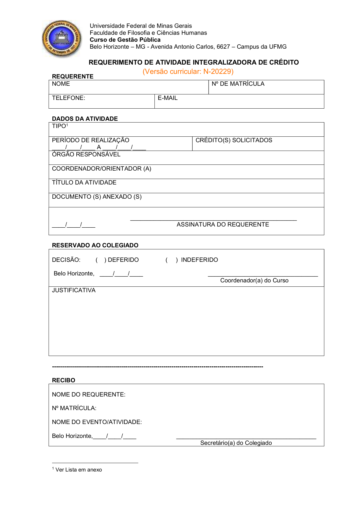

::: {.cagp-hero}
<div class="d-flex flex-wrap gap-2 mb-2">
  <span class="cagp-badge cagp-badge-red">Normas Oficiais • Capítulos IV e V</span>
  <span class="cagp-badge cagp-badge-dark">300h Extensão Obrigatória</span>
  <span class="cagp-badge cagp-badge-blue">Até 300h AAC (Art. 15)</span>
</div>

# EXTENSÃO UNIVERSITÁRIA E HORAS COMPLEMENTARES {.cagp-hero-title}

A formação em Gestão Pública na UFMG integra extensão comunitária obrigatória e enriquecimento acadêmico complementar. É fundamental compreender que **Formação em Extensão** e **Atividades Acadêmicas Complementares (AAC)** são exigências distintas previstas no Regulamento e no Projeto Pedagógico do Curso.
:::

```{=html}
<nav class="cagp-subnav" aria-label="Atalhos rápidos desta página">
  <span class="cagp-subnav-label">Nesta Página:</span>
  <a href="#calculadora-horas" class="cagp-subnav-link">🧮 Calculadora 600h</a>
  <a href="#regulamento-categorias" class="cagp-subnav-link">📑 As 9 Categorias AAC</a>
  <a href="#passo-a-passo" class="cagp-subnav-link">⚠️ Prazo 120 Dias & Validação</a>
  <a href="#programa-de-imersao" class="cagp-subnav-link">🏛️ Programa de Imersão</a>
  <a href="#nucleos-pesquisa" class="cagp-subnav-link">🔬 Núcleos de Pesquisa</a>
</nav>
```

## <span aria-hidden="true">🎯</span> Quadro Geral de Cargas Horárias

::: {.row .g-3 .mb-4}
::: {.col-md-4}
::: {.cagp-card .text-center}
<span class="cagp-badge cagp-badge-red mx-auto mb-2">Obrigação Legal</span>
<h3 class="h2 mb-0 cagp-tabular">300 HORAS</h3>
<p class="text-muted small mt-1 mb-0"><strong>Formação em Extensão Obrigatória</strong><br>10% da carga total do curso (Res. CEPE nº 10/2019)</p>
:::
:::

::: {.col-md-4}
::: {.cagp-card .text-center}
<span class="cagp-badge cagp-badge-dark mx-auto mb-2">Enriquecimento</span>
<h3 class="h2 mb-0 cagp-tabular">ATÉ 300 HORAS</h3>
<p class="text-muted small mt-1 mb-0"><strong>Atividades Complementares (AAC)</strong><br>Integralizáveis como optativas (Art. 15 do Regulamento)</p>
:::
:::

::: {.col-md-4}
::: {.cagp-card .text-center}
<span class="cagp-badge cagp-badge-blue mx-auto mb-2">Equivalência Regimental</span>
<h3 class="h2 mb-0 cagp-tabular">1 CRÉDITO = 15H</h3>
<p class="text-muted small mt-1 mb-0"><strong>Parâmetro Oficial da UFMG</strong><br>Todas as cargas são convertidas nesta proporção</p>
:::
:::
:::

---

## <span aria-hidden="true">🧮</span> Calculadora & Simulador Interativo de Horas {#calculadora-horas}

Use os botões **`-`** e **`+`** (em blocos de 15h = 1 crédito) para simular suas horas já realizadas ou planejadas. A calculadora **respeita automaticamente o teto máximo regimental de cada categoria** e salva seu rascunho neste navegador:

```{=html}
<section class="cagp-tool-box" aria-labelledby="calc-heading">
  <div class="cagp-tool-header">
    <div>
      <span class="cagp-badge cagp-badge-green mb-1">Trava Automática de Tetos (Art. 15)</span>
      <h3 id="calc-heading" class="h5 mb-0">SIMULADOR DE INTEGRALIZAÇÃO: EXTENSÃO (300H) + AAC (ATÉ 300H)</h3>
    </div>
    <button type="button" id="btn-calc-reset" class="cagp-chip">Zerar Simulação</button>
  </div>

  <div class="row g-4">
    <!-- Coluna 1: Extensão Obrigatória (300h) -->
    <div class="col-lg-6">
      <div class="cagp-compass-panel cagp-panel-boxed h-100">
        <div class="d-flex align-items-center justify-content-between flex-wrap gap-2 mb-2">
          <h4 class="h6 fw-bold text-uppercase mb-0">1. Formação em Extensão (Meta: 300h)</h4>
          <span id="ext-total-badge" class="cagp-badge cagp-badge-red cagp-tabular" aria-live="polite">0h / 300h (0 cr)</span>
        </div>
        <div class="cagp-progress-track mb-3" aria-hidden="true">
          <div id="ext-progress-bar" class="cagp-progress-fill" style="width: 0%;"></div>
        </div>
        <p class="small text-muted mb-3">Exigência obrigatória para colação de grau (20 créditos = 300h):</p>

        <div class="cagp-calc-row" data-calc-group="ext" data-calc-id="ext_lab_a" data-step="90" data-max="90">
          <div class="cagp-calc-info">
            <div class="fw-bold small">DCP 195 — Laboratório de Gestão A</div>
            <div class="cagp-calc-desc">Disciplina de Extensão • 90h (6 créditos)</div>
          </div>
          <div class="cagp-calc-controls">
            <button type="button" class="cagp-step-btn" data-action="dec" aria-label="Remover horas de Laboratório A">−</button>
            <span class="cagp-calc-readout">0h (0 cr)</span>
            <button type="button" class="cagp-step-btn" data-action="inc" aria-label="Adicionar horas de Laboratório A">+</button>
          </div>
        </div>

        <div class="cagp-calc-row" data-calc-group="ext" data-calc-id="ext_lab_b" data-step="90" data-max="90">
          <div class="cagp-calc-info">
            <div class="fw-bold small">DCP 196 — Laboratório de Gestão B</div>
            <div class="cagp-calc-desc">Disciplina de Extensão • 90h (6 créditos)</div>
          </div>
          <div class="cagp-calc-controls">
            <button type="button" class="cagp-step-btn" data-action="dec" aria-label="Remover horas de Laboratório B">−</button>
            <span class="cagp-calc-readout">0h (0 cr)</span>
            <button type="button" class="cagp-step-btn" data-action="inc" aria-label="Adicionar horas de Laboratório B">+</button>
          </div>
        </div>

        <div class="cagp-calc-row" data-calc-group="ext" data-calc-id="ext_equalitas" data-step="15" data-max="90">
          <div class="cagp-calc-info">
            <div class="fw-bold small">Equalitas Consultoria Jr. (Empresa Jr.)</div>
            <div class="cagp-calc-desc">Teto máximo: até 90h (6 créditos)</div>
          </div>
          <div class="cagp-calc-controls">
            <button type="button" class="cagp-step-btn" data-action="dec" aria-label="Remover horas de Equalitas Jr.">−</button>
            <span class="cagp-calc-readout">0h (0 cr)</span>
            <button type="button" class="cagp-step-btn" data-action="inc" aria-label="Adicionar horas de Equalitas Jr.">+</button>
          </div>
        </div>

        <div class="cagp-calc-row" data-calc-group="ext" data-calc-id="ext_proex" data-step="15" data-max="90">
          <div class="cagp-calc-info">
            <div class="fw-bold small">Projetos e Programas PROEX / SIEX</div>
            <div class="cagp-calc-desc">Bolsista ou voluntário • Teto: até 90h (6 cr)</div>
          </div>
          <div class="cagp-calc-controls">
            <button type="button" class="cagp-step-btn" data-action="dec" aria-label="Remover horas de PROEX">−</button>
            <span class="cagp-calc-readout">0h (0 cr)</span>
            <button type="button" class="cagp-step-btn" data-action="inc" aria-label="Adicionar horas de PROEX">+</button>
          </div>
        </div>

        <div class="cagp-calc-row" data-calc-group="ext" data-calc-id="ext_eventos" data-step="15" data-max="60">
          <div class="cagp-calc-info">
            <div class="fw-bold small">Organização / Debatedor de Eventos (II)</div>
            <div class="cagp-calc-desc">Comissão ou moderador • Teto: até 60h (4 cr)</div>
          </div>
          <div class="cagp-calc-controls">
            <button type="button" class="cagp-step-btn" data-action="dec" aria-label="Remover horas de Organização de Eventos">−</button>
            <span class="cagp-calc-readout">0h (0 cr)</span>
            <button type="button" class="cagp-step-btn" data-action="inc" aria-label="Adicionar horas de Organização de Eventos">+</button>
          </div>
        </div>

        <div class="cagp-calc-row" data-calc-group="ext" data-calc-id="ext_inter" data-step="15" data-max="120">
          <div class="cagp-calc-info">
            <div class="fw-bold small">Atividades Interinstitucionais de Ensino</div>
            <div class="cagp-calc-desc">Cursos em IES públicas • Teto: até 120h (8 cr)</div>
          </div>
          <div class="cagp-calc-controls">
            <button type="button" class="cagp-step-btn" data-action="dec" aria-label="Remover horas Interinstitucionais">−</button>
            <span class="cagp-calc-readout">0h (0 cr)</span>
            <button type="button" class="cagp-step-btn" data-action="inc" aria-label="Adicionar horas Interinstitucionais">+</button>
          </div>
        </div>
      </div>
    </div>

    <!-- Coluna 2: AAC (Até 300h - Art. 15) -->
    <div class="col-lg-6">
      <div class="cagp-compass-panel cagp-panel-boxed h-100">
        <div class="d-flex align-items-center justify-content-between flex-wrap gap-2 mb-2">
          <h4 class="h6 fw-bold text-uppercase mb-0">2. Horas Complementares AAC (Teto: 300h)</h4>
          <span id="aac-total-badge" class="cagp-badge cagp-badge-dark cagp-tabular" aria-live="polite">0h / 300h (0 cr)</span>
        </div>
        <div class="cagp-progress-track mb-3" aria-hidden="true">
          <div id="aac-progress-bar" class="cagp-progress-fill" style="width: 0%;"></div>
        </div>
        <p class="small text-muted mb-3">Abatem créditos optativos respeitando os limites do <strong>Art. 15</strong>:</p>

        <div class="cagp-calc-row" data-calc-group="aac" data-calc-id="aac_1" data-step="15" data-max="75">
          <div class="cagp-calc-info">
            <div class="fw-bold small">I. Pesquisa Interinstitucional</div>
            <div class="cagp-calc-desc">Teto máximo: até 75h (5 créditos)</div>
          </div>
          <div class="cagp-calc-controls">
            <button type="button" class="cagp-step-btn" data-action="dec" aria-label="Remover horas de Pesquisa Interinstitucional">−</button>
            <span class="cagp-calc-readout">0h (0 cr)</span>
            <button type="button" class="cagp-step-btn" data-action="inc" aria-label="Adicionar horas de Pesquisa Interinstitucional">+</button>
          </div>
        </div>

        <div class="cagp-calc-row" data-calc-group="aac" data-calc-id="aac_2" data-step="15" data-max="45">
          <div class="cagp-calc-info">
            <div class="fw-bold small">II. Monitoria Acadêmica</div>
            <div class="cagp-calc-desc">Teto máximo: até 45h (3 créditos)</div>
          </div>
          <div class="cagp-calc-controls">
            <button type="button" class="cagp-step-btn" data-action="dec" aria-label="Remover horas de Monitoria">−</button>
            <span class="cagp-calc-readout">0h (0 cr)</span>
            <button type="button" class="cagp-step-btn" data-action="inc" aria-label="Adicionar horas de Monitoria">+</button>
          </div>
        </div>

        <div class="cagp-calc-row" data-calc-group="aac" data-calc-id="aac_3" data-step="15" data-max="60">
          <div class="cagp-calc-info">
            <div class="fw-bold small">III. Eventos I — Ouvinte <span class="text-danger">(Prazo 120d!)</span></div>
            <div class="cagp-calc-desc">Teto máximo: até 60h (4 créditos)</div>
          </div>
          <div class="cagp-calc-controls">
            <button type="button" class="cagp-step-btn" data-action="dec" aria-label="Remover horas de Eventos Ouvinte">−</button>
            <span class="cagp-calc-readout">0h (0 cr)</span>
            <button type="button" class="cagp-step-btn" data-action="inc" aria-label="Adicionar horas de Eventos Ouvinte">+</button>
          </div>
        </div>

        <div class="cagp-calc-row" data-calc-group="aac" data-calc-id="aac_4" data-step="15" data-max="30">
          <div class="cagp-calc-info">
            <div class="fw-bold small">IV. Grupos de Estudo + VI. Pesq. Bibliográfica</div>
            <div class="cagp-calc-desc">Até 30h (2 cr) cada modalidade</div>
          </div>
          <div class="cagp-calc-controls">
            <button type="button" class="cagp-step-btn" data-action="dec" aria-label="Remover horas de Grupos de Estudo">−</button>
            <span class="cagp-calc-readout">0h (0 cr)</span>
            <button type="button" class="cagp-step-btn" data-action="inc" aria-label="Adicionar horas de Grupos de Estudo">+</button>
          </div>
        </div>

        <div class="cagp-calc-row" data-calc-group="aac" data-calc-id="aac_5" data-step="15" data-max="90">
          <div class="cagp-calc-info">
            <div class="fw-bold small">V. Iniciação Científica na UFMG (PIBIC/Volunt.)</div>
            <div class="cagp-calc-desc">Teto máximo: até 90h (6 créditos)</div>
          </div>
          <div class="cagp-calc-controls">
            <button type="button" class="cagp-step-btn" data-action="dec" aria-label="Remover horas de Iniciação Científica">−</button>
            <span class="cagp-calc-readout">0h (0 cr)</span>
            <button type="button" class="cagp-step-btn" data-action="inc" aria-label="Adicionar horas de Iniciação Científica">+</button>
          </div>
        </div>

        <div class="cagp-calc-row" data-calc-group="aac" data-calc-id="aac_7" data-step="15" data-max="90">
          <div class="cagp-calc-info">
            <div class="fw-bold small">VII. Anais (30h) + VIII. Artigo em Periódico (60h)</div>
            <div class="cagp-calc-desc">Publicações científicas • Anais têm prazo de 120d</div>
          </div>
          <div class="cagp-calc-controls">
            <button type="button" class="cagp-step-btn" data-action="dec" aria-label="Remover horas de Publicações">−</button>
            <span class="cagp-calc-readout">0h (0 cr)</span>
            <button type="button" class="cagp-step-btn" data-action="inc" aria-label="Adicionar horas de Publicações">+</button>
          </div>
        </div>

        <div class="cagp-calc-row" data-calc-group="aac" data-calc-id="aac_9" data-step="15" data-max="60">
          <div class="cagp-calc-info">
            <div class="fw-bold small">IX. Vivência Profissional / Estágio Não-Obrig.</div>
            <div class="cagp-calc-desc">Teto máximo: até 60h (4 créditos)</div>
          </div>
          <div class="cagp-calc-controls">
            <button type="button" class="cagp-step-btn" data-action="dec" aria-label="Remover horas de Vivência Profissional">−</button>
            <span class="cagp-calc-readout">0h (0 cr)</span>
            <button type="button" class="cagp-step-btn" data-action="inc" aria-label="Adicionar horas de Vivência Profissional">+</button>
          </div>
        </div>
      </div>
    </div>
  </div>
</section>
```

<div class="d-flex flex-wrap align-items-center justify-content-between p-3 my-4 bg-light border rounded gap-2">
  <span class="small">📜 Todas as 9 modalidades de AAC e os prazos regimentais constam no <strong>Capítulo IV do Regulamento</strong> (Art. 13 a 17).</span>
  <a href="documentos/regulamento-gestao-publica-ufmg.pdf" target="_blank" class="cagp-doc-btn cagp-doc-btn-outline py-1 px-3">📥 Baixar Regulamento do Curso (PDF • 2 MB)</a>
</div>

---

## <span aria-hidden="true">📑</span> Regulamento Detalhado por Categoria {#regulamento-categorias}

::: {.panel-tabset}

### 1. Formação em Extensão Obrigatória (300h)

A **Resolução CEPE nº 10/2019** estabelece que 10% da carga horária de todos os cursos de graduação da UFMG deve ser composta por extensão universitária com a sociedade.

### Como Integralizar as 300 Horas de Extensão: {.fs-5}

1. **Disciplinas Optativas de Laboratório de Extensão:**
   - `DCP 195 - Laboratório de Gestão e Políticas Públicas A:` 90 horas (6 créditos).
   - `DCP 196 - Laboratório de Gestão e Políticas Públicas B:` 90 horas (6 créditos).
2. **Empresa Júnior de Gestão Pública (Equalitas UFMG Consultoria Jr.):**
   - Atividades e projetos de consultoria desenvolvidos na *Equalitas Jr.* são convalidáveis como Atividades Interinstitucionais de Extensão (até 6 créditos / 90 horas).
3. **Projetos e Programas de Extensão na UFMG (PROEX / SIEX):**
   - Participação como bolsista ou voluntário em projetos registrados no Sistema de Informação da Extensão (até 6 créditos / 90 horas).
4. **Participação em Organização de Eventos (Eventos II):**
   - Atuação em comissão organizadora, comitê técnico-científico ou como debatedor/moderador de evento da área (até 2 créditos, extensível a 4 créditos somado a ouvinte).
5. **Atividades Interinstitucionais de Ensino:**
   - Cursos e oficinas promovidos por outras instituições de ensino públicas na área de Gestão Pública (até 8 créditos / 120 horas).

::: {.callout-note}
### Docente Responsável no DCP
Conforme o Art. 14, o Colegiado designa um docente específico do Departamento de Ciência Política com mandato de 2 anos para analisar e despachar requerimentos de extensão *ad referendum*.
:::

### 2. Atividades Acadêmicas Complementares - AAC (Art. 15)

As AACs são atividades facultativas de enriquecimento curricular desenvolvidas durante o vínculo com a graduação, podendo integralizar até 300 horas do grupo de optativas (Art. 15):

::: {.table-responsive}
| Modalidade Oficial (Art. 15) | Atividades Válidas | Teto Máximo | Comprovação Exigida no Colegiado |
| :--- | :--- | :---: | :--- |
| **I — Pesquisa Interinstitucional** | Projetos de pesquisa realizados em outras instituições voltadas para Gestão Pública. | **75h** (5 cr) | Relatório final assinado pelo discente e responsável externo, com avaliação de desempenho. |
| **II — Monitoria Acadêmica** | Monitoria (bolsista ou voluntária) em disciplinas afins à Gestão Pública. | **45h** (3 cr) | Relatório final assinado junto ao docente responsável pela matéria. |
| **III — Eventos I (Ouvinte)** | Congressos, seminários e palestras na área de públicas (1 crédito a cada 15h). | **60h** (4 cr) | <span class="cagp-badge cagp-badge-red mb-1">Prazo: 120 dias</span><br>Certificado com carga horária protocolado em até 120 dias corridos do evento! |
| **IV — Grupos de Estudo** | Participação regular em grupos de estudo cadastrados na UFMG. | **30h** (2 cr) | Relatório final assinado com avaliação do docente coordenador. |
| **V — Pesquisa na UFMG** | Iniciação Científica (PIBIC, PIBITI ou voluntária) desenvolvida na UFMG. | **90h** (6 cr) | Relatório final atestado pelo orientador da pesquisa no DCP/UFMG. |
| **VI — Pesquisa Bibliográfica** | Aprofundamento teórico orientado por docente em tema da área, distinto do TCC. | **30h** (2 cr) | Texto científico elaborado e parecer avaliativo do docente orientador. |
| **VII — Trabalho em Anais** | Apresentação de pôster, trabalho oral ou artigo publicado em anais de evento científico. | **30h** (2 cr) | <span class="cagp-badge cagp-badge-red mb-1">Prazo: 120 dias</span><br>Certificado de apresentação entregue em até 120 dias corridos do evento. |
| **VIII — Artigo em Periódico** | Artigo publicado em revista científica reconhecida (Qualis/Capes). | **60h** (4 cr) | Cópia do artigo publicado ou carta oficial de aceite definitivo do periódico. |
| **IX — Vivência Profissional** | Gestão em órgãos públicos, ONGs ou estágio não-obrigatório na área de públicas. | **60h** (4 cr) | Documento de autorização e relatório final assinado com avaliação das atribuições. |
:::

### 3. Prazos e Submissão ao Colegiado {#passo-a-passo}

::: {.callout-important}
### ⚠️ Fique Atento ao Prazo Regimental de 120 Dias!
O Art. 15, § 4º, incisos III e VII estabelece que certificados de participação e de apresentação em congressos, conferências e eventos devem ser protocolados junto ao Colegiado no **prazo máximo de 120 dias corridos após a realização do evento**! Não guarde certificados de eventos para o fim do curso.
:::

```{=html}
<section class="cagp-doc-guide my-4" aria-labelledby="guide-aac-title">
  <div class="cagp-doc-guide-header d-flex flex-wrap align-items-center justify-content-between gap-2">
    <div>
      <span class="cagp-badge cagp-badge-red mb-1">Guia Visual Passo a Passo</span>
      <h3 id="guide-aac-title" class="h5 mb-0 text-uppercase fw-bold">Como Preencher o Requerimento de AAC (Versão N-20229)</h3>
    </div>
    <a href="documentos/requerimento-atividade-integralizadora-credito-v20229.pdf" target="_blank" class="cagp-chip">📥 Baixar Requerimento Oficial (PDF)</a>
  </div>
  <p class="small text-muted mb-4">
    Preencha um requerimento para cada atividade extracurricular que desejar integralizar na sua carga horária de até 300h (Art. 15). Confira os campos indispensáveis no formulário padrão:
  </p>

  <div class="row g-4">
    <!-- Visual com Print e Pins -->
    <div class="col-lg-6">
      <div class="cagp-doc-preview-wrapper" role="region" aria-label="Visualização anotada do formulário de Requerimento de Atividade Integralizadora de Crédito">
        
        
        <!-- Box 1 & Pin 1: Identificação -->
        <div class="cagp-doc-box" style="top: 13%; left: 5%; width: 90%; height: 16%;" aria-hidden="true"></div>
        <button type="button" class="cagp-doc-pin" style="top: 13%; left: 5%;" aria-label="Ponto 1: Identificação do Requerente">1</button>

        <!-- Box 2 & Pin 2: Dados da Atividade -->
        <div class="cagp-doc-box" style="top: 31%; left: 5%; width: 90%; height: 26%;" aria-hidden="true"></div>
        <button type="button" class="cagp-doc-pin" style="top: 31%; left: 5%;" aria-label="Ponto 2: Dados da Atividade e Créditos Requeridos">2</button>

        <!-- Box 3 & Pin 3: Documentos e Assinatura -->
        <div class="cagp-doc-box" style="top: 58%; left: 5%; width: 90%; height: 18%;" aria-hidden="true"></div>
        <button type="button" class="cagp-doc-pin" style="top: 58%; left: 5%;" aria-label="Ponto 3: Comprovação e Assinatura">3</button>
      </div>
    </div>

    <!-- Passos Explicativos -->
    <div class="col-lg-6">
      <div class="cagp-step-list">
        <div class="cagp-step-card">
          <span class="cagp-step-num">1</span>
          <div class="cagp-step-content">
            <h4 class="cagp-step-title">1. Identificação do(a) Estudante</h4>
            <p class="cagp-step-desc">
              Preencha seu nome completo, <strong>Nº de Matrícula</strong>, telefone de contato e e-mail institucional <code>@ufmg.br</code>. Certifique-se de que sua versão curricular é a <strong>N-20229</strong>.
            </p>
          </div>
        </div>

        <div class="cagp-step-card">
          <span class="cagp-step-num">2</span>
          <div class="cagp-step-content">
            <h4 class="cagp-step-title">2. Classificação da Atividade & Créditos</h4>
            <p class="cagp-step-desc">
              Indique o <strong>Tipo (Modalidades I a IX)</strong>, período de realização (início e término), órgão ou entidade promotora e a quantidade exata de créditos solicitados (1 crédito = 15h).
            </p>
          </div>
        </div>

        <div class="cagp-step-card">
          <span class="cagp-step-num">3</span>
          <div class="cagp-step-content">
            <h4 class="cagp-step-title">3. Anexos Comprobatórios & Assinatura</h4>
            <p class="cagp-step-desc">
              Relacione no campo de documentos os certificados com código/link de verificação de autenticidade eletrônica. Assine e date a solicitação antes da entrega.
            </p>
          </div>
        </div>

        <div class="cagp-step-card">
          <span class="cagp-step-num">📍</span>
          <div class="cagp-step-content">
            <h4 class="cagp-step-title">Onde Entregar e Acompanhamento</h4>
            <p class="cagp-step-desc">
              Protocolar no guichê do CEAG (2º andar da FAFICH) ou conforme instrução semestral do Colegiado. Após análise do docente do DCP, os créditos constarão no seu histórico escolar no SIGA.
            </p>
          </div>
        </div>
      </div>
    </div>
  </div>
</section>
```

:::

---

## <span aria-hidden="true">🏛️</span> Programa de Imersão no Campo de Públicas {#programa-de-imersao}

Criado no segundo semestre de 2017 pelo Colegiado de Coordenação Didática, o **Programa de Imersão no Campo de Públicas** congrega ações de ensino, pesquisa e extensão universitária. Seu objetivo é integrar a formação teórica de sala de aula à prática profissional real, prestando consultoria e assessoramento direto a órgãos públicos municipais, estaduais e organizações da sociedade civil.

O programa estrutura-se em **3 eixos fundamentais**:

```{=html}
<div class="row g-4 my-2">
  <div class="col-md-4">
    <div class="cagp-card h-100">
      <div class="d-flex align-items-center justify-content-between mb-2">
        <span class="cagp-badge cagp-badge-red">Eixo 1 • Ensino & Extensão</span>
      </div>
      <h3 class="fs-6 fw-bold text-uppercase mb-2">Laboratórios A e B</h3>
      <p class="small text-muted mb-2">Operacionalizado nas disciplinas de <strong>Laboratório de Gestão e Políticas Públicas A e B</strong> (7º e 8º períodos). Equipes de alunos desenvolvem produtos sob demanda de órgãos públicos parceiros:</p>
      <ul class="small mb-3 ps-3">
        <li>Diagnósticos de gestão ou situacionais;</li>
        <li>Projetos de intervenção governamental;</li>
        <li>Análises de políticas públicas e matrizes orçamentárias;</li>
        <li>Otimização de processos e gestão de pessoas.</li>
      </ul>
    </div>
  </div>

  <div class="col-md-4">
    <div class="cagp-card h-100">
      <div class="d-flex align-items-center justify-content-between mb-2">
        <span class="cagp-badge cagp-badge-dark">Eixo 2 • Prefeituras</span>
      </div>
      <h3 class="fs-6 fw-bold text-uppercase mb-2">Gestão Além do Horizonte</h3>
      <p class="small text-muted mb-2">Projeto de assessoria técnica a gestores de prefeituras municipais de Minas Gerais, conduzido por discentes sob supervisão docente do DCP:</p>
      <ul class="small mb-3 ps-3">
        <li>Elaboração de planos municipais em áreas temáticas prioritárias;</li>
        <li>Captação de recursos federais e estaduais para municípios;</li>
        <li>Capacitação de equipes administrativas locais.</li>
      </ul>
    </div>
  </div>

  <div class="col-md-4">
    <div class="cagp-card h-100">
      <div class="d-flex align-items-center justify-content-between mb-2">
        <span class="cagp-badge cagp-badge-blue">Eixo 3 • SIEX UFMG</span>
      </div>
      <h3 class="fs-6 fw-bold text-uppercase mb-2">Práticas Avançadas</h3>
      <p class="small text-muted mb-2">Projetos de extensão contínuos com duração superior a um semestre, registrados oficialmente no Sistema de Informação da Extensão (SIEX):</p>
      <ul class="small mb-3 ps-3">
        <li><strong>Registro SIEX:</strong> Projetos nº 109111 e nº 109109;</li>
        <li><strong>Instagram Oficial:</strong> <a href="https://www.instagram.com/programadeimersao" target="_blank" rel="noopener noreferrer">@programadeimersao ↗</a>;</li>
        <li>Participação remunerada com bolsas de extensão ou voluntária válida para a carga horária de 300h.</li>
      </ul>
    </div>
  </div>
</div>
```

---

## <span aria-hidden="true">🔬</span> Núcleos de Pesquisa do DCP: Oportunidades de Bolsas e Iniciação Científica {#nucleos-pesquisa}

Os estudantes de Gestão Pública da UFMG têm acesso aos centros e laboratórios de pesquisa vinculados ao **Departamento de Ciência Política (DCP)** e à FAFICH. A atuação como bolsista (PIBIC, PIBITI, FAPEMIG) ou voluntário de Iniciação Científica permite integralizar horas de AAC (Modalidade V do Art. 15):

```{=html}
<div class="cagp-card mb-4">
  <h3 class="fs-6 fw-bold text-uppercase mb-3">Principais Centros de Pesquisa do DCP / FAFICH</h3>
  <div class="d-flex flex-wrap gap-1">
    <span class="cagp-research-pill"><strong>Publicus:</strong> Núcleo de Estudos em Gestão e Políticas Públicas</span>
    <span class="cagp-research-pill"><strong>PRODEP:</strong> Projeto Democracia Participativa</span>
    <span class="cagp-research-pill"><strong>CECOMP:</strong> Centro de Estudos do Comportamento Político</span>
    <span class="cagp-research-pill"><strong>CEDE:</strong> Centro de Estudos em Deliberação</span>
    <span class="cagp-research-pill"><strong>CEL:</strong> Centro de Estudos Legislativos</span>
    <span class="cagp-research-pill"><strong>CePPI:</strong> Política e Internet</span>
    <span class="cagp-research-pill"><strong>CIAPSOC:</strong> Análise de Políticas Públicas</span>
    <span class="cagp-research-pill"><strong>GEDAI:</strong> Deliberação, Ativismo e Inclusão</span>
    <span class="cagp-research-pill"><strong>DECODE:</strong> Democracia e Comunicação Digital</span>
    <span class="cagp-research-pill"><strong>Margem:</strong> Democracia e Justiça</span>
    <span class="cagp-research-pill"><strong>NEPEM:</strong> Estudos e Pesquisas sobre a Mulher</span>
    <span class="cagp-research-pill"><strong>NESTH:</strong> Trabalho Humano</span>
    <span class="cagp-research-pill"><strong>Observatório da Justiça no Brasil e América Latina</strong></span>
    <span class="cagp-research-pill"><strong>Opinião Pública:</strong> Marketing Político e Eleitoral</span>
    <span class="cagp-research-pill"><strong>RIPPERP:</strong> Política Externa e Regime Político</span>
  </div>
  <p class="small text-muted mt-3 mb-0">💡 <strong>Como ingressar:</strong> Acompanhe os editais semestrais de seleção de bolsistas e voluntários divulgados no mural da FAFICH, pelo Colegiado e pelas mídias do CAGP.</p>
</div>
```

---

## <span aria-hidden="true">📌</span> Principais Dúvidas sobre Horas e Atividades

::: {.cagp-card}
### Dicas Práticas dos Veteranos
- **Posso usar o mesmo evento para Extensão e AAC?**  
  Não. Conforme o regulamento, uma mesma atividade não pode ser duplicada entre categorias. O discente escolhe se a atividade preencherá o grupo de Extensão (caso envolva comissão/debatedor) ou de AAC (caso ouvinte).
- **Atividades anteriores à matrícula na UFMG são válidas?**  
  Não. O Art. 15, § 1º determina que as atividades devem ser realizadas estritamente **durante o período em que o discente estiver matriculado** no curso de Gestão Pública.
- **E se minha solicitação for indeferida?**  
  Conforme o Art. 16, a atividade indeferida não pode ser reapresentada na mesma modalidade, mas cabe recurso administrativo fundamentado ao Colegiado de Coordenação Didática.
:::

```{=html}
<nav class="cagp-journey-nav" aria-label="Continuidade da jornada acadêmica">
  <div class="row g-3">
    <div class="col-md-6">
      <a href="percurso.html" class="cagp-journey-link">
        <div>
          <div class="cagp-journey-dir">&larr; Passo Anterior</div>
          <div class="cagp-journey-title">Percurso Curricular & Ementas (10 Semestres)</div>
        </div>
        <p class="cagp-journey-desc">Voltar para o explorador das 27 matérias obrigatórias e comparativo dos 3 percursos.</p>
      </a>
    </div>
    <div class="col-md-6">
      <a href="estagio-tcc.html" class="cagp-journey-link">
        <div>
          <div class="cagp-journey-dir">Próximo Passo na Jornada &rarr;</div>
          <div class="cagp-journey-title">Estágio Supervisionado, Dispensa Art. 41 & TCC</div>
        </div>
        <p class="cagp-journey-desc">Simule sua elegibilidade para dispensa de estágio e conheça as 4 modalidades de TCC.</p>
      </a>
    </div>
  </div>
</nav>

<script>
document.addEventListener('DOMContentLoaded', function () {
  const STORAGE_KEY = 'cagp_calc_ext_aac_v1';
  const rows = Array.from(document.querySelectorAll('.cagp-calc-row'));
  const extBadge = document.getElementById('ext-total-badge');
  const extBar = document.getElementById('ext-progress-bar');
  const aacBadge = document.getElementById('aac-total-badge');
  const aacBar = document.getElementById('aac-progress-bar');
  const resetBtn = document.getElementById('btn-calc-reset');

  function loadState() {
    try {
      return JSON.parse(localStorage.getItem(STORAGE_KEY) || '{}');
    } catch (e) {
      return {};
    }
  }

  function saveState(state) {
    try {
      localStorage.setItem(STORAGE_KEY, JSON.stringify(state));
    } catch (e) {}
  }

  const values = loadState();

  function render() {
    let extSum = 0;
    let aacSum = 0;

    rows.forEach(function (row) {
      const id = row.getAttribute('data-calc-id');
      const group = row.getAttribute('data-calc-group');
      const max = parseInt(row.getAttribute('data-max') || '60', 10);
      const val = Math.min(max, Math.max(0, parseInt(values[id] || 0, 10)));
      values[id] = val;

      if (group === 'ext') extSum += val;
      if (group === 'aac') aacSum += val;

      const readout = row.querySelector('.cagp-calc-readout');
      const decBtn = row.querySelector('[data-action="dec"]');
      const incBtn = row.querySelector('[data-action="inc"]');
      const cr = Math.round(val / 15);
      if (readout) readout.textContent = val + 'h (' + cr + ' cr)';
      if (decBtn) decBtn.disabled = (val <= 0);
      if (incBtn) incBtn.disabled = (val >= max);
    });

    const extCap = Math.min(300, extSum);
    const extCr = Math.round(extCap / 15);
    const extPct = Math.round((extCap / 300) * 100);
    if (extBadge) extBadge.textContent = extCap + 'h / 300h (' + extCr + ' cr)';
    if (extBar) {
      extBar.style.width = extPct + '%';
      extBar.classList.toggle('is-complete', extCap >= 300);
    }

    const aacCap = Math.min(300, aacSum);
    const aacCr = Math.round(aacCap / 15);
    const aacPct = Math.round((aacCap / 300) * 100);
    if (aacBadge) aacBadge.textContent = aacCap + 'h / 300h (' + aacCr + ' cr)';
    if (aacBar) {
      aacBar.style.width = aacPct + '%';
      aacBar.classList.toggle('is-complete', aacCap >= 300);
    }
  }

  rows.forEach(function (row) {
    const id = row.getAttribute('data-calc-id');
    const step = parseInt(row.getAttribute('data-step') || '15', 10);
    const max = parseInt(row.getAttribute('data-max') || '60', 10);
    const decBtn = row.querySelector('[data-action="dec"]');
    const incBtn = row.querySelector('[data-action="inc"]');

    if (decBtn) {
      decBtn.addEventListener('click', function () {
        values[id] = Math.max(0, (parseInt(values[id] || 0, 10)) - step);
        saveState(values);
        render();
      });
    }
    if (incBtn) {
      incBtn.addEventListener('click', function () {
        values[id] = Math.min(max, (parseInt(values[id] || 0, 10)) + step);
        saveState(values);
        render();
      });
    }
  });

  if (resetBtn) {
    resetBtn.addEventListener('click', function () {
      Object.keys(values).forEach(function (k) { values[k] = 0; });
      saveState(values);
      render();
    });
  }

  render();
});
</script>
```
