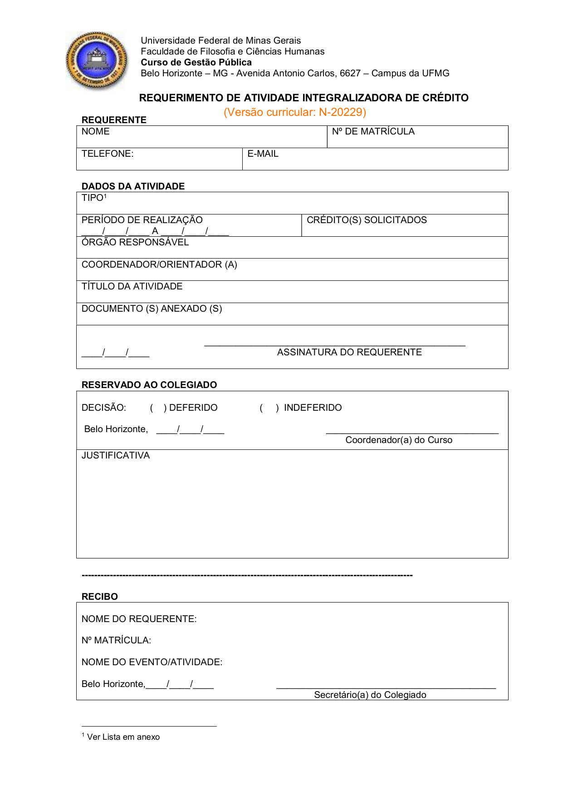

```{=html}
<header class="cagp-workspace-header" role="region" aria-label="Cabeçalho e Sub-Views de Extensão e AAC">
  <div class="cagp-workspace-toprow">
    <nav class="cagp-breadcrumbs" aria-label="Você está aqui: Trilha de navegação">
      <ol class="cagp-breadcrumb-list" itemscope itemtype="https://schema.org/BreadcrumbList">
        <li class="cagp-breadcrumb-item" itemprop="itemListElement" itemscope itemtype="https://schema.org/ListItem">
          <a href="index.html" itemprop="item"><i class="bi bi-house-door" aria-hidden="true"></i> <span itemprop="name">Início</span></a>
          <meta itemprop="position" content="1" />
        </li>
        <li class="cagp-breadcrumb-separator" aria-hidden="true">&rsaquo;</li>
        <li class="cagp-breadcrumb-item">
          <span class="cagp-breadcrumb-parent">Currículo &amp; Horas</span>
        </li>
        <li class="cagp-breadcrumb-separator" aria-hidden="true">&rsaquo;</li>
        <li class="cagp-breadcrumb-item is-active" itemprop="itemListElement" itemscope itemtype="https://schema.org/ListItem" aria-current="page">
          <span itemprop="name">Extensão &amp; Horas AAC (600h)</span>
          <meta itemprop="position" content="2" />
        </li>
      </ol>
    </nav>
    <div class="cagp-workspace-badges">
      <span class="cagp-badge cagp-badge-red">Normas Oficiais • Capítulos IV e V</span>
      <span class="cagp-badge cagp-badge-dark">300h Extensão Obrigatória</span>
      <span class="cagp-badge cagp-badge-blue">Até 300h AAC (Art. 15)</span>
      <span class="cagp-badge cagp-badge-green">1 Crédito = 15h</span>
    </div>
  </div>
  <h1 class="cagp-workspace-title">EXTENSÃO UNIVERSITÁRIA E HORAS COMPLEMENTARES (600H)</h1>
  <p class="cagp-workspace-subtitle">Simulador interativo com trava automática de tetos regimentais, Guardião do prazo fatal de 120 dias corridos (Art. 15, § 4º) e tutorial passo a passo do Formulário Oficial N-20229.</p>

  <nav class="cagp-workspace-bar" aria-label="Alternar ferramentas de Extensão e AAC">
    <div class="cagp-workspace-tabs" role="tablist">
      <button type="button" class="cagp-workspace-tab is-active" id="ws-tab-v1" role="tab" aria-selected="true" data-ws-tab="v1" data-ws-hash="#calculadora-horas">
        <i class="bi bi-calculator-fill" aria-hidden="true"></i>
        <span class="cagp-tab-label-full">1. Calculadora 600h</span>
        <span class="cagp-tab-label-short" aria-hidden="true">Calc</span>
      </button>
      <button type="button" class="cagp-workspace-tab" id="ws-tab-v2" role="tab" aria-selected="false" data-ws-tab="v2" data-ws-hash="#guardiao-120-dias">
        <i class="bi bi-shield-exclamation" aria-hidden="true"></i>
        <span class="cagp-tab-label-full">2. Guardião 120 Dias</span>
        <span class="cagp-tab-label-short" aria-hidden="true">120d</span>
      </button>
      <button type="button" class="cagp-workspace-tab" id="ws-tab-v3" role="tab" aria-selected="false" data-ws-tab="v3" data-ws-hash="#regulamento-categorias">
        <i class="bi bi-card-list" aria-hidden="true"></i>
        <span class="cagp-tab-label-full">3. Guia &amp; Tramitação</span>
        <span class="cagp-tab-label-short" aria-hidden="true">Guia</span>
      </button>
      <button type="button" class="cagp-workspace-tab" id="ws-tab-all" role="tab" aria-selected="false" data-ws-tab="__all__" data-ws-hash="#visao-completa">
        <i class="bi bi-arrows-expand" aria-hidden="true"></i>
        <span class="cagp-tab-label-full">Ver Tudo</span>
        <span class="cagp-tab-label-short" aria-hidden="true">Tudo</span>
      </button>
    </div>
  </nav>
</header>
```

::: {#ws-panel-v1 .cagp-workspace-view .is-active role="tabpanel" aria-labelledby="ws-tab-v1" data-ws-view="v1"}

```{=html}
<!-- HUD Linear Compacto de 64px para 1ª Dobra (Extensão 300h + AAC 300h) -->
<div id="cagp-calc-hud-linear" class="cagp-calc-hud-linear mb-3 p-2 border border-1 border-dark bg-light" role="region" aria-label="Progresso de Integralização 600h">
  <div class="row g-2">
    <div class="col-12 col-md-6">
      <div class="d-flex justify-content-between align-items-center mb-1">
        <span class="small fw-bold text-uppercase">Extensão Obrigatória</span>
        <span id="hud-ext-val" class="font-mono small fw-bold">0/300h (0 cr)</span>
      </div>
      <div class="progress" style="height: 8px;">
        <div id="hud-ext-bar" class="progress-bar bg-danger" role="progressbar" style="width: 0%;" aria-valuenow="0" aria-valuemin="0" aria-valuemax="300"></div>
      </div>
    </div>
    <div class="col-12 col-md-6">
      <div class="d-flex justify-content-between align-items-center mb-1">
        <span class="small fw-bold text-uppercase">Atividades Complementares (AAC)</span>
        <span id="hud-aac-val" class="font-mono small fw-bold">0/300h (0 cr)</span>
      </div>
      <div class="progress" style="height: 8px;">
        <div id="hud-aac-bar" class="progress-bar bg-success" role="progressbar" style="width: 0%;" aria-valuenow="0" aria-valuemin="0" aria-valuemax="300"></div>
      </div>
    </div>
  </div>
</div>
```

## <i class="bi bi-calculator" aria-hidden="true"></i> Calculadora & Simulador Interativo de Horas {#calculadora-horas}
<span id="calculadora" class="cagp-anchor-alias" aria-hidden="true"></span>

Use os botões **`-`** e **`+`** (em blocos de 15h = 1 crédito) para simular suas horas já realizadas ou planejadas. A calculadora **respeita automaticamente o teto máximo regimental de cada categoria** e salva seu rascunho neste navegador:

```{=html}
<section class="cagp-tool-box" aria-labelledby="calc-heading">
  <div class="cagp-tool-header">
    <div>
      <span class="cagp-badge cagp-badge-green mb-1">Trava Automática de Tetos (Art. 15)</span>
      <h3 id="calc-heading" class="h5 mb-0">SIMULADOR DE INTEGRALIZAÇÃO: EXTENSÃO (300H) + AAC (ATÉ 300H)</h3>
    </div>
    <div class="d-flex flex-wrap align-items-center gap-2">
      <a href="documentos/requerimento-atividade-integralizadora-credito-v20229.pdf" target="_blank" class="cagp-btn cagp-btn-primary btn-sm">
        <i class="bi bi-file-earmark-pdf me-1" aria-hidden="true"></i> Formulário Oficial N-20229 (PDF)
      </a>
      <button type="button" id="btn-calc-sample" class="cagp-chip"><i class="bi bi-play-circle me-1" aria-hidden="true"></i>Exemplo (360h)</button>
      <button type="button" id="btn-calc-reset" class="cagp-chip">Zerar Simulação</button>
    </div>
  </div>

  <!-- DASHBOARD DE SALDO E LIMITES DE HORAS ESTILO NUBANK / BANCO INTER -->
  <div id="cagp-hours-bank-dashboard" class="cagp-hours-bank-card" role="region" aria-label="Painel de saldo e limites de horas de Extensão e AAC">
    <div class="cagp-hours-bank-top">
      <div>
        <div class="small fw-bold text-uppercase" style="color: #ffe082; letter-spacing: 0.05em;">
          <i class="bi bi-wallet2 me-1" aria-hidden="true"></i> Extrato de Integralização • PPC 2020 &amp; Art. 15
        </div>
        <div class="h4 fw-bold font-display text-uppercase text-white mb-0">Limite e Metas de Horas (600h = 40 Créditos)</div>
      </div>
      <div class="d-flex align-items-center gap-2">
        <div id="acg-bank-ring" class="cagp-metric-ring" style="--ring-pct: 0;" aria-hidden="true">
          <div class="cagp-metric-ring-inner" style="background-color: #ffffff; color: #0a0a0a;">
            <span id="acg-bank-ring-val">0%</span>
          </div>
        </div>
      </div>
    </div>

    <div class="cagp-hours-bank-slots">
      <div class="cagp-hours-bank-slot">
        <div class="small fw-bold text-uppercase text-muted mb-1">Saldo Integralizado</div>
        <div id="acg-bank-completed-val" class="h4 fw-bold font-monospace cagp-tabular mb-0" style="color: #1E6B3A;">0h / 600h</div>
        <div id="acg-bank-completed-sub" class="small text-dark fw-semibold">0h Extensão (0 cr) • 0h AAC (0 cr)</div>
      </div>
      <div class="cagp-hours-bank-slot">
        <div class="small fw-bold text-uppercase text-muted mb-1">Quanto Falta para Formar</div>
        <div id="acg-bank-remaining-val" class="h4 fw-bold font-monospace cagp-tabular text-danger mb-0">600h restantes</div>
        <div id="acg-bank-remaining-sub" class="small text-dark fw-semibold">Faltam 300h Extensão + 300h AAC</div>
      </div>
      <div class="cagp-hours-bank-slot">
        <div class="small fw-bold text-uppercase text-danger mb-1">
          <i class="bi bi-exclamation-triangle-fill me-1" aria-hidden="true"></i>Prazo Fatal • Art. 15, § 4º
        </div>
        <div class="h5 fw-bold font-display text-uppercase text-dark mb-0">120 Dias Corridos</div>
        <div class="small text-muted">Protocolo obrigatório para <strong>Eventos I (Mod. III)</strong> e <strong>Trabalho em Anais (Mod. VII)</strong>.</div>
      </div>
    </div>
  </div>

  <!-- Banner Dinâmico de Progresso e Celebração 600h -->
  <div id="cagp-calc-celebration" class="cagp-calc-celebration-box" role="status" aria-live="polite">
    <div class="d-flex flex-wrap align-items-center justify-content-between gap-2 mb-2">
      <span id="calc-status-badge" class="cagp-calc-status-badge"><i class="bi bi-compass" aria-hidden="true"></i> SIMULADOR ATIVO</span>
      <span id="calc-combined-readout" class="small fw-bold cagp-tabular text-dark">0h / 600h simuladas (0 cr de 40 cr)</span>
    </div>
    <div id="calc-feedback-text" class="small mb-0">
      Ajuste as horas abaixo usando os botões <strong>+</strong> e <strong>−</strong> para calcular sua integralização nas duas frentes obrigatórias: <strong>300h de Extensão</strong> e <strong>300h de Atividades Complementares (AAC)</strong>.
    </div>
    <div id="calc-action-banner" class="mt-3" style="display: none;">
      <a href="#passo-a-passo" class="cagp-doc-btn cagp-doc-btn-primary">
        <i class="bi bi-check2-circle me-1" aria-hidden="true"></i> Ver Passo a Passo para Dar Entrada no Colegiado
      </a>
    </div>
  </div>

  <div class="row g-4">
    <!-- Coluna 1: Extensão Obrigatória (300h) -->
    <div class="col-lg-6">
      <div class="cagp-compass-panel cagp-panel-boxed h-100">
        <div class="d-flex align-items-center justify-content-between flex-wrap gap-2 mb-2">
          <h4 class="h6 fw-bold text-uppercase mb-0">1. Formação em Extensão (Meta: 300h)</h4>
          <span id="ext-total-badge" class="cagp-badge cagp-badge-red cagp-tabular" aria-live="polite">0h / 300h (0 cr)</span>
        </div>
        <div class="cagp-progress-track mb-3" aria-hidden="true">
          <div id="ext-progress-bar" class="cagp-progress-fill" style="width: 0%;"></div>
        </div>
        <p class="small text-muted mb-3">Exigência obrigatória para colação de grau (20 créditos = 300h):</p>

        <div class="cagp-calc-row" data-calc-group="ext" data-calc-id="ext_lab_a" data-step="90" data-max="90">
          <div class="cagp-calc-info">
            <div class="fw-bold small">DCP 195 — Laboratório de Gestão A</div>
            <div class="cagp-calc-desc">Disciplina de Extensão • 90h (6 créditos)</div>
            <button type="button" class="cagp-calc-drawer-toggle" aria-expanded="false" aria-controls="drawer-ext_lab_a">
              <i class="bi bi-info-circle-fill me-1" aria-hidden="true"></i> O que conta nisso?
              <i class="bi bi-chevron-down cagp-drawer-arrow ms-1" aria-hidden="true"></i>
            </button>
          </div>
          <div class="cagp-calc-controls">
            <button type="button" class="cagp-step-btn" data-action="dec" aria-label="Remover horas de Laboratório A">−</button>
            <span class="cagp-calc-readout">0h (0 cr)</span>
            <button type="button" class="cagp-step-btn" data-action="inc" aria-label="Adicionar horas de Laboratório A">+</button>
          </div>
          <div id="drawer-ext_lab_a" class="cagp-calc-drawer">
            <div class="cagp-calc-drawer-inner">
              <div class="cagp-drawer-grid">
                <div class="cagp-drawer-section is-accepted">
                  <div class="cagp-drawer-header">
                    <span class="cagp-badge cagp-badge-green"><i class="bi bi-check-circle-fill me-1"></i> O QUE CONTA</span>
                  </div>
                  <ul>
                    <li>Aprovação formal na disciplina prática <strong>DCP 195</strong> no 7º período;</li>
                    <li>Desenvolvimento de diagnósticos de gestão e matrizes aplicadas a órgãos parceiros;</li>
                    <li>Integralização direta de 90h de extensão no SIGA pela nota final.</li>
                  </ul>
                </div>
                <div class="cagp-drawer-section is-rejected">
                  <div class="cagp-drawer-header">
                    <span class="cagp-badge cagp-badge-red"><i class="bi bi-x-circle-fill me-1"></i> O QUE NÃO CONTA</span>
                  </div>
                  <ul>
                    <li>Não é passível de dispensa por estágio supervisionado ou vivência profissional;</li>
                    <li>Disciplinas teóricas comuns de outros departamentos sem componente extensionista;</li>
                    <li>Reprovações exigem nova matrícula no semestre seguinte.</li>
                  </ul>
                </div>
              </div>
            </div>
          </div>
        </div>

        <div class="cagp-calc-row" data-calc-group="ext" data-calc-id="ext_lab_b" data-step="90" data-max="90">
          <div class="cagp-calc-info">
            <div class="fw-bold small">DCP 196 — Laboratório de Gestão B</div>
            <div class="cagp-calc-desc">Disciplina de Extensão • 90h (6 créditos)</div>
            <button type="button" class="cagp-calc-drawer-toggle" aria-expanded="false" aria-controls="drawer-ext_lab_b">
              <i class="bi bi-info-circle-fill me-1" aria-hidden="true"></i> O que conta nisso?
              <i class="bi bi-chevron-down cagp-drawer-arrow ms-1" aria-hidden="true"></i>
            </button>
          </div>
          <div class="cagp-calc-controls">
            <button type="button" class="cagp-step-btn" data-action="dec" aria-label="Remover horas de Laboratório B">−</button>
            <span class="cagp-calc-readout">0h (0 cr)</span>
            <button type="button" class="cagp-step-btn" data-action="inc" aria-label="Adicionar horas de Laboratório B">+</button>
          </div>
          <div id="drawer-ext_lab_b" class="cagp-calc-drawer">
            <div class="cagp-calc-drawer-inner">
              <div class="cagp-drawer-grid">
                <div class="cagp-drawer-section is-accepted">
                  <div class="cagp-drawer-header">
                    <span class="cagp-badge cagp-badge-green"><i class="bi bi-check-circle-fill me-1"></i> O QUE CONTA</span>
                  </div>
                  <ul>
                    <li>Aprovação formal na disciplina prática <strong>DCP 196</strong> no 8º período;</li>
                    <li>Execução do plano de intervenção governamental elaborado no ciclo A;</li>
                    <li>Integralização direta de mais 90h de extensão no SIGA.</li>
                  </ul>
                </div>
                <div class="cagp-drawer-section is-rejected">
                  <div class="cagp-drawer-header">
                    <span class="cagp-badge cagp-badge-red"><i class="bi bi-x-circle-fill me-1"></i> O QUE NÃO CONTA</span>
                  </div>
                  <ul>
                    <li>Não pode ser cursada sem ter concluído o Laboratório A (requisito pedagógico);</li>
                    <li>Atividades de TCC ou pesquisa bibliográfica não contam como Laboratório B;</li>
                    <li>Não permite aproveitamento retroativo de empregos anteriores.</li>
                  </ul>
                </div>
              </div>
            </div>
          </div>
        </div>

        <div class="cagp-calc-row" data-calc-group="ext" data-calc-id="ext_equalitas" data-step="15" data-max="90">
          <div class="cagp-calc-info">
            <div class="fw-bold small">ATLAS Consultoria Jr. (antiga Equalitas)</div>
            <div class="cagp-calc-desc">Empresa Júnior de Gestão Pública • Teto: até 90h (6 cr)</div>
            <button type="button" class="cagp-calc-drawer-toggle" aria-expanded="false" aria-controls="drawer-ext_equalitas">
              <i class="bi bi-info-circle-fill me-1" aria-hidden="true"></i> O que conta nisso?
              <i class="bi bi-chevron-down cagp-drawer-arrow ms-1" aria-hidden="true"></i>
            </button>
          </div>
          <div class="cagp-calc-controls">
            <button type="button" class="cagp-step-btn" data-action="dec" aria-label="Remover horas de ATLAS Jr.">−</button>
            <span class="cagp-calc-readout">0h (0 cr)</span>
            <button type="button" class="cagp-step-btn" data-action="inc" aria-label="Adicionar horas de ATLAS Jr.">+</button>
          </div>
          <div id="drawer-ext_equalitas" class="cagp-calc-drawer">
            <div class="cagp-calc-drawer-inner">
              <div class="cagp-drawer-grid">
                <div class="cagp-drawer-section is-accepted">
                  <div class="cagp-drawer-header">
                    <span class="cagp-badge cagp-badge-green"><i class="bi bi-check-circle-fill me-1"></i> O QUE CONTA</span>
                  </div>
                  <ul>
                    <li>Atuação efetiva em projetos de consultoria técnica em Gestão Pública;</li>
                    <li>Cargos de diretoria executiva, gerência e atuação como trainee na ATLAS Jr.;</li>
                    <li>Declaração emitida pela Diretoria-Executiva da Empresa Júnior com discriminação de horas.</li>
                  </ul>
                </div>
                <div class="cagp-drawer-section is-rejected">
                  <div class="cagp-drawer-header">
                    <span class="cagp-badge cagp-badge-red"><i class="bi bi-x-circle-fill me-1"></i> O QUE NÃO CONTA</span>
                  </div>
                  <ul>
                    <li>Participação em processos seletivos sem ingresso formal ou desistência no treinamento;</li>
                    <li>Horas que ultrapassem o teto de 90h (6 créditos) fixado no regulamento;</li>
                    <li>Atividades puramente festivas ou comissões de formatura.</li>
                  </ul>
                </div>
              </div>
            </div>
          </div>
        </div>

        <div class="cagp-calc-row" data-calc-group="ext" data-calc-id="ext_proex" data-step="15" data-max="90">
          <div class="cagp-calc-info">
            <div class="fw-bold small">Projetos e Programas PROEX / SIEX</div>
            <div class="cagp-calc-desc">Bolsista ou voluntário • Teto: até 90h (6 cr)</div>
            <button type="button" class="cagp-calc-drawer-toggle" aria-expanded="false" aria-controls="drawer-ext_proex">
              <i class="bi bi-info-circle-fill me-1" aria-hidden="true"></i> O que conta nisso?
              <i class="bi bi-chevron-down cagp-drawer-arrow ms-1" aria-hidden="true"></i>
            </button>
          </div>
          <div class="cagp-calc-controls">
            <button type="button" class="cagp-step-btn" data-action="dec" aria-label="Remover horas de PROEX">−</button>
            <span class="cagp-calc-readout">0h (0 cr)</span>
            <button type="button" class="cagp-step-btn" data-action="inc" aria-label="Adicionar horas de PROEX">+</button>
          </div>
          <div id="drawer-ext_proex" class="cagp-calc-drawer">
            <div class="cagp-calc-drawer-inner">
              <div class="cagp-drawer-grid">
                <div class="cagp-drawer-section is-accepted">
                  <div class="cagp-drawer-header">
                    <span class="cagp-badge cagp-badge-green"><i class="bi bi-check-circle-fill me-1"></i> O QUE CONTA</span>
                  </div>
                  <ul>
                    <li>Participação como bolsista ou voluntário em projetos registrados no SIEX/PROEX;</li>
                    <li>Certificado formal emitido pela Pró-Reitoria de Extensão (PROEX/UFMG);</li>
                    <li>Projetos interdepartamentais que tenham interface com o setor público ou movimentos sociais.</li>
                  </ul>
                </div>
                <div class="cagp-drawer-section is-rejected">
                  <div class="cagp-drawer-header">
                    <span class="cagp-badge cagp-badge-red"><i class="bi bi-x-circle-fill me-1"></i> O QUE NÃO CONTA</span>
                  </div>
                  <ul>
                    <li>Ações de extensão sem registro oficial prévio no sistema SIEX;</li>
                    <li>Iniciação Científica (pertence à AAC Modalidade V, não à Extensão PROEX);</li>
                    <li>Declarações informais de docentes sem chancela da PROEX.</li>
                  </ul>
                </div>
              </div>
            </div>
          </div>
        </div>

        <div class="cagp-calc-row" data-calc-group="ext" data-calc-id="ext_eventos" data-step="15" data-max="60">
          <div class="cagp-calc-info">
            <div class="fw-bold small">Organização / Debatedor de Eventos (II)</div>
            <div class="cagp-calc-desc">Comissão ou moderador • Teto: até 60h (4 cr)</div>
            <button type="button" class="cagp-calc-drawer-toggle" aria-expanded="false" aria-controls="drawer-ext_eventos">
              <i class="bi bi-info-circle-fill me-1" aria-hidden="true"></i> O que conta nisso?
              <i class="bi bi-chevron-down cagp-drawer-arrow ms-1" aria-hidden="true"></i>
            </button>
          </div>
          <div class="cagp-calc-controls">
            <button type="button" class="cagp-step-btn" data-action="dec" aria-label="Remover horas de Organização de Eventos">−</button>
            <span class="cagp-calc-readout">0h (0 cr)</span>
            <button type="button" class="cagp-step-btn" data-action="inc" aria-label="Adicionar horas de Organização de Eventos">+</button>
          </div>
          <div id="drawer-ext_eventos" class="cagp-calc-drawer">
            <div class="cagp-calc-drawer-inner">
              <div class="cagp-drawer-grid">
                <div class="cagp-drawer-section is-accepted">
                  <div class="cagp-drawer-header">
                    <span class="cagp-badge cagp-badge-green"><i class="bi bi-check-circle-fill me-1"></i> O QUE CONTA</span>
                  </div>
                  <ul>
                    <li>Participação em comissão organizadora ou comitê executivo de congressos da área;</li>
                    <li>Atuação como moderador, debatedor ou coordenador de mesa-redonda ou grupo de trabalho (GT);</li>
                    <li>Certificado formal emitido pela comissão do evento atestando o papel exercido.</li>
                  </ul>
                </div>
                <div class="cagp-drawer-section is-rejected">
                  <div class="cagp-drawer-header">
                    <span class="cagp-badge cagp-badge-red"><i class="bi bi-x-circle-fill me-1"></i> O QUE NÃO CONTA</span>
                  </div>
                  <ul>
                    <li>Participar apenas sentado na plateia como ouvinte (isto é AAC Modalidade III);</li>
                    <li>Organização de calouradas, churrascos ou eventos sem caráter técnico-científico;</li>
                    <li>Apresentação de trabalho (isto é Trabalho em Anais / Modalidade VII).</li>
                  </ul>
                </div>
              </div>
            </div>
          </div>
        </div>

        <div class="cagp-calc-row" data-calc-group="ext" data-calc-id="ext_inter" data-step="15" data-max="120">
          <div class="cagp-calc-info">
            <div class="fw-bold small">Atividades Interinstitucionais de Ensino</div>
            <div class="cagp-calc-desc">Cursos em IES públicas • Teto: até 120h (8 cr)</div>
            <button type="button" class="cagp-calc-drawer-toggle" aria-expanded="false" aria-controls="drawer-ext_inter">
              <i class="bi bi-info-circle-fill me-1" aria-hidden="true"></i> O que conta nisso?
              <i class="bi bi-chevron-down cagp-drawer-arrow ms-1" aria-hidden="true"></i>
            </button>
          </div>
          <div class="cagp-calc-controls">
            <button type="button" class="cagp-step-btn" data-action="dec" aria-label="Remover horas Interinstitucionais">−</button>
            <span class="cagp-calc-readout">0h (0 cr)</span>
            <button type="button" class="cagp-step-btn" data-action="inc" aria-label="Adicionar horas Interinstitucionais">+</button>
          </div>
          <div id="drawer-ext_inter" class="cagp-calc-drawer">
            <div class="cagp-calc-drawer-inner">
              <div class="cagp-drawer-grid">
                <div class="cagp-drawer-section is-accepted">
                  <div class="cagp-drawer-header">
                    <span class="cagp-badge cagp-badge-green"><i class="bi bi-check-circle-fill me-1"></i> O QUE CONTA</span>
                  </div>
                  <ul>
                    <li>Cursos de extensão e oficinas em outras Instituições Públicas de Ensino Superior (IES);</li>
                    <li>Cursos certificados por Escolas de Governo reconhecidas (ENAP, Fundação João Pinheiro, ILB, etc.);</li>
                    <li>Conteúdo com estrita aderência ao campo de Gestão e Políticas Públicas.</li>
                  </ul>
                </div>
                <div class="cagp-drawer-section is-rejected">
                  <div class="cagp-drawer-header">
                    <span class="cagp-badge cagp-badge-red"><i class="bi bi-x-circle-fill me-1"></i> O QUE NÃO CONTA</span>
                  </div>
                  <ul>
                    <li>Cursos livres de plataformas comerciais privadas (Udemy, Coursera etc.) sem convalidação pública;</li>
                    <li>Cursos que apenas reproduzam matérias obrigatórias já constantes no percurso;</li>
                    <li>Cursos sem prova de carga horária, ementa oficial e autenticação digital.</li>
                  </ul>
                </div>
              </div>
            </div>
          </div>
        </div>
      </div>
    </div>

    <!-- Coluna 2: AAC (Até 300h - Art. 15) -->
    <div class="col-lg-6">
      <div class="cagp-compass-panel cagp-panel-boxed h-100">
        <div class="d-flex align-items-center justify-content-between flex-wrap gap-2 mb-2">
          <h4 class="h6 fw-bold text-uppercase mb-0">2. Horas Complementares AAC (Teto: 300h)</h4>
          <span id="aac-total-badge" class="cagp-badge cagp-badge-dark cagp-tabular" aria-live="polite">0h / 300h (0 cr)</span>
        </div>
        <div class="cagp-progress-track mb-3" aria-hidden="true">
          <div id="aac-progress-bar" class="cagp-progress-fill" style="width: 0%;"></div>
        </div>
        <p class="small text-muted mb-3">Abatem créditos optativos respeitando os limites do <strong>Art. 15</strong>:</p>

        <div class="cagp-calc-row" data-calc-group="aac" data-calc-id="aac_1" data-step="15" data-max="75">
          <div class="cagp-calc-info">
            <div class="fw-bold small">I. Pesquisa Interinstitucional</div>
            <div class="cagp-calc-desc">Teto máximo: até 75h (5 créditos)</div>
            <button type="button" class="cagp-calc-drawer-toggle" aria-expanded="false" aria-controls="drawer-aac_1">
              <i class="bi bi-info-circle-fill me-1" aria-hidden="true"></i> O que conta nisso?
              <i class="bi bi-chevron-down cagp-drawer-arrow ms-1" aria-hidden="true"></i>
            </button>
          </div>
          <div class="cagp-calc-controls">
            <button type="button" class="cagp-step-btn" data-action="dec" aria-label="Remover horas de Pesquisa Interinstitucional">−</button>
            <span class="cagp-calc-readout">0h (0 cr)</span>
            <button type="button" class="cagp-step-btn" data-action="inc" aria-label="Adicionar horas de Pesquisa Interinstitucional">+</button>
          </div>
          <div id="drawer-aac_1" class="cagp-calc-drawer">
            <div class="cagp-calc-drawer-inner">
              <div class="cagp-drawer-grid">
                <div class="cagp-drawer-section is-accepted">
                  <div class="cagp-drawer-header">
                    <span class="cagp-badge cagp-badge-green"><i class="bi bi-check-circle-fill me-1"></i> O QUE CONTA</span>
                  </div>
                  <ul>
                    <li>Pesquisas em outras IES públicas ou institutos estatais reconhecidos (IPEA, FJP, etc.);</li>
                    <li>Plano de trabalho acadêmico supervisionado por pesquisador externo qualificado;</li>
                    <li>Relatório final com parecer formal avaliativo assinado pelo orientador.</li>
                  </ul>
                </div>
                <div class="cagp-drawer-section is-rejected">
                  <div class="cagp-drawer-header">
                    <span class="cagp-badge cagp-badge-red"><i class="bi bi-x-circle-fill me-1"></i> O QUE NÃO CONTA</span>
                  </div>
                  <ul>
                    <li>Pesquisas desenvolvidas internamente na UFMG (pertencem à Modalidade V);</li>
                    <li>Atividades sem comprovação acadêmica ou sem relatório avaliativo de desempenho;</li>
                    <li>Horas que ultrapassem o teto de 75h (5 créditos).</li>
                  </ul>
                </div>
              </div>
            </div>
          </div>
        </div>

        <div class="cagp-calc-row" data-calc-group="aac" data-calc-id="aac_2" data-step="15" data-max="45">
          <div class="cagp-calc-info">
            <div class="fw-bold small">II. Monitoria Acadêmica</div>
            <div class="cagp-calc-desc">Teto máximo: até 45h (3 créditos)</div>
            <button type="button" class="cagp-calc-drawer-toggle" aria-expanded="false" aria-controls="drawer-aac_2">
              <i class="bi bi-info-circle-fill me-1" aria-hidden="true"></i> O que conta nisso?
              <i class="bi bi-chevron-down cagp-drawer-arrow ms-1" aria-hidden="true"></i>
            </button>
          </div>
          <div class="cagp-calc-controls">
            <button type="button" class="cagp-step-btn" data-action="dec" aria-label="Remover horas de Monitoria">−</button>
            <span class="cagp-calc-readout">0h (0 cr)</span>
            <button type="button" class="cagp-step-btn" data-action="inc" aria-label="Adicionar horas de Monitoria">+</button>
          </div>
          <div id="drawer-aac_2" class="cagp-calc-drawer">
            <div class="cagp-calc-drawer-inner">
              <div class="cagp-drawer-grid">
                <div class="cagp-drawer-section is-accepted">
                  <div class="cagp-drawer-header">
                    <span class="cagp-badge cagp-badge-green"><i class="bi bi-check-circle-fill me-1"></i> O QUE CONTA</span>
                  </div>
                  <ul>
                    <li>Monitoria formal (bolsista ou voluntária) em disciplinas vinculadas ao curso de Gestão Pública;</li>
                    <li>Disciplinas de Ciência Política (DCP), Sociologia (SOA), Economia (FACE) ou Estatística (ICEx);</li>
                    <li>Relatório final com termo de encerramento assinado junto ao docente responsável da disciplina.</li>
                  </ul>
                </div>
                <div class="cagp-drawer-section is-rejected">
                  <div class="cagp-drawer-header">
                    <span class="cagp-badge cagp-badge-red"><i class="bi bi-x-circle-fill me-1"></i> O QUE NÃO CONTA</span>
                  </div>
                  <ul>
                    <li>Aulas particulares informais ou cursinhos externos;</li>
                    <li>Monitoria exercida sem processo seletivo ou sem cadastro no departamento da UFMG;</li>
                    <li>Carga horária além do limite de 45h (3 créditos).</li>
                  </ul>
                </div>
              </div>
            </div>
          </div>
        </div>

        <div class="cagp-calc-row" data-calc-group="aac" data-calc-id="aac_3" data-step="15" data-max="60">
          <div class="cagp-calc-info">
            <div class="fw-bold small">III. Eventos I — Ouvinte <span class="text-danger">(Prazo 120d!)</span></div>
            <div class="cagp-calc-desc">Teto máximo: até 60h (4 créditos)</div>
            <button type="button" class="cagp-calc-drawer-toggle" aria-expanded="false" aria-controls="drawer-aac_3">
              <i class="bi bi-info-circle-fill me-1" aria-hidden="true"></i> O que conta nisso?
              <i class="bi bi-chevron-down cagp-drawer-arrow ms-1" aria-hidden="true"></i>
            </button>
          </div>
          <div class="cagp-calc-controls">
            <button type="button" class="cagp-step-btn" data-action="dec" aria-label="Remover horas de Eventos Ouvinte">−</button>
            <span class="cagp-calc-readout">0h (0 cr)</span>
            <button type="button" class="cagp-step-btn" data-action="inc" aria-label="Adicionar horas de Eventos Ouvinte">+</button>
          </div>
          <div id="drawer-aac_3" class="cagp-calc-drawer">
            <div class="cagp-calc-drawer-inner">
              <div class="cagp-drawer-grid">
                <div class="cagp-drawer-section is-accepted">
                  <div class="cagp-drawer-header">
                    <span class="cagp-badge cagp-badge-green"><i class="bi bi-check-circle-fill me-1"></i> O QUE CONTA</span>
                  </div>
                  <ul>
                    <li>Participação como ouvinte em congressos, seminários, conferências e semanas acadêmicas;</li>
                    <li>Eventos promovidos por universidades, associações científicas (ex.: ABCP, ENEAP) ou órgãos públicos;</li>
                    <li>Certificados com carga horária expressa (converte 1 crédito a cada 15h comprovadas).</li>
                  </ul>
                </div>
                <div class="cagp-drawer-section is-rejected">
                  <div class="cagp-drawer-header">
                    <span class="cagp-badge cagp-badge-red"><i class="bi bi-x-circle-fill me-1"></i> O QUE NÃO CONTA</span>
                  </div>
                  <ul>
                    <li><strong>Certificados protocolados após 120 dias corridos do evento são indeferidos!</strong> (Art. 15, § 4º);</li>
                    <li>Certificados sem indicação explícita da carga horária cumprida;</li>
                    <li>Eventos puramente corporativos, comerciais ou sem relação com Gestão Pública.</li>
                  </ul>
                </div>
              </div>
              <div class="cagp-drawer-alert">
                <i class="bi bi-exclamation-triangle-fill text-danger me-1"></i> <strong>Atenção ao Prazo Regimental de 120 Dias:</strong> Não guarde certificados de eventos para o último semestre! O Colegiado indefere requerimentos de eventos submetidos após 120 dias do término.
              </div>
            </div>
          </div>
        </div>

        <div class="cagp-calc-row" data-calc-group="aac" data-calc-id="aac_4" data-step="15" data-max="30">
          <div class="cagp-calc-info">
            <div class="fw-bold small">IV. Grupos de Estudo + VI. Pesq. Bibliográfica</div>
            <div class="cagp-calc-desc">Até 30h (2 cr) cada modalidade</div>
            <button type="button" class="cagp-calc-drawer-toggle" aria-expanded="false" aria-controls="drawer-aac_4">
              <i class="bi bi-info-circle-fill me-1" aria-hidden="true"></i> O que conta nisso?
              <i class="bi bi-chevron-down cagp-drawer-arrow ms-1" aria-hidden="true"></i>
            </button>
          </div>
          <div class="cagp-calc-controls">
            <button type="button" class="cagp-step-btn" data-action="dec" aria-label="Remover horas de Grupos de Estudo">−</button>
            <span class="cagp-calc-readout">0h (0 cr)</span>
            <button type="button" class="cagp-step-btn" data-action="inc" aria-label="Adicionar horas de Grupos de Estudo">+</button>
          </div>
          <div id="drawer-aac_4" class="cagp-calc-drawer">
            <div class="cagp-calc-drawer-inner">
              <div class="cagp-drawer-grid">
                <div class="cagp-drawer-section is-accepted">
                  <div class="cagp-drawer-header">
                    <span class="cagp-badge cagp-badge-green"><i class="bi bi-check-circle-fill me-1"></i> O QUE CONTA</span>
                  </div>
                  <ul>
                    <li>Participação regular em grupos de estudo cadastrados na UFMG sob tutoria docente;</li>
                    <li>Pesquisa bibliográfica de aprofundamento teórico orientada por professor da área;</li>
                    <li>Apresentação de texto científico original avaliado pelo orientador docente.</li>
                  </ul>
                </div>
                <div class="cagp-drawer-section is-rejected">
                  <div class="cagp-drawer-header">
                    <span class="cagp-badge cagp-badge-red"><i class="bi bi-x-circle-fill me-1"></i> O QUE NÃO CONTA</span>
                  </div>
                  <ul>
                    <li>Grupos de estudo autônomos sem chancela docente oficial no departamento;</li>
                    <li>Reaproveitamento de trabalhos escolares de disciplinas regulares ou do TCC;</li>
                    <li>Trabalhos sem parecer formal avaliativo do orientador.</li>
                  </ul>
                </div>
              </div>
            </div>
          </div>
        </div>

        <div class="cagp-calc-row" data-calc-group="aac" data-calc-id="aac_5" data-step="15" data-max="90">
          <div class="cagp-calc-info">
            <div class="fw-bold small">V. Iniciação Científica na UFMG (PIBIC/Volunt.)</div>
            <div class="cagp-calc-desc">Teto máximo: até 90h (6 créditos)</div>
            <button type="button" class="cagp-calc-drawer-toggle" aria-expanded="false" aria-controls="drawer-aac_5">
              <i class="bi bi-info-circle-fill me-1" aria-hidden="true"></i> O que conta nisso?
              <i class="bi bi-chevron-down cagp-drawer-arrow ms-1" aria-hidden="true"></i>
            </button>
          </div>
          <div class="cagp-calc-controls">
            <button type="button" class="cagp-step-btn" data-action="dec" aria-label="Remover horas de Iniciação Científica">−</button>
            <span class="cagp-calc-readout">0h (0 cr)</span>
            <button type="button" class="cagp-step-btn" data-action="inc" aria-label="Adicionar horas de Iniciação Científica">+</button>
          </div>
          <div id="drawer-aac_5" class="cagp-calc-drawer">
            <div class="cagp-calc-drawer-inner">
              <div class="cagp-drawer-grid">
                <div class="cagp-drawer-section is-accepted">
                  <div class="cagp-drawer-header">
                    <span class="cagp-badge cagp-badge-green"><i class="bi bi-check-circle-fill me-1"></i> O QUE CONTA</span>
                  </div>
                  <ul>
                    <li>Atuação como bolsista ou voluntário registrado na PRPq/UFMG (PIBIC, PIBITI, etc.);</li>
                    <li>Pesquisa vinculada a núcleos do DCP (ex.: Rede Femjusp, PUBLICUS, INCT/IDDC, MARGEM, CEL) ou da FAFICH;</li>
                    <li>Relatório final atestado pelo docente orientador no DCP/UFMG.</li>
                  </ul>
                </div>
                <div class="cagp-drawer-section is-rejected">
                  <div class="cagp-drawer-header">
                    <span class="cagp-badge cagp-badge-red"><i class="bi bi-x-circle-fill me-1"></i> O QUE NÃO CONTA</span>
                  </div>
                  <ul>
                    <li>Pesquisas sem registro oficial no sistema da Pró-Reitoria de Pesquisa (PRPq);</li>
                    <li>Atividades meramente operacionais sem plano metodológico de investigação científica;</li>
                    <li>Pesquisas executadas fora da UFMG (pertencem à Modalidade I).</li>
                  </ul>
                </div>
              </div>
            </div>
          </div>
        </div>

        <div class="cagp-calc-row" data-calc-group="aac" data-calc-id="aac_7" data-step="15" data-max="90">
          <div class="cagp-calc-info">
            <div class="fw-bold small">VII. Anais (30h) + VIII. Artigo em Periódico (60h)</div>
            <div class="cagp-calc-desc">Publicações científicas • Anais têm prazo de 120d</div>
            <button type="button" class="cagp-calc-drawer-toggle" aria-expanded="false" aria-controls="drawer-aac_7">
              <i class="bi bi-info-circle-fill me-1" aria-hidden="true"></i> O que conta nisso?
              <i class="bi bi-chevron-down cagp-drawer-arrow ms-1" aria-hidden="true"></i>
            </button>
          </div>
          <div class="cagp-calc-controls">
            <button type="button" class="cagp-step-btn" data-action="dec" aria-label="Remover horas de Publicações">−</button>
            <span class="cagp-calc-readout">0h (0 cr)</span>
            <button type="button" class="cagp-step-btn" data-action="inc" aria-label="Adicionar horas de Publicações">+</button>
          </div>
          <div id="drawer-aac_7" class="cagp-calc-drawer">
            <div class="cagp-calc-drawer-inner">
              <div class="cagp-drawer-grid">
                <div class="cagp-drawer-section is-accepted">
                  <div class="cagp-drawer-header">
                    <span class="cagp-badge cagp-badge-green"><i class="bi bi-check-circle-fill me-1"></i> O QUE CONTA</span>
                  </div>
                  <ul>
                    <li><strong>Para Anais (até 30h / 2 cr):</strong> Apresentação de pôster ou comunicação oral em evento científico (ex.: Semana do Conhecimento UFMG, ENEAP, EnANPAD, ABCP) com resumo publicado nos anais;</li>
                    <li><strong>Para Periódico (até 60h / 4 cr):</strong> Artigo completo publicado ou carta oficial de aceite definitivo em revista indexada com Qualis/CAPES reconhecido;</li>
                    <li>Comprovante formal de apresentação ou exemplar do artigo com ISSN.</li>
                  </ul>
                </div>
                <div class="cagp-drawer-section is-rejected">
                  <div class="cagp-drawer-header">
                    <span class="cagp-badge cagp-badge-red"><i class="bi bi-x-circle-fill me-1"></i> O QUE NÃO CONTA</span>
                  </div>
                  <ul>
                    <li><strong>Assistir como ouvinte não conta como Anais</strong> (pertence à Modalidade III - Eventos I);</li>
                    <li><strong>Certificados de Anais entregues após 120 dias corridos do evento são indeferidos!</strong> (Art. 15, § 4º, VII);</li>
                    <li>Trabalhos avaliativos internos de disciplinas sem apresentação em congresso;</li>
                    <li>Textos em blogs, redes sociais, cartas de opinião ou veículos sem corpo editorial científico.</li>
                  </ul>
                </div>
              </div>
              <div class="cagp-drawer-alert">
                <i class="bi bi-exclamation-triangle-fill text-danger me-1"></i> <strong>Atenção ao Prazo de Anais (Art. 15, § 4º, VII):</strong> O certificado de apresentação em anais precisa ser protocolado no Colegiado em até <strong>120 dias corridos</strong> após o encerramento do congresso.
              </div>
            </div>
          </div>
        </div>

        <div class="cagp-calc-row" data-calc-group="aac" data-calc-id="aac_9" data-step="15" data-max="60">
          <div class="cagp-calc-info">
            <div class="fw-bold small">IX. Vivência Profissional / Estágio Não-Obrig.</div>
            <div class="cagp-calc-desc">Teto máximo: até 60h (4 créditos)</div>
            <button type="button" class="cagp-calc-drawer-toggle" aria-expanded="false" aria-controls="drawer-aac_9">
              <i class="bi bi-info-circle-fill me-1" aria-hidden="true"></i> O que conta nisso?
              <i class="bi bi-chevron-down cagp-drawer-arrow ms-1" aria-hidden="true"></i>
            </button>
          </div>
          <div class="cagp-calc-controls">
            <button type="button" class="cagp-step-btn" data-action="dec" aria-label="Remover horas de Vivência Profissional">−</button>
            <span class="cagp-calc-readout">0h (0 cr)</span>
            <button type="button" class="cagp-step-btn" data-action="inc" aria-label="Adicionar horas de Vivência Profissional">+</button>
          </div>
          <div id="drawer-aac_9" class="cagp-calc-drawer">
            <div class="cagp-calc-drawer-inner">
              <div class="cagp-drawer-grid">
                <div class="cagp-drawer-section is-accepted">
                  <div class="cagp-drawer-header">
                    <span class="cagp-badge cagp-badge-green"><i class="bi bi-check-circle-fill me-1"></i> O QUE CONTA</span>
                  </div>
                  <ul>
                    <li>Estágio não-obrigatório em órgãos públicos (prefeituras, secretarias estaduais, ministérios, tribunais) ou ONGs do campo de públicas;</li>
                    <li>Termo de Compromisso de Estágio (TCE) regularizado e relatório final assinado pelo supervisor do órgão;</li>
                    <li>Atuação prática em processos de gestão, análise orçamentária ou políticas públicas.</li>
                  </ul>
                </div>
                <div class="cagp-drawer-section is-rejected">
                  <div class="cagp-drawer-header">
                    <span class="cagp-badge cagp-badge-red"><i class="bi bi-x-circle-fill me-1"></i> O QUE NÃO CONTA</span>
                  </div>
                  <ul>
                    <li><strong>Horas do Estágio Curricular Obrigatório não podem ser duplicadas como AAC!</strong> (pertencem a DCP 046);</li>
                    <li>Estágios em empresas privadas comerciais sem interface governamental comprovada;</li>
                    <li>Funções operacionais sem relação com a formação em Gestão Pública;</li>
                    <li>Carga horária excedente ao teto de 60h (4 créditos).</li>
                  </ul>
                </div>
              </div>
            </div>
          </div>
        </div>
      </div>
    </div>
  </div>

  <!-- Barra de Fechamento da Calculadora: Protocolo e Formulário Oficial N-20229 -->
  <div class="d-flex flex-wrap align-items-center justify-content-between gap-2 p-3 mt-4 border border-1 border-dark bg-light">
    <div>
      <div class="fw-bold font-display text-uppercase small text-dark">
        <i class="bi bi-file-earmark-check text-danger me-1" aria-hidden="true"></i> Protocolo no Colegiado (Sala F-2039)
      </div>
      <div class="small text-muted">Baixe o Requerimento Oficial N-20229 em PDF, anexe seus comprovantes autenticáveis e entregue na Secretaria do Curso ou via SEI UFMG.</div>
    </div>
    <div class="d-flex flex-wrap gap-2">
      <a href="documentos/requerimento-atividade-integralizadora-credito-v20229.pdf" target="_blank" class="cagp-btn cagp-btn-primary btn-sm">
        <i class="bi bi-file-earmark-pdf me-1" aria-hidden="true"></i> Baixar N-20229 (PDF)
      </a>
      <button type="button" class="cagp-action-chip" data-cagp-ics="protocolo-aac-semestral">
        <i class="bi bi-calendar-plus" aria-hidden="true"></i> <span>Lembrete Protocolo (.ics)</span>
      </button>
    </div>
  </div>
</section>
```

---

## <i class="bi bi-bullseye" aria-hidden="true"></i> Quadro Geral de Cargas Horárias {#visao-geral}

::: {.row .g-3 .mb-4}
::: {.col-md-4}
::: {.cagp-card .text-center}
<span class="cagp-badge cagp-badge-red mx-auto mb-2">Obrigação Legal</span>
<h3 class="h2 mb-0 cagp-tabular">300 HORAS</h3>
<p class="text-muted small mt-1 mb-0"><strong>Formação em Extensão Obrigatória</strong><br>10% da carga total do curso (Res. CEPE nº 10/2019)</p>
:::
:::

::: {.col-md-4}
::: {.cagp-card .text-center}
<span class="cagp-badge cagp-badge-dark mx-auto mb-2">Enriquecimento</span>
<h3 class="h2 mb-0 cagp-tabular">ATÉ 300 HORAS</h3>
<p class="text-muted small mt-1 mb-0"><strong>Atividades Complementares (AAC)</strong><br>Integralizáveis como optativas (Art. 15 do Regulamento)</p>
:::
:::

::: {.col-md-4}
::: {.cagp-card .text-center}
<span class="cagp-badge cagp-badge-blue mx-auto mb-2">Equivalência Regimental</span>
<h3 class="h2 mb-0 cagp-tabular">1 CRÉDITO = 15H</h3>
<p class="text-muted small mt-1 mb-0"><strong>Parâmetro Oficial da UFMG</strong><br>Todas as cargas são convertidas nesta proporção</p>
:::
:::
:::

:::

::: {#ws-panel-v2 .cagp-workspace-view role="tabpanel" aria-labelledby="ws-tab-v2" data-ws-view="v2" hidden="true"}
```{=html}
<!-- =========================================================================
     GUARDIÃO DO PRAZO FATAL DE 120 DIAS DAS AAC (ART. 15, § 4º • N-20229)
     ========================================================================= -->
<section id="guardiao-120-dias" class="cagp-tool-box mt-2" aria-labelledby="guardiao-120d-heading">
  <div class="cagp-tool-header">
    <div>
      <div class="d-flex flex-wrap gap-2 mb-1">
        <span class="cagp-badge cagp-badge-red">Art. 15, § 4º do Regulamento</span>
        <span class="cagp-badge cagp-badge-dark">Modalidades III e VII</span>
      </div>
      <h3 id="guardiao-120d-heading" class="h5 mb-0">GUARDIÃO DO PRAZO FATAL DE 120 DIAS CORRIDOS (AAC)</h3>
    </div>
    <div class="d-flex flex-wrap align-items-center gap-2">
      <button type="button" id="btn-sample-cert-120d" class="cagp-chip">
        <i class="bi bi-lightning-charge me-1" aria-hidden="true"></i> Simular Certificado em Alerta
      </button>
      <button type="button" class="cagp-action-chip" onclick="window.openCagpAppSettings &amp;&amp; window.openCagpAppSettings()">
        <i class="bi bi-bell-fill text-danger" aria-hidden="true"></i> <span>Configurar Alertas</span>
      </button>
    </div>
  </div>

  <p class="small text-muted mb-3">
    Conforme o <strong>Art. 15, § 4º, incisos III e VII do Regulamento N-20229</strong>, certificados de <strong>Eventos I — Ouvinte (Modalidade III)</strong> e <strong>Apresentação de Trabalho em Anais (Modalidade VII)</strong> prescrevem caso não sejam protocolados na Secretaria do Colegiado (<strong>Sala F-2039</strong> com Norma Guedes / SEI) em até <strong>120 dias corridos</strong> após o encerramento. Cadastre seus certificados pendentes abaixo para acompanhar a contagem regressiva e atualizar o selo de alerta do Super App:
  </p>

  <!-- Placar de Status do Guardião -->
  <div class="cagp-120d-scoreboard mb-3" role="status" aria-live="polite">
    <div class="cagp-120d-score-slot">
      <span class="cagp-120d-score-label">Total Monitorado</span>
      <strong id="guardiao-count-total" class="cagp-120d-score-val font-mono">0</strong>
    </div>
    <div class="cagp-120d-score-slot is-safe">
      <span class="cagp-120d-score-label">Verde (&gt; 30 dias)</span>
      <strong id="guardiao-count-safe" class="cagp-120d-score-val font-mono">0</strong>
    </div>
    <div class="cagp-120d-score-slot is-warn">
      <span class="cagp-120d-score-label">Âmbar (11 a 30 dias)</span>
      <strong id="guardiao-count-warn" class="cagp-120d-score-val font-mono">0</strong>
    </div>
    <div class="cagp-120d-score-slot is-critical">
      <span class="cagp-120d-score-label">Crítico (&le; 10d / Vencido)</span>
      <strong id="guardiao-count-crit" class="cagp-120d-score-val font-mono">0</strong>
    </div>
  </div>

  <!-- Formulário de Registro de Certificado Pendente -->
  <form id="guardiao-120d-form" class="cagp-120d-form mb-3" onsubmit="return false;" aria-label="Adicionar certificado pendente de protocolo">
    <div class="row g-2 align-items-end">
      <div class="col-md-4">
        <label for="cert-120d-title" class="form-label small fw-bold mb-1">Título do Evento / Publicação em Anais</label>
        <input type="text" id="cert-120d-title" class="form-control border-dark" placeholder="Ex.: Semana do Conhecimento UFMG / ENEAP" required>
      </div>
      <div class="col-md-3">
        <label for="cert-120d-mod" class="form-label small fw-bold mb-1">Modalidade Sujeita a 120d</label>
        <select id="cert-120d-mod" class="form-select border-dark">
          <option value="III. Eventos I (Ouvinte)">III. Eventos I — Ouvinte (até 60h)</option>
          <option value="VII. Trabalho em Anais">VII. Trabalho em Anais (até 30h)</option>
        </select>
      </div>
      <div class="col-6 col-md-2">
        <label for="cert-120d-date" class="form-label small fw-bold mb-1">Data de Emissão/Fim</label>
        <input type="date" id="cert-120d-date" class="form-control border-dark" required>
      </div>
      <div class="col-6 col-md-1">
        <label for="cert-120d-hours" class="form-label small fw-bold mb-1">Horas</label>
        <input type="number" id="cert-120d-hours" class="form-control border-dark" min="1" max="60" value="15" required>
      </div>
      <div class="col-md-2">
        <button type="submit" id="btn-add-cert-120d" class="cagp-btn cagp-btn-primary w-100">
          <i class="bi bi-plus-circle me-1" aria-hidden="true"></i> Monitorar
        </button>
      </div>
    </div>
  </form>

  <!-- Lista de Certificados Monitorados -->
  <div id="guardiao-120d-list" class="cagp-120d-list" aria-live="polite"></div>
</section>
```
:::

::: {#ws-panel-v3 .cagp-workspace-view role="tabpanel" aria-labelledby="ws-tab-v3" data-ws-view="v3" hidden="true"}

## <i class="bi bi-card-list" aria-hidden="true"></i> Regulamento Detalhado por Modalidade {#regulamento-categorias}

<div class="d-flex flex-wrap align-items-center justify-content-between p-3 mb-4 bg-light border border-dark gap-2">
  <span class="small"><i class="bi bi-file-earmark-text text-danger me-1"></i> Todas as modalidades de Extensão e as 9 categorias de AAC com seus prazos regimentais constam no <strong>Capítulo IV do Regulamento</strong> (Art. 13 a 17).</span>
  <a href="documentos/regulamento-gestao-publica-ufmg.pdf" target="_blank" class="cagp-doc-btn cagp-doc-btn-red py-2 px-3"><i class="bi bi-file-earmark-pdf me-1" aria-hidden="true"></i> Baixar Regulamento do Curso (PDF • 2 MB)</a>
</div>

```{=html}
<div class="row g-4 mb-4">
  <!-- Coluna 1: Formação em Extensão Obrigatória (300h) -->
  <div class="col-lg-6">
    <div class="cagp-card h-100">
      <div class="d-flex align-items-center justify-content-between mb-3">
        <span class="cagp-badge cagp-badge-red">Resolução CEPE nº 10/2019</span>
        <span class="fw-bold small text-muted">10% da Carga Curricular</span>
      </div>
      <h3 class="h5 fw-bold text-uppercase mb-2">1. Formação em Extensão Obrigatória (300h)</h3>
      <p class="small text-muted mb-3">
        Exigência obrigatória para colação de grau que integra a universidade à sociedade por meio de consultorias públicas, intervenções e programas comunitários:
      </p>
      <ul class="small mb-3 ps-3">
        <li class="mb-2"><strong>Disciplinas de Laboratório de Extensão (DCP 195 e 196):</strong> 90 horas cada (total de até 180h / 12 créditos) em consultoria governamental e projetos aplicados no 7º e 8º períodos.</li>
        <li class="mb-2"><strong>ATLAS Consultoria Jr. (antiga Equalitas):</strong> Atividades e projetos de consultoria desenvolvidos na empresa júnior de Gestão Pública contam como Atividades Interinstitucionais de Extensão (até 90h / 6 créditos).</li>
        <li class="mb-2"><strong>Projetos e Programas PROEX / SIEX:</strong> Atuação bolsista ou voluntária em programas com registro ativo no Sistema de Informação da Extensão da UFMG (até 90h / 6 créditos).</li>
        <li class="mb-2"><strong>Organização de Eventos (Eventos II):</strong> Atuação em comissão organizadora ou mediação de mesas-redondas da área (até 60h / 4 créditos).</li>
        <li class="mb-0"><strong>Cursos Interinstitucionais de Extensão:</strong> Cursos e oficinas em outras IES públicas ou Escolas de Governo reconhecidas (ENAP, FJP, etc., até 120h / 8 créditos).</li>
      </ul>
      <div class="p-2 bg-light border border-dark small mt-auto">
        <i class="bi bi-info-circle-fill text-danger me-1"></i> Conforme o Art. 14, o Colegiado designa um docente do DCP com mandato de 2 anos para analisar e despachar requerimentos de extensão <em>ad referendum</em>.
      </div>
    </div>
  </div>

  <!-- Coluna 2: AAC (Art. 15 - até 300h) -->
  <div class="col-lg-6">
    <div class="cagp-card h-100">
      <div class="d-flex align-items-center justify-content-between mb-3">
        <span class="cagp-badge cagp-badge-dark">Capítulo IV • Art. 15</span>
        <span class="fw-bold small text-danger">Atenção ao Prazo de 120d</span>
      </div>
      <h3 class="h5 fw-bold text-uppercase mb-2">2. Horas Complementares AAC (Até 300h)</h3>
      <p class="small text-muted mb-3">
        Atividades extracurriculares facultativas que abatem créditos do grupo de optativas (cada 15h = 1 crédito). Fique atento aos limites e comprovações:
      </p>

      <!-- Busca Rápida e Chips Deslizantes de Modalidades AAC -->
      <div class="mb-3">
        <label for="aac-table-search" class="visually-hidden">Filtrar modalidades de AAC</label>
        <div class="input-group input-group-sm mb-2">
          <span class="input-group-text bg-white border-dark"><i class="bi bi-search text-muted" aria-hidden="true"></i></span>
          <input type="search" id="aac-table-search" class="form-control border-dark" placeholder="Buscar por modalidade, teto ou comprovação..." aria-label="Buscar modalidades de AAC">
        </div>
        <div class="cagp-chip-rail mb-2" role="group" aria-label="Filtrar modalidades do Art. 15 por teto ou prazo">
          <button type="button" class="cagp-chip cagp-chip-m3 active" aria-pressed="true" data-aac-chip="">Todas (9)</button>
          <button type="button" class="cagp-chip cagp-chip-m3" aria-pressed="false" data-aac-chip="120 dias"><i class="bi bi-exclamation-triangle-fill text-danger me-1" aria-hidden="true"></i>Prazo 120 Dias!</button>
          <button type="button" class="cagp-chip cagp-chip-m3" aria-pressed="false" data-aac-chip="90h">Teto 90h (IC)</button>
          <button type="button" class="cagp-chip cagp-chip-m3" aria-pressed="false" data-aac-chip="75h">Teto 75h</button>
          <button type="button" class="cagp-chip cagp-chip-m3" aria-pressed="false" data-aac-chip="60h">Teto 60h</button>
        </div>
        <div class="d-flex justify-content-between align-items-center mt-1">
          <span id="aac-table-count" class="cagp-muted-metric small" aria-live="polite">Exibindo 9 de 9 modalidades</span>
        </div>
      </div>

      <div class="table-responsive small">
        <table id="aac-modalidades-table" class="table table-sm table-bordered align-middle mb-0">
          <thead class="table-dark">
            <tr>
              <th>Modalidade Oficial</th>
              <th class="text-center">Teto</th>
              <th>Comprovação Exigida</th>
            </tr>
          </thead>
          <tbody>
            <tr>
              <td><strong>I. Pesquisa Interinstitucional</strong></td>
              <td class="text-center fw-bold">75h</td>
              <td>Relatório assinado com orientador de outra IES/órgão.</td>
            </tr>
            <tr>
              <td><strong>II. Monitoria Acadêmica</strong></td>
              <td class="text-center fw-bold">45h</td>
              <td>Relatório final assinado com o docente titular na UFMG.</td>
            </tr>
            <tr>
              <td><strong>III. Eventos I (Ouvinte)</strong></td>
              <td class="text-center fw-bold">60h</td>
              <td><span class="badge bg-danger">Prazo: 120 dias corridos!</span><br>Certificado com carga horária expressa.</td>
            </tr>
            <tr>
              <td><strong>IV. Grupos de Estudo</strong></td>
              <td class="text-center fw-bold">30h</td>
              <td>Participação regular com parecer docente.</td>
            </tr>
            <tr>
              <td><strong>V. Iniciação Científica (UFMG)</strong></td>
              <td class="text-center fw-bold">90h</td>
              <td>PIBIC/voluntário registrado na PRPq com relatório.</td>
            </tr>
            <tr>
              <td><strong>VI. Pesquisa Bibliográfica</strong></td>
              <td class="text-center fw-bold">30h</td>
              <td>Texto científico orientado (distinto do TCC).</td>
            </tr>
            <tr>
              <td><strong>VII. Trabalho em Anais</strong></td>
              <td class="text-center fw-bold">30h</td>
              <td><span class="badge bg-danger">Prazo: 120 dias corridos!</span><br>Apresentação oral/pôster em congresso.</td>
            </tr>
            <tr>
              <td><strong>VIII. Artigo em Periódico</strong></td>
              <td class="text-center fw-bold">60h</td>
              <td>Artigo publicado em revista Qualis/CAPES.</td>
            </tr>
            <tr>
              <td><strong>IX. Vivência Profissional</strong></td>
              <td class="text-center fw-bold">60h</td>
              <td>Estágio não obrigatório em órgão público ou ONG.</td>
            </tr>
          </tbody>
        </table>
      </div>

      <!-- Empty State Pedagógico da Tabela de AAC -->
      <div id="aac-table-empty" class="cagp-empty-state mt-3" style="display: none;" role="status">
        <div class="cagp-empty-icon"><i class="bi bi-search" aria-hidden="true"></i></div>
        <h4 class="h6 mb-1 text-dark">NENHUMA MODALIDADE ENCONTRADA</h4>
        <p class="small text-muted mb-2">Não encontramos nenhuma modalidade correspondente ao termo pesquisado.</p>
        <div class="cagp-empty-tips small mb-3">
          <strong><i class="bi bi-lightbulb-fill text-warning me-1" aria-hidden="true"></i>Sugestões de busca:</strong> Tente termos como <em>pesquisa</em>, <em>monitoria</em>, <em>eventos</em>, <em>artigo</em>, <em>estágio</em> ou <em>60h</em>.
        </div>
        <div class="mt-2">
          <button type="button" id="btn-aac-table-reset" class="cagp-chip">
            <i class="bi bi-arrow-counterclockwise me-1" aria-hidden="true"></i> Limpar Busca
          </button>
        </div>
      </div>
    </div>
  </div>
</div>
```

---

## <i class="bi bi-file-earmark-check" aria-hidden="true"></i> Guia Prático: Como Preencher e Submeter o Requerimento de AAC {#passo-a-passo}

::: {.callout-important}
### <i class="bi bi-exclamation-triangle-fill" aria-hidden="true"></i> Fique Atento ao Prazo Regimental de 120 Dias!
**O que você precisa saber imediatamente:** Nunca acumule certificados de eventos, seminários ou anais de congressos para o final do curso! O Colegiado de Gestão Pública indefere sumariamente qualquer certificado protocolado fora do prazo.

**Respaldo Legal e Regra de Contagem:** Conforme o **Art. 15, § 4º, incisos III e VII do Regulamento do Curso**, certificados de participação como ouvinte (Modalidade III) e apresentação de trabalhos em anais (Modalidade VII) devem ser protocolados no **prazo decadencial fatal de até 120 dias corridos**. Para eventos ocorridos durante as férias ou recesso acadêmico, o Colegiado adota a interpretação benéfica de que a contagem do prazo inicia-se a partir do **primeiro dia letivo do semestre regular subsequente** à emissão do documento.
:::

```{=html}
<section class="cagp-doc-guide my-4" aria-labelledby="guide-aac-title">
  <div class="cagp-doc-guide-header d-flex flex-wrap align-items-center justify-content-between gap-2">
    <div>
      <span class="cagp-badge cagp-badge-red mb-1">Guia Visual Passo a Passo</span>
      <h3 id="guide-aac-title" class="h5 mb-0 text-uppercase fw-bold">Como Preencher o Requerimento de AAC (Versão N-20229)</h3>
    </div>
    <a href="documentos/requerimento-atividade-integralizadora-credito-v20229.pdf" target="_blank" class="cagp-doc-btn cagp-doc-btn-red py-2 px-3">
      <i class="bi bi-file-earmark-arrow-down-fill me-1" aria-hidden="true"></i> Baixar Requerimento Oficial (PDF)
    </a>
  </div>
  <p class="small text-muted mb-4">
    Preencha um formulário para cada atividade extracurricular que desejar integralizar na sua carga horária de optativas (Art. 15). Confira os campos indispensáveis e as etapas corretas de tramitação:
  </p>

  <div class="row g-4">
    <!-- Visual com Print e Pins Recalibrados -->
    <div class="col-lg-6">
      <div class="cagp-doc-preview-wrapper" role="region" aria-label="Visualização anotada do formulário de Requerimento de Atividade Integralizadora de Crédito">
        
        
        <!-- Box 1 & Pin 1: Identificação (Alinhado exatamente à tabela) -->
        <div class="cagp-doc-box" style="top: 15.7%; left: 13.5%; width: 76.8%; height: 6%;" aria-hidden="true"></div>
        <button type="button" class="cagp-doc-pin" style="top: 15.7%; left: 13.5%;" aria-label="Ponto 1: Identificação do Requerente">1</button>

        <!-- Box 2 & Pin 2: Dados da Atividade (Alinhado exatamente à tabela) -->
        <div class="cagp-doc-box" style="top: 23.9%; left: 13.5%; width: 76.8%; height: 22.5%;" aria-hidden="true"></div>
        <button type="button" class="cagp-doc-pin" style="top: 23.9%; left: 13.5%;" aria-label="Ponto 2: Dados da Atividade e Créditos Requeridos">2</button>

        <!-- Box 3 & Pin 3: Documentos e Assinatura (Alinhado exatamente à linha de assinatura) -->
        <div class="cagp-doc-box" style="top: 49%; left: 13.5%; width: 76.8%; height: 21.2%;" aria-hidden="true"></div>
        <button type="button" class="cagp-doc-pin" style="top: 49%; left: 13.5%;" aria-label="Ponto 3: Comprovação e Assinatura do Requerente">3</button>
      </div>
    </div>

    <!-- Passos Explicativos e Fluxo de Entrega Atualizado -->
    <div class="col-lg-6">
      <div class="cagp-step-list">
        <div class="cagp-step-card">
          <span class="cagp-step-num">1</span>
          <div class="cagp-step-content">
            <h4 class="cagp-step-title">1. Identificação do(a) Estudante</h4>
            <p class="cagp-step-desc">
              Preencha seu nome completo, <strong>Nº de Matrícula</strong>, telefone de contato e e-mail institucional <code>@ufmg.br</code>. Certifique-se de que sua versão curricular é a <strong>N-20229</strong>.
            </p>
          </div>
        </div>

        <div class="cagp-step-card">
          <span class="cagp-step-num">2</span>
          <div class="cagp-step-content">
            <h4 class="cagp-step-title">2. Classificação da Atividade & Créditos</h4>
            <p class="cagp-step-desc">
              Indique o <strong>Tipo (Modalidades I a IX)</strong>, período de realização (início e término), órgão ou entidade promotora e a quantidade exata de créditos solicitados (1 crédito = 15h comprovadas).
            </p>
          </div>
        </div>

        <div class="cagp-step-card">
          <span class="cagp-step-num">3</span>
          <div class="cagp-step-content">
            <h4 class="cagp-step-title">3. Envio para Análise da Coordenação</h4>
            <p class="cagp-step-desc">
              Após preencher e assinar o formulário, anexe os certificados comprobatórios (com link/código de autenticidade eletrônica) e envie para o e-mail da Coordenação: <a href="mailto:coordgestaopublica@gmail.com"><strong>coordgestaopublica@gmail.com</strong></a> solicitando a análise e assinatura da Coordenadora (Profª Isabele Batista Mitozo).
            </p>
          </div>
        </div>

        <div class="cagp-step-card">
          <span class="cagp-step-num"><i class="bi bi-printer-fill"></i></span>
          <div class="cagp-step-content">
            <h4 class="cagp-step-title">4. Impressão e Protocolo na Secretaria</h4>
            <p class="cagp-step-desc">
              Com o documento assinado e deferido pela Coordenação, <strong>imprima o requerimento homologado</strong> e leve pessoalmente à <strong>Secretaria do Curso (Sala F-2039)</strong> para protocolar a validação e lançamento definitivo no histórico escolar do SIGA.
            </p>
          </div>
        </div>
      </div>
    </div>
  </div>
</section>
```

---

## <i class="bi bi-question-circle" aria-hidden="true"></i> Principais Dúvidas sobre Horas e Atividades

::: {.cagp-card}
### Dicas Práticas dos Veteranos
- **Posso usar o mesmo evento para Extensão e AAC?**  
  Não. Conforme o regulamento, uma mesma atividade não pode ser duplicada entre categorias. O discente escolhe se a atividade preencherá o grupo de Extensão (caso envolva comissão/debatedor) ou de AAC (caso ouvinte).
- **Atividades anteriores à matrícula na UFMG são válidas?**  
  Não. O Art. 15, § 1º determina que as atividades devem ser realizadas estritamente **durante o período em que o discente estiver matriculado** no curso de Gestão Pública.
- **E se minha solicitação for indeferida?**  
  Conforme o Art. 16, a atividade indeferida não pode ser reapresentada na mesma modalidade, mas cabe recurso administrativo fundamentado ao Colegiado de Coordenação Didática.
:::

```{=html}
<!-- Pontes Canônicas para Pesquisa & Programa de Imersão -->
<div id="nucleos-pesquisa" class="cagp-redirect-bridge my-4" data-cagp-redirect="pesquisa.html#nucleos-pesquisa">
  <span id="programa-de-imersao" class="cagp-anchor-alias" aria-hidden="true" data-cagp-redirect="pesquisa.html#programa-de-imersao"></span>
  <div>
    <div class="d-flex flex-wrap gap-2 mb-1">
      <span class="cagp-badge cagp-badge-red">Workspace Dedicado</span>
      <span class="cagp-badge cagp-badge-dark">11 Núcleos DCP • Até 90h AAC (Mod. V) • SIEX 109111 &amp; 109109</span>
    </div>
    <h3 class="h5 fw-bold text-uppercase mb-1">
      <i class="bi bi-journal-bookmark-fill text-danger me-1" aria-hidden="true"></i> Iniciação Científica (90h Mod. V) &amp; Programa de Imersão no Campo de Públicas
    </h3>
    <p class="small text-muted mb-0">
      O guia operacional de <strong>Iniciação Científica (até 90h de AAC Modalidade V)</strong>, os <strong>11 Núcleos de Pesquisa do DCP</strong> e os 3 eixos do <strong>Programa de Imersão (Laboratórios A/B, Gestão Além do Horizonte e Práticas Avançadas SIEX)</strong> estão reunidos no Hub de Pesquisa.
    </p>
  </div>
  <div class="d-flex flex-wrap gap-2 flex-shrink-0">
    <a href="pesquisa.html#nucleos-pesquisa" class="cagp-btn cagp-btn-primary">
      <i class="bi bi-award-fill me-1" aria-hidden="true"></i> Guia de 90h IC (Mod. V)
    </a>
    <a href="pesquisa.html#programa-de-imersao" class="cagp-btn cagp-btn-secondary">
      <i class="bi bi-bank2 me-1" aria-hidden="true"></i> Programa de Imersão
    </a>
  </div>
</div>

<nav class="cagp-journey-nav" aria-label="Continuidade da jornada acadêmica">
  <div class="row g-3">
    <div class="col-md-6">
      <a href="percurso.html" class="cagp-journey-link">
        <div>
          <div class="cagp-journey-dir">&larr; Passo Anterior</div>
          <div class="cagp-journey-title">Percurso Curricular &amp; Ementas (10 Semestres)</div>
        </div>
        <p class="cagp-journey-desc">Voltar para o explorador das 27 matérias obrigatórias e comparativo dos 3 percursos.</p>
      </a>
    </div>
    <div class="col-md-6">
      <a href="estagio.html" class="cagp-journey-link">
        <div>
          <div class="cagp-journey-dir">Próximo Passo na Jornada &rarr;</div>
          <div class="cagp-journey-title">Estágio Supervisionado (300h) &amp; Dispensa Art. 41</div>
        </div>
        <p class="cagp-journey-desc">Simule sua elegibilidade para dispensa de estágio e consulte o tutorial do TCE.</p>
      </a>
    </div>
  </div>
</nav>
```
:::

<script>
(function () {
  function initAcgPage() {
  const STORAGE_KEY = 'cagp_calc_ext_aac_v1';
  const rows = Array.from(document.querySelectorAll('.cagp-calc-row'));
  const extBadge = document.getElementById('ext-total-badge');
  const extBar = document.getElementById('ext-progress-bar');
  const aacBadge = document.getElementById('aac-total-badge');
  const aacBar = document.getElementById('aac-progress-bar');
  const resetBtn = document.getElementById('btn-calc-reset');
  const sampleBtn = document.getElementById('btn-calc-sample');
  const celebrationBox = document.getElementById('cagp-calc-celebration');
  const statusBadge = document.getElementById('calc-status-badge');
  const combinedReadout = document.getElementById('calc-combined-readout');
  const feedbackText = document.getElementById('calc-feedback-text');
  const actionBanner = document.getElementById('calc-action-banner');

  const bankRing = document.getElementById('acg-bank-ring');
  const bankRingVal = document.getElementById('acg-bank-ring-val');
  const bankCompletedVal = document.getElementById('acg-bank-completed-val');
  const bankCompletedSub = document.getElementById('acg-bank-completed-sub');
  const bankRemainingVal = document.getElementById('acg-bank-remaining-val');
  const bankRemainingSub = document.getElementById('acg-bank-remaining-sub');

  function loadState() {
    try {
      return JSON.parse(localStorage.getItem(STORAGE_KEY) || '{}');
    } catch (e) {
      return {};
    }
  }

  function saveState(state) {
    try {
      localStorage.setItem(STORAGE_KEY, JSON.stringify(state));
      if (window.refreshCagpVault) window.refreshCagpVault();
    } catch (e) {}
  }

  const values = loadState();

  // Injetar mini-barra proporcional de consumo de teto em cada linha da calculadora
  rows.forEach(function (row) {
    const info = row.querySelector('.cagp-calc-info');
    if (info && !info.querySelector('.cagp-calc-mini-track')) {
      const track = document.createElement('div');
      track.className = 'cagp-calc-mini-track';
      track.setAttribute('aria-hidden', 'true');
      track.innerHTML = '<div class="cagp-calc-mini-fill" style="width: 0%;"></div>';
      info.appendChild(track);
    }
  });

  function render() {
    let extSum = 0;
    let aacSum = 0;

    rows.forEach(function (row) {
      const id = row.getAttribute('data-calc-id');
      const group = row.getAttribute('data-calc-group');
      const max = parseInt(row.getAttribute('data-max') || '60', 10);
      const val = Math.min(max, Math.max(0, parseInt(values[id] || 0, 10)));
      values[id] = val;

      if (group === 'ext') extSum += val;
      if (group === 'aac') aacSum += val;

      const readout = row.querySelector('.cagp-calc-readout');
      const decBtn = row.querySelector('[data-action="dec"]');
      const incBtn = row.querySelector('[data-action="inc"]');
      const miniFill = row.querySelector('.cagp-calc-mini-fill');
      const cr = Math.round(val / 15);
      const rowPct = Math.min(100, Math.round((val / max) * 100));

      if (readout) {
        let numSpan = readout.querySelector('.cagp-calc-readout-num');
        let tetoBadge = readout.querySelector('.cagp-stamp-badge');
        if (!numSpan) {
          readout.innerHTML =
            '<span class="cagp-calc-readout-num">' + val + 'h (' + cr + ' cr)</span>' +
            '<span class="cagp-stamp-badge is-homologado py-0 px-2 ms-1" hidden><i class="bi bi-shield-check me-1" aria-hidden="true"></i>TETO</span>';
          numSpan = readout.querySelector('.cagp-calc-readout-num');
          tetoBadge = readout.querySelector('.cagp-stamp-badge');
        }
        if (window.cagpAnimateNumber && numSpan) {
          window.cagpAnimateNumber(numSpan, val, {
            formatter: function (n) {
              const r = Math.round(n);
              return r + 'h (' + Math.round(r / 15) + ' cr)';
            }
          });
        } else if (numSpan) {
          numSpan.textContent = val + 'h (' + cr + ' cr)';
        }
        if (tetoBadge) {
          if (val >= max) {
            tetoBadge.removeAttribute('hidden');
          } else {
            tetoBadge.setAttribute('hidden', '');
          }
        }
      }
      if (miniFill) {
        if (window.cagpPulseProgress) {
          window.cagpPulseProgress(miniFill, rowPct);
        } else {
          miniFill.style.width = rowPct + '%';
        }
        miniFill.classList.toggle('is-maxed', val >= max);
      }
      if (decBtn) decBtn.disabled = (val <= 0);
      if (incBtn) incBtn.disabled = (val >= max);
    });

    const extCap = Math.min(300, extSum);
    const extCr = Math.round(extCap / 15);
    const extPct = Math.round((extCap / 300) * 100);
    if (extBadge) {
      if (window.cagpAnimateNumber) {
        window.cagpAnimateNumber(extBadge, extCap, {
          formatter: function (n) {
            const r = Math.round(n);
            return r + 'h / 300h (' + Math.round(r / 15) + ' cr)';
          }
        });
      } else {
        extBadge.textContent = extCap + 'h / 300h (' + extCr + ' cr)';
      }
    }
    if (extBar) {
      if (window.cagpPulseProgress) {
        window.cagpPulseProgress(extBar, extPct);
      } else {
        extBar.style.width = extPct + '%';
      }
      extBar.classList.toggle('is-complete', extCap >= 300);
    }

    const aacCap = Math.min(300, aacSum);
    const aacCr = Math.round(aacCap / 15);
    const aacPct = Math.round((aacCap / 300) * 100);
    if (aacBadge) {
      if (window.cagpAnimateNumber) {
        window.cagpAnimateNumber(aacBadge, aacCap, {
          formatter: function (n) {
            const r = Math.round(n);
            return r + 'h / 300h (' + Math.round(r / 15) + ' cr)';
          }
        });
      } else {
        aacBadge.textContent = aacCap + 'h / 300h (' + aacCr + ' cr)';
      }
    }
    if (aacBar) {
      if (window.cagpPulseProgress) {
        window.cagpPulseProgress(aacBar, aacPct);
      } else {
        aacBar.style.width = aacPct + '%';
      }
      aacBar.classList.toggle('is-complete', aacCap >= 300);
    }

    // Atualização reativa do HUD Linear Compacto de 64px
    const hudExtBar = document.getElementById('hud-ext-bar');
    const hudAacBar = document.getElementById('hud-aac-bar');
    const hudExtVal = document.getElementById('hud-ext-val');
    const hudAacVal = document.getElementById('hud-aac-val');
    if (hudExtBar) {
      hudExtBar.style.width = Math.min(100, extPct) + '%';
      hudExtBar.setAttribute('aria-valuenow', extCap);
    }
    if (hudAacBar) {
      hudAacBar.style.width = Math.min(100, aacPct) + '%';
      hudAacBar.setAttribute('aria-valuenow', aacCap);
    }
    if (hudExtVal) {
      hudExtVal.textContent = extCap + '/300h (' + extCr + ' cr)';
    }
    if (hudAacVal) {
      hudAacVal.textContent = aacCap + '/300h (' + aacCr + ' cr)';
    }

    const totalHours = extCap + aacCap;
    const totalCredits = extCr + aacCr;
    const totalPct = Math.min(100, Math.round((totalHours / 600) * 100));
    const remExt = Math.max(0, 300 - extCap);
    const remAac = Math.max(0, 300 - aacCap);
    const remTotal = remExt + remAac;

    if (bankRing) {
      bankRing.style.setProperty('--ring-pct', String(totalPct));
      bankRing.classList.toggle('is-complete', totalPct >= 100);
    }
    if (bankRingVal) {
      if (window.cagpAnimateNumber) {
        window.cagpAnimateNumber(bankRingVal, totalPct, { suffix: '%' });
      } else {
        bankRingVal.textContent = totalPct + '%';
      }
    }
    if (bankCompletedVal) {
      if (window.cagpAnimateNumber) {
        window.cagpAnimateNumber(bankCompletedVal, totalHours, {
          formatter: function (n) {
            const r = Math.round(n);
            return r + 'h / 600h (' + Math.round(r / 15) + ' cr)';
          }
        });
      } else {
        bankCompletedVal.textContent = totalHours + 'h / 600h (' + totalCredits + ' cr)';
      }
    }
    if (bankCompletedSub) bankCompletedSub.textContent = extCap + 'h Extensão (' + extCr + ' cr) • ' + aacCap + 'h AAC (' + aacCr + ' cr)';
    if (bankRemainingVal) {
      if (remTotal === 0) {
        bankRemainingVal._cagpNumCurrent = 0;
        bankRemainingVal.textContent = '0h pendentes ✓';
      } else if (window.cagpAnimateNumber) {
        window.cagpAnimateNumber(bankRemainingVal, remTotal, { suffix: 'h restantes' });
      } else {
        bankRemainingVal.textContent = remTotal + 'h restantes';
      }
    }
    if (bankRemainingSub) {
      bankRemainingSub.textContent = remTotal === 0
        ? '100% da meta de 600h atingida!'
        : 'Faltam ' + remExt + 'h Extensão + ' + remAac + 'h AAC';
    }

    if (combinedReadout) {
      if (window.cagpAnimateNumber) {
        window.cagpAnimateNumber(combinedReadout, totalHours, {
          formatter: function (n) {
            const r = Math.round(n);
            return r + 'h / 600h simuladas (' + Math.round(r / 15) + ' cr de 40 cr)';
          }
        });
      } else {
        combinedReadout.textContent = totalHours + 'h / 600h simuladas (' + totalCredits + ' cr de 40 cr)';
      }
    }

    if (resetBtn) {
      resetBtn.disabled = (totalHours === 0);
    }

    if (celebrationBox && statusBadge && feedbackText && actionBanner) {
      if (extCap >= 300 && aacCap >= 300) {
        celebrationBox.classList.add('is-all-complete');
        statusBadge.innerHTML = '<span class="cagp-stamp-badge is-deferido me-2"><i class="bi bi-patch-check-fill me-1" aria-hidden="true"></i> INTEGRALIZAÇÃO APTA</span> 100% REGULAMENTAR ATINGIDO!';
        feedbackText.innerHTML = '<strong>Parabéns!</strong> Você preencheu integralmente as <strong>300h de Extensão (20 cr)</strong> e as <strong>300h de AAC (20 cr)</strong>. Todas as 600h necessárias para colação de grau estão cumpridas nesta simulação. Reúna seus certificados comprobatórios e confira as orientações de protocolo.';
        actionBanner.style.display = 'block';
      } else {
        celebrationBox.classList.remove('is-all-complete');
        actionBanner.style.display = 'none';

        if (totalHours === 0) {
          statusBadge.innerHTML = '<i class="bi bi-compass" aria-hidden="true"></i> SIMULADOR ATIVO';
          feedbackText.innerHTML = 'Ajuste as horas abaixo usando os botões <strong>+</strong> e <strong>−</strong> para calcular sua integralização nas duas frentes obrigatórias: <strong>300h de Extensão</strong> e <strong>300h de AAC</strong>.';
        } else if (extCap >= 300 && aacCap < 300) {
          statusBadge.innerHTML = '<i class="bi bi-check-circle-fill text-success" aria-hidden="true"></i> EXTENSÃO CUMPRIDA (300h)';
          feedbackText.innerHTML = '✓ <strong>Formação em Extensão 100% integralizada!</strong> Agora faltam <strong>' + (300 - aacCap) + 'h</strong> de Atividades Complementares (AAC) para fechar o ciclo de 600h.';
        } else if (aacCap >= 300 && extCap < 300) {
          statusBadge.innerHTML = '<i class="bi bi-check-circle-fill text-success" aria-hidden="true"></i> AAC CUMPRIDA (300h)';
          feedbackText.innerHTML = '✓ <strong>Carga de AAC 100% integralizada!</strong> Agora faltam <strong>' + (300 - extCap) + 'h</strong> de Extensão Curricular Obrigatória (Resolução CEPE nº 10/2019).';
        } else {
          statusBadge.innerHTML = '<i class="bi bi-hourglass-split" aria-hidden="true"></i> PROGRESSO EM ANDAMENTO';
          feedbackText.innerHTML = 'Você já planejou <strong>' + totalHours + 'h</strong> das 600h necessárias. Faltam <strong>' + (300 - extCap) + 'h de Extensão</strong> e <strong>' + (300 - aacCap) + 'h de AAC</strong>.';
        }
      }
    }
  }

  function pulseCalcBtn(btn) {
    if (!btn) return;
    if (window.cagpHaptic) window.cagpHaptic(8);
    btn.classList.remove('is-tapped');
    void btn.offsetWidth;
    btn.classList.add('is-tapped');
    setTimeout(function () {
      btn.classList.remove('is-tapped');
    }, 220);
  }

  rows.forEach(function (row) {
    const id = row.getAttribute('data-calc-id');
    const step = parseInt(row.getAttribute('data-step') || '15', 10);
    const max = parseInt(row.getAttribute('data-max') || '60', 10);
    const decBtn = row.querySelector('[data-action="dec"]');
    const incBtn = row.querySelector('[data-action="inc"]');

    if (decBtn) {
      decBtn.onclick = function () {
        pulseCalcBtn(decBtn);
        values[id] = Math.max(0, (parseInt(values[id] || 0, 10)) - step);
        saveState(values);
        render();
      };
    }
    if (incBtn) {
      incBtn.onclick = function () {
        pulseCalcBtn(incBtn);
        values[id] = Math.min(max, (parseInt(values[id] || 0, 10)) + step);
        saveState(values);
        render();
      };
    }
  });

  if (resetBtn) {
    resetBtn.onclick = function () {
      if (window.cagpHaptic) window.cagpHaptic(10);
      Object.keys(values).forEach(function (k) { values[k] = 0; });
      saveState(values);
      render();
    };
  }

  if (sampleBtn) {
    sampleBtn.onclick = function () {
      if (window.cagpHaptic) window.cagpHaptic([8, 20, 8]);
      Object.keys(values).forEach(function (k) { values[k] = 0; });
      values['ext_lab_a'] = 90;
      values['ext_proex'] = 90;
      values['aac_5'] = 90;
      values['aac_1'] = 45;
      values['aac_2'] = 45;
      saveState(values);
      render();
    };
  }

  // Interatividade das gavetas "O que conta nisso?" com interpolação 0fr -> 1fr
  const drawerToggles = Array.from(document.querySelectorAll('.cagp-calc-drawer-toggle'));
  drawerToggles.forEach(function (btn) {
    btn.onclick = function (e) {
      e.stopPropagation();
      if (window.cagpHaptic) window.cagpHaptic(6);
      const targetId = btn.getAttribute('aria-controls');
      const drawer = document.getElementById(targetId);
      if (!drawer) return;
      const willOpen = !drawer.classList.contains('is-open');
      drawer.classList.toggle('is-open', willOpen);
      btn.setAttribute('aria-expanded', willOpen ? 'true' : 'false');
    };
  });

  // Filtro interativo da Tabela de Modalidades AAC (Art. 15) + Chips M3
  const aacSearchInput = document.getElementById('aac-table-search');
  const aacChipBtns = document.querySelectorAll('[data-aac-chip]');
  const aacCountEl = document.getElementById('aac-table-count');
  const aacEmptyState = document.getElementById('aac-table-empty');
  const aacResetBtn = document.getElementById('btn-aac-table-reset');
  const aacTable = document.getElementById('aac-modalidades-table');
  const aacRows = aacTable ? Array.from(aacTable.querySelectorAll('tbody tr')) : [];

  function filterAacTable() {
    if (!aacSearchInput || !aacCountEl || aacRows.length === 0) return;
    const query = aacSearchInput.value.trim().toLowerCase();
    let visible = 0;

    aacRows.forEach(function (row) {
      const text = row.textContent.toLowerCase();
      const matches = !query || text.includes(query);
      row.style.display = matches ? '' : 'none';
      if (matches) visible++;
    });

    aacCountEl.textContent = 'Exibindo ' + visible + ' de ' + aacRows.length + ' modalidades';
    if (aacEmptyState) {
      aacEmptyState.style.display = (visible === 0) ? 'block' : 'none';
    }
  }

  aacChipBtns.forEach(function (btn) {
    btn.onclick = function () {
      const chipVal = btn.getAttribute('data-aac-chip') || '';
      aacChipBtns.forEach(function (b) {
        const active = b === btn;
        b.classList.toggle('active', active);
        b.setAttribute('aria-pressed', active ? 'true' : 'false');
      });
      if (aacSearchInput) {
        aacSearchInput.value = chipVal;
        filterAacTable();
      }
    };
  });

  if (aacSearchInput) {
    aacSearchInput.oninput = filterAacTable;
    aacSearchInput.onkeydown = function (e) {
      if (e.key === 'Escape') {
        aacSearchInput.value = '';
        filterAacTable();
      }
    };
  }

  if (aacResetBtn) {
    aacResetBtn.onclick = function () {
      if (aacSearchInput) {
        aacSearchInput.value = '';
        aacChipBtns.forEach(function (b) {
          const isAll = b.getAttribute('data-aac-chip') === '';
          b.classList.toggle('active', isAll);
          b.setAttribute('aria-pressed', isAll ? 'true' : 'false');
        });
        filterAacTable();
        aacSearchInput.focus();
      }
    };
  }

  // Pinos Interativos do Guia Visual (.cagp-doc-guide)
  document.querySelectorAll('.cagp-doc-guide').forEach(function (guide) {
    const pins = Array.from(guide.querySelectorAll('.cagp-doc-pin'));
    const stepCards = Array.from(guide.querySelectorAll('.cagp-step-card'));
    pins.forEach(function (pin, idx) {
      pin.onclick = function () {
        pins.forEach(function (p) { p.classList.remove('is-active'); });
        stepCards.forEach(function (c) { c.classList.remove('is-highlighted'); });
        pin.classList.add('is-active');
        if (stepCards[idx]) {
          stepCards[idx].classList.add('is-highlighted');
          stepCards[idx].scrollIntoView({ behavior: 'smooth', block: 'nearest' });
        }
      };
    });
  });

  // =========================================================================
  // GUARDIÃO DO PRAZO FATAL DE 120 DIAS (cagp_aac_120d_certs_v1)
  // =========================================================================
  const CERTS_KEY = 'cagp_aac_120d_certs_v1';
  const certForm = document.getElementById('guardiao-120d-form');
  const certTitleInput = document.getElementById('cert-120d-title');
  const certModSelect = document.getElementById('cert-120d-mod');
  const certDateInput = document.getElementById('cert-120d-date');
  const certHoursInput = document.getElementById('cert-120d-hours');
  const certListEl = document.getElementById('guardiao-120d-list');
  const sampleCertBtn = document.getElementById('btn-sample-cert-120d');

  const countTotalEl = document.getElementById('guardiao-count-total');
  const countSafeEl = document.getElementById('guardiao-count-safe');
  const countWarnEl = document.getElementById('guardiao-count-warn');
  const countCritEl = document.getElementById('guardiao-count-crit');

  if (certDateInput && !certDateInput.value) {
    certDateInput.value = new Date().toISOString().slice(0, 10);
  }

  function loadCerts() {
    try {
      const raw = localStorage.getItem(CERTS_KEY);
      if (raw) {
        const parsed = JSON.parse(raw);
        if (Array.isArray(parsed)) return parsed;
      }
    } catch (e) {}
    return [];
  }

  function saveCerts(list) {
    try {
      localStorage.setItem(CERTS_KEY, JSON.stringify(list));
      if (window.refreshCagpVault) window.refreshCagpVault();
      if (window.applyCagpCampusState) window.applyCagpCampusState(document);
    } catch (e) {}
  }

  function formatDateBrFromIso(iso) {
    const parts = String(iso || '').split('-');
    if (parts.length !== 3) return iso || '';
    return parts[2] + '/' + parts[1] + '/' + parts[0];
  }

  function renderGuardiao120d() {
    if (!certListEl) return;
    const summary = window.cagpGet120dSummary ? window.cagpGet120dSummary() : {
      total: 0, safeCount: 0, warnCount: 0, criticalCount: 0, expiredCount: 0, urgentCount: 0, items: []
    };

    if (countTotalEl) countTotalEl.textContent = String(summary.total);
    if (countSafeEl) countSafeEl.textContent = String(summary.safeCount);
    if (countWarnEl) countWarnEl.textContent = String(summary.warnCount);
    if (countCritEl) countCritEl.textContent = String(summary.criticalCount + summary.expiredCount);

    if (summary.items.length === 0) {
      certListEl.innerHTML =
        '<div class="cagp-120d-empty p-3 text-center border border-2 border-dark" style="background: var(--cagp-surface-low, #F4F1EA);">' +
          '<div class="fw-bold font-display text-uppercase small mb-1">' +
            '<i class="bi bi-shield-check text-success me-1" aria-hidden="true"></i> Nenhum certificado pendente no Guardião de 120 Dias' +
          '</div>' +
          '<div class="small text-muted">Participou de congresso, semana acadêmica ou apresentou artigo em anais? Cadastre acima para monitorar o prazo decadencial de 120 dias corridos (Art. 15, § 4º).</div>' +
        '</div>';
      return;
    }

    const sorted = summary.items.slice().sort(function (a, b) {
      return a.daysLeft - b.daysLeft;
    });

    certListEl.innerHTML = sorted.map(function (item) {
      let badgeClass = 'cagp-120d-badge--safe';
      let statusLabel = 'VERDE SEGURO • Faltam ' + item.daysLeft + ' dias';
      let adviceHtml = 'Prazo regular até <strong>' + item.deadlineBr + '</strong>. Reúna o certificado autenticável e o Requerimento N-20229.';

      if (item.status === 'expired') {
        badgeClass = 'cagp-120d-badge--critical';
        statusLabel = 'PRAZO VENCIDO (' + Math.abs(item.daysLeft) + 'd após 120 dias)';
        adviceHtml = '<strong>Atenção:</strong> O prazo de 120 dias encerrou em ' + item.deadlineBr + '. Verifique se o evento ocorreu em período de férias (contagem a partir do 1º dia letivo subsequente).';
      } else if (item.status === 'critical') {
        badgeClass = 'cagp-120d-badge--critical';
        statusLabel = 'VERMELHO CRÍTICO • Faltam ' + item.daysLeft + ' dia(s)!';
        adviceHtml = '<strong>Protocolo imediato obrigatório!</strong> Envie para <code>coordgestaopublica@gmail.com</code> e protocole na <strong>Secretaria Sala F-2039</strong> até <strong>' + item.deadlineBr + '</strong>.';
      } else if (item.status === 'warn') {
        badgeClass = 'cagp-120d-badge--warn';
        statusLabel = 'ÂMBAR ATENÇÃO • Faltam ' + item.daysLeft + ' dias';
        adviceHtml = 'Restam menos de 30 dias (data fatal: <strong>' + item.deadlineBr + '</strong>). Providencie o protocolo na <strong>Sala F-2039</strong> com Norma Guedes.';
      }

      const hrs = Number(item.hours) || 15;
      const cr = (hrs / 15).toFixed(hrs % 15 === 0 ? 0 : 1);
      const safeTitle = String(item.title || 'Certificado AAC').replace(/"/g, '&quot;');

      return (
        '<div class="cagp-120d-item" data-cert-status="' + item.status + '">' +
          '<div class="d-flex flex-wrap align-items-center justify-content-between gap-2 mb-1">' +
            '<div class="d-flex flex-wrap align-items-center gap-2">' +
              '<span class="cagp-120d-badge ' + badgeClass + '">' + statusLabel + '</span>' +
              '<span class="cagp-badge cagp-badge-dark">' + (item.mod || 'Modalidade III') + '</span>' +
              '<span class="font-mono small fw-bold">' + hrs + 'h (' + cr + ' cr)</span>' +
            '</div>' +
            '<div class="d-flex flex-wrap align-items-center gap-2">' +
              '<button type="button" class="cagp-action-chip" data-cagp-ics="custom" ' +
                'data-ics-title="Prazo Fatal 120 Dias AAC: ' + safeTitle + '" ' +
                'data-ics-date="' + item.deadlineIso + '" ' +
                'data-ics-location="Secretaria do Colegiado — Sala F-2039 FAFICH / SEI UFMG" ' +
                'data-ics-desc="Prazo fatal de 120 dias corridos (Art. 15, § 4º do Regulamento N-20229) para protocolar o certificado: ' + safeTitle + ' (' + hrs + 'h).">' +
                '<i class="bi bi-calendar-plus" aria-hidden="true"></i> <span>+ Agenda (.ics)</span>' +
              '</button>' +
              '<button type="button" class="cagp-action-chip text-danger" data-remove-cert-id="' + item.id + '" title="Marcar como protocolado ou remover">' +
                '<i class="bi bi-check2-square" aria-hidden="true"></i> <span>Protocolado / Remover</span>' +
              '</button>' +
            '</div>' +
          '</div>' +
          '<div class="fw-bold text-dark">' + safeTitle + '</div>' +
          '<div class="small text-muted mt-1">' +
            'Emissão/Realização: <strong>' + formatDateBrFromIso(item.date) + '</strong> • Limite 120 dias: <strong>' + item.deadlineBr + '</strong> — ' + adviceHtml +
          '</div>' +
        '</div>'
      );
    }).join('');
  }

  if (certForm) {
    certForm.onsubmit = function (e) {
      e.preventDefault();
      const title = certTitleInput ? certTitleInput.value.trim() : '';
      const mod = certModSelect ? certModSelect.value : 'III. Eventos I (Ouvinte)';
      const dateVal = certDateInput ? certDateInput.value : '';
      const hoursVal = certHoursInput ? Math.max(1, Math.min(60, parseInt(certHoursInput.value || '15', 10))) : 15;
      if (!title || !dateVal) return false;

      const list = loadCerts();
      list.push({
        id: 'cert_' + Date.now() + '_' + Math.random().toString(36).slice(2, 6),
        title: title,
        mod: mod,
        date: dateVal,
        hours: hoursVal
      });
      saveCerts(list);
      if (certTitleInput) certTitleInput.value = '';
      renderGuardiao120d();
      if (window.cagpToast) {
        window.cagpToast('Certificado registrado no Guardião de 120 Dias!', 'bi-shield-check', 2600);
      }
      return false;
    };
  }

  if (certListEl) {
    certListEl.onclick = function (e) {
      const remBtn = e.target.closest('[data-remove-cert-id]');
      if (!remBtn) return;
      const targetId = remBtn.getAttribute('data-remove-cert-id');
      const next = loadCerts().filter(function (c) { return c.id !== targetId; });
      saveCerts(next);
      renderGuardiao120d();
      if (window.cagpToast) {
        window.cagpToast('Certificado marcado como protocolado / removido.', 'bi-check2-circle', 2200);
      }
    };
  }

  if (sampleCertBtn) {
    sampleCertBtn.onclick = function () {
      const now = new Date();
      function isoDaysAgo(daysAgo) {
        const d = new Date(now.getTime() - (daysAgo * 86400000));
        return d.toISOString().slice(0, 10);
      }
      const demo = [
        {
          id: 'demo_crit',
          title: 'V Encontro Nacional de Ensino e Pesquisa do Campo de Públicas (ENEPCP)',
          mod: 'VII. Trabalho em Anais',
          date: isoDaysAgo(113), // restam 7 dias (Vermelho Crítico)
          hours: 30
        },
        {
          id: 'demo_warn',
          title: 'Seminário de Orçamento Público e Federalismo Fiscal — DCP/FAFICH',
          mod: 'III. Eventos I (Ouvinte)',
          date: isoDaysAgo(98), // restam 22 dias (Âmbar Atenção)
          hours: 15
        },
        {
          id: 'demo_safe',
          title: 'Semana do Conhecimento UFMG — Painel Políticas Sociais',
          mod: 'III. Eventos I (Ouvinte)',
          date: isoDaysAgo(30), // restam 90 dias (Verde Seguro)
          hours: 15
        }
      ];
      saveCerts(demo);
      renderGuardiao120d();
      if (window.cagpToast) {
        window.cagpToast('3 certificados de exemplo carregados (Verde, Âmbar e Crítico)!', 'bi-shield-exclamation', 3000);
      }
    };
  }

  // Sincronização em tempo real quando o aluno restaura, limpa o Cofre ou edita o Passaporte
  if (window.__cagpAcgSyncHandler) {
    window.removeEventListener('cagp:vault-synced', window.__cagpAcgSyncHandler);
    window.removeEventListener('cagp:vault-cleared', window.__cagpAcgSyncHandler);
    window.removeEventListener('cagp:profile-updated', window.__cagpAcgSyncHandler);
  }
  window.__cagpAcgSyncHandler = function () {
    const fresh = loadState();
    Object.keys(values).forEach(function (k) { delete values[k]; });
    Object.keys(fresh).forEach(function (k) { values[k] = fresh[k]; });
    render();
    renderGuardiao120d();
  };
  window.addEventListener('cagp:vault-synced', window.__cagpAcgSyncHandler);
  window.addEventListener('cagp:vault-cleared', window.__cagpAcgSyncHandler);
  window.addEventListener('cagp:profile-updated', window.__cagpAcgSyncHandler);

  // Limpeza de listeners ao navegar via SPA
  window.addEventListener('cagp:navigated', function () {
    rows.forEach(function (row) {
      const decBtn = row.querySelector('[data-action="dec"]');
      const incBtn = row.querySelector('[data-action="inc"]');
      if (decBtn) decBtn.onclick = null;
      if (incBtn) incBtn.onclick = null;
    });
  }, { once: true });

  render();
  renderGuardiao120d();
  }

  if (document.readyState === 'loading') {
    document.addEventListener('DOMContentLoaded', initAcgPage, { once: true });
  } else {
    initAcgPage();
  }
})();
</script>
```
