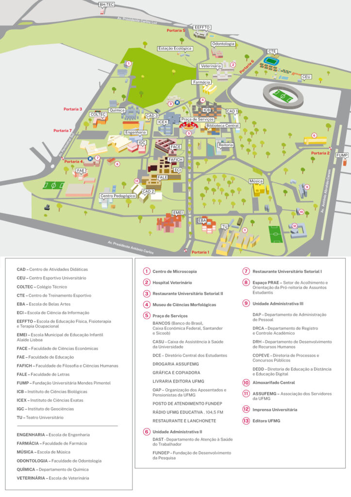
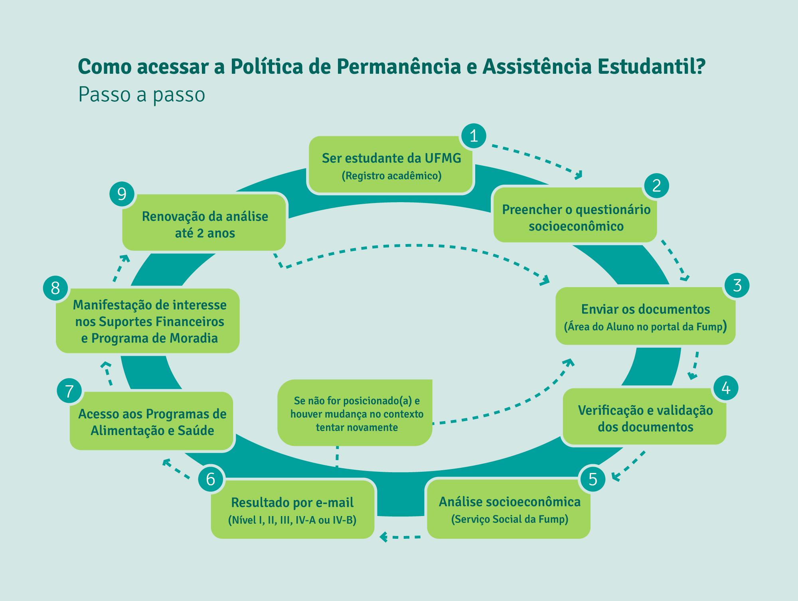

::: {.cagp-hero}
<div class="d-flex flex-wrap gap-2 mb-2">
  <span class="cagp-badge cagp-badge-red">Acolhimento Discente</span>
  <span class="cagp-badge cagp-badge-dark">Turno Noturno (19h - 22h30)</span>
</div>

# PARABÉNS PELA APROVAÇÃO NA UFMG! {.cagp-hero-title}

Você agora é estudante de **Gestão Pública** na **Faculdade de Filosofia e Ciências Humanas (FAFICH)**, no campus Pampulha da UFMG. O curso funciona no **turno noturno**, permitindo que muitos discentes conciliem a formação universitária de ponta com estágios, trabalho e pesquisa durante o dia.
:::

```{=html}
<nav class="cagp-subnav" aria-label="Atalhos rápidos desta página">
  <span class="cagp-subnav-label">Nesta Página:</span>
  <a href="#checklist-calouro" class="cagp-subnav-link">✅ Checklist 30 Dias</a>
  <a href="#rotina-noturna" class="cagp-subnav-link">🌙 Rotina Noturna & RU</a>
  <a href="#mapas-campus" class="cagp-subnav-link">🗺️ Mapas do Campus</a>
  <a href="#videos-tutoriais" class="cagp-subnav-link">🎥 Vídeos Tutoriais</a>
  <a href="#secretaria-e-ceag" class="cagp-subnav-link">🏢 CEAG & Secretaria</a>
  <a href="#assistencia-estudantil" class="cagp-subnav-link">🤝 Assistência FUMP & PRAE</a>
</nav>
```

## <span aria-hidden="true">✅</span> Checklist Interativo dos Primeiros 30 Dias {#checklist-calouro}

Marque abaixo os passos já cumpridos na sua chegada à UFMG. O progresso fica salvo automaticamente neste navegador:

```{=html}
<section class="cagp-tool-box" aria-labelledby="calouro-check-title">
  <div class="cagp-tool-header">
    <div>
      <span class="cagp-badge cagp-badge-green mb-1">Salvo no Navegador</span>
      <h3 id="calouro-check-title" class="h5 mb-0">SEU PROGRESSO DE AMBIENTAÇÃO</h3>
    </div>
    <div class="d-flex align-items-center gap-2">
      <span id="calouro-check-status" class="cagp-badge cagp-badge-dark cagp-tabular" aria-live="polite">0 de 6 concluídos (0%)</span>
      <button type="button" id="calouro-check-reset" class="cagp-chip">Desmarcar tudo</button>
    </div>
  </div>

  <div class="cagp-progress-track mb-4" aria-hidden="true">
    <div id="calouro-check-bar" class="cagp-progress-fill" style="width: 0%;"></div>
  </div>

  <div class="row g-3">
    <div class="col-md-6">
      <label class="cagp-check-card" for="chk-minhaufmg">
        <input type="checkbox" class="cagp-check-box" id="chk-minhaufmg" data-calouro-chk="minhaufmg">
        <div>
          <h3 class="h6 fw-bold mb-1">1. Ativar MinhaUFMG e App Siga UFMG</h3>
          <p class="small text-muted mb-2">Crie sua senha inicial em <a href="https://sistemas.ufmg.br" target="_blank" rel="noopener noreferrer">minha.ufmg.br</a> com a folha NIPs do DRCA. No computador, o portal integra o SIGA e e-mail institucional.</p>
          <div class="d-flex flex-wrap gap-2 mt-1">
            <a href="https://play.google.com/store/apps/details?id=br.ufmg.ddp.cecom.academico.sigaufmg" target="_blank" rel="noopener noreferrer" class="cagp-store-btn" aria-label="Baixar Siga UFMG para Android no Google Play">
              <span>🤖</span> Play Store
            </a>
            <a href="https://apps.apple.com/br/app/siga-ufmg/id1456022680" target="_blank" rel="noopener noreferrer" class="cagp-store-btn" aria-label="Baixar Siga UFMG para iPhone na Apple App Store">
              <span>🍏</span> App Store
            </a>
            <a href="documentos/manual-aplicativo-siga-ufmg.pdf" target="_blank" class="cagp-store-btn" aria-label="Manual do Aplicativo Siga UFMG em PDF">
              <span>📖</span> Manual PDF
            </a>
          </div>
        </div>
      </label>
    </div>

    <div class="col-md-6">
      <label class="cagp-check-card" for="chk-carteirinha">
        <input type="checkbox" class="cagp-check-box" id="chk-carteirinha" data-calouro-chk="carteirinha">
        <div>
          <h3 class="h6 fw-bold mb-1">2. Solicitar Carteirinha</h3>
          <p class="small text-muted mb-0">Essencial para catracas, empréstimo de livros nas bibliotecas da UFMG e pagamento rápido no Bandejão.</p>
        </div>
      </label>
    </div>

    <div class="col-md-6">
      <label class="cagp-check-card" for="chk-matricula">
        <input type="checkbox" class="cagp-check-box" id="chk-matricula" data-calouro-chk="matricula">
        <div>
          <h3 class="h6 fw-bold mb-1">3. Conferir Matrícula do 1º Período (300h)</h3>
          <p class="small text-muted mb-0">No 1º semestre, sua inscrição nas 5 matérias obrigatórias (300h / 20 créditos) é automática pelo DRCA. Nos períodos seguintes, o mínimo regimental é de <strong>180h (12 créditos)</strong>.</p>
        </div>
      </label>
    </div>

    <div class="col-md-6">
      <label class="cagp-check-card" for="chk-eduroam">
        <input type="checkbox" class="cagp-check-box" id="chk-eduroam" data-calouro-chk="eduroam">
        <div>
          <h3 class="h6 fw-bold mb-1">4. Configurar o Wi-Fi Institucional (eduroam)</h3>
          <p class="small text-muted mb-0">Conecte celular e notebook à rede criptografada <code>eduroam</code> usando seu login completo no formato <code>seulogin@ufmg.br</code> e a senha do MinhaUFMG.</p>
        </div>
      </label>
    </div>

    <div class="col-md-6">
      <label class="cagp-check-card" for="chk-dispensa">
        <input type="checkbox" class="cagp-check-box" id="chk-dispensa" data-calouro-chk="dispensa">
        <div>
          <h3 class="h6 fw-bold mb-1">5. Avaliar Aproveitamento de Estudos (Até o 2ºP)</h3>
          <p class="small text-muted mb-0">Cursou disciplinas em outra faculdade? Conforme a <strong>Res. CEPE nº 06/2019</strong>, o pedido de dispensa de matérias só é aceito até o seu <strong>2º período letivo</strong>.</p>
        </div>
      </label>
    </div>

    <div class="col-md-6">
      <label class="cagp-check-card" for="chk-fump">
        <input type="checkbox" class="cagp-check-box" id="chk-fump" data-calouro-chk="fump">
        <div>
          <h3 class="h6 fw-bold mb-1">6. Preencher Questionário da FUMP (Se aplicável)</h3>
          <p class="small text-muted mb-2">Solicite classificação socioeconômica na Fundação Universitária Mendes Pimentel para desconto ou isenção no jantar do RU, auxílio transporte e moradia.</p>
          <div class="d-flex flex-wrap gap-2 mt-1">
            <a href="https://www.fump.ufmg.br" target="_blank" rel="noopener noreferrer" class="cagp-store-btn" aria-label="Acessar Portal da FUMP">
              <span>🌐</span> Portal FUMP
            </a>
            <a href="https://play.google.com/store/apps/details?id=com.appfump" target="_blank" rel="noopener noreferrer" class="cagp-store-btn" aria-label="Baixar Aplicativo Fump no Google Play">
              <span>🤖</span> App FUMP
            </a>
          </div>
        </div>
      </label>
    </div>
  </div>
</section>

<script>
document.addEventListener('DOMContentLoaded', function () {
  const STORAGE_KEY = 'cagp_calouro_checklist_v1';
  const checkboxes = document.querySelectorAll('[data-calouro-chk]');
  const statusEl = document.getElementById('calouro-check-status');
  const barEl = document.getElementById('calouro-check-bar');
  const resetBtn = document.getElementById('calouro-check-reset');

  function loadState() {
    try {
      return JSON.parse(localStorage.getItem(STORAGE_KEY) || '{}');
    } catch (e) {
      return {};
    }
  }

  function saveState(state) {
    try {
      localStorage.setItem(STORAGE_KEY, JSON.stringify(state));
    } catch (e) {}
  }

  function render() {
    const total = checkboxes.length;
    let done = 0;
    checkboxes.forEach(function (cb) {
      const card = cb.closest('.cagp-check-card');
      if (cb.checked) {
        done++;
        if (card) card.classList.add('is-checked');
      } else {
        if (card) card.classList.remove('is-checked');
      }
    });
    const pct = total > 0 ? Math.round((done / total) * 100) : 0;
    if (statusEl) statusEl.textContent = done + ' de ' + total + ' concluídos (' + pct + '%)';
    if (barEl) {
      barEl.style.width = pct + '%';
      barEl.classList.toggle('is-complete', done === total);
    }
  }

  const saved = loadState();
  checkboxes.forEach(function (cb) {
    const key = cb.getAttribute('data-calouro-chk');
    if (saved[key]) cb.checked = true;
    cb.addEventListener('change', function () {
      const current = loadState();
      current[key] = cb.checked;
      saveState(current);
      render();
    });
  });

  if (resetBtn) {
    resetBtn.addEventListener('click', function () {
      checkboxes.forEach(function (cb) { cb.checked = false; });
      saveState({});
      render();
    });
  }

  render();
});
</script>
```

---

## <span aria-hidden="true">📱</span> Aplicativos e Plataformas Essenciais do Calouro {#apps-essenciais}

Instale em seu smartphone os aplicativos oficiais e utilize as plataformas essenciais para sua rotina acadêmica na UFMG:

```{=html}
<div class="cagp-app-grid mb-4">
  <!-- Card MinhaUFMG -->
  <article class="cagp-app-card cagp-app-card-minhaufmg">
    <div class="cagp-app-header">
      <div class="cagp-app-logo-box">
        
      </div>
      <div class="cagp-app-meta">
        <h3 class="cagp-app-title">MinhaUFMG</h3>
        <div class="cagp-app-tags">
          <span class="cagp-app-tag cagp-app-tag-cyan">Portal Desktop</span>
          <span class="cagp-app-tag cagp-app-tag-cyan">NIPs</span>
        </div>
      </div>
    </div>
    <p class="cagp-app-desc">Portal integrador de login único. Acesse pelo computador para cadastrar sua senha inicial, entrar no SIGA Web e usar o e-mail institucional @ufmg.br.</p>
    <div class="cagp-app-actions">
      <a href="https://sistemas.ufmg.br" target="_blank" rel="noopener noreferrer" class="cagp-store-btn cagp-store-btn-primary" aria-label="Acessar MinhaUFMG no navegador">💻 Portal Web ↗</a>
      <a href="https://sistemas.ufmg.br/nips/home.seam" target="_blank" rel="noopener noreferrer" class="cagp-store-btn" aria-label="Acessar primeiro cadastro com Folha NIPs">🔑 Folha NIPs ↗</a>
    </div>
  </article>

  <!-- Card Siga UFMG -->
  <article class="cagp-app-card cagp-app-card-siga">
    <div class="cagp-app-header">
      <div class="cagp-app-logo-box">
        
      </div>
      <div class="cagp-app-meta">
        <h3 class="cagp-app-title">Siga UFMG Mobile</h3>
        <div class="cagp-app-tags">
          <span class="cagp-app-tag cagp-app-tag-blue">App Celular</span>
          <span class="cagp-app-tag cagp-app-tag-blue">Carteirinha</span>
        </div>
      </div>
    </div>
    <p class="cagp-app-desc">Aplicativo para Android e iOS: visualize horários de aula, número de faltas, notas parciais, avisos dos professores e sua carteirinha virtual de estudante.</p>
    <div class="cagp-app-actions">
      <a href="https://play.google.com/store/apps/details?id=br.ufmg.ddp.cecom.academico.sigaufmg" target="_blank" rel="noopener noreferrer" class="cagp-store-btn cagp-store-btn-primary" aria-label="Baixar Siga UFMG para Android">🤖 Android ↗</a>
      <a href="https://apps.apple.com/br/app/siga-ufmg/id1456022680" target="_blank" rel="noopener noreferrer" class="cagp-store-btn cagp-store-btn-primary" aria-label="Baixar Siga UFMG para iOS">🍎 iOS ↗</a>
      <a href="documentos/manual-aplicativo-siga-ufmg.pdf" target="_blank" class="cagp-store-btn" aria-label="Baixar manual oficial do Siga UFMG">📄 Manual PDF</a>
    </div>
  </article>

  <!-- Card App FUMP -->
  <article class="cagp-app-card cagp-app-card-fump">
    <div class="cagp-app-header">
      <div class="cagp-app-logo-box">
        
      </div>
      <div class="cagp-app-meta">
        <h3 class="cagp-app-title">FUMP Assistência</h3>
        <div class="cagp-app-tags">
          <span class="cagp-app-tag cagp-app-tag-orange">Bolsas &amp; RU</span>
          <span class="cagp-app-tag cagp-app-tag-orange">Saúde</span>
        </div>
      </div>
    </div>
    <p class="cagp-app-desc">Fundação Mendes Pimentel: consulte cardápios diários do Restaurante Universitário, agende consultas médicas e preencha o questionário socioeconômico.</p>
    <div class="cagp-app-actions">
      <a href="https://play.google.com/store/apps/details?id=com.appfump" target="_blank" rel="noopener noreferrer" class="cagp-store-btn cagp-store-btn-primary" aria-label="Baixar aplicativo Fump para Android">📱 App Fump ↗</a>
      <a href="https://www.fump.ufmg.br" target="_blank" rel="noopener noreferrer" class="cagp-store-btn" aria-label="Acessar portal web da FUMP">🌐 Portal FUMP ↗</a>
    </div>
  </article>

  <!-- Card Interno Rotas -->
  <article class="cagp-app-card cagp-app-card-rotas">
    <div class="cagp-app-header">
      <div class="cagp-app-logo-box">
        
      </div>
      <div class="cagp-app-meta">
        <h3 class="cagp-app-title">Interno Rotas</h3>
        <div class="cagp-app-tags">
          <span class="cagp-app-tag cagp-app-tag-green">Circulares Noturnos</span>
          <span class="cagp-app-tag cagp-app-tag-green">Ao Vivo</span>
        </div>
      </div>
    </div>
    <p class="cagp-app-desc">Rastreamento colaborativo via GPS dos ônibus circulares gratuitos no campus Pampulha. Desenvolvido por discente da UFMG sob licença livre MIT.</p>
    <div class="cagp-app-actions">
      <a href="https://internorotas.com/" target="_blank" rel="noopener noreferrer" class="cagp-store-btn cagp-store-btn-primary" aria-label="Abrir mapa em tempo real no Interno Rotas">🚌 Ver Ônibus ao Vivo ↗</a>
    </div>
  </article>
</div>
```
```

---

## <span aria-hidden="true">🌙</span> A Rotina do Estudante do Turno Noturno {#rotina-noturna}

Estudar à noite na UFMG tem uma dinâmica própria que você precisa dominar desde a primeira semana para não perder aulas, refeições ou condução:

::: {.row .g-3 .mb-4}
::: {.col-md-6}
::: {.cagp-card}
### <span aria-hidden="true">⏰</span> Horários das Aulas e Presença {.fs-5}
- As aulas do turno noturno ocorrem de **segunda a sexta-feira, das 19h00 às 22h30**, divididas em dois blocos de 1h40 (com intervalo de 10 minutos).
- **Assiduidade:** O regimento da UFMG exige no mínimo **75% de frequência** em cada disciplina. Planeje seu deslocamento pós-trabalho para não sofrer reprovação por falta (infrequência).
:::
:::

::: {.col-md-6}
::: {.cagp-card}
### <span aria-hidden="true">🍽️</span> Logística da Alimentação Noturna (RUs) {.fs-5}
- **Jantar no Campus:** Servido exclusivamente no **RU Setorial II** (próximo ao ICB), das **17h10 às 19h30**.
- **Café da Manhã:** Exclusivo para estudantes Níveis I, II e III da assistência estudantil no **RU Setorial I**, das **06h40 às 08h15**.
- **Cobrança Política do CAGP:** O CAGP e o DA FAFICH cobram da PRAE e da FUMP a reabertura do jantar no Setorial I (vizinho à FAFICH) ou distribuição de marmitas no CAD 2, para evitar a subida íngreme à noite.
:::
:::

::: {.col-md-6}
::: {.cagp-card}
### <span aria-hidden="true">🚌</span> Ônibus Circulares Noturnos (Linhas 3 e 4) {.fs-5}
- Os **circulares internos são 100% gratuitos** e ligam as portarias da Av. Antônio Carlos e Catalão aos prédios até as 22h45.
- Para atender ao jantar no Setorial II, a PRA reforçou as viagens nos horários de pico:
  - **Linha 3:** 16h40, 17h20, 18h00 e 19h05.
  - **Linha 4:** 16h20, 17h00, 17h40 e 18h35.
- **Ao Vivo no Celular:** Acesse o app colaborativo livre [**Interno Rotas** (internorotas.com)](https://internorotas.com/){target="_blank" rel="noopener noreferrer"} para ver o GPS dos circulares em tempo real.
:::
:::

::: {.col-md-6}
::: {.cagp-card}
### <span aria-hidden="true">🛡️</span> Segurança e Iluminação no Campus {.fs-5}
- O campus Pampulha conta com iluminação reforçada na escadaria da Praça de Serviços até o Setorial II e rondas da vigilância interna (ramal de emergência: **3409-4444**).
- **Dica de Ouro:** Ao término das aulas às 22h30, desça para os pontos de ônibus ou estações do MOVE (Estação UFMG e Mineirão) em grupos de colegas.
:::
:::
:::

---

## <span aria-hidden="true">🗺️</span> Mapas do Campus Pampulha & Acessos Noturnos {#mapas-campus}

Localize os principais pontos da sua vivência noturna: a FAFICH, o CAD 2 (onde ocorrem diversas aulas compartilhadas), a Praça de Serviços e os Restaurantes Universitários.

::: {.cagp-map-card}
<div class="cagp-map-img-container">
  
</div>
<div class="cagp-map-caption">
  <strong>Guia Espacial do Campus Pampulha:</strong> A FAFICH localiza-se próxima à Faculdade de Educação (FaE) e ao CAD 2. O <em>RU Setorial I</em> fica ao lado da FAFICH (aberto para café da manhã e almoço); o <em>RU Setorial II</em> (onde é servido o jantar das 17h10 às 19h30) situa-se na região biológica, acessível a pé ou via circulares linhas 3 e 4.
</div>
:::

::: {.callout-note}
### Mapas Setoriais e Unidades Acadêmicas
Você também pode consultar o [Mapa Integrado dos Campi da UFMG (Pampulha, Saúde e Montes Claros)](imagens/mapas-dos-campi.png){target="_blank"} para conhecer as conexões com as demais unidades da universidade.
:::

---

## <span aria-hidden="true">🎥</span> Tutoriais Oficiais em Vídeo (UFMG & Sistemas) {#videos-tutoriais}

Assista aos guias audiovisuais produzidos pela DTI, PRAE e canais oficiais da UFMG para tirar dúvidas rápidas sobre ferramentas e direitos:

```{=html}
<div class="cagp-video-grid">
  <!-- Vídeo 1: SIGA UFMG -->
  <article class="cagp-video-card">
    <div class="cagp-video-thumb-wrap" onclick="this.innerHTML='<iframe width=\'100%\' height=\'100%\' src=\'https://www.youtube-nocookie.com/embed/JpBGj59NPqs?autoplay=1\' title=\'Conheça o SIGA UFMG\' frameborder=\'0\' allow=\'accelerometer; autoplay; clipboard-write; encrypted-media; gyroscope; picture-in-picture\' allowfullscreen></iframe>'">
      
      <div class="cagp-video-play-btn" aria-label="Reproduzir vídeo">▶</div>
    </div>
    <div class="cagp-video-body">
      <h3 class="cagp-video-title">Conheça o SIGA UFMG</h3>
      <span class="cagp-video-source">DTI • Diretoria de Tecnologia da Informação</span>
    </div>
  </article>

  <!-- Vídeo 2: MinhaUFMG vs App Siga -->
  <article class="cagp-video-card">
    <div class="cagp-video-thumb-wrap" onclick="this.innerHTML='<iframe width=\'100%\' height=\'100%\' src=\'https://www.youtube-nocookie.com/embed/gZI42d0rrfk?autoplay=1\' title=\'MinhaUFMG Desktop ou App Siga no Celular?\' frameborder=\'0\' allow=\'accelerometer; autoplay; clipboard-write; encrypted-media; gyroscope; picture-in-picture\' allowfullscreen></iframe>'">
      
      <div class="cagp-video-play-btn" aria-label="Reproduzir vídeo">▶</div>
    </div>
    <div class="cagp-video-body">
      <h3 class="cagp-video-title">MinhaUFMG ou App SIGA?</h3>
      <span class="cagp-video-source">DTI / CECOM • UFMG</span>
    </div>
  </article>

  <!-- Vídeo 3: Carteirinha e Biblioteca -->
  <article class="cagp-video-card">
    <div class="cagp-video-thumb-wrap" onclick="this.innerHTML='<iframe width=\'100%\' height=\'100%\' src=\'https://www.youtube-nocookie.com/embed/g8979vI6M-s?autoplay=1\' title=\'Carteira de Estudante UFMG e Bibliotecas\' frameborder=\'0\' allow=\'accelerometer; autoplay; clipboard-write; encrypted-media; gyroscope; picture-in-picture\' allowfullscreen></iframe>'">
      
      <div class="cagp-video-play-btn" aria-label="Reproduzir vídeo">▶</div>
    </div>
    <div class="cagp-video-body">
      <h3 class="cagp-video-title">Carteira da UFMG &amp; Bibliotecas</h3>
      <span class="cagp-video-source">Universidade Federal de Minas Gerais</span>
    </div>
  </article>

  <!-- Vídeo 4: Acessibilidade NAI -->
  <article class="cagp-video-card">
    <div class="cagp-video-thumb-wrap" onclick="this.innerHTML='<iframe width=\'100%\' height=\'100%\' src=\'https://www.youtube-nocookie.com/embed/4DonihIQXSM?autoplay=1\' title=\'Acessibilidade e Inclusão na Prática (NAI/UFMG)\' frameborder=\'0\' allow=\'accelerometer; autoplay; clipboard-write; encrypted-media; gyroscope; picture-in-picture\' allowfullscreen></iframe>'">
      
      <div class="cagp-video-play-btn" aria-label="Reproduzir vídeo">▶</div>
    </div>
    <div class="cagp-video-body">
      <h3 class="cagp-video-title">Acessibilidade &amp; Inclusão (NAI)</h3>
      <span class="cagp-video-source">Núcleo de Acessibilidade e Inclusão</span>
    </div>
  </article>

  <!-- Vídeo 5: Saúde Mental DASE -->
  <article class="cagp-video-card">
    <div class="cagp-video-thumb-wrap" onclick="this.innerHTML='<iframe width=\'100%\' height=\'100%\' src=\'https://www.youtube-nocookie.com/embed/LzVLJ_zE8uM?autoplay=1\' title=\'Saúde Mental e Acolhimento Discente (DASE/PRAE)\' frameborder=\'0\' allow=\'accelerometer; autoplay; clipboard-write; encrypted-media; gyroscope; picture-in-picture\' allowfullscreen></iframe>'">
      
      <div class="cagp-video-play-btn" aria-label="Reproduzir vídeo">▶</div>
    </div>
    <div class="cagp-video-body">
      <h3 class="cagp-video-title">Saúde Mental &amp; Acolhimento</h3>
      <span class="cagp-video-source">DASE • Pró-Reitoria de Assuntos Estudantis</span>
    </div>
  </article>

  <!-- Vídeo 6: Direitos Humanos & Assédio -->
  <article class="cagp-video-card">
    <div class="cagp-video-thumb-wrap" onclick="this.innerHTML='<iframe width=\'100%\' height=\'100%\' src=\'https://www.youtube-nocookie.com/embed/dg8hXD2Qbp4?autoplay=1\' title=\'Direitos Humanos e Enfrentamento ao Assédio na UFMG\' frameborder=\'0\' allow=\'accelerometer; autoplay; clipboard-write; encrypted-media; gyroscope; picture-in-picture\' allowfullscreen></iframe>'">
      
      <div class="cagp-video-play-btn" aria-label="Reproduzir vídeo">▶</div>
    </div>
    <div class="cagp-video-body">
      <h3 class="cagp-video-title">UFMG Contra o Assédio (Res. 07/25)</h3>
      <span class="cagp-video-source">Ouvidoria Geral da UFMG</span>
    </div>
  </article>
</div>
```

---

## <span aria-hidden="true">🏛️</span> Conhecendo a FAFICH e os Espaços do Curso

A **Faculdade de Filosofia e Ciências Humanas** é uma das unidades mais tradicionais e politizadas da UFMG.

::: {.cagp-card}
### <span aria-hidden="true">📍</span> Onde Encontrar a Gestão e Pontos-Chave
- **Salinha do CAGP (Pilotis da FAFICH):** Espaço dos Centros Acadêmicos no pilotis térreo. Venha tomar um café, tirar dúvidas sobre professores, provas e percurso, e participar dos debates da gestão.
- **Departamento de Ciência Política (DCP):** Departamento acadêmico de vinculação do curso de Gestão Pública, no 3º andar da FAFICH.
- **Biblioteca Setorial da FAFICH (2º Andar):** Amplo acervo especializado em Ciência Política, Administração Pública, Sociologia, Economia e periódicos internacionais.
:::

### <span aria-hidden="true">🏢</span> Atendimento Acadêmico: Secretaria vs. CEAG {#secretaria-e-ceag}

Como estudante do noturno, você conta com dois guichês de atendimento presencial no **2º andar da FAFICH**:

```{=html}
<div class="row g-4 my-2">
  <div class="col-md-6">
    <div class="cagp-card h-100">
      <div class="d-flex align-items-center justify-content-between mb-2">
        <span class="cagp-badge cagp-badge-red">Secretaria do Curso</span>
        <span class="text-muted small">Sala 2039</span>
      </div>
      <h4 class="fs-6 fw-bold text-uppercase mb-2">Secretaria de Gestão Pública</h4>
      <p class="small text-muted mb-2">Atendimento especializado em demandas curriculares exclusivas de Gestão Pública (contato direto com a coordenação).</p>
      <ul class="small mb-3 ps-3">
        <li><strong>Secretários Oficiais:</strong> Wander Wenceslau Pereira / Ubirajara Dutra</li>
        <li><strong>Horário Presencial:</strong> Quarta-feira, das 13h00 às 19h00</li>
        <li><strong>Telefone:</strong> (31) 3409-3826</li>
        <li><strong>E-mail Oficial:</strong> <a href="mailto:gestaopublica@ufmg.br">gestaopublica@ufmg.br</a></li>
        <li><strong>Atribuições:</strong> Aproveitamento de estudos, validação de Formação Complementar Aberta (FCA), mudança de percurso e requerimentos pedagógicos.</li>
      </ul>
    </div>
  </div>

  <div class="col-md-6">
    <div class="cagp-card h-100">
      <div class="d-flex align-items-center justify-content-between mb-2">
        <span class="cagp-badge cagp-badge-dark">Cobertura Noturna Contínua</span>
        <span class="text-muted small">2º Andar (Caixas)</span>
      </div>
      <h4 class="fs-6 fw-bold text-uppercase mb-2">CEAG FAFICH (Graduação)</h4>
      <p class="small text-muted mb-2">Centro de Atendimento à Graduação da FAFICH. Ideal para o estudante do noturno protocolar processos sem faltar ao trabalho diurno!</p>
      <ul class="small mb-3 ps-3">
        <li><strong>Horário Noturno:</strong> Segunda a sexta-feira, das <strong>08h00 às 22h00</strong></li>
        <li><strong>Localização:</strong> Guichê em frente aos caixas eletrônicos (2º piso da FAFICH)</li>
        <li><strong>Atribuições:</strong> Entrega de atestados médicos de alunos, protocolos de trancamento total/parcial, colação de grau, exame especial, certidões e histórico escolar autenticado.</li>
      </ul>
    </div>
  </div>
</div>
```

---

## <span aria-hidden="true">🤝</span> Permanência Estudantil, Bolsas e Assistência {#assistencia-estudantil}

A Política de Permanência da UFMG é coordenada pela **PRAE** e executada pela **FUMP**, visando assegurar condições de igualdade para que todo estudante conclua o curso com dignidade.

### Os Níveis de Classificação Socioeconômica (FUMP)

Após o preenchimento do questionário e análise dos assistentes sociais, os estudantes recebem um posicionamento:

::: {.row .g-3 .mb-4}
::: {.col-md-4}
::: {.cagp-card}
<span class="cagp-badge cagp-badge-red mb-2">Nível I</span>
<h4 class="fs-6 fw-bold text-uppercase mb-1">Extrema Vulnerabilidade</h4>
<p class="small text-muted mb-2">Isenção total (100% gratuita) das refeições no Restaurante Universitário (café, almoço e jantar), além de prioridade máxima em bolsas de permanência, moradia e auxílio transporte.</p>
:::
:::

::: {.col-md-4}
::: {.cagp-card}
<span class="cagp-badge cagp-badge-dark mb-2">Nível II</span>
<h4 class="fs-6 fw-bold text-uppercase mb-1">Alta Vulnerabilidade</h4>
<p class="small text-muted mb-2">Subsídio ampliado de alimentação nos RUs e acesso prioritário aos programas de auxílio financeiro e manutenção de material acadêmico.</p>
:::
:::

::: {.col-md-4}
::: {.cagp-card}
<span class="cagp-badge cagp-badge-blue mb-2">Nível III</span>
<h4 class="fs-6 fw-bold text-uppercase mb-1">Média Vulnerabilidade</h4>
<p class="small text-muted mb-2">Subsídio parcial de alimentação nos RUs, atendimento médico e odontológico gratuito e encaminhamento para programas de assistência estudantil.</p>
:::
:::
:::

### Passo a Passo: Como Preencher o Questionário Socioeconômico

Todo discente que deseja pleitear benefícios (alimentação gratuita/subsidiada, moradia, auxílio transporte ou atendimento odontológico/médico) deve preencher o questionário:

::: {.row .g-4 .align-items-center .mb-4}
::: {.col-lg-6}
1. **Onde acessar:** Entre no portal oficial da FUMP em [**fump.ufmg.br**](https://www.fump.ufmg.br/){target="_blank" rel="noopener noreferrer"} e clique em **Área do Aluno**.
2. **Login com dados UFMG:** Insira seu CPF e a senha cadastrada no sistema institucional.
3. **Seleção de Perfil para a FAFICH:** No campo de categoria discente, selecione obrigatoriamente **"Estudantes da Graduação"**.
4. **Comprovação Documental:** Envie cópias de contracheques/declarações de renda familiar, comprovante de residência atualizado e comprovantes de despesas médicas contínuas.
5. **Canais Diretos de Suporte FUMP:**
   - WhatsApp Oficial Pampulha: [**(31) 97537-0115**](https://wa.me/5531975370115){target="_blank"}
   - Telefones: `(31) 3409-8401` / `(31) 3409-8470`
   - Atendimento presencial na sede da FUMP (Campus Pampulha, próximo à Praça de Serviços).
:::

::: {.col-lg-6}
<div class="cagp-card text-center p-2">
  
  <small class="text-muted d-block mt-2">Passo a passo oficial da Fundação Mendes Pimentel (FUMP / PRAE UFMG)</small>
</div>
:::
:::

### Saúde Mental, Diversidade e Acessibilidade no Campus

- **Acolhimento Psicológico (DASE / PRAE):** Oferece espaço de escuta e oficinas para controle da ansiedade acadêmica. Contato: `dase@prae.ufmg.br` | [Saiba mais no portal da PRAE](https://www.ufmg.br/prae/){target="_blank" rel="noopener noreferrer"}.
- **Acessibilidade e Inclusão (NAI):** Adaptação de provas e apostilas para pessoas com deficiência, intérpretes de Libras e mediação didática. Contato: `acessibilidade@ufmg.br` | Tel: `(31) 3409-4674`.
- **Nome Social e Enfrentamento ao Assédio (Res. 07/2025 e 09/2015):** Garantia de uso do nome social em carteirinhas, e-mails e diários, além de canal formal para denúncias na [Ouvidoria Geral da UFMG](https://www.ufmg.br/ouvidoria/){target="_blank" rel="noopener noreferrer"}.

---

## <span aria-hidden="true">💡</span> Dicas de Ouro dos Veteranos do CAGP

::: {.callout-tip}
### Cuide do seu Percurso desde o 1º Período
Disciplinas como *Fundamentos da Análise Política (DCP 032)*, *Metodologia (DCP 033)* e *Introdução à Economia (ECN 140)* constituem alicerces para as disciplinas analíticas do 3º e 4º períodos. Não deixe matérias acumularem!
:::

::: {.callout-important}
### Comece a Pensar nas Horas de Extensão (300h)
Lembre-se de que 10% da carga horária total (300 horas) são de **Formação em Extensão Obrigatória** (Resolução CEPE nº 10/2019). Visite a página de [Extensão & AAC](acg.qmd) para entender como integralizar essas horas através de projetos PROEX e na *Equalitas Consultoria Jr.*
:::

::: {.callout-note}
### Conte Sempre com o Centro Acadêmico
O CAGP existe para garantir que sua passagem pela universidade pública seja justa, rica e acolhedora. Qualquer dúvida com colegiado, professores ou dificuldades acadêmicas, fale com a nossa diretoria. Você também pode consultar todos os [Documentos Oficiais, PPC e Regulamentos do Curso &rarr;](documentos.qmd).
:::

```{=html}
<nav class="cagp-journey-nav" aria-label="Continuidade da jornada acadêmica">
  <div class="row g-3">
    <div class="col-md-6">
      <a href="index.html" class="cagp-journey-link">
        <div>
          <div class="cagp-journey-dir">&larr; Voltar ao Início</div>
          <div class="cagp-journey-title">Hub Principal do CAGP</div>
        </div>
        <p class="cagp-journey-desc">Bússola de resolução rápida, atalhos para SIGA/SEI/MinhaUFMG e avisos do colegiado.</p>
      </a>
    </div>
    <div class="col-md-6">
      <a href="percurso.html" class="cagp-journey-link">
        <div>
          <div class="cagp-journey-dir">Próximo Passo na Jornada &rarr;</div>
          <div class="cagp-journey-title">Percurso Curricular & Ementas (10 Semestres)</div>
        </div>
        <p class="cagp-journey-desc">Explore as 27 disciplinas obrigatórias por semestre, filtre por departamento e conheça os 3 percursos.</p>
      </a>
    </div>
  </div>
</nav>
```
