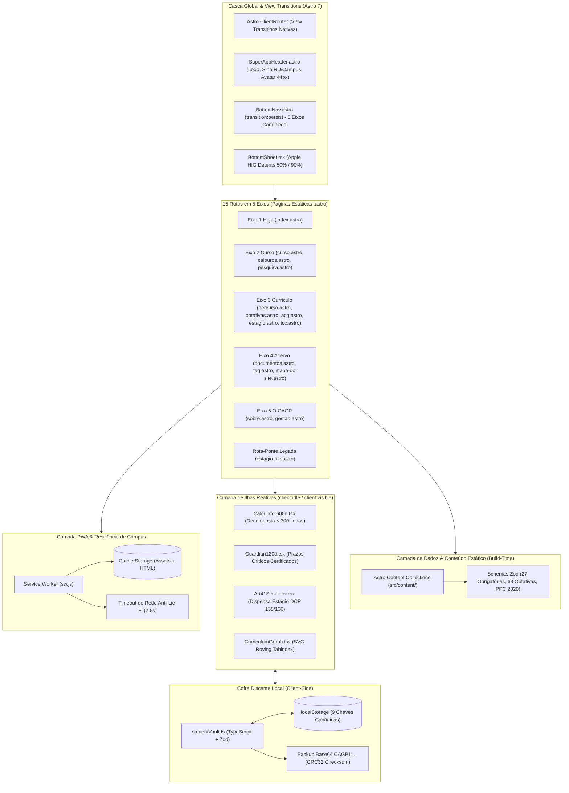
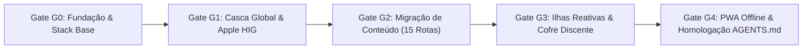

# Refatoração Integral do Super App CAGP: Quarto para Astro 7, React, Tailwind & Apple HIG

* **Author:** Antigravity & EGM Design Engine
* **Status:** In Review
* **Date:** 2026-10-30
* **Repository Target:** [CAGP UFMG Super App](file:///home/gsathler/Nextcloud/Projects/cagp)
* **Base Template:** [violet-velocity/](file:///home/gsathler/Nextcloud/Projects/cagp/violet-velocity) (Astro 7.4.4 + `@astrojs/react` + Tailwind CSS)
* **Target Engine / LLM:** Gemini 3.8 Flash (High Thinking) no Google Antigravity
* **Predecessor RFC:** [concepts_brief.md](file:///home/gsathler/Nextcloud/Projects/cagp/concepts_brief.md)

--------------------------------------------------------------------------------

## 1. Overview

O portal institucional e aplicativo discente do Centro Acadêmico de Gestão Pública (CAGP FAFICH/UFMG) será integralmente refatorado, substituindo o gerador estático documental **Quarto** pelo framework moderno **Astro 7**, utilizando ilhas reativas em **React (TypeScript)** e estilização atômica com **Tailwind CSS**.

A motivação central é sanar a dívida técnica estrutural acumulada pelo Quarto, que foi projetado para artigos científicos e relatórios Pandoc, mas foi empurrado para além de seus limites com um roteador SPA manual em JavaScript puro ([super-app-router.html](file:///home/gsathler/Nextcloud/Projects/cagp/_includes/super-app-router.html)), injeções de DOM fraturadas e arquivos monolíticos de até 144 KB misturando marcação, prosa e scripts (`percurso.qmd`, `acg.qmd`).

Essa estrutura legada gera gargalos severos para agentes autônomos de IA (especialmente **Gemini 3.8 Flash High Thinking**) devido à saturação de contexto e ausência de verificação estática de tipos, além de limitar a experiência do usuário móvel. A nova arquitetura entrega um PWA estático de alto desempenho no **GitHub Pages (custo zero)**, operação **100% offline**, ergonomia mobile aderente ao **Apple Human Interface Guidelines (HIG 2026)** e respeito rigoroso à identidade visual **Brite Institucional Refinado**.

---

## 2. The Problem (Diagnóstico do Sistema Atual)

1. **Arquivos Monolíticos e Perda de Contexto para Modelos LLM:** Arquivos como `percurso.qmd` (144 KB) e `acg.qmd` (102 KB) concentram mais de 3.000 linhas de código misturando marcação Quarto, blocos SVG crus, templates HTML embutidos e scripts imperativos com dezenas de `document.querySelector`. Agentes de IA que operam sobre esses arquivos sofrem degradação de atenção, risco de corrupção de manipuladores de eventos e incapacidade de validar sintaxe e tipos em tempo real.
2. **Fragilidade do Roteador SPA Legado:** Para evitar recargas bruscas de página no PWA, o portal implementou uma rotina em `super-app-router.html` que intercepta cliques em links `<a>`, faz `fetch()` do HTML da próxima rota, extrai o container `<main id="quarto-document-content">` e sobrescreve o nó no DOM reexecutando scripts embutidos manualmente. Esse mecanismo gera *flicker*, quebra de listeners e comportamentos instáveis no histórico do navegador (`popstate`).
3. **Ergonomia Mobile Pré-Moderna:**
   - Telas móveis sofrem com o zoom automático indesejado no iOS Safari causado por campos com tipografia menor que `16px`;
   - O atraso tátil de duplo toque (300ms) reduz a sensação de fluidez;
   - As gavetas e modais utilizam caixas flutuantes centralizadas do Bootstrap em vez de *bottom sheets* com física de molas e gestos de arrasto naturais;
   - Alvos de toque inferiores a `44×44px` prejudicam a precisão em mobilidade.
4. **Acoplamento entre Conteúdo Normativo e Código de Interface:** Qualquer correção pontual em ementas ou artigos estatutários exige editar arquivos de interface complexos, aumentando a probabilidade de regressão acidental em ferramentas críticas.

---

## 3. Goals (Critérios Inegociáveis de Sucesso)

*   **Meta 1 (Migração 100% Estática para Astro 7):** Migrar as 15 rotas acadêmicas e os 5 eixos canônicos (`Hoje · Curso · Currículo · Acervo · O CAGP`) para Astro 7, mantendo hospedagem com custo zero no GitHub Pages (`cagp-ufmg.github.io`).
*   **Meta 2 (Navegação Instantânea via Astro `<ClientRouter />`):** Adotar View Transitions nativas com persistência da barra inferior de navegação (`transition:persist="main-bottom-nav"`) e animações direcionais suaves de transição entre páginas.
*   **Meta 3 (Modularidade Atômica < 300 Linhas):** Decompor 100% das ferramentas dinâmicas (Calculadora 600h, Guardião 120 Dias, Simulador Art. 41 e Grafo Curricular) em componentes React TypeScript com no máximo 300 linhas por arquivo, blindando o Gemini 3.8 Flash High Thinking contra saturação de contexto.
*   **Meta 4 (Ergonomia Apple HIG Mobile-First):**
    - Bottom sheets modais com *grabber handle* e 2 detents nativos (~50% medium e ~90% large) e descarte por arrasto vertical (*drag-to-dismiss*);
    - Alvos de toque `>= 44×44px` (ideal `48×48px`) em todos os elementos clicáveis;
    - Inputs com fonte mínima de `16px` (`text-base`) para impedir auto-zoom no iOS Safari sem uso de `user-scalable=no`;
    - `touch-action: manipulation` e física de molas amortecidas (`cubic-bezier(0.32, 0.72, 0, 1)`).
*   **Meta 5 (PWA Offline Resiliente a Lie-Fi):** Service Worker com cache prévio de páginas e assets estáticos, operando com timeout de rede de **2.5 segundos** antes de servir o cache local no campus da UFMG.
*   **Meta 6 (Integridade Factual Absoluta - Zero Supressão):**
    - Preservação estrita das 3.000h curriculares (PPC 2020), 27 obrigatórias, 68 optativas com ementas, prazos normativos de 120 dias de AAC e regras do Art. 41 de estágio;
    - Preservação do contrato das 9 chaves canônicas de `localStorage` e backup Base64 `CAGP1:...` com checksum CRC32.

---

## 4. Non-Goals (Limites Rígidos de Escopo)

*   **Não-Objetivo 1 (Zero Backend Ativo):** Não introduzir servidores Node.js, contêineres Docker, bancos de dados pagos (Supabase, PostgreSQL, Firebase) ou dependência de planos corporativos de nuvem. A aplicação continua estática e client-side.
*   **Não-Objetivo 2 (Zero Violação de Acessibilidade):** Não desabilitar o zoom de acessibilidade do usuário com `user-scalable=no` ou `maximum-scale=1.0` (conformidade WCAG SC 1.4.4).
*   **Não-Objetivo 3 (Zero Glassmorphism Difuso):** Não aplicar fundos borrados (`backdrop-filter: blur`) que degradem o contraste sob sol direto no pátio da FAFICH; manter superfícies 100% sólidas.
*   **Não-Objetivo 4 (Zero Alteração de Regras Fatuais):** Não inventar, alterar ou suprimir qualquer regra acadêmica, artigo estatutário, e-mail institucional ou link de PDF oficial.
*   **Não-Objetivo 5 (Não Incluir `astro-main/`):** O monorrepositório do framework Astro permanece fora do controle de versão e do build do portal.

---

## 5. Open Questions (Questões em Aberto)

*   **Questão 1:** *Biblioteca de Renderização do Grafo Curricular:* Manter o SVG otimizado dos 27 nós com *roving tabindex* nativo e interatividade via React, ou adotar uma biblioteca leve baseada em Canvas/SVG (como `@visx/network` ou `dagre-d3`) para simplificar a manutenção do layout do grafo?
*   **Questão 2:** *Estratégia de Transição de Branches Git:* A migração deve ocorrer diretamente na branch de trabalho atual promovendo `violet-velocity` para a raiz, preservando os arquivos `.qmd` legados em pasta de transição `_legacy_quarto/` até a homologação final?

---

## 6. Critical User Journeys (CUJs)

### CUJ 1: Calouro Consultando Checklist de Sobrevivência no Corredor da FAFICH
*   **Given (Contexto):** Um calouro do curso noturno de Gestão Pública acabou de chegar à FAFICH, com conexão Wi-Fi fraca/inexistente no subsolo do prédio.
*   **When (Ação):** Abre o Super App no celular, acessa a rota `Curso -> Calouros` e toca no checklist "30 Primeiros Dias".
*   **Then (Resultado):** A página carrega instantaneamente do cache local via Service Worker (sem tela em branco). O checklist responde imediatamente ao toque com micro-press tátil (`active:scale-[0.98]`), salva o estado do item na chave `cagp_calouro_checklist_v1` do `localStorage` e exibe o progresso em HUD compacto sem saltar o scroll da tela.

### CUJ 2: Discente do 6º Período Calculando Horas de Extensão e AAC
*   **Given (Contexto):** O estudante deseja calcular se já completou as 300h obrigatórias de Extensão e até 300h de AAC antes do protocolo no Colegiado.
*   **When (Ação):** Acessa `Currículo -> Extensão & AAC (acg)` e insere 90h em "Empresa Júnior" e 120h em "Projeto de Pesquisa".
*   **Then (Resultado):** O campo de entrada não dispara zoom automático na tela do iPhone (fonte `>= 16px`). A barra HUD linear superior atualiza instantaneamente as metas com preenchimento em Borgonha `#8B1E2D`, valida os limites máximos de cada modalidade via Zod e persiste os valores na chave `cagp_calc_ext_aac_v1` de forma transparente.

### CUJ 3: Discente Consultando e Filtrando Optativas em Tela Móvel
*   **Given (Contexto):** O estudante está na fila do RU II e precisa escolher optativas de 60h ofertadas pelo DCP.
*   **When (Ação):** Acessa `Currículo -> Optativas` e clica no botão "Filtros".
*   **Then (Resultado):** Uma bottom sheet modal desliza do fundo da tela ancorando em *medium detent* (~50% da viewport), com *grabber handle* tátil. O estudante seleciona o filtro "DCP" e arrasta a folha para baixo para descartá-la. A lista de disciplinas filtra instantaneamente sem recarregar a página e sem travar a interface.

### CUJ 4: Navegação por Eixos com Barra Inferior Contínua
*   **Given (Contexto):** O discente está navegando entre o mural diário (`Hoje`) e o acervo normativo (`Acervo`).
*   **When (Ação):** Toca no ícone `Acervo` na barra inferior de navegação.
*   **Then (Resultado):** A barra inferior permanece 100% fixa e contínua sem nenhum piscar de tela (garantida por `transition:persist`). O conteúdo da página executa uma transição direcional suave da direita para a esquerda. Ao focar no primeiro documento, a rota está pronta para interação em menos de 100ms.

---

## 7. Technical Plan (Arquitetura de Sistemas & Engenharia)

### 7.1. Diagrama Arquitetural de Alto Nível



### 7.2. Estrutura de Diretórios e Regra de Ouro (< 300 Linhas)

Para blindar o **Gemini 3.8 Flash High Thinking** contra saturação de contexto e garantir manutenibilidade humana, **nenhum arquivo excederá 300 linhas de código**. O projeto adota a seguinte separação estrita de responsabilidades:

```text
src/
├── layouts/
│   └── BaseLayout.astro            # Shell principal, ClientRouter, PWA meta, Viewport cover (~160 linhas)
├── components/
│   ├── shell/
│   │   ├── SuperAppHeader.astro    # Barra superior, Sino de Alertas, Gatilho Passaporte (~140 linhas)
│   │   ├── BottomNav.astro         # 5 eixos persistentes com transition:persist (~120 linhas)
│   │   └── BottomSheet.tsx         # Modal Apple HIG com detents (50%/90%), drag handle (~210 linhas)
│   ├── calculators/
│   │   ├── Calculator600h.tsx      # Orquestrador da Calculadora 600h (~110 linhas)
│   │   ├── LinearHud.tsx           # HUD linear fixo com meta 300h Ext + 300h AAC (~80 linhas)
│   │   ├── ExtensionForm.tsx       # Formulário específico de Extensão 300h (~170 linhas)
│   │   ├── AacForm.tsx             # Formulário específico de AAC 300h (~190 linhas)
│   │   └── Guardian120d.tsx        # Guardião dos 120 dias e prazos decadenciais (~220 linhas)
│   ├── curriculum/
│   │   ├── CurriculumGraph.tsx     # Grafo SVG dos 27 nós com roving tabindex (~240 linhas)
│   │   ├── CourseDetailModal.tsx   # Painel de ementa e pré-requisitos de disciplina (~130 linhas)
│   │   └── Art41Simulator.tsx      # Simulador de Dispensa de Estágio Art. 41 (~180 linhas)
│   └── ui/
│       ├── SegmentedControl.astro  # Controle segmentado 100% visível sem scroll (~90 linhas)
│       └── NormativeDetails.astro  # Detalhes progressivos para normas regimentais (~70 linhas)
├── content/
│   ├── config.ts                   # Schemas Zod de validação para disciplinas e normas (~95 linhas)
│   ├── disciplinas/                # 27 obrigatórias + 68 optativas (arquivos de dados puros)
│   └── normas/                     # PPC 2020, Regulamento N-20229, Regimento Interno
├── lib/
│   ├── storage/
│   │   ├── studentVault.ts         # Leitura, escrita e validação Zod das 9 chaves (~190 linhas)
│   │   ├── backupVault.ts          # Serialização/deserialização Base64 CAGP1:... + CRC32 (~130 linhas)
│   │   └── notificationsStore.ts   # Preferências de notificações do RU II e Circular (~90 linhas)
│   ├── gestures/
│   │   └── pointerGestures.ts      # Manipuladores táteis nativos (< 3KB) para swipe e drag (~140 linhas)
│   └── a11y/
│       └── a11yPreferences.ts      # Alto contraste AAA e detecção de reduced motion (~85 linhas)
├── pages/
│   ├── index.astro                 # Eixo 1: Hoje
│   ├── curso.astro                 # Eixo 2: Visão Geral do Curso
│   ├── calouros.astro              # Eixo 2: Guia do Calouro & Sobrevivência
│   ├── pesquisa.astro              # Eixo 2: Núcleos de Pesquisa & Extensão
│   ├── percurso.astro              # Eixo 3: Grafo Curricular & Percursos
│   ├── optativas.astro             # Eixo 3: Catálogo de 68 Optativas
│   ├── acg.astro                   # Eixo 3: Extensão Obrigatória & AAC (Calculadora 600h)
│   ├── estagio.astro               # Eixo 3: Estágio Supervisionado & Art. 41
│   ├── tcc.astro                   # Eixo 3: Monografia e Artigo Científico
│   ├── documentos.astro            # Eixo 4: Atos, Regulamentos e Formulários
│   ├── faq.astro                   # Eixo 4: Dúvidas Regimentais Frequentes
│   ├── mapa-do-site.astro          # Eixo 4: Árvore Estrutural do Portal (14 ativas)
│   ├── sobre.astro                 # Eixo 5: Princípios e Estatuto do CAGP
│   ├── gestao.astro                # Eixo 5: Gestão, Equipe e Prestação de Contas
│   ├── configuracoes.astro         # Passaporte Discente & Painel de Acessibilidade
│   └── estagio-tcc.astro           # Rota-Ponte Legada (Redirecionamento Informativo)
└── styles/
    └── global.css                  # Mapeamento Tailwind dos tokens Brite Institucional (~220 linhas)
```

### 7.3. Ergonomia Apple HIG & Mecânica de Bottom Sheets

O componente `BottomSheet.tsx` é projetado como uma ilha React agnóstica de alto desempenho:
1. **Física de Molas e Detents:**
   - Define dois detents padrão: **Medium (50vh)** e **Large (90vh)**;
   - Animações controladas via transições CSS com curva `cubic-bezier(0.32, 0.72, 0, 1)`;
   - Barra *grabber handle* superior de 36×5px com área invisível expandida de toque para 44×24px;
   - Descarte rápido ao arrastar para baixo ultrapassando o limiar de 120px ou com velocidade (*velocity flick*) superior a 0.5 px/ms.
2. **Prevenção de Zoom Acidental e Gestos Táteis:**
   - `<meta name="viewport" content="width=device-width, initial-scale=1, viewport-fit=cover">`;
   - Todos os inputs de formulário recebem a classe utilitária `text-base` (`16px` no mobile) para impedir que o iOS Safari aplique zoom automático de foco;
   - `touch-action: manipulation` ativado no container raiz para eliminar a latência de duplo toque (300ms) sem violar o redimensionamento por pinça de acessibilidade;
   - Suporte a swipe horizontal no controle segmentado de abas via `pointerGestures.ts` (escutando `pointerdown`, `pointermove`, `pointerup` nativos sem dependências pesadas).

### 7.4. Integração Tailwind com a Identidade Brite Institucional

No arquivo `src/styles/global.css`, os tokens canônicos do `_brand.yml` são mapeados como utilitários de primeira classe:

```css
@theme {
  --color-cagp-burgundy: #8B1E2D;
  --color-cagp-red: #9E2424;
  --color-cagp-black: #0A0A0A;
  --color-cagp-cream: #F7F5F0;
  --color-cagp-surface: #FFFFFF;
  --color-cagp-border: #DFDBD2;
  --color-cagp-success: #15803D;
  --color-cagp-warning: #B45309;
  --color-cagp-danger: #DC2626;

  --font-display: 'Oswald', sans-serif;
  --font-body: 'Inter', sans-serif;
  --font-mono: 'JetBrains Mono', monospace;

  --shadow-cagp-hard: 2px 2px 0px #0A0A0A;
}
```

*Regra de Contenção de Over-Boxing:* A borda `2px solid #0A0A0A` e a sombra dura `shadow-cagp-hard` são aplicadas estritamente a botões primários (`.cagp-btn-primary`), à aba selecionada do controle segmentado e ao modal aberto. Todos os demais cartões adotam borda fina de `1px solid #DFDBD2` e sombra zero, garantindo elegância visual e baixo ruído cognitivo.

### 7.5. PWA, Service Worker e Resiliência Anti-Lie-Fi

Para garantir que o estudante nunca encare telas brancas ou congelamentos durante a transição de sinal no campus da UFMG:
1. **Precaching Ativo:** O Service Worker armazena em cache na instalação todos os arquivos estáticos (`index.html`, bundles JS do Astro, CSS consolidado, fontes e ícones SVG).
2. **Estratégia Network-First com Timeout Curto (2.5s):**
   - Requisições de navegação tentam a rede por no máximo **2.500 ms**;
   - Caso a rede não responda nesse prazo (típico de *Lie-Fi* em corredores ou na fila do RU II), o Service Worker interrompe a requisição de rede e serve imediatamente a versão em cache;
   - Atualizações de dados são sincronizadas em background via padrão *Stale-While-Revalidate*.

### 7.6. Contrato do Cofre Discente (9 Chaves Canônicas & Backup Base64)

O módulo `src/lib/storage/studentVault.ts` encapsula a persistência local com validação estrita via schemas Zod:

| Chave Canônica | Formato / Schema Zod | Descrição e Validação |
| :--- | :--- | :--- |
| `cagp_calc_ext_aac_v1` | `z.record(z.string(), z.number())` | Registro de horas de Extensão (meta 300h) e AAC (até 300h) |
| `cagp_aac_120d_certs_v1` | `z.array(CertSchema)` | Certificados submetidos com data e prazo limite de 120 dias corridos |
| `cagp_notifications_prefs_v1` | `z.object({ ru1815, circular2230, aac120d })` | Preferências de avisos do campus (tamanho < 600 bytes) |
| `cagp_calouro_checklist_v1` | `z.record(z.string(), z.boolean())` | Checklist de sobrevivência de 30 dias do calouro |
| `cagp_percurso_quiz_v1` | `z.object({ answers, resultPath })` | Respostas do quiz de direcionamento de percurso curricular |
| `cagp_minha_grade_v1` | `z.object({ savedCourses: z.array(z.string()) })` | Grade personalizada de disciplinas optativas do aluno |
| `cagp_art41_checklist_v1` | `z.record(z.string(), z.boolean())` | Checklist de elegibilidade para dispensa de estágio (Art. 41) |
| `cagp_a11y_prefs_v2` | `z.object({ font, contrast, dyslexia, motion })` | Configurações de acessibilidade (Alto Contraste AAA, fonte, etc.) |
| `cagp_student_profile_v1` | `z.object({ name, period, photoDataUrl })` | Dados do Passaporte Discente para identificação rápida |

*Padrão de Backup/Restauração:* Função `exportVaultBackup()` exporta um payload codificado com prefixo `CAGP1:...` acompanhado de checksum CRC32 de 8 caracteres hexadecimais, mantendo 100% de compatibilidade retroativa com os backups gerados pela versão legada Quarto.


---

## 8. Alternatives Considered (Alternativas Avaliadas e Rejeitadas)

### Alternativa A: Next.js (App Router com Exportação Estática `output: 'export'`)

*   **Prós:**
    - Ecossistema massivo e ampla familiaridade da comunidade React e de agentes de IA;
    - Suporte nativo a React 19 e tipagem TypeScript robusta;
    - Roteamento por sistema de arquivos padronizado.
*   **Contras:**
    - **Ociosidade e Overhead:** Ao configurar `output: 'export'` para rodar no GitHub Pages, mais de 70% das funcionalidades do Next.js (Server Actions, rotas de API dinâmicas, middleware, ISR e Image Optimization no servidor) são permanentemente desativadas, mantendo o peso de compilação do framework;
    - **Fragilidade em Modo Offline (PWA):** O App Router do Next.js navega buscando payloads binários `_rsc` no servidor. Em ambientes com conexão intermitente (*Lie-Fi* do campus da UFMG), o Service Worker frequentemente falha em interceptar requisições `_rsc` não cacheadas, disparando travamentos silenciosos e erros de hidratação no cliente;
    - **Rotatividade de Dependências:** O histórico de migrações maiores do Next.js (Next 13 -> 14 -> 15) quebra com frequência plugins de Service Worker comunitários (como `@serwist/next` ou `next-pwa`).
*   **Motivo da Rejeição:** Complexidade excessiva para uma aplicação estática e risco inaceitável de quebra do modo offline discente no campus.

---

### Alternativa B: Next.js com Backend Ativo em Servidor (Vercel Pro / Node.js VPS)

*   **Prós:**
    - Capacidade de criar APIs dinâmicas no servidor e conectar um banco de dados centralizado (ex.: PostgreSQL discente);
    - Possibilidade de integrar autenticação OAuth direta com os sistemas da UFMG (MinhaUFMG).
*   **Contras:**
    - **Inviabilidade Orçamentária e Governança:** O CAGP é uma entidade estudantil acadêmica sem dotação orçamentária para custear instâncias de nuvem pagas. Planos gratuitos de plataformas como Vercel possuem limites rígidos de transferência e vetam uso por equipes e organizações sem upgrade comercial;
    - **Risco de Abandono por Troca de Gestão:** Projetos discentes que dependem de cartões de crédito ou servidores permanentes são invariavelmente abandonados quando a gestão anual da chapa é substituída.
*   **Motivo da Rejeição:** Violação do princípio institucional de custo zero perpétuo e hospedagem estática no GitHub Pages.

---

### Alternativa C: Manutenção do Status Quo (Quarto Refatorado)

*   **Prós:**
    - Zero necessidade de reescrever as 15 rotas ou alterar o processo de compilação Pandoc;
    - Não exige instalação de Node.js para editar documentos simples em Markdown.
*   **Contras:**
    - **Falta de Modelo de Componentes:** O Quarto não suporta componentes reativos com ciclo de vida isolado, forçando o acúmulo de scripts imperativos misturados com marcação em arquivos monolíticos de até 144 KB;
    - **Saturação de Contexto para Modelos LLM:** O modelo **Gemini 3.8 Flash High Thinking** sofre degradação de atenção ao processar simultaneamente milhares de linhas de HTML, SVG e lógica JavaScript, elevando o risco de corrupção acidental de dados;
    - **Instabilidade da Casca SPA:** A navegação rápida continuaria dependente do script legado de 33 KB ([super-app-router.html](file:///home/gsathler/Nextcloud/Projects/cagp/_includes/super-app-router.html)), sujeito a piscares de tela e falhas de memória no DOM.
*   **Motivo da Rejeição:** Inviabilidade de sustentar a evolução de ferramentas complexas com garantia de integridade por agentes autônomos.

---

### Alternativa D: Single Page Application (SPA) Pura com Vite + React

*   **Prós:**
    - Excelente suporte a PWA com `vite-plugin-pwa` maduro e sem atritos de hidratação de servidor;
    - Arquitetura client-side pura e previsível;
    - Ecossistema de testes unitários (`vitest`) e tipagem velozes.
*   **Contras:**
    - **Ineficiência para Conteúdo Textual Denso:** O portal do CAGP reúne dezenas de páginas de leitura regimental (PPC 2020, Regulamento N-20229, 68 ementas de optativas). Uma SPA pura exigiria carregar todo esse conteúdo estático como strings JavaScript ou via requisições JSON em tempo de execução, prejudicando o primeiro carregamento e a indexação;
    - **Falta de Suporte Nativo a Content Collections:** Não oferece o sistema integrado do Astro para validação de esquemas Zod em arquivos Markdown e YAML durante o build.
*   **Motivo da Rejeição:** O Astro entrega o melhor dos dois mundos: gera HTML estático puro com zero JavaScript para as páginas de leitura e aciona ilhas React somente onde há interatividade real.


---

## 9. Detailed Implementation Plan (Plano Passo a Passo)

A execução é dividida em 5 fases sequenciais governadas por gates formais de qualidade. Nenhuma fase é iniciada sem a homologação prévia do gate anterior.



---

### 9.1. Fase 0: Inicialização da Stack Astro 7 e Configuração Base (Gate G0)

O objetivo desta fase é promover o template `violet-velocity/` para a raiz do repositório, instalar as dependências necessárias e configurar Tailwind e TypeScript.

#### Arquivos Modificados / Criados:
1. `package.json` *(Criado/Promovido na raiz)*:
   - **Rationale:** Substitui a inexistência de gerenciador de pacotes do Quarto por um manifesto Node.js moderno, integrando scripts de compilação e verificação estática.
   - **Conteúdo:** Scripts `dev`, `build`, `preview`, `typecheck` (`tsc -b`), e dependências: `astro@^7.4.4`, `@astrojs/react`, `@tailwindcss/vite` (ou `@astrojs/tailwind`), `react@^19.0.0`, `react-dom@^19.0.0`, `@types/react`, `@types/react-dom`, `zod`, `typescript`.
2. `astro.config.mjs` *(Criado na raiz)*:
   - **Rationale:** Configuração central do Astro para exportação 100% estática compatível com GitHub Pages.
   - **Conteúdo:** `output: 'static'`, integrações com React e Tailwind, ativação do suporte a View Transitions.
3. `tsconfig.json` *(Criado na raiz)*:
   - **Rationale:** Configuração estrita de compilação TypeScript para prevenir erros de tipos durante a escrita de código por agentes.
   - **Conteúdo:** `extends: "astro/tsconfigs/strict"`, path aliases `@components/*`, `@lib/*`, `@content/*` e `@styles/*`.
4. `src/styles/global.css` *(Criado)*:
   - **Rationale:** Substitui o monolito de 290 KB (`styles.css`) por uma folha de estilo atômica e limpa baseada em Tailwind.
   - **Conteúdo:** Mapeamento de tokens do `_brand.yml` (`--color-cagp-burgundy`, etc.), fontes `Oswald`, `Inter` e `JetBrains Mono`, regra anti-zoom iOS (`input, select, textarea { font-size: 16px }`) e `touch-action: manipulation`.
5. `src/content/config.ts` *(Criado)*:
   - **Rationale:** Define os contratos estritos de dados do curso via Zod para garantir que nenhuma disciplina ou ementa seja corrompida.
   - **Conteúdo:** Schemas `disciplinaSchema` (código, nome, carga horária, período, departamento, ementa, pré-requisitos) e `normaSchema`.

*Critério de Aprovação Gate G0:* Execução de `pnpm install` e `pnpm typecheck` com zero erros.

---

### 9.2. Fase 1: Casca Global, Roteamento e Padrões Apple HIG (Gate G1)

O objetivo é estruturar o layout base, a navegação contínua por eixos e os componentes universais de interface móvel.

#### Arquivos Criados:
1. `src/layouts/BaseLayout.astro` *(Criado, < 180 linhas)*:
   - **Rationale:** Casca HTML universal com `<ClientRouter />`, `<meta name="viewport" content="width=device-width, initial-scale=1, viewport-fit=cover">`, injeção de fontes e cabeçalhos PWA.
2. `src/components/shell/SuperAppHeader.astro` *(Criado, < 150 linhas)*:
   - **Rationale:** Cabeçalho persistente com logo oficial CAGP, botão do Sino de Alertas do Campus (fila do RU II, Circular) e botão Avatar do Passaporte Discente com zonas de toque `>= 44×44px`.
3. `src/components/shell/BottomNav.astro` *(Criado, < 120 linhas)*:
   - **Rationale:** Barra inferior móvel persistente com a diretiva `transition:persist="main-bottom-nav"` cobrindo os 5 eixos canônicos (`Hoje · Curso · Currículo · Acervo · O CAGP`), eliminando qualquer cintilação visual.
4. `src/components/shell/BottomSheet.tsx` *(Criado, < 220 linhas)*:
   - **Rationale:** Componente universal de gaveta modal padrão Apple HIG com *grabber handle* de 36×5px, suporte a dois detents (Medium 50% e Large 90%), física de molas e arrasto vertical para descarte.
5. `src/components/ui/SegmentedControl.astro` *(Criado, < 90 linhas)*:
   - **Rationale:** Barra de alternância de sub-views (`.cagp-workspace-bar`) 100% visível sem rolagem horizontal entre 280px e 1440px.
6. `src/components/ui/NormativeDetails.astro` *(Criado, < 70 linhas)*:
   - **Rationale:** Componente padronizado para encapsular artigos estatutários e regras complexas em `<details>` com sumários concisos.

*Critério de Aprovação Gate G1:* Navegação entre páginas de teste demonstrando barra inferior fixa e bottom sheet responsiva ao toque sem recargas bruscas.

---

### 9.3. Fase 2: Camada de Conteúdo e Migração das 15 Rotas (Gate G2)

O objetivo é transpor 100% dos dados factuais e das páginas informativas do Quarto para Astro com validação Zod.

#### Arquivos Criados:
1. `src/content/disciplinas/` *(27 obrigatórias + 68 optativas)*:
   - **Rationale:** Preservação factual estrita de códigos, ementas e cargas horárias sem misturar marcação com lógica de software.
2. `src/content/normas/`:
   - **Rationale:** Armazenamento estruturado dos textos integrais do PPC 2020, Regulamento N-20229 e Regimento Interno do CAGP.
3. 15 Páginas em `src/pages/`:
   - `src/pages/index.astro` (Eixo 1: Hoje / Hub discente)
   - `src/pages/curso.astro` (Eixo 2: Visão Geral, Egressos, Colegiado)
   - `src/pages/calouros.astro` (Eixo 2: Checklist 30 dias e guia FAFICH)
   - `src/pages/pesquisa.astro` (Eixo 2: Catálogo dos 11 núcleos e IC)
   - `src/pages/percurso.astro` (Eixo 3: Visualização curricular)
   - `src/pages/optativas.astro` (Eixo 3: Catálogo completo com busca e filtros)
   - `src/pages/acg.astro` (Eixo 3: Extensão e AAC)
   - `src/pages/estagio.astro` (Eixo 3: Regulamento de estágio e Art. 41)
   - `src/pages/tcc.astro` (Eixo 3: Modalidades e prazos de TCC)
   - `src/pages/documentos.astro` (Eixo 4: Atos, atas e requerimentos)
   - `src/pages/faq.astro` (Eixo 4: Dúvidas regimentais com âncora fixa `#acessibilidade`)
   - `src/pages/mapa-do-site.astro` (Eixo 4: Árvore estática gerada no build)
   - `src/pages/sobre.astro` (Eixo 5: História e governança do CAGP)
   - `src/pages/gestao.astro` (Eixo 5: Prestação de contas e equipe)
   - `src/pages/configuracoes.astro` (Perfil discente e ajustes de acessibilidade)
   - `src/pages/estagio-tcc.astro` (Rota-ponte legada com aviso e direcionamento)

*Critério de Aprovação Gate G2:* As 15 rotas compilam estaticamente sem erros e todos os controles interativos primários situam-se em `y <= 300px` em `360×640px`.

---

### 9.4. Fase 3: Ilhas Reativas e Contrato do Cofre Discente (Gate G3)

O objetivo é implementar as ferramentas interativas como componentes React atômicos (< 300 linhas) garantindo persistência e compatibilidade retroativa.

#### Arquivos Criados:
1. `src/lib/storage/studentVault.ts` *(Criado, < 190 linhas)*:
   - **Rationale:** Gerencia o ciclo de vida do cofre discente com validação Zod nas 9 chaves canônicas de `localStorage`.
2. `src/lib/storage/backupVault.ts` *(Criado, < 130 linhas)*:
   - **Rationale:** Exporta e importa backups no formato `CAGP1:...` com validação de checksum CRC32.
3. `src/lib/gestures/pointerGestures.ts` *(Criado, < 140 linhas)*:
   - **Rationale:** Biblioteca leve (< 3 KB) de captura de gestos táteis em `PointerEvents` para swipe entre abas e drag em sheets.
4. `src/components/calculators/Calculator600h.tsx` *(Criado, < 110 linhas)*:
   - **Rationale:** Orquestrador principal da integralização de Extensão e AAC.
5. `src/components/calculators/LinearHud.tsx` *(Criado, < 80 linhas)*:
   - **Rationale:** HUD superior linear fixo com barra de progresso visual de 64px.
6. `src/components/calculators/ExtensionForm.tsx` *(Criado, < 170 linhas)*:
   - **Rationale:** Formulário atômico para registro das 300h obrigatórias de Extensão.
7. `src/components/calculators/AacForm.tsx` *(Criado, < 190 linhas)*:
   - **Rationale:** Formulário atômico para até 300h de AAC com validação de tetos por modalidade.
8. `src/components/calculators/Guardian120d.tsx` *(Criado, < 220 linhas)*:
   - **Rationale:** Monitor do prazo decadencial de 120 dias corridos para protocolo de certificados com alertas coloridos.
9. `src/components/curriculum/CurriculumGraph.tsx` *(Criado, < 240 linhas)*:
   - **Rationale:** Visualizador curricular SVG dos 27 nós com suporte a teclado (*roving tabindex*).
10. `src/components/curriculum/Art41Simulator.tsx` *(Criado, < 180 linhas)*:
    - **Rationale:** Simulador de requisitos de dispensa de Estágio Supervisionado (300h: DCP 135 + DCP 136).

*Critério de Aprovação Gate G3:* Testes unitários comprovam persistência e recuperação correta dos dados do cofre sem quebra de compatibilidade com backups legados.

---

### 9.5. Fase 4: PWA Offline, Limpeza de Legados e Homologação (Gate G4)

O objetivo é garantir a operação offline, higienizar o repositório e formalizar as regras operacionais no `AGENTS.md`.

#### Arquivos Modificados / Excluídos / Criados:
1. `public/sw.js` *(Criado/Atualizado)*:
   - **Rationale:** Service Worker configurado para precaching de páginas e assets estáticos com timeout de rede anti-Lie-Fi de 2.5s.
2. `public/manifest.webmanifest` *(Criado/Atualizado)*:
   - **Rationale:** Manifesto PWA configurado com cores da marca CAGP e display standalone.
3. `violet-velocity/` *(Excluído após migração)*:
   - **Rationale:** Limpeza da pasta de referência temporária uma vez que seus arquivos foram incorporados à raiz.
4. `_legacy_quarto/` *(Criado temporariamente)*:
   - **Rationale:** Arquivamento seguro de `_quarto.yml`, `styles.css` antigo e arquivos `.qmd` até a validação final da compilação.
5. `AGENTS.md` *(Atualizado)*:
   - **Rationale:** Consagra formalmente as regras de governança para o Gemini 3.8 Flash High Thinking: regra de arquivos < 300 linhas, uso de TypeScript estrito, verificação obrigatória em loop fechado (`pnpm typecheck && pnpm build`) e integridade factual inegociável.

*Critério de Aprovação Gate G4:* Execução com sucesso de `pnpm build`, site estático gerado em `docs/` (ou `dist/`), auditoria de acessibilidade AAA sem falhas e PWA 100% navegável em modo offline simulado.
