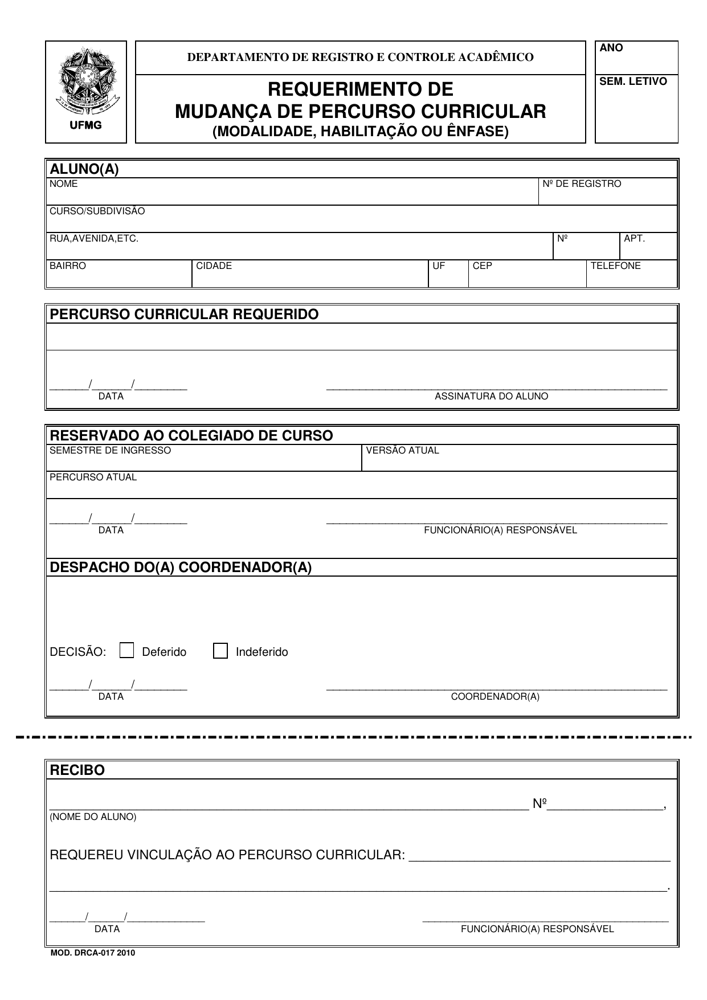

::: {.cagp-hero}
<div class="d-flex flex-wrap gap-2 mb-2">
  <span class="cagp-badge cagp-badge-red">Acervo Oficial FAFICH/UFMG</span>
  <span class="cagp-badge cagp-badge-dark">Versão Curricular N-20229</span>
  <span class="cagp-badge cagp-badge-blue">8 PDFs + 9 Formulários</span>
</div>

# REPOSITÓRIO NORMATIVO DE GESTÃO PÚBLICA {.cagp-hero-title}

Todas as diretrizes, prazos e regras informados neste portal baseiam-se estritamente nos documentos oficiais aprovados pelas instâncias colegiadas da UFMG (Colegiado de Gestão Pública, Congregação da FAFICH e Conselho de Ensino, Pesquisa e Extensão - CEPE), bem como no Regimento Interno formal da entidade discente. Disponibilizamos abaixo os arquivos originais digitalizados para consulta pública e download.
:::

```{=html}
<nav class="cagp-subnav" aria-label="Atalhos rápidos desta página">
  <span class="cagp-subnav-label">Nesta Página:</span>
  <a href="#filtro-documentos" class="cagp-subnav-link">🔎 Busca Rápida</a>
  <a href="#atos-cagp" class="cagp-subnav-link">📜 Regimento CAGP</a>
  <a href="#atos-curso" class="cagp-subnav-link">🏛️ PPC, Regulamento e Ementário</a>
  <a href="#matrizes-percursos" class="cagp-subnav-link">🗺️ Matrizes dos 3 Percursos</a>
  <a href="#formularios" class="cagp-subnav-link">📝 Formulários</a>
  <a href="#tutorial-drca" class="cagp-subnav-link">🔍 Tutorial DRCA</a>
</nav>

<section id="filtro-documentos" class="cagp-tool-box" aria-labelledby="doc-filter-heading">
  <div class="cagp-tool-header">
    <div>
      <span class="cagp-badge cagp-badge-dark mb-1">Localizador de Arquivos</span>
      <h2 id="doc-filter-heading" class="h5 mb-0">BUSCAR DOCUMENTO OFICIAL OU FORMULÁRIO DE REQUERIMENTO</h2>
    </div>
    <span id="doc-filter-status" class="cagp-badge cagp-badge-red cagp-filter-count" aria-live="polite">Exibindo todos os documentos e formulários</span>
  </div>
  <div class="row g-3 align-items-end">
    <div class="col-md-6">
      <label for="doc-search-input" class="small fw-bold text-uppercase d-block mb-1">Filtrar por nome, assunto ou artigo (ex: TCC, trancamento, FCA, regimento):</label>
      <input type="search" id="doc-search-input" class="cagp-search-input" placeholder="Digite o que você procura...">
    </div>
    <div class="col-md-6">
      <div class="cagp-filter-group" role="group" aria-label="Filtrar categoria de documento">
        <button type="button" class="cagp-chip" aria-pressed="true" data-doc-cat="all">Todos</button>
        <button type="button" class="cagp-chip" aria-pressed="false" data-doc-cat="normativo">📜 Normas & Ementário</button>
        <button type="button" class="cagp-chip" aria-pressed="false" data-doc-cat="percurso">🗺️ Percursos (01-01 a 01-03)</button>
        <button type="button" class="cagp-chip" aria-pressed="false" data-doc-cat="formulario">📝 Requerimentos SEI/DOCX</button>
      </div>
    </div>
  </div>
</section>
```

## <span aria-hidden="true">📜</span> Atos Institucionais da Representação Discente {#atos-cagp}

O documento supremo de auto-organização, direitos discentes e governança do Centro Acadêmico de Gestão Pública da FAFICH/UFMG:

::: {.row .g-4 .mb-5}
::: {.col-12}
```{=html}
<div class="cagp-doc-card" data-doc-item="normativo">
  <div class="cagp-doc-header">
    <div>
      <span class="cagp-doc-badge bg-danger text-white">Regimento Interno Oficial • 2024</span>
      <span class="cagp-doc-badge bg-light text-dark">PDF • 307 KB</span>
      <span class="cagp-doc-badge bg-dark text-white">Vigência Plena</span>
    </div>
    <h3 class="cagp-doc-title">Regimento Interno do Centro Acadêmico de Gestão Pública (CAGP)</h3>
    <div class="cagp-doc-meta"><strong>Aprovação:</strong> Assembleia Geral dos Estudantes de Gestão Pública • 14 de outubro de 2024 (Revoga o Estatuto de 2010 e o Regimento de 2021)</div>
    <p class="cagp-doc-desc">Documento normativo soberano que define a natureza civil, autônoma e suprapartidária do CAGP (Art. 3º e 4º), os princípios regedores da Administração Pública de legalidade, impessoalidade, moralidade, publicidade e eficiência (Art. 8º, III), a estruturação em 7 Diretorias Executivas com no mínimo 8 membros (Art. 24 e 25), a soberania da Assembleia Geral (Art. 35 a 40), a fiscalização pela Junta Eleitoral permanente e independente (Art. 20 a 23) e o rito de eleições diretas e secretas com debate obrigatório (Art. 41 a 45).</p>
  </div>
  <div class="cagp-doc-actions">
    <a href="documentos/regimento-interno-cagp-ufmg.pdf" target="_blank" class="cagp-doc-btn cagp-doc-btn-primary" aria-label="Visualizar Regimento Interno do CAGP em PDF">👁️ Visualizar PDF</a>
    <a href="documentos/regimento-interno-cagp-ufmg.pdf" download="Regimento-Interno-CAGP-UFMG.pdf" class="cagp-doc-btn cagp-doc-btn-outline" aria-label="Baixar Regimento Interno do CAGP em PDF">📥 Baixar Arquivo Oficial</a>
  </div>
</div>
```
:::
:::

---

## <span aria-hidden="true">🏛️</span> Atos Fundamentais do Curso {#atos-curso}

Os documentos basilares que regem a estrutura pedagógica, os direitos e os deveres dos discentes de Gestão Pública da UFMG:

::: {.row .g-4 .mb-5}
::: {.col-lg-6}
```{=html}
<div class="cagp-doc-card" data-doc-item="normativo">
  <div class="cagp-doc-header">
    <div>
      <span class="cagp-doc-badge bg-danger text-white">Documento Mestre</span>
      <span class="cagp-doc-badge bg-light text-dark">PDF • 3.3 MB</span>
    </div>
    <h3 class="cagp-doc-title">Projeto Pedagógico do Curso (PPC)</h3>
    <div class="cagp-doc-meta"><strong>Emissão:</strong> Colegiado de Coordenação Didática / FAFICH / CEPE-UFMG • Versão N-20229</div>
    <p class="cagp-doc-desc">Documento institucional completo que define o perfil do egresso, as competências técnicas e analíticas, a matriz curricular de 3.000 horas no turno noturno, as diretrizes de extensão obrigatória e a justificativa pedagógica do curso de Gestão Pública da UFMG.</p>
  </div>
  <div class="cagp-doc-actions">
    <a href="documentos/ppc-gestao-publica-ufmg.pdf" target="_blank" class="cagp-doc-btn cagp-doc-btn-primary" aria-label="Visualizar Projeto Pedagógico do Curso em PDF">👁️ Visualizar PDF</a>
    <a href="documentos/ppc-gestao-publica-ufmg.pdf" download="PPC-Gestao-Publica-UFMG.pdf" class="cagp-doc-btn cagp-doc-btn-outline" aria-label="Baixar Projeto Pedagógico do Curso em PDF">📥 Baixar Arquivo</a>
  </div>
</div>
```
:::

::: {.col-lg-6}
```{=html}
<div class="cagp-doc-card" data-doc-item="normativo">
  <div class="cagp-doc-header">
    <div>
      <span class="cagp-doc-badge bg-dark text-white">Regulamento Oficial</span>
      <span class="cagp-doc-badge bg-light text-dark">PDF • 2.0 MB</span>
    </div>
    <h3 class="cagp-doc-title">Regulamento do Curso de Graduação</h3>
    <div class="cagp-doc-meta"><strong>Emissão:</strong> Colegiado do Curso de Gestão Pública • FAFICH / UFMG</div>
    <p class="cagp-doc-desc">Conjunto formal de regras regimentais do curso: matrícula mínima semestral de 180h (12 créditos), os 3 percursos formais (Art. 3º), Atividades Acadêmicas Complementares e prazos de 120 dias (Art. 15), dispensa de estágio profissional (Art. 41), TCC e avaliação de conhecimentos (Art. 51).</p>
  </div>
  <div class="cagp-doc-actions">
    <a href="documentos/regulamento-gestao-publica-ufmg.pdf" target="_blank" class="cagp-doc-btn cagp-doc-btn-primary" aria-label="Visualizar Regulamento do Curso em PDF">👁️ Visualizar PDF</a>
    <a href="documentos/regulamento-gestao-publica-ufmg.pdf" download="Regulamento-Curso-Gestao-Publica-UFMG.pdf" class="cagp-doc-btn cagp-doc-btn-outline" aria-label="Baixar Regulamento do Curso em PDF">📥 Baixar Arquivo</a>
  </div>
</div>
```
:::
:::

---

## <span aria-hidden="true">📖</span> Ementário Geral do Curso

O programa curricular com os objetivos de ensino, conteúdos e referências bibliográficas de todas as matérias:

::: {.row .g-4 .mb-5}
::: {.col-12}
```{=html}
<div class="cagp-doc-card" data-doc-item="normativo">
  <div class="cagp-doc-header">
    <div>
      <span class="cagp-doc-badge bg-primary text-white">Ementário Completo</span>
      <span class="cagp-doc-badge bg-light text-dark">PDF • 3.0 MB</span>
    </div>
    <h3 class="cagp-doc-title">Ementário Oficial das Disciplinas Obrigatórias</h3>
    <div class="cagp-doc-meta"><strong>Departamentos Ofertantes:</strong> DCP (Ciência Política), ECN (Economia), EST (Estatística) e SOA (Sociologia)</div>
    <p class="cagp-doc-desc">Catálogo normativo que detalha as ementas oficiais, objetivos programáticos e bibliografias recomendadas de todas as <strong>27 disciplinas obrigatórias</strong> dos 10 períodos curriculares, fundamentando o aprendizado teórico e instrumental em políticas públicas, finanças, avaliação e governança.</p>
  </div>
  <div class="cagp-doc-actions">
    <a href="documentos/ementario-gestao-publica-ufmg.pdf" target="_blank" class="cagp-doc-btn cagp-doc-btn-primary" aria-label="Visualizar Ementário Oficial em PDF">👁️ Visualizar Ementário Completo</a>
    <a href="documentos/ementario-gestao-publica-ufmg.pdf" download="Ementario-Gestao-Publica-UFMG.pdf" class="cagp-doc-btn cagp-doc-btn-outline" aria-label="Baixar Ementário Oficial em PDF">📥 Baixar Ementário (PDF)</a>
  </div>
</div>
```
:::
:::

---

## <span aria-hidden="true">🗺️</span> Matrizes Curriculares dos Três Percursos Oficiais {#matrizes-percursos}

Conforme o **Art. 3º do Regulamento**, o curso oferece 3 modalidades formais de percurso curricular registradas nos sistemas acadêmicos da UFMG:

::: {.row .g-4 .mb-5}
::: {.col-md-4}
```{=html}
<div class="cagp-doc-card" data-doc-item="percurso">
  <div class="cagp-doc-header">
    <div>
      <span class="cagp-doc-badge bg-dark text-white">Percurso 01-01</span>
      <span class="cagp-doc-badge bg-light text-dark">PDF • 166 KB</span>
    </div>
    <h3 class="cagp-doc-title">Bacharelado / Núcleo Geral</h3>
    <div class="cagp-doc-meta"><strong>Padrão Canônico:</strong> 10 Semestres • 3.000h</div>
    <p class="cagp-doc-desc">Relatório oficial de percurso padrão. Grade recomendada período a período com 1.560h obrigatórias, 300h de estágio, 1.020h optativas e 120h de Formação Livre.</p>
  </div>
  <div class="cagp-doc-actions">
    <a href="documentos/percurso-bacharelado-nucleo-geral.pdf" target="_blank" class="cagp-doc-btn cagp-doc-btn-primary" aria-label="Visualizar Percurso Geral em PDF">👁️ Ver PDF</a>
    <a href="documentos/percurso-bacharelado-nucleo-geral.pdf" download="Percurso-Bacharelado-Nucleo-Geral.pdf" class="cagp-doc-btn cagp-doc-btn-outline" aria-label="Baixar Percurso Geral em PDF">📥 Baixar</a>
  </div>
</div>
```
:::

::: {.col-md-4}
```{=html}
<div class="cagp-doc-card" data-doc-item="percurso">
  <div class="cagp-doc-header">
    <div>
      <span class="cagp-doc-badge bg-warning text-dark">Percurso 01-02</span>
      <span class="cagp-doc-badge bg-light text-dark">PDF • 166 KB</span>
    </div>
    <h3 class="cagp-doc-title">Núcleo Complementar</h3>
    <div class="cagp-doc-meta"><strong>Transversal/Aberta:</strong> A partir do 5º Período</div>
    <p class="cagp-doc-desc">Relatório do percurso de formação interdisciplinar. Integralização de 300h em Formação Transversal com redução das optativas específicas para 720h.</p>
  </div>
  <div class="cagp-doc-actions">
    <a href="documentos/percurso-bacharelado-nucleo-complementar.pdf" target="_blank" class="cagp-doc-btn cagp-doc-btn-primary" aria-label="Visualizar Percurso Complementar em PDF">👁️ Ver PDF</a>
    <a href="documentos/percurso-bacharelado-nucleo-complementar.pdf" download="Percurso-Bacharelado-Nucleo-Complementar.pdf" class="cagp-doc-btn cagp-doc-btn-outline" aria-label="Baixar Percurso Complementar em PDF">📥 Baixar</a>
  </div>
</div>
```
:::

::: {.col-md-4}
```{=html}
<div class="cagp-doc-card" data-doc-item="percurso">
  <div class="cagp-doc-header">
    <div>
      <span class="cagp-doc-badge cagp-badge-blue">Percurso 01-03</span>
      <span class="cagp-doc-badge bg-light text-dark">PDF • 167 KB</span>
    </div>
    <h3 class="cagp-doc-title">Núcleo Avançado</h3>
    <div class="cagp-doc-meta"><strong>Pós-Graduação:</strong> A partir do 7º Período</div>
    <p class="cagp-doc-desc">Relatório do percurso acadêmico articulado com a Pós-Graduação. Permite cursar de 45h a 120h em disciplinas do mestrado (ex: PPGCP/FAFICH).</p>
  </div>
  <div class="cagp-doc-actions">
    <a href="documentos/percurso-bacharelado-nucleo-avancado.pdf" target="_blank" class="cagp-doc-btn cagp-doc-btn-primary" aria-label="Visualizar Percurso Avançado em PDF">👁️ Ver PDF</a>
    <a href="documentos/percurso-bacharelado-nucleo-avancado.pdf" download="Percurso-Bacharelado-Nucleo-Avancado.pdf" class="cagp-doc-btn cagp-doc-btn-outline" aria-label="Baixar Percurso Avançado em PDF">📥 Baixar</a>
  </div>
</div>
```
:::
:::
---

## <span aria-hidden="true">📝</span> Formulários e Requerimentos Administrativos {#formularios}

Modelos oficiais disponibilizados pelo Colegiado de Coordenação Didática da FAFICH/UFMG para abertura de processos acadêmicos via SEI ou protocolo presencial:

```{=html}
<div class="row g-4 mb-5">
  <!-- Coluna 1: Trajetória & Percurso -->
  <div class="col-lg-6">
    <div class="cagp-card h-100">
      <h3 class="fs-6 fw-bold text-uppercase text-danger mb-3"><span aria-hidden="true">🧭</span> Trajetória Curricular e Matrícula</h3>
      
      <div class="cagp-form-item" data-doc-item="formulario">
        <div>
          <div class="cagp-form-title">Mudança de Percurso Curricular</div>
          <div class="cagp-form-sub">Migração formal entre Geral (01-01), Complementar (01-02) e Avançado (01-03).</div>
        </div>
        <div class="d-flex flex-wrap gap-2">
          <a href="documentos/requerimento-mudanca-percurso-curricular-drca.pdf" target="_blank" class="cagp-form-link">Ver PDF 📥</a>
          <a href="https://www.fafich.ufmg.br/gestaopublica/wp-content/uploads/2024/09/REQUERIMENTO-DE-MUDANCA-DE-PERCURSO-CURRICULAR.docx" target="_blank" rel="noopener noreferrer" class="cagp-form-link">DOCX ↗</a>
        </div>
      </div>

      <div class="cagp-form-item" data-doc-item="formulario">
        <div>
          <div class="cagp-form-title">Formação Complementar Aberta (FCA)</div>
          <div class="cagp-form-sub">Solicitação de percurso individual com disciplinas de outros departamentos da UFMG.</div>
        </div>
        <div class="d-flex flex-wrap gap-2">
          <a href="documentos/requerimento-formacao-complementar-aberta-fca.pdf" target="_blank" class="cagp-form-link">Ver PDF 📥</a>
          <a href="https://www.fafich.ufmg.br/gestaopublica/wp-content/uploads/2024/09/REQUERIMENTO-DE-FORMACAO-COMPLEMENTAR-ABERTA-FCA.docx" target="_blank" rel="noopener noreferrer" class="cagp-form-link">DOCX ↗</a>
        </div>
      </div>

      <div class="cagp-form-item" data-doc-item="formulario">
        <div>
          <div class="cagp-form-title">Trancamento Parcial de Matrícula</div>
          <div class="cagp-form-sub">Cancelamento de inscrição em disciplina isolada dentro do prazo do calendário.</div>
        </div>
        <div class="d-flex flex-wrap gap-2">
          <a href="documentos/requerimento-trancamento-parcial-matricula.pdf" target="_blank" class="cagp-form-link">Ver PDF 📥</a>
          <a href="https://www.fafich.ufmg.br/gestaopublica/wp-content/uploads/2024/09/REQUERIMENTO-DE-TRANCAMENTO-PARCIAL-DE-MATRICULA.docx" target="_blank" rel="noopener noreferrer" class="cagp-form-link">DOCX ↗</a>
        </div>
      </div>

      <div class="cagp-form-item" data-doc-item="formulario">
        <div>
          <div class="cagp-form-title">Trancamento Total de Matrícula</div>
          <div class="cagp-form-sub">Suspensão de atividades no semestre com justificativa formal comprovada.</div>
        </div>
        <div class="d-flex flex-wrap gap-2">
          <a href="documentos/requerimento-trancamento-total-matricula.pdf" target="_blank" class="cagp-form-link">Ver PDF 📥</a>
          <a href="https://www.fafich.ufmg.br/gestaopublica/wp-content/uploads/2024/09/REQUERIMENTO-DE-TRANCAMENTO-TOTAL-DE-MATRICULA.docx" target="_blank" rel="noopener noreferrer" class="cagp-form-link">DOCX ↗</a>
        </div>
      </div>
    </div>
  </div>

  <!-- Coluna 2: Integralização & Aproveitamento -->
  <div class="col-lg-6">
    <div class="cagp-card h-100">
      <h3 class="fs-6 fw-bold text-uppercase text-dark mb-3"><span aria-hidden="true">🎓</span> Aproveitamento, Conclusão & Condições Especiais</h3>

      <div class="cagp-form-item" data-doc-item="formulario">
        <div>
          <div class="cagp-form-title">Aproveitamento de Estudos (Dispensa)</div>
          <div class="cagp-form-sub">Para disciplinas cursadas em outra faculdade. <em>Prazo limite: até o 2º período</em> (Res. CEPE 06/19).</div>
        </div>
        <div class="d-flex flex-wrap gap-2">
          <a href="documentos/requerimento-aproveitamento-de-estudos-colegiado.pdf" target="_blank" class="cagp-form-link">Ver PDF 📥</a>
          <a href="https://www.fafich.ufmg.br/gestaopublica/wp-content/uploads/2024/09/REQUERIMENTO-DE-APROVEITAMENTO-DE-ESTUDOS.docx" target="_blank" rel="noopener noreferrer" class="cagp-form-link">DOCX ↗</a>
        </div>
      </div>

      <div class="cagp-form-item" data-doc-item="formulario">
        <div>
          <div class="cagp-form-title">Integralização de Horas por AAC (N-20229)</div>
          <div class="cagp-form-sub">Validação de até 300h de atividades complementares na versão curricular vigente.</div>
        </div>
        <div class="d-flex flex-wrap gap-2">
          <a href="documentos/requerimento-atividade-integralizadora-credito-v20229.pdf" target="_blank" class="cagp-form-link">Ver PDF 📥</a>
          <a href="https://www.fafich.ufmg.br/gestaopublica/wp-content/uploads/2024/09/REQUERIMENTO-DE-INTEGRALIZACAO-DE-HORAS-POR-ATIVIDADE-ACADEMICA-COMPLEMENTAR-N-20229.docx" target="_blank" rel="noopener noreferrer" class="cagp-form-link">DOCX ↗</a>
        </div>
      </div>

      <div class="cagp-form-item" data-doc-item="formulario">
        <div>
          <div class="cagp-form-title">Termo de Aceite de Orientador de TCC</div>
          <div class="cagp-form-sub">Declaração formal assinada pelo orientador docente para início da monografia/artigo.</div>
        </div>
        <div class="d-flex flex-wrap gap-2">
          <a href="documentos/termo-aceite-orientador-tcc.pdf" target="_blank" class="cagp-form-link" aria-label="Visualizar Termo de Aceite de Orientador de TCC em PDF">Ver PDF 📥</a>
          <a href="https://www.fafich.ufmg.br/gestaopublica/wp-content/uploads/2024/09/TERMO-DE-ACEITE-ORIENTADOR-TCC.docx" target="_blank" rel="noopener noreferrer" class="cagp-form-link">DOCX ↗</a>
        </div>
      </div>

      <div class="cagp-form-item" data-doc-item="formulario">
        <div>
          <div class="cagp-form-title">Inscrição à Colação de Grau</div>
          <div class="cagp-form-sub">Requerimento final de formatura para discentes concluintes dos 10 períodos.</div>
        </div>
        <div class="d-flex flex-wrap gap-2">
          <a href="documentos/requerimento-inscricao-colacao-de-grau-colegiado.pdf" target="_blank" class="cagp-form-link">Ver PDF 📥</a>
          <a href="https://www.fafich.ufmg.br/gestaopublica/wp-content/uploads/2024/09/REQUERIMENTO-DE-INSCRICAO-A-COLACAO-DE-GRAU.docx" target="_blank" rel="noopener noreferrer" class="cagp-form-link">DOCX ↗</a>
        </div>
      </div>

      <div class="cagp-form-item" data-doc-item="formulario">
        <div>
          <div class="cagp-form-title">Regime Especial (Gestante / Médico)</div>
          <div class="cagp-form-sub">Requerimento de exercícios domiciliares e inspeção médica oficial.</div>
        </div>
        <div class="d-flex flex-wrap gap-2">
          <a href="documentos/requerimento-regime-especial-graduacao.pdf" target="_blank" class="cagp-form-link">Regime Especial PDF</a>
          <a href="documentos/requerimento-avaliacao-medica.pdf" target="_blank" class="cagp-form-link">Avaliação Médica PDF</a>
        </div>
      </div>
    </div>
  </div>
</div>
```

### <span aria-hidden="true">🔍</span> Tutorial Visual: Requerimento de Mudança de Percurso (DRCA) {#tutorial-drca}

```{=html}
<section class="cagp-doc-guide mb-4" aria-labelledby="guide-drca-title">
  <div class="cagp-doc-guide-header d-flex flex-wrap align-items-center justify-content-between gap-2">
    <div>
      <span class="cagp-badge cagp-badge-red mb-1">Guia Visual Passo a Passo</span>
      <h4 id="guide-drca-title" class="h5 mb-0 text-uppercase fw-bold">Como Preencher o Requerimento de Mudança de Percurso Curricular (DRCA)</h4>
    </div>
    <a href="documentos/requerimento-mudanca-percurso-curricular-drca.pdf" target="_blank" class="cagp-chip">📥 Baixar Requerimento DRCA (PDF)</a>
  </div>
  <p class="small text-muted mb-4">
    Utilize este formulário padronizado do DRCA para solicitar a vinculação formal a um dos 3 percursos do curso (Geral 01-01, Complementar 01-02 ou Avançado 01-03) ou para alteração de ênfase curricular:
  </p>

  <div class="row g-4">
    <!-- Visual com Print e Pins -->
    <div class="col-lg-6">
      <div class="cagp-doc-preview-wrapper" role="region" aria-label="Visualização anotada do Requerimento de Mudança de Percurso Curricular DRCA">
        
        
        <!-- Box 1 & Pin 1: Cabeçalho & Dados do Discente -->
        <div class="cagp-doc-box" style="top: 8%; left: 5%; width: 90%; height: 29%;" aria-hidden="true"></div>
        <button type="button" class="cagp-doc-pin" style="top: 8%; left: 5%;" aria-label="Ponto 1: Ano Letivo e Dados do Aluno">1</button>

        <!-- Box 2 & Pin 2: Percurso Requerido & Assinatura -->
        <div class="cagp-doc-box" style="top: 38%; left: 5%; width: 90%; height: 18%;" aria-hidden="true"></div>
        <button type="button" class="cagp-doc-pin" style="top: 38%; left: 5%;" aria-label="Ponto 2: Percurso Curricular e Assinatura">2</button>

        <!-- Box 3 & Pin 3: Despacho do Colegiado -->
        <div class="cagp-doc-box" style="top: 57%; left: 5%; width: 90%; height: 36%;" aria-hidden="true"></div>
        <button type="button" class="cagp-doc-pin" style="top: 57%; left: 5%;" aria-label="Ponto 3: Despacho do Colegiado e Recibo">3</button>
      </div>
    </div>

    <!-- Lista Explicativa dos Passos -->
    <div class="col-lg-6">
      <div class="cagp-step-list">
        <div class="cagp-step-card">
          <span class="cagp-step-num">1</span>
          <div class="cagp-step-content">
            <h5 class="cagp-step-title">1. Ano Letivo e Dados Pessoais</h5>
            <p class="cagp-step-desc">
              Preencha o <strong>Ano</strong> e o <strong>Semestre Letivo</strong> corrente no cabeçalho. No bloco de identificação, insira seu nome completo, <strong>Nº de Registro (Matrícula)</strong>, curso (<em>Gestão Pública - Subdivisão 003</em>) e endereço de residência atualizado.
            </p>
          </div>
        </div>

        <div class="cagp-step-card">
          <span class="cagp-step-num">2</span>
          <div class="cagp-step-content">
            <h5 class="cagp-step-title">2. Percurso Curricular Requerido</h5>
            <p class="cagp-step-desc">
              Escreva textualmente o percurso pretendido: <em>Bacharelado com Núcleo Geral</em>, <em>Bacharelado com Núcleo Complementar</em> ou <em>Bacharelado com Núcleo Avançado</em>. Date e assine no campo indicado.
            </p>
          </div>
        </div>

        <div class="cagp-step-card">
          <span class="cagp-step-num">3</span>
          <div class="cagp-step-content">
            <h5 class="cagp-step-title">3. Trâmite: Colegiado & Protocolo no DRCA</h5>
            <p class="cagp-step-desc">
              <strong>Não preencha</strong> os campos inferiores. Entregue o formulário no guichê do CEAG (2º andar da FAFICH) para conferência da versão curricular e assinatura da Coordenação do Curso antes do envio definitivo ao DRCA.
            </p>
          </div>
        </div>

        <div class="cagp-step-card">
          <span class="cagp-step-num">📅</span>
          <div class="cagp-step-content">
            <h5 class="cagp-step-title">Prazo no Calendário Acadêmico</h5>
            <p class="cagp-step-desc">
              A mudança de percurso deve obedecer estritamente às datas estipuladas no <strong>Calendário Escolar DRCA/UFMG</strong> (geralmente nas primeiras semanas de cada semestre letivo).
            </p>
          </div>
        </div>
      </div>
    </div>
  </div>
</section>
```

---

## <span aria-hidden="true">💡</span> Como Usar os Documentos Oficiais em Requerimentos

::: {.callout-note}
### Dicas Jurídicas e Regimentais do CAGP para o Estudante
1. **Citação Literal em Requerimentos:** Ao solicitar dispensa de pré-requisitos, aproveitamento de estudos ou justificativa de quebra de matrícula no SEI, cite o artigo específico do **Regulamento do Curso**.
2. **Dispensa de Estágio (Art. 41):** Estudantes que exercem cargo público efetivo, função pública ou cargo em comissão devem anexar cópia do Art. 41 do Regulamento junto ao termo de posse e declaração de atribuições no processo SEI.
3. **Prazo Decadencial de AAC (Art. 15):** Os certificados de Atividades Acadêmicas Complementares devem ser protocolados em no máximo **120 dias corridos** a contar do início do semestre seguinte à conclusão da atividade.
4. **Dúvidas ou Apoio:** Caso tenha dificuldades na interpretação das normas ou no trâmite processual com o Colegiado, procure a diretoria do CAGP pelo e-mail [cagp@fafich.ufmg.br](mailto:cagp@fafich.ufmg.br).
:::

```{=html}
<nav class="cagp-journey-nav" aria-label="Continuidade da jornada acadêmica">
  <div class="row g-3">
    <div class="col-md-6">
      <a href="estagio-tcc.html" class="cagp-journey-link">
        <div>
          <div class="cagp-journey-dir">&larr; Passo Anterior</div>
          <div class="cagp-journey-title">Estágio Supervisionado, Dispensa Art. 41 & TCC</div>
        </div>
        <p class="cagp-journey-desc">Simulador de elegibilidade de dispensa profissional e as 4 modalidades de TCC.</p>
      </a>
    </div>
    <div class="col-md-6">
      <a href="faq.html" class="cagp-journey-link">
        <div>
          <div class="cagp-journey-dir">Próximo Passo na Jornada &rarr;</div>
          <div class="cagp-journey-title">Dúvidas Frequentes (FAQ com Busca Rápida)</div>
        </div>
        <p class="cagp-journey-desc">Respostas diretas sobre trancamento, quebra de pré-requisito, EaD e intercâmbio.</p>
      </a>
    </div>
  </div>
</nav>

<script>
document.addEventListener('DOMContentLoaded', function () {
  const items = Array.from(document.querySelectorAll('[data-doc-item]'));
  const searchInput = document.getElementById('doc-search-input');
  const catBtns = document.querySelectorAll('[data-doc-cat]');
  const statusEl = document.getElementById('doc-filter-status');
  let activeCat = 'all';

  function normalize(str) {
    return (str || '').toLowerCase().normalize('NFD').replace(/[\u0300-\u036f]/g, '');
  }

  function applyDocFilter() {
    const q = normalize(searchInput ? searchInput.value : '');
    let visible = 0;

    items.forEach(function (item) {
      const cat = item.getAttribute('data-doc-item');
      const catMatch = (activeCat === 'all' || cat === activeCat);
      const textMatch = (!q || normalize(item.textContent).indexOf(q) !== -1);
      const show = catMatch && textMatch;
      item.style.display = show ? '' : 'none';
      if (show) visible++;
    });

    if (statusEl) {
      statusEl.textContent = 'Exibindo ' + visible + ' de ' + items.length + ' itens';
    }
  }

  catBtns.forEach(function (btn) {
    btn.addEventListener('click', function () {
      activeCat = btn.getAttribute('data-doc-cat');
      catBtns.forEach(function (b) { b.setAttribute('aria-pressed', 'false'); });
      btn.setAttribute('aria-pressed', 'true');
      applyDocFilter();
    });
  });

  if (searchInput) {
    searchInput.addEventListener('input', applyDocFilter);
  }
});
</script>
```
