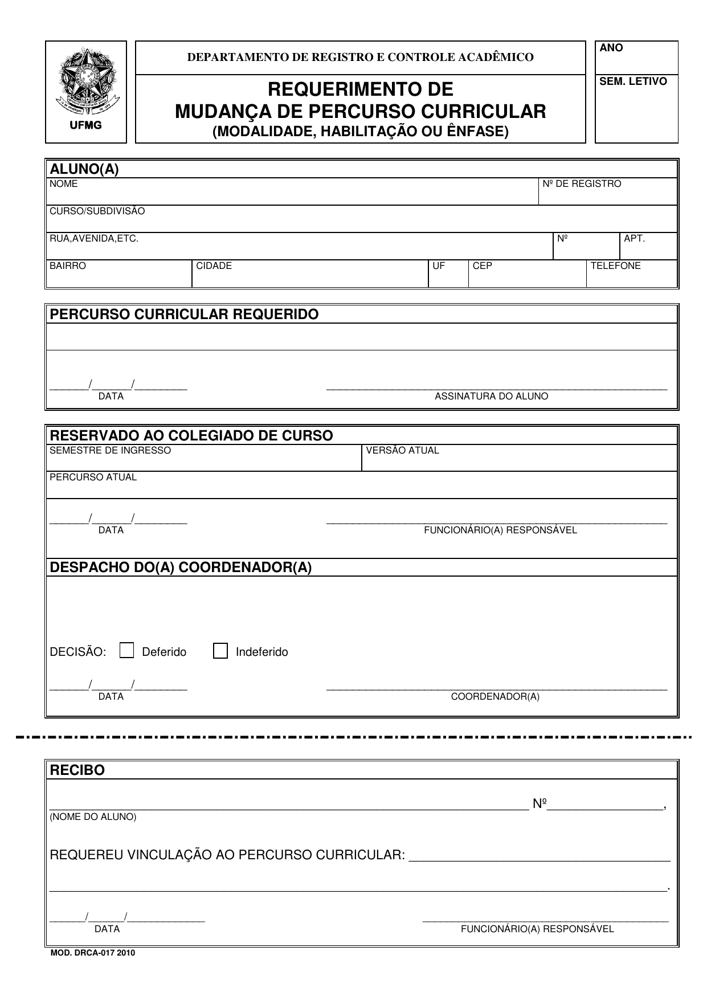

```{=html}
<header class="cagp-workspace-header" role="region" aria-label="Cabeçalho e Sub-Views de Documentos Oficiais">
  <div class="cagp-workspace-toprow">
    <nav class="cagp-breadcrumbs" aria-label="Você está aqui: Trilha de navegação">
      <ol class="cagp-breadcrumb-list" itemscope itemtype="https://schema.org/BreadcrumbList">
        <li class="cagp-breadcrumb-item" itemprop="itemListElement" itemscope itemtype="https://schema.org/ListItem">
          <a href="index.html" itemprop="item"><i class="bi bi-house-door" aria-hidden="true"></i> <span itemprop="name">Início</span></a>
          <meta itemprop="position" content="1" />
        </li>
        <li class="cagp-breadcrumb-separator" aria-hidden="true">&rsaquo;</li>
        <li class="cagp-breadcrumb-item">
          <span class="cagp-breadcrumb-parent">Acervo &amp; Ajuda</span>
        </li>
        <li class="cagp-breadcrumb-separator" aria-hidden="true">&rsaquo;</li>
        <li class="cagp-breadcrumb-item is-active" itemprop="itemListElement" itemscope itemtype="https://schema.org/ListItem" aria-current="page">
          <span itemprop="name">Documentos &amp; Formulários</span>
          <meta itemprop="position" content="2" />
        </li>
      </ol>
    </nav>
    <div class="cagp-workspace-badges">
      <span class="cagp-badge cagp-badge-red">Acervo Oficial FAFICH/UFMG</span>
      <span class="cagp-badge cagp-badge-dark">Versão Curricular N-20229</span>
      <span class="cagp-badge cagp-badge-blue">8 PDFs Offline + 17 Modelos</span>
    </div>
  </div>
  <h1 class="cagp-workspace-title">REPOSITÓRIO NORMATIVO DE GESTÃO PÚBLICA</h1>
  <p class="cagp-workspace-subtitle">Cofre Offline dos 8 PDFs normativos essenciais (PPC 2020, Regulamento N-20229, Ementário, 3 Percursos, Termo de TCC e Regimento CAGP), formulários editáveis em PDF/DOCX e tutorial do DRCA.</p>

  <nav class="cagp-workspace-bar" aria-label="Alternar categorias de Documentos">
    <div class="cagp-workspace-tabs" role="tablist" data-tab-count="3">
      <button type="button" class="cagp-workspace-tab is-active" id="ws-tab-v1" role="tab" aria-controls="ws-panel-v1" aria-selected="true" tabindex="0" data-ws-tab="v1" data-ws-hash="#atos-cagp">
        <i class="bi bi-file-earmark-pdf-fill" aria-hidden="true"></i>
        <span class="cagp-tab-label-full">1. Atos Normativos</span>
        <span class="cagp-tab-label-short" aria-hidden="true">Atos</span>
      </button>
      <button type="button" class="cagp-workspace-tab" id="ws-tab-v2" role="tab" aria-controls="ws-panel-v2" aria-selected="false" tabindex="-1" data-ws-tab="v2" data-ws-hash="#formularios">
        <i class="bi bi-pencil-square" aria-hidden="true"></i>
        <span class="cagp-tab-label-full">2. Formulários</span>
        <span class="cagp-tab-label-short" aria-hidden="true">Formulários</span>
      </button>
      <button type="button" class="cagp-workspace-tab" id="ws-tab-v3" role="tab" aria-controls="ws-panel-v3" aria-selected="false" tabindex="-1" data-ws-tab="v3" data-ws-hash="#tutorial-drca">
        <i class="bi bi-journal-text" aria-hidden="true"></i>
        <span class="cagp-tab-label-full">3. Instruções DRCA</span>
        <span class="cagp-tab-label-short" aria-hidden="true">DRCA</span>
      </button>
    </div>
    <button type="button" class="cagp-workspace-viewall" aria-pressed="false" aria-label="Ver todas as abas" data-ws-tab="__all__" data-ws-hash="#visao-completa">
      <i class="bi bi-layout-text-sidebar" aria-hidden="true"></i>
    </button>
  </nav>
</header>

<!-- Faixa Inline de Status Offline (44px) -->
<div id="cagp-offline-status-strip" class="cagp-offline-strip mb-3 d-flex align-items-center justify-content-between p-2 border border-1 border-dark bg-light" style="min-height: 44px;">
  <div class="d-flex align-items-center gap-2 small">
    <i class="bi bi-cloud-check-fill text-success" aria-hidden="true"></i>
    <span id="cagp-vault-status-indicator">✓ 9/9 PDFs oficiais essenciais disponíveis offline</span>
  </div>
  <button type="button" id="cagp-vault-sync-pill" class="cagp-btn cagp-btn-outline btn-sm py-1" onclick="window.cagpCacheAllPdfs()">
    <i class="bi bi-arrow-repeat me-1"></i> Sincronizar
  </button>
</div>

<section id="filtro-documentos" class="cagp-tool-box mb-4" aria-labelledby="doc-filter-heading">
  <div class="cagp-tool-header">
    <div>
      <span class="cagp-badge cagp-badge-dark mb-1">Catálogo &amp; Biblioteca Offline</span>
      <h2 id="doc-filter-heading" class="h5 mb-0">BUSCAR DOCUMENTO OFICIAL, MODELO DE ESTÁGIO OU REQUERIMENTO</h2>
    </div>
    <span id="doc-filter-status" class="cagp-badge cagp-badge-red cagp-filter-count" aria-live="polite">Exibindo todos os documentos e formulários</span>
  </div>
  <div class="cagp-sticky-search-bar">
    <div class="row g-2 align-items-center mb-2">
      <div class="col-12">
        <label for="doc-search-input" class="visually-hidden">Filtrar por nome, assunto ou artigo</label>
        <input type="search" id="doc-search-input" class="cagp-search-input" placeholder="Buscar por nome, assunto ou artigo (ex: TCC, Estágio Art. 41, trancamento, FCA, regimento)...">
      </div>
    </div>
    <div class="cagp-chip-rail" role="group" aria-label="Filtrar categoria de documento">
      <button type="button" class="cagp-chip cagp-chip-m3 active" aria-pressed="true" data-doc-cat="all">Todos</button>
      <button type="button" class="cagp-chip cagp-chip-m3" aria-pressed="false" data-doc-cat="offline"><i class="bi bi-check-circle-fill text-success me-1" aria-hidden="true"></i>Baixados Offline ✓</button>
      <button type="button" class="cagp-chip cagp-chip-m3" aria-pressed="false" data-doc-cat="normativo"><i class="bi bi-file-earmark-text me-1" aria-hidden="true"></i>Normas &amp; PPC</button>
      <button type="button" class="cagp-chip cagp-chip-m3" aria-pressed="false" data-doc-cat="percurso"><i class="bi bi-signpost-split me-1" aria-hidden="true"></i>Percursos (01-01 a 01-03)</button>
      <button type="button" class="cagp-chip cagp-chip-m3" aria-pressed="false" data-doc-cat="formulario"><i class="bi bi-pencil-square me-1" aria-hidden="true"></i>Formulários &amp; Requerimentos</button>
      <button type="button" class="cagp-chip cagp-chip-m3" aria-pressed="false" data-doc-cat="estagio"><i class="bi bi-briefcase-fill me-1" aria-hidden="true"></i>Modelos de Estágio</button>
    </div>
  </div>
</section>

<!-- Empty State Acolhedor de Busca de Documentos -->
<div id="doc-empty-state" class="cagp-empty-state mb-4" style="display: none;" role="status">
  <div class="cagp-empty-icon"><i class="bi bi-file-earmark-x" aria-hidden="true"></i></div>
  <h3 class="h5 mb-1">NENHUM DOCUMENTO ENCONTRADO</h3>
  <p class="small text-muted mb-3">Nenhum ato normativo, percurso, modelo de estágio ou formulário corresponde ao filtro selecionado.</p>
  <div class="cagp-empty-tips small mb-3">
    <strong><i class="bi bi-lightbulb-fill text-warning me-1" aria-hidden="true"></i> Dica do Acervo:</strong> Você pode consultar os processos e formulários padronizados diretamente no SEI da UFMG ou verificar o modelo de aproveitamento no CEAG da FAFICH (Sala F-2033).
  </div>
  <div>
    <button type="button" id="btn-doc-empty-reset" class="cagp-chip">
      <i class="bi bi-arrow-counterclockwise me-1" aria-hidden="true"></i> Limpar busca e ver todos os documentos
    </button>
  </div>
</div>
```

::: {#ws-panel-v1 .cagp-workspace-view .is-active role="tabpanel" aria-labelledby="ws-tab-v1" data-ws-view="v1"}
```{=html}
<!-- Atalhos de Alta Urgência / Documentos Mais Solicitados -->
<div class="cagp-urgent-grid mb-4">
  <div class="cagp-urgent-card cagp-surface-timbre">
    <div class="cagp-urgent-badge">Documento Mestre</div>
    <div class="cagp-urgent-title">PPC — Projeto Pedagógico</div>
    <div class="cagp-urgent-desc">Estrutura de 3.000h, competências e matriz curricular do curso.</div>
    <div class="mt-2">
      <a href="documentos/ppc-gestao-publica-ufmg.pdf" target="_blank" class="cagp-chip"><i class="bi bi-file-earmark-pdf me-1" aria-hidden="true"></i>Baixar PDF (3.3 MB)</a>
    </div>
  </div>
  <div class="cagp-urgent-card cagp-surface-timbre">
    <div class="cagp-urgent-badge">Protocolo SEI</div>
    <div class="cagp-urgent-title">Requerimento AAC (N-20229)</div>
    <div class="cagp-urgent-desc">Formulário oficial para integralizar até 300h de atividades complementares.</div>
    <div class="mt-2">
      <a href="documentos/requerimento-atividade-integralizadora-credito-v20229.pdf" target="_blank" class="cagp-chip"><i class="bi bi-download me-1" aria-hidden="true"></i>Baixar Formulário</a>
    </div>
  </div>
  <div class="cagp-urgent-card cagp-surface-timbre">
    <div class="cagp-urgent-badge">Entidade Discente</div>
    <div class="cagp-urgent-title">Regimento Interno CAGP</div>
    <div class="cagp-urgent-desc">Estatuto soberano de 2024 aprovado em Assembleia Geral discente.</div>
    <div class="mt-2">
      <a href="documentos/regimento-interno-cagp-ufmg.pdf" target="_blank" class="cagp-chip"><i class="bi bi-file-earmark-ruled me-1" aria-hidden="true"></i>Baixar Regimento</a>
    </div>
  </div>
</div>
```

## <i class="bi bi-file-earmark-ruled" aria-hidden="true"></i> Atos Institucionais da Representação Discente {#atos-cagp}

O documento supremo de auto-organização, direitos discentes e governança do Centro Acadêmico de Gestão Pública da FAFICH/UFMG:

::: {.row .g-4 .mb-5}
::: {.col-12}
```{=html}
<div class="cagp-doc-card" data-doc-item="normativo">
  <div class="cagp-doc-header">
    <div>
      <span class="cagp-doc-badge bg-danger text-white">Regimento Interno Oficial • 2024</span>
      <span class="cagp-doc-badge bg-light text-dark">PDF • 307 KB</span>
      <span class="cagp-doc-badge bg-dark text-white">Vigência Plena</span>
    </div>
    <h3 class="cagp-doc-title">Regimento Interno do Centro Acadêmico de Gestão Pública (CAGP)</h3>
    <div class="cagp-doc-meta"><strong>Aprovação:</strong> Assembleia Geral dos Estudantes de Gestão Pública • 14 de outubro de 2024 (Revoga o Estatuto de 2010 e o Regimento de 2021)</div>
    <p class="cagp-doc-desc">Documento normativo soberano que define a natureza civil, autônoma e suprapartidária do CAGP (Art. 3º e 4º), os princípios regedores da Administração Pública de legalidade, impessoalidade, moralidade, publicidade e eficiência (Art. 8º, III), a estruturação em 7 Diretorias Executivas com no mínimo 8 membros (Art. 24 e 25), a soberania da Assembleia Geral (Art. 35 a 40), a fiscalização pela Junta Eleitoral permanente e independente (Art. 20 a 23) e o rito de eleições diretas e secretas com debate obrigatório (Art. 41 a 45).</p>
  </div>
  <div class="cagp-doc-actions">
    <a href="documentos/regimento-interno-cagp-ufmg.pdf" target="_blank" class="cagp-doc-btn cagp-doc-btn-primary" aria-label="Visualizar Regimento Interno do CAGP em PDF"><i class="bi bi-eye" aria-hidden="true"></i> Visualizar PDF</a>
    <a href="documentos/regimento-interno-cagp-ufmg.pdf" download="Regimento-Interno-CAGP-UFMG.pdf" class="cagp-doc-btn cagp-doc-btn-outline" aria-label="Baixar Regimento Interno do CAGP em PDF"><i class="bi bi-download" aria-hidden="true"></i> Baixar Arquivo Oficial</a>
  </div>
</div>
```
:::
:::

---

## <i class="bi bi-bank" aria-hidden="true"></i> Atos Fundamentais do Curso {#atos-curso}

Os documentos basilares que regem a estrutura pedagógica, os direitos e os deveres dos discentes de Gestão Pública da UFMG:

::: {.row .g-4 .mb-5}
::: {.col-lg-6}
```{=html}
<div class="cagp-doc-card" data-doc-item="normativo">
  <div class="cagp-doc-header">
    <div>
      <span class="cagp-doc-badge bg-danger text-white">Documento Mestre</span>
      <span class="cagp-doc-badge bg-light text-dark">PDF • 3.3 MB</span>
    </div>
    <h3 class="cagp-doc-title">Projeto Pedagógico do Curso (PPC)</h3>
    <div class="cagp-doc-meta"><strong>Emissão:</strong> Colegiado de Coordenação Didática / FAFICH / CEPE-UFMG • Versão N-20229</div>
    <p class="cagp-doc-desc">Documento institucional completo que define o perfil do egresso, as competências técnicas e analíticas, a matriz curricular de 3.000 horas no turno noturno, as diretrizes de extensão obrigatória e a justificativa pedagógica do curso de Gestão Pública da UFMG.</p>
  </div>
  <div class="cagp-doc-actions">
    <a href="documentos/ppc-gestao-publica-ufmg.pdf" target="_blank" class="cagp-doc-btn cagp-doc-btn-primary" aria-label="Visualizar Projeto Pedagógico do Curso em PDF"><i class="bi bi-eye" aria-hidden="true"></i> Visualizar PDF</a>
    <a href="documentos/ppc-gestao-publica-ufmg.pdf" download="PPC-Gestao-Publica-UFMG.pdf" class="cagp-doc-btn cagp-doc-btn-outline" aria-label="Baixar Projeto Pedagógico do Curso em PDF"><i class="bi bi-download" aria-hidden="true"></i> Baixar Arquivo</a>
  </div>
</div>
```
:::

::: {.col-lg-6}
```{=html}
<div class="cagp-doc-card" data-doc-item="normativo">
  <div class="cagp-doc-header">
    <div>
      <span class="cagp-doc-badge bg-dark text-white">Regulamento Oficial</span>
      <span class="cagp-doc-badge bg-light text-dark">PDF • 2.0 MB</span>
    </div>
    <h3 class="cagp-doc-title">Regulamento do Curso de Graduação</h3>
    <div class="cagp-doc-meta"><strong>Emissão:</strong> Colegiado do Curso de Gestão Pública • FAFICH / UFMG</div>
    <p class="cagp-doc-desc">Conjunto formal de regras regimentais do curso: matrícula mínima semestral de 180h (12 créditos), os 3 percursos formais (Art. 3º), Atividades Acadêmicas Complementares e prazos de 120 dias (Art. 15), dispensa de estágio profissional (Art. 41), TCC e avaliação de conhecimentos (Art. 51).</p>
  </div>
  <div class="cagp-doc-actions">
    <a href="documentos/regulamento-gestao-publica-ufmg.pdf" target="_blank" class="cagp-doc-btn cagp-doc-btn-primary" aria-label="Visualizar Regulamento do Curso em PDF"><i class="bi bi-eye" aria-hidden="true"></i> Visualizar PDF</a>
    <a href="documentos/regulamento-gestao-publica-ufmg.pdf" download="Regulamento-Curso-Gestao-Publica-UFMG.pdf" class="cagp-doc-btn cagp-doc-btn-outline" aria-label="Baixar Regulamento do Curso em PDF"><i class="bi bi-download" aria-hidden="true"></i> Baixar Arquivo</a>
  </div>
</div>
```
:::
:::

---

## <i class="bi bi-book" aria-hidden="true"></i> Ementário Geral do Curso

O programa curricular com os objetivos de ensino, conteúdos e referências bibliográficas de todas as matérias:

::: {.row .g-4 .mb-5}
::: {.col-12}
```{=html}
<div class="cagp-doc-card" data-doc-item="normativo">
  <div class="cagp-doc-header">
    <div>
      <span class="cagp-doc-badge bg-primary text-white">Ementário Completo</span>
      <span class="cagp-doc-badge bg-light text-dark">PDF • 3.0 MB</span>
    </div>
    <h3 class="cagp-doc-title">Ementário Oficial das Disciplinas Obrigatórias</h3>
    <div class="cagp-doc-meta"><strong>Departamentos Ofertantes:</strong> DCP (Ciência Política), ECN (Economia), EST (Estatística) e SOA (Sociologia)</div>
    <p class="cagp-doc-desc">Catálogo normativo que detalha as ementas oficiais, objetivos programáticos e bibliografias recomendadas de todas as <strong>27 disciplinas obrigatórias</strong> dos 10 períodos curriculares, fundamentando o aprendizado teórico e instrumental em políticas públicas, finanças, avaliação e governança.</p>
  </div>
  <div class="cagp-doc-actions">
    <a href="documentos/ementario-gestao-publica-ufmg.pdf" target="_blank" class="cagp-doc-btn cagp-doc-btn-primary" aria-label="Visualizar Ementário Oficial em PDF"><i class="bi bi-eye" aria-hidden="true"></i> Visualizar Ementário Completo</a>
    <a href="documentos/ementario-gestao-publica-ufmg.pdf" download="Ementario-Gestao-Publica-UFMG.pdf" class="cagp-doc-btn cagp-doc-btn-outline" aria-label="Baixar Ementário Oficial em PDF"><i class="bi bi-download" aria-hidden="true"></i> Baixar Ementário (PDF)</a>
  </div>
</div>
```
:::
:::

---

## <i class="bi bi-signpost-split" aria-hidden="true"></i> Matrizes Curriculares dos Três Percursos Oficiais {#matrizes-percursos}

Conforme o **Art. 3º do Regulamento**, o curso oferece 3 modalidades formais de percurso curricular registradas nos sistemas acadêmicos da UFMG:

::: {.row .g-4 .mb-4}
::: {.col-md-4}
```{=html}
<div class="cagp-doc-card" data-doc-item="percurso">
  <div class="cagp-doc-header">
    <div>
      <span class="cagp-doc-badge bg-dark text-white">Percurso 01-01</span>
      <span class="cagp-doc-badge bg-light text-dark">PDF • 166 KB</span>
    </div>
    <h3 class="cagp-doc-title">Bacharelado / Núcleo Geral</h3>
    <div class="cagp-doc-meta"><strong>Padrão Canônico:</strong> 10 Semestres • 3.000h</div>
    <p class="cagp-doc-desc">Relatório oficial de percurso padrão. Grade recomendada período a período com 1.560h obrigatórias, 300h de estágio, 1.020h optativas e 120h de Formação Livre.</p>
  </div>
  <div class="cagp-doc-actions">
    <a href="documentos/percurso-bacharelado-nucleo-geral.pdf" target="_blank" class="cagp-doc-btn cagp-doc-btn-primary" aria-label="Visualizar Percurso Geral em PDF"><i class="bi bi-eye" aria-hidden="true"></i> Ver PDF</a>
    <a href="documentos/percurso-bacharelado-nucleo-geral.pdf" download="Percurso-Bacharelado-Nucleo-Geral.pdf" class="cagp-doc-btn cagp-doc-btn-outline" aria-label="Baixar Percurso Geral em PDF"><i class="bi bi-download" aria-hidden="true"></i> Baixar</a>
  </div>
</div>
```
:::

::: {.col-md-4}
```{=html}
<div class="cagp-doc-card" data-doc-item="percurso">
  <div class="cagp-doc-header">
    <div>
      <span class="cagp-doc-badge cagp-badge-gold">Percurso 01-02</span>
      <span class="cagp-doc-badge bg-light text-dark">PDF • 166 KB</span>
    </div>
    <h3 class="cagp-doc-title">Núcleo Complementar</h3>
    <div class="cagp-doc-meta"><strong>Transversal/Aberta:</strong> A partir do 5º Período</div>
    <p class="cagp-doc-desc">Relatório do percurso de formação interdisciplinar. Integralização de 300h em Formação Transversal com redução das optativas específicas para 720h.</p>
  </div>
  <div class="cagp-doc-actions">
    <a href="documentos/percurso-bacharelado-nucleo-complementar.pdf" target="_blank" class="cagp-doc-btn cagp-doc-btn-primary" aria-label="Visualizar Percurso Complementar em PDF"><i class="bi bi-eye" aria-hidden="true"></i> Ver PDF</a>
    <a href="documentos/percurso-bacharelado-nucleo-complementar.pdf" download="Percurso-Bacharelado-Nucleo-Complementar.pdf" class="cagp-doc-btn cagp-doc-btn-outline" aria-label="Baixar Percurso Complementar em PDF"><i class="bi bi-download" aria-hidden="true"></i> Baixar</a>
  </div>
</div>
```
:::

::: {.col-md-4}
```{=html}
<div class="cagp-doc-card" data-doc-item="percurso">
  <div class="cagp-doc-header">
    <div>
      <span class="cagp-doc-badge cagp-badge-blue">Percurso 01-03</span>
      <span class="cagp-doc-badge bg-light text-dark">PDF • 167 KB</span>
    </div>
    <h3 class="cagp-doc-title">Núcleo Avançado</h3>
    <div class="cagp-doc-meta"><strong>Pós-Graduação:</strong> A partir do 7º Período</div>
    <p class="cagp-doc-desc">Relatório do percurso acadêmico articulado com a Pós-Graduação. Permite cursar de 45h a 120h em disciplinas do mestrado (ex: PPGCP/FAFICH).</p>
  </div>
  <div class="cagp-doc-actions">
    <a href="documentos/percurso-bacharelado-nucleo-avancado.pdf" target="_blank" class="cagp-doc-btn cagp-doc-btn-primary" aria-label="Visualizar Percurso Avançado em PDF"><i class="bi bi-eye" aria-hidden="true"></i> Ver PDF</a>
    <a href="documentos/percurso-bacharelado-nucleo-avancado.pdf" download="Percurso-Bacharelado-Nucleo-Avancado.pdf" class="cagp-doc-btn cagp-doc-btn-outline" aria-label="Baixar Percurso Avançado em PDF"><i class="bi bi-download" aria-hidden="true"></i> Baixar</a>
  </div>
</div>
```
:::
:::

:::

::: {#ws-panel-v2 .cagp-workspace-view role="tabpanel" aria-labelledby="ws-tab-v2" data-ws-view="v2" hidden="true"}

## <i class="bi bi-pencil-square" aria-hidden="true"></i> Formulários e Requerimentos Administrativos {#formularios}

Modelos oficiais disponibilizados pelo Colegiado de Coordenação Didática da FAFICH/UFMG para abertura de processos acadêmicos via SEI ou protocolo presencial:

```{=html}
<div class="row g-4 mb-5">
  <!-- Coluna 1: Trajetória & Percurso -->
  <div class="col-lg-6">
    <div class="cagp-card h-100">
      <h3 class="fs-6 fw-bold text-uppercase text-danger mb-3"><i class="bi bi-compass" aria-hidden="true"></i> Trajetória Curricular e Matrícula</h3>
      
      <div class="cagp-form-item" data-doc-item="formulario">
        <div>
          <div class="cagp-form-title">Mudança de Percurso Curricular</div>
          <div class="cagp-form-sub">Migração formal entre Geral (01-01), Complementar (01-02) e Avançado (01-03).</div>
        </div>
        <div class="d-flex flex-wrap gap-2">
          <a href="documentos/requerimento-mudanca-percurso-curricular-drca.pdf" target="_blank" class="cagp-form-link">Ver PDF <i class="bi bi-file-earmark-pdf" aria-hidden="true"></i></a>
          <a href="https://www.fafich.ufmg.br/gestaopublica/wp-content/uploads/2024/09/REQUERIMENTO-DE-MUDANCA-DE-PERCURSO-CURRICULAR.docx" target="_blank" rel="noopener noreferrer" class="cagp-form-link">DOCX <i class="bi bi-box-arrow-up-right cagp-external-icon" aria-hidden="true"></i></a>
        </div>
      </div>

      <div class="cagp-form-item" data-doc-item="formulario">
        <div>
          <div class="cagp-form-title">Formação Complementar Aberta (FCA)</div>
          <div class="cagp-form-sub">Solicitação de percurso individual com disciplinas de outros departamentos da UFMG.</div>
        </div>
        <div class="d-flex flex-wrap gap-2">
          <a href="documentos/requerimento-formacao-complementar-aberta-fca.pdf" target="_blank" class="cagp-form-link">Ver PDF <i class="bi bi-file-earmark-pdf" aria-hidden="true"></i></a>
          <a href="https://www.fafich.ufmg.br/gestaopublica/wp-content/uploads/2024/09/REQUERIMENTO-DE-FORMACAO-COMPLEMENTAR-ABERTA-FCA.docx" target="_blank" rel="noopener noreferrer" class="cagp-form-link">DOCX <i class="bi bi-box-arrow-up-right cagp-external-icon" aria-hidden="true"></i></a>
        </div>
      </div>

      <div class="cagp-form-item" data-doc-item="formulario">
        <div>
          <div class="cagp-form-title">Trancamento Parcial de Matrícula</div>
          <div class="cagp-form-sub">Cancelamento de inscrição em disciplina isolada dentro do prazo do calendário.</div>
        </div>
        <div class="d-flex flex-wrap gap-2">
          <a href="documentos/requerimento-trancamento-parcial-matricula.pdf" target="_blank" class="cagp-form-link">Ver PDF <i class="bi bi-file-earmark-pdf" aria-hidden="true"></i></a>
          <a href="https://www.fafich.ufmg.br/gestaopublica/wp-content/uploads/2024/09/REQUERIMENTO-DE-TRANCAMENTO-PARCIAL-DE-MATRICULA.docx" target="_blank" rel="noopener noreferrer" class="cagp-form-link">DOCX <i class="bi bi-box-arrow-up-right cagp-external-icon" aria-hidden="true"></i></a>
        </div>
      </div>

      <div class="cagp-form-item" data-doc-item="formulario">
        <div>
          <div class="cagp-form-title">Trancamento Total de Matrícula</div>
          <div class="cagp-form-sub">Suspensão de atividades no semestre com justificativa formal comprovada.</div>
        </div>
        <div class="d-flex flex-wrap gap-2">
          <a href="documentos/requerimento-trancamento-total-matricula.pdf" target="_blank" class="cagp-form-link">Ver PDF <i class="bi bi-file-earmark-pdf" aria-hidden="true"></i></a>
          <a href="https://www.fafich.ufmg.br/gestaopublica/wp-content/uploads/2024/09/REQUERIMENTO-DE-TRANCAMENTO-TOTAL-DE-MATRICULA.docx" target="_blank" rel="noopener noreferrer" class="cagp-form-link">DOCX <i class="bi bi-box-arrow-up-right cagp-external-icon" aria-hidden="true"></i></a>
        </div>
      </div>
    </div>
  </div>

  <!-- Coluna 2: Integralização & Aproveitamento -->
  <div class="col-lg-6">
    <div class="cagp-card h-100">
      <h3 class="fs-6 fw-bold text-uppercase text-dark mb-3"><i class="bi bi-mortarboard" aria-hidden="true"></i> Aproveitamento, Conclusão &amp; Condições Especiais</h3>

      <div class="cagp-form-item" data-doc-item="formulario">
        <div>
          <div class="cagp-form-title">Aproveitamento de Estudos (Dispensa)</div>
          <div class="cagp-form-sub">Para disciplinas cursadas em outra faculdade. <em>Prazo limite: até o 2º período</em> (Res. CEPE 06/19).</div>
        </div>
        <div class="d-flex flex-wrap gap-2">
          <a href="documentos/requerimento-aproveitamento-de-estudos-colegiado.pdf" target="_blank" class="cagp-form-link">Ver PDF <i class="bi bi-file-earmark-pdf" aria-hidden="true"></i></a>
          <a href="https://www.fafich.ufmg.br/gestaopublica/wp-content/uploads/2024/09/REQUERIMENTO-DE-APROVEITAMENTO-DE-ESTUDOS.docx" target="_blank" rel="noopener noreferrer" class="cagp-form-link">DOCX <i class="bi bi-box-arrow-up-right cagp-external-icon" aria-hidden="true"></i></a>
        </div>
      </div>

      <div class="cagp-form-item" data-doc-item="formulario">
        <div>
          <div class="cagp-form-title">Integralização de Horas por AAC (N-20229)</div>
          <div class="cagp-form-sub">Validação de até 300h de atividades complementares na versão curricular vigente.</div>
        </div>
        <div class="d-flex flex-wrap gap-2">
          <a href="documentos/requerimento-atividade-integralizadora-credito-v20229.pdf" target="_blank" class="cagp-form-link">Ver PDF <i class="bi bi-file-earmark-pdf" aria-hidden="true"></i></a>
          <a href="https://www.fafich.ufmg.br/gestaopublica/wp-content/uploads/2024/09/REQUERIMENTO-DE-INTEGRALIZACAO-DE-HORAS-POR-ATIVIDADE-ACADEMICA-COMPLEMENTAR-N-20229.docx" target="_blank" rel="noopener noreferrer" class="cagp-form-link">DOCX <i class="bi bi-box-arrow-up-right cagp-external-icon" aria-hidden="true"></i></a>
        </div>
      </div>

      <div class="cagp-form-item" data-doc-item="formulario">
        <div>
          <div class="cagp-form-title">Termo de Aceite de Orientador de TCC</div>
          <div class="cagp-form-sub">Declaração formal assinada pelo orientador docente para início da monografia/artigo.</div>
        </div>
        <div class="d-flex flex-wrap gap-2">
          <a href="documentos/termo-aceite-orientador-tcc.pdf" target="_blank" class="cagp-form-link" aria-label="Visualizar Termo de Aceite de Orientador de TCC em PDF">Ver PDF <i class="bi bi-file-earmark-pdf" aria-hidden="true"></i></a>
          <a href="https://www.fafich.ufmg.br/gestaopublica/wp-content/uploads/2024/09/TERMO-DE-ACEITE-ORIENTADOR-TCC.docx" target="_blank" rel="noopener noreferrer" class="cagp-form-link">DOCX <i class="bi bi-box-arrow-up-right cagp-external-icon" aria-hidden="true"></i></a>
        </div>
      </div>

      <div class="cagp-form-item" data-doc-item="formulario">
        <div>
          <div class="cagp-form-title">Inscrição à Colação de Grau</div>
          <div class="cagp-form-sub">Requerimento final de formatura para discentes concluintes dos 10 períodos.</div>
        </div>
        <div class="d-flex flex-wrap gap-2">
          <a href="documentos/requerimento-inscricao-colacao-de-grau-colegiado.pdf" target="_blank" class="cagp-form-link">Ver PDF <i class="bi bi-file-earmark-pdf" aria-hidden="true"></i></a>
          <a href="https://www.fafich.ufmg.br/gestaopublica/wp-content/uploads/2024/09/REQUERIMENTO-DE-INSCRICAO-A-COLACAO-DE-GRAU.docx" target="_blank" rel="noopener noreferrer" class="cagp-form-link">DOCX <i class="bi bi-box-arrow-up-right cagp-external-icon" aria-hidden="true"></i></a>
        </div>
      </div>

      <div class="cagp-form-item" data-doc-item="formulario">
        <div>
          <div class="cagp-form-title">Regime Especial (Gestante / Médico)</div>
          <div class="cagp-form-sub">Requerimento de exercícios domiciliares e inspeção médica oficial.</div>
        </div>
        <div class="d-flex flex-wrap gap-2">
          <a href="documentos/requerimento-regime-especial-graduacao.pdf" target="_blank" class="cagp-form-link">Regime Especial PDF</a>
          <a href="documentos/requerimento-avaliacao-medica.pdf" target="_blank" class="cagp-form-link">Avaliação Médica PDF</a>
        </div>
      </div>
    </div>
  </div>
</div>

<!-- Modelos Oficiais de Estágio Supervisionado & Dispensa Profissional (Art. 41) -->
<div class="cagp-card mb-4" id="modelos-estagio">
  <div class="d-flex flex-wrap align-items-center justify-content-between gap-2 mb-3 pb-2" style="border-bottom: 2px solid #0A0A0A;">
    <div>
      <span class="cagp-badge cagp-badge-gold mb-1">Setor de Estágios FAFICH &amp; Art. 41</span>
      <h3 class="h5 mb-0" style="font-family:'Oswald',sans-serif;text-transform:uppercase;">Modelos Oficiais de Estágio Supervisionado e Dispensa Profissional (PDF &amp; DOCX)</h3>
    </div>
    <a href="estagio.html#simulador-art41" class="cagp-chip"><i class="bi bi-briefcase-fill me-1" aria-hidden="true"></i> Ir para Guia de Estágio &amp; Simulador Art. 41</a>
  </div>
  <div class="row g-3">
    <div class="col-md-6">
      <div class="cagp-form-item" data-doc-item="estagio">
        <div>
          <div class="cagp-form-title">Requerimento de Integralização por Experiência Profissional (Art. 41)</div>
          <div class="cagp-form-sub">Formulário oficial para dispensa de Estágio Supervisionado A e B (300h) por exercício profissional na área pública.</div>
        </div>
        <div class="d-flex flex-wrap gap-2">
          <a href="documentos/estagio-requerimento-integralizacao-experiencia-profissional.pdf" target="_blank" class="cagp-form-link">Ver PDF <i class="bi bi-file-earmark-pdf" aria-hidden="true"></i></a>
          <a href="documentos/estagio-requerimento-integralizacao-experiencia-profissional.docx" target="_blank" class="cagp-form-link">Baixar DOCX <i class="bi bi-file-earmark-word" aria-hidden="true"></i></a>
        </div>
      </div>

      <div class="cagp-form-item" data-doc-item="estagio">
        <div>
          <div class="cagp-form-title">Relatório de Atividades — Experiência Profissional (Art. 41)</div>
          <div class="cagp-form-sub">Modelo de memorial descritivo das atribuições públicas ou do 3º setor para instrução do processo SEI de dispensa.</div>
        </div>
        <div class="d-flex flex-wrap gap-2">
          <a href="documentos/estagio-relatorio-atividades-experiencia-profissional.pdf" target="_blank" class="cagp-form-link">Ver PDF <i class="bi bi-file-earmark-pdf" aria-hidden="true"></i></a>
          <a href="documentos/estagio-relatorio-atividades-experiencia-profissional.docx" target="_blank" class="cagp-form-link">Baixar DOCX <i class="bi bi-file-earmark-word" aria-hidden="true"></i></a>
        </div>
      </div>

      <div class="cagp-form-item" data-doc-item="estagio">
        <div>
          <div class="cagp-form-title">Termo de Compromisso de Estágio (Com Convênio UFMG)</div>
          <div class="cagp-form-sub">Minuta padrão para órgãos públicos, autarquias e instituições que já possuem convênio ativo com a UFMG.</div>
        </div>
        <div class="d-flex flex-wrap gap-2">
          <a href="documentos/estagio-modelo-termo-de-compromisso-com-convenio.pdf" target="_blank" class="cagp-form-link">Ver PDF <i class="bi bi-file-earmark-pdf" aria-hidden="true"></i></a>
          <a href="documentos/estagio-modelo-termo-de-compromisso-com-convenio.docx" target="_blank" class="cagp-form-link">Baixar DOCX <i class="bi bi-file-earmark-word" aria-hidden="true"></i></a>
        </div>
      </div>

      <div class="cagp-form-item" data-doc-item="estagio">
        <div>
          <div class="cagp-form-title">Termo de Compromisso de Estágio (Sem Vínculo Prévio)</div>
          <div class="cagp-form-sub">Minuta para celebração direta de Termo de Compromisso com concedentes sem convênio prévio.</div>
        </div>
        <div class="d-flex flex-wrap gap-2">
          <a href="documentos/estagio-modelo-termo-de-compromisso-sem-vinculo.pdf" target="_blank" class="cagp-form-link">Ver PDF <i class="bi bi-file-earmark-pdf" aria-hidden="true"></i></a>
          <a href="documentos/estagio-modelo-termo-de-compromisso-sem-vinculo.docx" target="_blank" class="cagp-form-link">Baixar DOCX <i class="bi bi-file-earmark-word" aria-hidden="true"></i></a>
        </div>
      </div>
    </div>

    <div class="col-md-6">
      <div class="cagp-form-item" data-doc-item="estagio">
        <div>
          <div class="cagp-form-title">Plano de Atividades de Estágio (PAE)</div>
          <div class="cagp-form-sub">Cronograma e descrição das atividades pactuadas entre estagiário, supervisor de campo e professor orientador.</div>
        </div>
        <div class="d-flex flex-wrap gap-2">
          <a href="documentos/estagio-modelo-plano-de-atividades.pdf" target="_blank" class="cagp-form-link">Ver PDF <i class="bi bi-file-earmark-pdf" aria-hidden="true"></i></a>
          <a href="documentos/estagio-modelo-plano-de-atividades.docx" target="_blank" class="cagp-form-link">Baixar DOCX <i class="bi bi-file-earmark-word" aria-hidden="true"></i></a>
        </div>
      </div>

      <div class="cagp-form-item" data-doc-item="estagio">
        <div>
          <div class="cagp-form-title">Relatório Semestral de Estágio</div>
          <div class="cagp-form-sub">Modelo de acompanhamento periódico exigido a cada 6 meses de vigência do Termo de Compromisso.</div>
        </div>
        <div class="d-flex flex-wrap gap-2">
          <a href="documentos/estagio-modelo-relatorio-semestral.pdf" target="_blank" class="cagp-form-link">Ver PDF <i class="bi bi-file-earmark-pdf" aria-hidden="true"></i></a>
          <a href="documentos/estagio-modelo-relatorio-semestral.docx" target="_blank" class="cagp-form-link">Baixar DOCX <i class="bi bi-file-earmark-word" aria-hidden="true"></i></a>
        </div>
      </div>

      <div class="cagp-form-item" data-doc-item="estagio">
        <div>
          <div class="cagp-form-title">Relatório Final de Estágio Supervisionado</div>
          <div class="cagp-form-sub">Modelo oficial para encerramento e integralização de créditos de Estágio Supervisionado A (150h) e B (150h).</div>
        </div>
        <div class="d-flex flex-wrap gap-2">
          <a href="documentos/estagio-modelo-relatorio-final.pdf" target="_blank" class="cagp-form-link">Ver PDF <i class="bi bi-file-earmark-pdf" aria-hidden="true"></i></a>
          <a href="documentos/estagio-modelo-relatorio-final.docx" target="_blank" class="cagp-form-link">Baixar DOCX <i class="bi bi-file-earmark-word" aria-hidden="true"></i></a>
        </div>
      </div>

      <div class="cagp-form-item" data-doc-item="estagio">
        <div>
          <div class="cagp-form-title">Manual de Orientações de Estágio FAFICH &amp; Resoluções</div>
          <div class="cagp-form-sub">Diretrizes operacionais do Setor de Estágios da FAFICH, Resolução 01/2019 do Colegiado e Resolução CEPE 02/2009.</div>
        </div>
        <div class="d-flex flex-wrap gap-2">
          <a href="documentos/estagio-manual-orientacoes-fafich.pdf" target="_blank" class="cagp-form-link">Manual FAFICH PDF</a>
          <a href="documentos/resolucao-01-2019-estagio-curricular.pdf" target="_blank" class="cagp-form-link">Res. 01/2019 PDF</a>
          <a href="documentos/resolucao-cepe-02-2009-estagio-ufmg.pdf" target="_blank" class="cagp-form-link">CEPE 02/2009 PDF</a>
        </div>
      </div>
    </div>
  </div>
</div>
</div>
```
:::

::: {#ws-panel-v3 .cagp-workspace-view role="tabpanel" aria-labelledby="ws-tab-v3" data-ws-view="v3" hidden="true"}

## <i class="bi bi-journal-text" aria-hidden="true"></i> Tutorial Visual: Requerimento de Mudança de Percurso (DRCA) {#tutorial-drca}

```{=html}
<section class="cagp-doc-guide mb-4" aria-labelledby="guide-drca-title">
  <div class="cagp-doc-guide-header d-flex flex-wrap align-items-center justify-content-between gap-2">
    <div>
      <span class="cagp-badge cagp-badge-red mb-1">Guia Visual Passo a Passo</span>
      <h3 id="guide-drca-title" class="h5 mb-0 text-uppercase fw-bold">Como Preencher o Requerimento de Mudança de Percurso Curricular (DRCA)</h3>
    </div>
    <a href="documentos/requerimento-mudanca-percurso-curricular-drca.pdf" target="_blank" class="cagp-chip"><i class="bi bi-download" aria-hidden="true"></i> Baixar Requerimento DRCA (PDF)</a>
  </div>
  <p class="small text-muted mb-4">
    Utilize este formulário padronizado do DRCA para solicitar a vinculação formal a um dos 3 percursos do curso (Geral 01-01, Complementar 01-02 ou Avançado 01-03) ou para alteração de ênfase curricular:
  </p>

  <div class="row g-4">
    <!-- Visual com Print e Pins -->
    <div class="col-lg-6">
      <div class="cagp-doc-preview-wrapper" role="region" aria-label="Visualização anotada do Requerimento de Mudança de Percurso Curricular DRCA">
        
        
        <!-- Box 1 & Pin 1: Cabeçalho & Dados do Discente -->
        <div class="cagp-doc-box" style="top: 3%; left: 5%; width: 92.5%; height: 26.5%;" aria-hidden="true"></div>
        <button type="button" class="cagp-doc-pin" style="top: 3%; left: 5%;" aria-label="Ponto 1: Ano Letivo e Dados do Aluno">1</button>

        <!-- Box 2 & Pin 2: Percurso Requerido & Assinatura -->
        <div class="cagp-doc-box" style="top: 29.71%; left: 5%; width: 92.5%; height: 12%;" aria-hidden="true"></div>
        <button type="button" class="cagp-doc-pin" style="top: 29.8%; left: 5%;" aria-label="Ponto 2: Percurso Curricular e Assinatura">2</button>

        <!-- Box 3 & Pin 3: Despacho do Colegiado -->
        <div class="cagp-doc-box" style="top: 42%; left: 5%; width: 92.5%; height: 31%;" aria-hidden="true"></div>
        <button type="button" class="cagp-doc-pin" style="top: 42%; left: 5%;" aria-label="Ponto 3: Despacho do Colegiado e Recibo">3</button>
      </div>
    </div>

    <!-- Lista Explicativa dos Passos -->
    <div class="col-lg-6">
      <div class="cagp-step-list">
        <div class="cagp-step-card">
          <span class="cagp-step-num">1</span>
          <div class="cagp-step-content">
            <h4 class="cagp-step-title">1. Ano Letivo e Dados Pessoais</h4>
            <p class="cagp-step-desc">
              Preencha o <strong>Ano</strong> e o <strong>Semestre Letivo</strong> corrente no cabeçalho. No bloco de identificação, insira seu nome completo, <strong>Nº de Registro (Matrícula)</strong>, curso (<em>Gestão Pública - Subdivisão 003</em>) e endereço de residência atualizado.
            </p>
          </div>
        </div>

        <div class="cagp-step-card">
          <span class="cagp-step-num">2</span>
          <div class="cagp-step-content">
            <h4 class="cagp-step-title">2. Percurso Curricular Requerido</h4>
            <p class="cagp-step-desc">
              Escreva textualmente o percurso pretendido: <em>Bacharelado com Núcleo Geral</em>, <em>Bacharelado com Núcleo Complementar</em> ou <em>Bacharelado com Núcleo Avançado</em>. Date e assine no campo indicado.
            </p>
          </div>
        </div>

        <div class="cagp-step-card">
          <span class="cagp-step-num">3</span>
          <div class="cagp-step-content">
            <h4 class="cagp-step-title">3. Trâmite: Colegiado &amp; Protocolo no DRCA</h4>
            <p class="cagp-step-desc">
              <strong>Não preencha</strong> os campos inferiores. Entregue o formulário no guichê do CEAG (2º andar da FAFICH) para conferência da versão curricular e assinatura da Coordenação do Curso antes do envio definitivo ao DRCA.
            </p>
          </div>
        </div>

        <div class="cagp-step-card">
          <span class="cagp-step-num"><i class="bi bi-calendar-event" aria-hidden="true"></i></span>
          <div class="cagp-step-content">
            <h4 class="cagp-step-title">Prazo no Calendário Acadêmico</h4>
            <p class="cagp-step-desc">
              A mudança de percurso deve obedecer estritamente às datas estipuladas no <strong>Calendário Escolar DRCA/UFMG</strong> (geralmente nas primeiras semanas de cada semestre letivo).
            </p>
          </div>
        </div>
      </div>
    </div>
  </div>
</section>
```

---

## <i class="bi bi-lightbulb" aria-hidden="true"></i> Como Usar os Documentos Oficiais em Requerimentos

::: {.callout-note}
### Dicas Jurídicas e Regimentais do CAGP para o Estudante
1. **Citação Literal em Requerimentos:** Ao solicitar dispensa de pré-requisitos, aproveitamento de estudos ou justificativa de quebra de matrícula no SEI, cite o artigo específico do **Regulamento do Curso**.
2. **Dispensa de Estágio (Art. 41):** Estudantes que exercem cargo público efetivo, função pública ou cargo em comissão devem anexar cópia do Art. 41 do Regulamento junto ao termo de posse e declaração de atribuições no processo SEI.
3. **Prazo Decadencial de AAC (Art. 15):** Os certificados de Atividades Acadêmicas Complementares devem ser protocolados em no máximo **120 dias corridos** a contar do início do semestre seguinte à conclusão da atividade.
4. **Dúvidas ou Apoio:** Caso tenha dificuldades na interpretação das normas ou no trâmite processual com o Colegiado, procure a diretoria do CAGP pelo e-mail [cagp@fafich.ufmg.br](mailto:cagp@fafich.ufmg.br).
:::

```{=html}
<nav class="cagp-journey-nav" aria-label="Continuidade da jornada acadêmica">
  <div class="row g-3">
    <div class="col-md-6">
      <a href="tcc.html" class="cagp-journey-link">
        <div>
          <div class="cagp-journey-dir">&larr; Passo Anterior</div>
          <div class="cagp-journey-title">Trabalho de Conclusão de Curso (TCC) &amp; 4 Modalidades</div>
        </div>
        <p class="cagp-journey-desc">Matriz comparativa das 4 modalidades oficiais de TCC (Art. 19) e Termo de Aceite.</p>
      </a>
    </div>
    <div class="col-md-6">
      <a href="faq.html" class="cagp-journey-link">
        <div>
          <div class="cagp-journey-dir">Próximo Passo na Jornada &rarr;</div>
          <div class="cagp-journey-title">Dúvidas Frequentes (FAQ com Busca Rápida)</div>
        </div>
        <p class="cagp-journey-desc">Respostas diretas sobre trancamento, quebra de pré-requisito, EaD e intercâmbio.</p>
      </a>
    </div>
  </div>
</nav>
```
:::

<script>
(function () {
  var CACHE_NAME = 'cagp-pdfs-oficiais-v1';
  var CANONICAL_PDFS = [
    'documentos/ppc-gestao-publica-ufmg.pdf',
    'documentos/regulamento-gestao-publica-ufmg.pdf',
    'documentos/ementario-gestao-publica-ufmg.pdf',
    'documentos/percurso-bacharelado-nucleo-geral.pdf',
    'documentos/percurso-bacharelado-nucleo-complementar.pdf',
    'documentos/percurso-bacharelado-nucleo-avancado.pdf',
    'documentos/termo-aceite-orientador-tcc.pdf',
    'documentos/regimento-interno-cagp-ufmg.pdf',
    'documentos/requerimento-atividade-integralizadora-credito-v20229.pdf'
  ];

  function initDocumentosPage() {
    var items = Array.from(document.querySelectorAll('[data-doc-item]'));
    if (!items.length) return;

    var searchInput = document.getElementById('doc-search-input');
    var catBtns = document.querySelectorAll('[data-doc-cat]');
    var statusEl = document.getElementById('doc-filter-status');
    var emptyState = document.getElementById('doc-empty-state');
    var btnEmptyReset = document.getElementById('btn-doc-empty-reset');
    var activeCat = 'all';

    function normalize(str) {
      return (str || '').toLowerCase().normalize('NFD').replace(/[\u0300-\u036f]/g, '');
    }

    function applyDocFilter() {
      var q = normalize(searchInput ? searchInput.value : '');
      var visible = 0;

      // When filtering by category or search query, ensure matching workspace views are visible
      if (q || activeCat !== 'all') {
        if (activeCat === 'formulario' || activeCat === 'estagio') {
          if (window.cagpActivateWorkspaceView) window.cagpActivateWorkspaceView('v2', { scroll: false });
        } else if (activeCat === 'normativo' || activeCat === 'percurso') {
          if (window.cagpActivateWorkspaceView) window.cagpActivateWorkspaceView('v1', { scroll: false });
        } else {
          if (window.cagpActivateWorkspaceView) window.cagpActivateWorkspaceView('__all__', { scroll: false });
        }
      }

      items.forEach(function (item) {
        var cat = item.getAttribute('data-doc-item');
        var isCached = item.getAttribute('data-is-cached') === 'true';
        var catMatch = false;
        if (activeCat === 'all') {
          catMatch = true;
        } else if (activeCat === 'offline') {
          catMatch = isCached;
        } else {
          catMatch = (cat === activeCat);
        }
        var textMatch = (!q || normalize(item.textContent).indexOf(q) !== -1);
        var show = catMatch && textMatch;
        item.style.display = show ? '' : 'none';
        if (show) visible++;
      });

      if (statusEl) {
        statusEl.textContent = 'Exibindo ' + visible + ' de ' + items.length + ' itens';
      }
      if (emptyState) {
        emptyState.style.display = (visible === 0) ? 'block' : 'none';
      }
    }

    // Inject individual Offline Pill on each card with a local PDF
    function ensureOfflinePills() {
      items.forEach(function (item) {
        if (item.dataset.offlinePillReady === 'true') return;
        var pdfLink = item.querySelector('a[href*="documentos/"][href$=".pdf"]');
        if (!pdfLink) return;
        item.dataset.offlinePillReady = 'true';
        var rawHref = pdfLink.getAttribute('href') || '';
        var pdfUrl = rawHref.indexOf('documentos/') !== -1
          ? 'documentos/' + rawHref.split('documentos/').pop()
          : rawHref;
        item.setAttribute('data-pdf-url', pdfUrl);

        var pill = document.createElement('button');
        pill.type = 'button';
        pill.className = 'cagp-offline-pill ms-auto';
        pill.setAttribute('data-offline-pill-btn', pdfUrl);
        pill.innerHTML = '<i class="bi bi-arrow-down-circle" aria-hidden="true"></i> <span>Salvar Offline</span>';

        pill.addEventListener('click', async function (e) {
          e.preventDefault();
          e.stopPropagation();
          if (!('caches' in window)) return;
          if (window.cagpHaptic) window.cagpHaptic(8);
          try {
            pill.classList.add('cagp-shimmer');
            pill.innerHTML = '<i class="bi bi-hourglass-split" aria-hidden="true"></i> <span>Salvando...</span>';
            var cache = await caches.open(CACHE_NAME);
            await cache.add(pdfUrl);
            pill.classList.remove('cagp-shimmer');
            if (window.cagpHaptic) window.cagpHaptic([6, 20, 10]);
            await syncOfflineBadges();
          } catch (err) {
            pill.classList.remove('cagp-shimmer');
            pill.innerHTML = '<i class="bi bi-exclamation-circle" aria-hidden="true"></i> <span>Tentar novamente</span>';
          }
        });

        var actionsRow = pdfLink.parentElement;
        if (actionsRow) {
          actionsRow.appendChild(pill);
          var titleEl = item.querySelector('h3, h4, .cagp-form-title, strong');
          var docTitle = (titleEl ? titleEl.textContent.trim() : 'Documento Oficial CAGP UFMG').replace(/"/g, '&quot;');
          var shareBtn = document.createElement('button');
          shareBtn.type = 'button';
          shareBtn.className = 'cagp-action-chip';
          shareBtn.setAttribute('data-cagp-share', 'true');
          shareBtn.setAttribute('data-share-title', docTitle + ' • Gestão Pública UFMG');
          shareBtn.setAttribute('data-share-text', 'Acesse o documento oficial "' + docTitle + '" no Portal & Super App do CAGP UFMG:');
          shareBtn.setAttribute('data-share-url', pdfUrl);
          shareBtn.innerHTML = '<i class="bi bi-share" aria-hidden="true"></i> <span>Compartilhar</span>';
          actionsRow.appendChild(shareBtn);
        }
      });
    }

    async function syncOfflineBadges() {
      if (!('caches' in window)) return;
      try {
        var cache = await caches.open(CACHE_NAME);
        var cachedCanonical = 0;

        for (var i = 0; i < CANONICAL_PDFS.length; i++) {
          var match = await cache.match(CANONICAL_PDFS[i]);
          if (match) cachedCanonical++;
        }

        for (var j = 0; j < items.length; j++) {
          var item = items[j];
          var pdfUrl = item.getAttribute('data-pdf-url');
          if (!pdfUrl) continue;
          var matched = await cache.match(pdfUrl);
          var isCached = !!matched;
          item.setAttribute('data-is-cached', isCached ? 'true' : 'false');
          var pill = item.querySelector('[data-offline-pill-btn]');
          if (pill) {
            if (isCached) {
              pill.classList.add('is-cached');
              pill.innerHTML = '<i class="bi bi-check-circle-fill" aria-hidden="true"></i> <span>Salvo no Aparelho ✓</span>';
            } else {
              pill.classList.remove('is-cached');
              pill.innerHTML = '<i class="bi bi-arrow-down-circle" aria-hidden="true"></i> <span>Salvar Offline</span>';
            }
          }
        }

        var indicator = document.getElementById('cagp-vault-status-indicator');
        var syncPill = document.getElementById('cagp-vault-sync-pill');
        if (indicator) {
          if (cachedCanonical >= CANONICAL_PDFS.length) {
            indicator.textContent = '✓ ' + cachedCanonical + '/' + CANONICAL_PDFS.length + ' PDFs oficiais essenciais disponíveis offline';
          } else {
            indicator.textContent = '⚡ ' + cachedCanonical + '/' + CANONICAL_PDFS.length + ' PDFs offline (toque em sincronizar)';
          }
        }
        if (syncPill) {
          if (cachedCanonical >= CANONICAL_PDFS.length) {
            syncPill.innerHTML = '<i class="bi bi-check2-all me-1"></i> Sincronizado';
            syncPill.classList.add('cagp-btn-success');
          } else {
            syncPill.innerHTML = '<i class="bi bi-arrow-repeat me-1"></i> Sincronizar';
            syncPill.classList.remove('cagp-btn-success');
          }
        }

        var badge = document.getElementById('cagp-offline-vault-badge');
        var btn = document.getElementById('cagp-btn-cache-pdfs');
        if (cachedCanonical >= CANONICAL_PDFS.length) {
          if (badge) {
            badge.innerHTML = '<i class="bi bi-check-circle-fill me-1" aria-hidden="true"></i> Cofre Completo: ' + CANONICAL_PDFS.length + '/' + CANONICAL_PDFS.length + ' PDFs Salvos no Aparelho';
            badge.style.background = '#1E6B3A';
            badge.style.color = '#FFFFFF';
          }
          if (btn) {
            btn.innerHTML = '<i class="bi bi-check2-all me-1" aria-hidden="true"></i> <span>' + CANONICAL_PDFS.length + ' PDFs Prontos Offline ✓</span>';
            btn.style.background = '#1E6B3A';
            btn.style.color = '#FFFFFF';
          }
        } else if (cachedCanonical > 0) {
          if (badge) {
            badge.innerHTML = '<i class="bi bi-hdd-network me-1" aria-hidden="true"></i> ' + cachedCanonical + '/' + CANONICAL_PDFS.length + ' PDFs Essenciais Salvos';
          }
        }

        if (activeCat === 'offline') {
          applyDocFilter();
        }
      } catch (e) {}
    }

    window.cagpCheckCachedPdfs = syncOfflineBadges;

    window.cagpCacheAllPdfs = async function () {
      var syncPill = document.getElementById('cagp-vault-sync-pill');
      var btn = document.getElementById('cagp-btn-cache-pdfs');
      var status = document.getElementById('cagp-offline-pdf-status');
      if (!('caches' in window)) {
        if (status) status.textContent = 'Armazenamento offline não suportado neste navegador.';
        if (indicator) indicator.textContent = 'Armazenamento offline não suportado neste navegador.';
        return;
      }
      if (window.cagpHaptic) window.cagpHaptic(8);
      if (window.cagpRouteProgress) window.cagpRouteProgress.start();
      try {
        if (syncPill) {
          syncPill.disabled = true;
          syncPill.innerHTML = '<i class="bi bi-hourglass-split me-1"></i> Baixando...';
        }
        if (btn) {
          btn.disabled = true;
          btn.classList.add('cagp-shimmer');
          btn.innerHTML = '<i class="bi bi-hourglass-split me-1" aria-hidden="true"></i> <span>Baixando ' + CANONICAL_PDFS.length + ' PDFs...</span>';
        }
        if (status) status.textContent = 'Sincronizando 9 PDFs oficiais essenciais...';
        var cache = await caches.open(CACHE_NAME);
        await cache.addAll(CANONICAL_PDFS);
        if (status) status.textContent = 'Sucesso! Os 9 PDFs essenciais estão salvos no seu aparelho para leitura sem internet.';
        if (btn) {
          btn.disabled = false;
          btn.classList.remove('cagp-shimmer');
        }
        if (syncPill) {
          syncPill.disabled = false;
        }
        if (window.cagpRouteProgress) window.cagpRouteProgress.finish();
        if (window.cagpHaptic) window.cagpHaptic([8, 24, 12]);
        await syncOfflineBadges();
      } catch (e) {
        if (window.cagpRouteProgress) window.cagpRouteProgress.finish();
        if (btn) {
          btn.disabled = false;
          btn.classList.remove('cagp-shimmer');
          btn.innerHTML = '<i class="bi bi-arrow-repeat me-1" aria-hidden="true"></i> <span>Tentar Novamente</span>';
        }
        if (status) status.textContent = 'Não foi possível concluir o download em lote agora. Verifique sua conexão.';
      }
    };

    ensureOfflinePills();
    syncOfflineBadges();

    catBtns.forEach(function (btn) {
      if (btn.dataset.catBound === 'true') return;
      btn.dataset.catBound = 'true';
      btn.addEventListener('click', function () {
        activeCat = btn.getAttribute('data-doc-cat');
        catBtns.forEach(function (b) {
          var isMatch = (b === btn);
          b.setAttribute('aria-pressed', isMatch ? 'true' : 'false');
          b.classList.toggle('active', isMatch);
        });
        applyDocFilter();
      });
    });

    if (searchInput && searchInput.dataset.searchBound !== 'true') {
      searchInput.dataset.searchBound = 'true';
      searchInput.addEventListener('input', applyDocFilter);
      searchInput.addEventListener('keydown', function (e) {
        if (e.key === 'Escape') {
          searchInput.value = '';
          applyDocFilter();
        }
      });
    }

    if (btnEmptyReset && btnEmptyReset.dataset.resetBound !== 'true') {
      btnEmptyReset.dataset.resetBound = 'true';
      btnEmptyReset.addEventListener('click', function () {
        activeCat = 'all';
        catBtns.forEach(function (b) {
          var isAll = b.getAttribute('data-doc-cat') === 'all';
          b.setAttribute('aria-pressed', isAll ? 'true' : 'false');
          b.classList.toggle('active', isAll);
        });
        if (searchInput) searchInput.value = '';
        applyDocFilter();
      });
    }

    // Interactive Tutorial Pins (#tutorial-drca)
    document.querySelectorAll('.cagp-doc-guide').forEach(function (guide) {
      var pins = Array.from(guide.querySelectorAll('.cagp-doc-pin'));
      var cards = Array.from(guide.querySelectorAll('.cagp-step-card'));
      function activateStep(idx) {
        pins.forEach(function (p, i) { p.classList.toggle('is-active', i === idx); });
        cards.forEach(function (c, i) { c.classList.toggle('is-highlighted', i === idx); });
        if (cards[idx] && window.innerWidth < 992) {
          cards[idx].scrollIntoView({ behavior: 'smooth', block: 'nearest' });
        }
      }
      pins.forEach(function (pin, idx) {
        if (pin.dataset.pinBound === 'true') return;
        pin.dataset.pinBound = 'true';
        pin.addEventListener('click', function () { activateStep(idx); });
      });
      cards.slice(0, pins.length).forEach(function (card, idx) {
        if (card.dataset.cardBound === 'true') return;
        card.dataset.cardBound = 'true';
        card.style.cursor = 'pointer';
        card.addEventListener('click', function () { activateStep(idx); });
      });
    });

    applyDocFilter();
  }

  if (document.readyState === 'loading') {
    document.addEventListener('DOMContentLoaded', initDocumentosPage);
  } else {
    initDocumentosPage();
  }
})();
</script>
```
