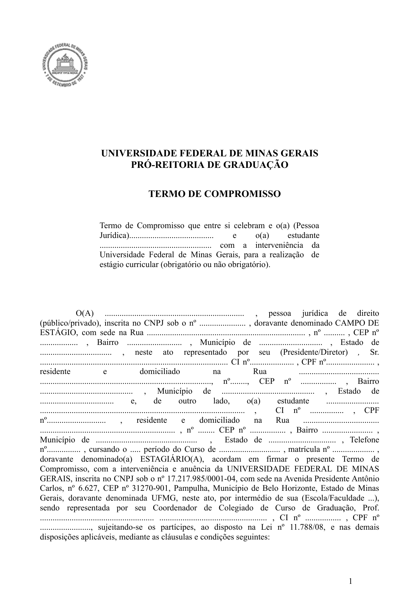

```{=html}
<header class="cagp-workspace-header" role="region" aria-label="Cabeçalho e Sub-Views de Estágio Supervisionado">
  <div class="cagp-workspace-toprow">
    <nav class="cagp-breadcrumbs" aria-label="Você está aqui: Trilha de navegação">
      <ol class="cagp-breadcrumb-list" itemscope itemtype="https://schema.org/BreadcrumbList">
        <li class="cagp-breadcrumb-item" itemprop="itemListElement" itemscope itemtype="https://schema.org/ListItem">
          <a href="index.html" itemprop="item"><i class="bi bi-house-door" aria-hidden="true"></i> <span itemprop="name">Início</span></a>
          <meta itemprop="position" content="1" />
        </li>
        <li class="cagp-breadcrumb-separator" aria-hidden="true">&rsaquo;</li>
        <li class="cagp-breadcrumb-item">
          <span class="cagp-breadcrumb-parent">Currículo &amp; Horas</span>
        </li>
        <li class="cagp-breadcrumb-separator" aria-hidden="true">&rsaquo;</li>
        <li class="cagp-breadcrumb-item is-active" itemprop="itemListElement" itemscope itemtype="https://schema.org/ListItem" aria-current="page">
          <span itemprop="name">Estágio &amp; Dispensa Art. 41</span>
          <meta itemprop="position" content="2" />
        </li>
      </ol>
    </nav>
    <div class="cagp-workspace-badges">
      <span class="cagp-badge cagp-badge-red">Regulamento • Capítulo VII (Art. 29 a 41)</span>
      <span class="cagp-badge cagp-badge-dark">300h Obrigatórias (DCP 135 + 136)</span>
      <span class="cagp-badge cagp-badge-blue">Lei nº 11.788/2008</span>
    </div>
  </div>
  <h1 class="cagp-workspace-title">ESTÁGIO SUPERVISIONADO (300H) &amp; DISPENSA ART. 41</h1>
  <p class="cagp-workspace-subtitle">Verificador interativo de integralização por experiência profissional (Art. 41), regras do Estágio Obrigatório A (180h) e B (120h) e tutorial visual do Termo de Compromisso (TCE).</p>

  <nav class="cagp-workspace-bar" aria-label="Alternar ferramentas de Estágio">
    <div class="cagp-workspace-tabs" role="tablist" data-tab-count="2">
      <button type="button" class="cagp-workspace-tab is-active" id="ws-tab-v1" role="tab" aria-controls="ws-panel-v1" aria-selected="true" tabindex="0" data-ws-tab="v1" data-ws-hash="#simulador-art41">
        <i class="bi bi-briefcase-fill" aria-hidden="true"></i>
        <span class="cagp-tab-label-full">1. Simulador Art. 41 (300h)</span>
        <span class="cagp-tab-label-short" aria-hidden="true">Art. 41</span>
      </button>
      <button type="button" class="cagp-workspace-tab" id="ws-tab-v2" role="tab" aria-controls="ws-panel-v2" aria-selected="false" tabindex="-1" data-ws-tab="v2" data-ws-hash="#tutorial-estagio">
        <i class="bi bi-journal-text" aria-hidden="true"></i>
        <span class="cagp-tab-label-full">2. Tutorial TCE &amp; Estágio</span>
        <span class="cagp-tab-label-short" aria-hidden="true">Tutorial</span>
      </button>
    </div>
    <button type="button" class="cagp-workspace-viewall" aria-pressed="false" aria-label="Ver todas as abas" data-ws-tab="__all__" data-ws-hash="#visao-completa">
      <i class="bi bi-layout-text-sidebar" aria-hidden="true"></i>
    </button>
  </nav>
</header>
```

```{=html}
<div id="ws-panel-v1" class="cagp-workspace-view is-active" role="tabpanel" aria-labelledby="ws-tab-v1" data-ws-view="v1">
```

## <i class="bi bi-scale" aria-hidden="true"></i> Art. 41: Simulador de Integralização por Experiência Profissional {#simulador-art41}

```{=html}
<section class="cagp-tool-box mb-4" aria-labelledby="art41-sim-title">
  <div class="cagp-tool-header">
    <div>
      <span class="cagp-badge cagp-badge-red mb-1">Verificador Interativo • Art. 41 do Regulamento</span>
      <h3 id="art41-sim-title" class="h5 mb-0">POSSO PEDIR DISPENSA/INTEGRALIZAÇÃO DO ESTÁGIO A E B?</h3>
    </div>
    <span class="small text-muted fw-semibold">Selecione seu vínculo profissional atual:</span>
  </div>

  <div class="cagp-segmented-control flex-wrap mb-3" role="group" aria-label="Situação profissional">
    <button type="button" class="cagp-segmented-btn cagp-chip" aria-pressed="true" data-art41-choice="servidor"><i class="bi bi-bank" aria-hidden="true"></i> Servidor(a) no Setor Público</button>
    <button type="button" class="cagp-segmented-btn cagp-chip" aria-pressed="false" data-art41-choice="osc"><i class="bi bi-globe" aria-hidden="true"></i> Trabalhador(a) em ONG / OSC</button>
    <button type="button" class="cagp-segmented-btn cagp-chip" aria-pressed="false" data-art41-choice="estagiario"><i class="bi bi-card-checklist" aria-hidden="true"></i> Estágio Não-Obrigatório</button>
    <button type="button" class="cagp-segmented-btn cagp-chip" aria-pressed="false" data-art41-choice="privado"><i class="bi bi-building" aria-hidden="true"></i> Setor Privado (Fora da Área)</button>
  </div>

  <div class="cagp-compass-panel cagp-panel-boxed" aria-live="polite">
    <div id="art41-res-servidor">
      <div class="d-flex flex-wrap align-items-center justify-content-between gap-2 mb-2">
        <span class="cagp-stamp-badge is-deferido"><i class="bi bi-patch-check-fill me-1" aria-hidden="true"></i> DEFERIDO • ART. 41</span>
        <span class="small fw-bold">Vale para Estágio A (180h) e/ou Estágio B (120h)</span>
      </div>
      <p class="small mb-2">Conforme o <strong>Art. 41 do Regulamento</strong>, servidores concursados, comissionados ou contratados em órgãos da administração direta ou indireta podem integralizar os créditos de estágio com sua atuação profissional.</p>
      <ol class="small mb-0 ps-3">
        <li><strong>Matrícula Obrigatória no SIGA:</strong> Inscreva-se normalmente no SIGA (via MinhaUFMG) em <code>DCP 135</code> (7ºP) ou <code>DCP 136</code> (8ºP). <em>Atenção:</em> A dispensa não ocorre de ofício fora do sistema; a matrícula regular é indispensável para o lançamento de nota e convalidação dos créditos pelo Colegiado.</li>
        <li><strong>No Início do Semestre:</strong> Preencha o <a href="documentos/estagio-requerimento-integralizacao-experiencia-profissional.pdf" target="_blank">Requerimento de Experiência Profissional (PDF)</a> (<a href="documentos/estagio-requerimento-integralizacao-experiencia-profissional.docx" download>DOCX</a>) acompanhado de <strong>declaração funcional da chefia</strong> com descrição detalhada das atividades.</li>
        <li><strong>No Fim do Semestre:</strong> Apresente o <a href="documentos/estagio-relatorio-atividades-experiencia-profissional.pdf" target="_blank">Relatório de Atividades (PDF)</a> (<a href="documentos/estagio-relatorio-atividades-experiencia-profissional.docx" download>DOCX</a>) no Moodle demonstrando o cumprimento da carga horária e a pertinência com a gestão pública.</li>
      </ol>
      <div class="cagp-art41-checklist" role="group" aria-label="Checklist de protocolo Art. 41 — Servidor Público">
        <div class="d-flex flex-wrap justify-content-between align-items-center gap-2 mb-1">
          <span class="small fw-bold text-uppercase text-dark"><i class="bi bi-check2-square text-success me-1" aria-hidden="true"></i>Checklist Documental de Protocolo (Art. 41):</span>
          <span id="art41-check-status" class="cagp-badge cagp-badge-dark cagp-tabular">0 / 4 etapas prontas</span>
        </div>
        <label class="cagp-art41-check-item">
          <input type="checkbox" data-art41-check="srv_1">
          <span><strong>1. Matrícula Regular no SIGA:</strong> Inscrito(a) em <code>DCP 135</code> (7ºP • 180h) ou <code>DCP 136</code> (8ºP • 120h).</span>
        </label>
        <label class="cagp-art41-check-item">
          <input type="checkbox" data-art41-check="srv_2">
          <span><strong>2. Requerimento de Experiência Profissional:</strong> Formulário oficial preenchido e assinado (<a href="documentos/estagio-requerimento-integralizacao-experiencia-profissional.pdf" target="_blank">PDF</a> / <a href="documentos/estagio-requerimento-integralizacao-experiencia-profissional.docx" download>DOCX</a>).</span>
        </label>
        <label class="cagp-art41-check-item">
          <input type="checkbox" data-art41-check="srv_3">
          <span><strong>3. Declaração Funcional da Chefia + Vínculo:</strong> Termo de posse/contrato e descrição das atribuições na administração pública.</span>
        </label>
        <label class="cagp-art41-check-item">
          <input type="checkbox" data-art41-check="srv_4">
          <span><strong>4. Relatório Final de Atividades no Moodle:</strong> Entrega ao fim do semestre para lançamento da nota (<a href="documentos/estagio-relatorio-atividades-experiencia-profissional.pdf" target="_blank">PDF</a> / <a href="documentos/estagio-relatorio-atividades-experiencia-profissional.docx" download>DOCX</a>).</span>
        </label>
      </div>
    </div>

    <div id="art41-res-osc" hidden>
      <div class="d-flex flex-wrap align-items-center justify-content-between gap-2 mb-2">
        <span class="cagp-stamp-badge is-homologado"><i class="bi bi-clock-history me-1" aria-hidden="true"></i> DEFERIMENTO CONDICIONADO</span>
        <span class="small fw-bold">Organizações que Executam Políticas Públicas</span>
      </div>
      <p class="small mb-2">O Art. 41 abrange vínculos profissionais em instituições governamentais ou organizações que atuem diretamente na gestão de políticas públicas, desde que as funções desempenhadas sejam compatíveis com o perfil do curso.</p>
      <p class="small mb-0"><strong>Como proceder:</strong> Matricule-se na disciplina de estágio e apresente no início do semestre a declaração formal do dirigente da entidade detalhando os projetos públicos em que você atua, para validação do docente orientador do DCP.</p>
      <div class="cagp-art41-checklist">
        <div class="small fw-bold text-uppercase text-dark mb-1"><i class="bi bi-file-earmark-check text-danger me-1" aria-hidden="true"></i>Documentos para Análise do Orientador:</div>
        <div class="d-flex flex-wrap gap-2 mt-1">
          <a href="documentos/estagio-requerimento-integralizacao-experiencia-profissional.pdf" target="_blank" class="cagp-chip py-1 px-2"><i class="bi bi-file-earmark-pdf me-1" aria-hidden="true"></i>Requerimento Art. 41 (PDF)</a>
          <a href="documentos/estagio-relatorio-atividades-experiencia-profissional.pdf" target="_blank" class="cagp-chip py-1 px-2"><i class="bi bi-file-earmark-text me-1" aria-hidden="true"></i>Modelo de Relatório (PDF)</a>
        </div>
      </div>
    </div>

    <div id="art41-res-estagiario" hidden>
      <div class="d-flex flex-wrap align-items-center justify-content-between gap-2 mb-2">
        <span class="cagp-stamp-badge is-homologado"><i class="bi bi-arrow-repeat me-1" aria-hidden="true"></i> CONVERSÃO DE TCE / AAC</span>
        <span class="small fw-bold">Lei do Estágio nº 11.788/2008</span>
      </div>
      <p class="small mb-2">Se você já realiza estágio remunerado (não-obrigatório) em órgão público ou entidade conveniada:</p>
      <ul class="small mb-0 ps-3">
        <li><strong>Para valer como Estágio Obrigatório (DCP 135 / 136):</strong> Ao chegar no 7º ou 8º período, formalize junto ao setor de estágios da FAFICH (CEAG) e ao orientador do DCP o Termo de Compromisso / Aditivo vinculando a atividade à disciplina.</li>
        <li><strong>Nos períodos anteriores (1º ao 6ºP):</strong> Você pode aproveitar até <strong>60 horas (4 créditos)</strong> como <strong>AAC — Modalidade IX (Vivência Profissional Complementar)</strong>!</li>
      </ul>
      <div class="cagp-art41-checklist">
        <div class="d-flex flex-wrap gap-2">
          <a href="documentos/estagio-modelo-plano-de-atividades.pdf" target="_blank" class="cagp-chip py-1 px-2"><i class="bi bi-file-earmark-pdf me-1" aria-hidden="true"></i>Plano de Atividades (PDF)</a>
          <a href="documentos/estagio-modelo-relatorio-final.pdf" target="_blank" class="cagp-chip py-1 px-2"><i class="bi bi-file-earmark-check me-1" aria-hidden="true"></i>Relatório Final de Estágio (PDF)</a>
          <a href="acg.html#calculadora-horas" class="cagp-chip py-1 px-2"><i class="bi bi-calculator me-1" aria-hidden="true"></i>Simular 60h em AAC (Mod. IX)</a>
        </div>
      </div>
    </div>

    <div id="art41-res-privado" hidden>
      <div class="d-flex flex-wrap align-items-center justify-content-between gap-2 mb-2">
        <span class="cagp-stamp-badge is-indeferido"><i class="bi bi-x-octagon-fill me-1" aria-hidden="true"></i> INDEFERIDO • ART. 41</span>
        <span class="small fw-bold">Planejamento para Trabalhadores do Noturno</span>
      </div>
      <p class="small mb-2">Atividades sem relação com gestão pública ou políticas públicas não dispensam o estágio pelo Art. 41. Contudo, o Regulamento oferece alternativas para quem trabalha durante o dia:</p>
      <ul class="small mb-0 ps-3">
        <li><strong>Estágio nas Férias Escolares (Art. 31):</strong> É permitido cumprir a carga horária durante o recesso escolar (respeitando o teto legal de 6h/dia e 30h/semana).</li>
        <li><strong>Projetos Conveniados e Terceiro Setor:</strong> Consulte o orientador de estágio do DCP sobre modalidades e parcerias institucionais com flexibilidade de horário.</li>
      </ul>
      <div class="cagp-art41-checklist">
        <a href="documentos/estagio-manual-orientacoes-fafich.pdf" target="_blank" class="cagp-chip py-1 px-2"><i class="bi bi-book me-1" aria-hidden="true"></i>Consultar Manual de Orientações de Estágio FAFICH (PDF)</a>
      </div>
    </div>
  </div>
</section>
```

---

## <i class="bi bi-briefcase" aria-hidden="true"></i> Estágio Curricular Supervisionado (Art. 29 a 41) {#estagio-supervisionado}
<span id="estagio" class="cagp-anchor-alias" aria-hidden="true"></span>

O estágio destina-se a propiciar ao estudante o aprendizado prático de aspectos que contribuam para a atuação profissional nos diversos órgãos da administração direta, autarquias, fundações, agências reguladoras e terceiro setor.

::: {.row .g-3 .mb-4}
::: {.col-md-4}
::: {.cagp-stat-card}
<div class="cagp-stat-value">180 h</div>
<div class="cagp-stat-label">Estágio Curricular A</div>
<small class="text-muted">DCP 135 • 7º Período (12 créditos)</small>
:::
:::

::: {.col-md-4}
::: {.cagp-stat-card}
<div class="cagp-stat-value">120 h</div>
<div class="cagp-stat-label">Estágio Curricular B</div>
<small class="text-muted">DCP 136 • 8º Período (8 créditos)</small>
:::
:::

::: {.col-md-4}
::: {.cagp-stat-card}
<div class="cagp-stat-value">Até 60 h</div>
<div class="cagp-stat-label">Estágio Não-Obrigatório (AAC)</div>
<small class="text-muted">Modalidade IX • Art. 15 (4 créditos)</small>
:::
:::
:::

::: {.row .g-4 .mb-4}
::: {.col-md-6}
::: {.cagp-card}
<span class="cagp-badge cagp-badge-red mb-2">Componente Obrigatório</span>

### Estágio Obrigatório (300 Horas)
- Dividido em duas etapas curriculares sequenciais:
  - **DCP 135 - Estágio Curricular A (7º período):** 180 horas (12 créditos).
  - **DCP 136 - Estágio Curricular B (8º período):** 120 horas (8 créditos).
- **Legislação Aplicável:** Respeita os limites da Lei Federal nº 11.788/2008 (máximo de 6 horas diárias e 30 horas semanais).
- **Formalização:** Exige Termo de Compromisso de Estágio (TCE) assinado pela concedente, UFMG e estudante, sob supervisão de um docente do Departamento de Ciência Política.
:::
:::

::: {.col-md-6}
::: {.cagp-card}
<span class="cagp-badge cagp-badge-dark mb-2">Enriquecimento Curricular</span>

### Estágio Não-Obrigatório
- Atividade extracurricular remunerada com concessão de bolsa e auxílio-transporte.
- Pode ser iniciado a partir dos primeiros semestres letivos para ganho de experiência.
- As horas de estágio não-obrigatório na área pública podem ser aproveitadas como **Atividades Acadêmicas Complementares (AAC - Vivência Profissional)** até o limite de 60 horas (4 créditos).
:::
:::
:::

```{=html}
</div>

<div id="ws-panel-v2" class="cagp-workspace-view" role="tabpanel" aria-labelledby="ws-tab-v2" data-ws-view="v2" hidden>
```

## <i class="bi bi-journal-text" aria-hidden="true"></i> Tutorial Visual: Termo de Compromisso de Estágio (TCE) {#tutorial-estagio}

```{=html}
<section class="cagp-doc-guide mb-4" aria-labelledby="guide-estagio-title">
  <div class="cagp-doc-guide-header d-flex flex-wrap align-items-center justify-content-between gap-2">
    <div>
      <span class="cagp-badge cagp-badge-red mb-1">Guia Visual Passo a Passo</span>
      <h3 id="guide-estagio-title" class="h5 mb-0 text-uppercase fw-bold">Preenchimento do Termo de Compromisso com Interveniência da UFMG</h3>
    </div>
    <div class="d-flex flex-wrap gap-2">
      <a href="documentos/estagio-modelo-termo-de-compromisso-com-convenio.pdf" target="_blank" class="cagp-chip"><i class="bi bi-download" aria-hidden="true"></i> Baixar Modelo Oficial (PDF)</a>
      <a href="documentos/estagio-modelo-termo-de-compromisso-com-convenio.docx" download class="cagp-chip"><i class="bi bi-file-earmark-word" aria-hidden="true"></i> Versão Editável (DOCX)</a>
    </div>
  </div>
  <p class="small text-muted mb-4">
    O Termo de Compromisso com interveniência da UFMG é o documento jurídico obrigatório pela Lei nº 11.788/2008 para formalizar o Estágio Obrigatório (DCP 135/136) ou Não-Obrigatório. Confira os campos indispensáveis na primeira folha:
  </p>

  <div class="row g-4">
    <div class="col-lg-6">
      <div class="cagp-doc-preview-wrapper" role="region" aria-label="Visualização anotada da primeira página do Termo de Compromisso de Estágio">
        
        
        <div class="cagp-doc-box" style="top: 36%; left: 5%; width: 90%; height: 30.69%;" aria-hidden="true"></div>
        <button type="button" class="cagp-doc-pin" style="top: 36%; left: 5%;" aria-label="Ponto 1: Instituição Concedente do Estágio">1</button>

        <div class="cagp-doc-box" style="top: 66.5%; left: 5%; width: 90%; height: 10.5%;" aria-hidden="true"></div>
        <button type="button" class="cagp-doc-pin" style="top: 66.5%; left: 5%;" aria-label="Ponto 2: Dados Cadastrais do Discente">2</button>

        <div class="cagp-doc-box" style="top: 84.5%; left: 5%; width: 90%; height: 10%;" aria-hidden="true"></div>
        <button type="button" class="cagp-doc-pin" style="top: 84.5%; left: 5%;" aria-label="Ponto 3: Interveniência FAFICH/UFMG">3</button>
      </div>
    </div>

    <div class="col-lg-6">
      <div class="cagp-step-list">
        <div class="cagp-step-card">
          <span class="cagp-step-num">1</span>
          <div class="cagp-step-content">
            <h4 class="cagp-step-title">1. Dados da Instituição Concedente</h4>
            <p class="cagp-step-desc">
              Preencha a Razão Social completa, CNPJ, endereço oficial da entidade concedente (órgão público, fundação, ONG ou empresa) e os dados do representante legal signatário (cargo, RG e CPF).
            </p>
          </div>
        </div>

        <div class="cagp-step-card">
          <span class="cagp-step-num">2</span>
          <div class="cagp-step-content">
            <h4 class="cagp-step-title">2. Identificação Acadêmica do Discente</h4>
            <p class="cagp-step-desc">
              Insira seus dados pessoais, CPF, RG, endereço e registre expressamente o curso como <strong>Bacharelado em Gestão Pública</strong>, seu período letivo e número de registro de matrícula no SIGA.
            </p>
          </div>
        </div>

        <div class="cagp-step-card">
          <span class="cagp-step-num">3</span>
          <div class="cagp-step-content">
            <h4 class="cagp-step-title">3. Interveniência Institucional UFMG</h4>
            <p class="cagp-step-desc">
              Identifique a <em>Faculdade de Filosofia e Ciências Humanas (FAFICH)</em> e o Colegiado de Gestão Pública. A assinatura é firmada pela Coordenação do Colegiado com a anuência do docente orientador do Departamento de Ciência Política (DCP).
            </p>
          </div>
        </div>

        <div class="cagp-step-card">
          <span class="cagp-step-num"><i class="bi bi-scale"></i></span>
          <div class="cagp-step-content">
            <h4 class="cagp-step-title">Limites da Lei nº 11.788/2008</h4>
            <p class="cagp-step-desc">
              A jornada de estágio não pode ultrapassar <strong>6 horas diárias e 30 horas semanais</strong>, garantindo compatibilidade com o turno noturno (19h às 22h30). O seguro contra acidentes pessoais é obrigatório e deve constar na apólice informada no contrato.
            </p>
          </div>
        </div>
      </div>
    </div>
  </div>
</section>
```

---

## <i class="bi bi-question-circle" aria-hidden="true"></i> Perguntas Frequentes sobre Estágio

::: {.cagp-card}
### Dúvidas Rápidas sobre o Estágio Supervisionado
- **Posso fazer estágio obrigatório nas férias?**  
  Sim! Conforme o Art. 31 do Regulamento do Curso, o estágio pode ser realizado durante as férias escolares, respeitando o limite legal de 6h diárias e 30h semanais.
- **Preciso me matricular no SIGA mesmo pedindo dispensa pelo Art. 41?**  
  Sim! A matrícula em `DCP 135` (7ºP) e `DCP 136` (8ºP) no SIGA é indispensável para que o docente orientador lance sua nota e convalide os 20 créditos (300h) no histórico escolar.
- **Onde baixo todos os modelos editáveis (DOCX) de Estágio?**  
  Você encontra os 11 documentos de estágio (TCE com e sem convênio, Plano de Atividades, Termo Aditivo, Rescisão, Ficha de Avaliação e Requerimento Art. 41) na aba [Formulários Editáveis](documentos.html#formularios).
:::

```{=html}
<nav class="cagp-journey-nav" aria-label="Continuidade da jornada acadêmica">
  <div class="row g-3">
    <div class="col-md-6">
      <a href="acg.html" class="cagp-journey-link">
        <div>
          <div class="cagp-journey-dir">&larr; Passo Anterior</div>
          <div class="cagp-journey-title">Extensão Obrigatória &amp; Horas AAC (Calculadora 600h)</div>
        </div>
        <p class="cagp-journey-desc">Simule suas horas de Extensão e Atividades Complementares nas 9 categorias do Art. 15.</p>
      </a>
    </div>
    <div class="col-md-6">
      <a href="tcc.html" class="cagp-journey-link">
        <div>
          <div class="cagp-journey-dir">Próximo Passo na Jornada &rarr;</div>
          <div class="cagp-journey-title">Trabalho de Conclusão de Curso (TCC) &amp; 4 Modalidades</div>
        </div>
        <p class="cagp-journey-desc">Conheça as 4 modalidades oficiais (Art. 19), baixe o Termo de Aceite e veja as regras de defesa.</p>
      </a>
    </div>
  </div>
</nav>
</div>

<script>
(function () {
  function initEstagioPage() {
    const CHECK_KEY = 'cagp_art41_checklist_v1';
    const btns = document.querySelectorAll('[data-art41-choice]');
    const btnList = Array.from(btns);
    const keys = ['servidor', 'osc', 'estagiario', 'privado'];

    btns.forEach(function (btn, idx) {
      btn.onclick = function () {
        const target = btn.getAttribute('data-art41-choice');
        btns.forEach(function (b) { b.setAttribute('aria-pressed', 'false'); });
        btn.setAttribute('aria-pressed', 'true');
        keys.forEach(function (k) {
          const el = document.getElementById('art41-res-' + k);
          if (el) {
            el.hidden = (k !== target);
            if (k === target) {
              const stamp = el.querySelector('.cagp-stamp-badge');
              if (stamp) {
                stamp.style.animation = 'none';
                stamp.offsetHeight; // forçar reflow
                stamp.style.animation = '';
              }
            }
          }
        });
      };

      btn.onkeydown = function (e) {
        let nextIdx = null;
        if (e.key === 'ArrowRight' || e.key === 'ArrowDown') {
          nextIdx = (idx + 1) % btnList.length;
        } else if (e.key === 'ArrowLeft' || e.key === 'ArrowUp') {
          nextIdx = (idx - 1 + btnList.length) % btnList.length;
        }
        if (nextIdx !== null) {
          e.preventDefault();
          btnList[nextIdx].focus();
          btnList[nextIdx].click();
        }
      };
    });

    // Checklist Documental Art. 41 (Persistência em localStorage)
    const checkInputs = Array.from(document.querySelectorAll('[data-art41-check]'));
    const checkStatusEl = document.getElementById('art41-check-status');
    let savedChecks = {};
    try {
      savedChecks = JSON.parse(localStorage.getItem(CHECK_KEY) || '{}') || {};
    } catch (e) {
      savedChecks = {};
    }

    function updateArt41Checks() {
      let done = 0;
      checkInputs.forEach(function (inp) {
        const k = inp.getAttribute('data-art41-check');
        inp.checked = Boolean(savedChecks[k]);
        if (inp.checked) done++;
      });
      if (checkStatusEl) {
        checkStatusEl.textContent = done + ' / ' + checkInputs.length + ' etapas prontas';
        checkStatusEl.className = 'cagp-badge ' + (done === checkInputs.length ? 'cagp-badge-green' : 'cagp-badge-dark') + ' cagp-tabular';
      }
    }

    checkInputs.forEach(function (inp) {
      inp.onchange = function () {
        if (window.cagpHaptic) window.cagpHaptic(8);
        const k = inp.getAttribute('data-art41-check');
        savedChecks[k] = inp.checked;
        try {
          localStorage.setItem(CHECK_KEY, JSON.stringify(savedChecks));
          if (window.refreshCagpVault) window.refreshCagpVault();
        } catch (e) {}
        updateArt41Checks();
      };
    });

    if (window.__cagpArt41SyncHandler) {
      window.removeEventListener('cagp:vault-synced', window.__cagpArt41SyncHandler);
      window.removeEventListener('cagp:vault-cleared', window.__cagpArt41SyncHandler);
    }
    window.__cagpArt41SyncHandler = function () {
      try {
        savedChecks = JSON.parse(localStorage.getItem(CHECK_KEY) || '{}') || {};
      } catch (e) {
        savedChecks = {};
      }
      updateArt41Checks();
    };
    window.addEventListener('cagp:vault-synced', window.__cagpArt41SyncHandler);
    window.addEventListener('cagp:vault-cleared', window.__cagpArt41SyncHandler);

    updateArt41Checks();

    // Pinos Interativos do Guia Visual do TCE (.cagp-doc-guide)
    document.querySelectorAll('.cagp-doc-guide').forEach(function (guide) {
      const pins = Array.from(guide.querySelectorAll('.cagp-doc-pin'));
      const stepCards = Array.from(guide.querySelectorAll('.cagp-step-card'));
      pins.forEach(function (pin, idx) {
        pin.onclick = function () {
          pins.forEach(function (p) { p.classList.remove('is-active'); });
          stepCards.forEach(function (c) { c.classList.remove('is-highlighted'); });
          pin.classList.add('is-active');
          if (stepCards[idx]) {
            stepCards[idx].classList.add('is-highlighted');
            stepCards[idx].scrollIntoView({ behavior: 'smooth', block: 'nearest' });
          }
        };
      });
      stepCards.forEach(function (card, idx) {
        if (idx < pins.length) {
          card.style.cursor = 'pointer';
          card.onclick = function () {
            pins.forEach(function (p) { p.classList.remove('is-active'); });
            stepCards.forEach(function (c) { c.classList.remove('is-highlighted'); });
            pins[idx].classList.add('is-active');
            card.classList.add('is-highlighted');
          };
        }
      });
    });
  }

  if (document.readyState === 'loading') {
    document.addEventListener('DOMContentLoaded', initEstagioPage, { once: true });
  } else {
    initEstagioPage();
  }
})();
</script>
```
