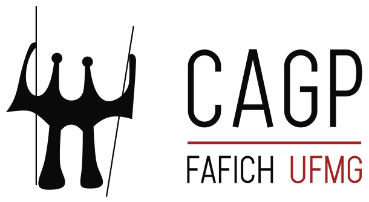

```{=html}
<nav class="cagp-breadcrumbs" aria-label="Você está aqui: Trilha de navegação">
  <ol class="cagp-breadcrumb-list" itemscope itemtype="https://schema.org/BreadcrumbList">
    <li class="cagp-breadcrumb-item" itemprop="itemListElement" itemscope itemtype="https://schema.org/ListItem">
      <a href="index.html" itemprop="item"><i class="bi bi-house-door" aria-hidden="true"></i> <span itemprop="name">Início</span></a>
      <meta itemprop="position" content="1" />
    </li>
    <li class="cagp-breadcrumb-separator" aria-hidden="true">&rsaquo;</li>
    <li class="cagp-breadcrumb-item">
      <span class="cagp-breadcrumb-parent">O CAGP</span>
    </li>
    <li class="cagp-breadcrumb-separator" aria-hidden="true">&rsaquo;</li>
    <li class="cagp-breadcrumb-item is-active" itemprop="itemListElement" itemscope itemtype="https://schema.org/ListItem" aria-current="page">
      <span itemprop="name">Gestão em Exercício &amp; Equipe</span>
      <meta itemprop="position" content="2" />
    </li>
  </ol>
</nav>
```

::: {.cagp-hero}
::: {.row .align-items-center}
::: {.col-lg-8}
<div class="d-flex flex-wrap gap-2 mb-2">
  <span class="cagp-badge cagp-badge-red">Mandato Vigente</span>
  <span class="cagp-badge cagp-badge-dark">Representação Discente</span>
  <span class="cagp-badge cagp-badge-gold">Regimento Interno 2024</span>
</div>

# GESTÃO EM EXERCÍCIO & NOSSA EQUIPE {.cagp-hero-title}

O **Centro Acadêmico de Gestão Pública (CAGP)** da Faculdade de Filosofia e Ciências Humanas da UFMG é construído diariamente pela dedicação dos estudantes eleitos pela comunidade discente. Atuamos com base nos princípios republicanos da **Legalidade, Impessoalidade, Moralidade, Publicidade e Eficiência** (Art. 8º do Regimento Interno), garantindo acolhimento contínuo, defesa intransigente dos direitos dos discentes do turno noturno e transparência ativa nas ações e contas da entidade.

Conheça abaixo o organograma hierárquico da gestão, a estrutura funcional das **7 diretorias estatutárias**, os canais de atendimento direto e as formas de participação e engajamento discente.

<div class="mt-3 d-flex flex-wrap gap-2">
  <a href="https://www.instagram.com/cagp.ufmg" class="cagp-doc-btn cagp-doc-btn-primary" target="_blank" rel="noopener noreferrer">
    <i class="bi bi-instagram me-1" aria-hidden="true"></i> Acompanhe no Instagram
  </a>
  <a href="mailto:cagp@fafich.ufmg.br" class="cagp-doc-btn cagp-doc-btn-outline">
    <i class="bi bi-envelope me-1" aria-hidden="true"></i> Fale com o CAGP
  </a>
  <a href="sobre.html" class="cagp-doc-btn cagp-doc-btn-outline">
    <i class="bi bi-bank me-1" aria-hidden="true"></i> O Centro Acadêmico &rarr;
  </a>
</div>
:::
::: {.col-lg-4 .col-12 .text-center .mt-4 .mt-lg-0}
```{=html}
<div class="cagp-hero-emblem-card">
  
</div>
```
:::
:::
:::

```{=html}
<nav class="cagp-subnav" aria-label="Atalhos rápidos desta página">
  <span class="cagp-subnav-label">Nesta Página:</span>
  <a href="#apresentacao-gestao" class="cagp-subnav-link"><i class="bi bi-megaphone" aria-hidden="true"></i> Comunicação</a>
  <a href="#organograma-funcional" class="cagp-subnav-link"><i class="bi bi-diagram-3" aria-hidden="true"></i> Organograma</a>
  <a href="#diretoria-presidencia" class="cagp-subnav-link"><i class="bi bi-people" aria-hidden="true"></i> Presidência</a>
  <a href="#governanca-financas" class="cagp-subnav-link"><i class="bi bi-shield-shaded" aria-hidden="true"></i> DIJUR • DIFI • DIAC</a>
  <a href="#articulacao-cultura-midias" class="cagp-subnav-link"><i class="bi bi-broadcast" aria-hidden="true"></i> DIAP • DICULT • DIMAC</a>
  <a href="#transparencia-ativa" class="cagp-subnav-link"><i class="bi bi-file-earmark-spreadsheet" aria-hidden="true"></i> Prestação de Contas</a>
  <a href="#participe-gestao" class="cagp-subnav-link"><i class="bi bi-person-plus" aria-hidden="true"></i> Participe</a>
</nav>
```

## <i class="bi bi-megaphone" aria-hidden="true"></i> Comunicação Oficial e Apresentação da Gestão {#apresentacao-gestao}

A gestão do Centro Acadêmico orienta-se pela **escuta discente, impessoalidade e descentralização**. Nosso compromisso é garantir que qualquer aluno — do calouro no primeiro dia ao concluinte calculando as últimas horas de formação — encontre no CAGP um ponto seguro de orientação acadêmica, suporte regimental e representação política ativa.

```{=html}
<div class="cagp-team-hero mb-4">
  <div class="row g-4 align-items-center">
    <div class="col-lg-7">
      <div class="d-flex flex-wrap gap-2 mb-2">
        <span class="cagp-badge cagp-badge-red">Representação Ativa</span>
        <span class="cagp-badge cagp-badge-dark">Gestão Participativa</span>
      </div>
      <h3 class="fs-4 fw-bold text-uppercase mb-3">Compromisso com a Comunidade Discente</h3>
      <p class="mb-3">
        Os membros da diretoria exercem seus mandatos de forma voluntária e democrática, dedicando suas horas extracurriculares à melhoria das condições de ensino, ampliação de oportunidades de estágio e pesquisa, e mediação de demandas com o Colegiado e os departamentos parceiros.
      </p>
      <p class="small text-muted mb-4">
        Acompanhe nossos comunicados formais, convocações de Assembleia Geral, cobertura de eventos e informes semanais em nossos canais oficiais de comunicação.
      </p>
      <div class="d-flex flex-wrap gap-2">
        <a href="https://www.instagram.com/cagp.ufmg" target="_blank" rel="noopener noreferrer" class="cagp-doc-btn cagp-doc-btn-primary">
          <i class="bi bi-instagram me-1" aria-hidden="true"></i> Feed Oficial (@cagp.ufmg)
        </a>
        <a href="mailto:cagp@fafich.ufmg.br" class="cagp-doc-btn cagp-doc-btn-outline">
          <i class="bi bi-envelope me-1" aria-hidden="true"></i> Envie uma Demanda
        </a>
        <button type="button" class="cagp-copy-btn" data-copy="cagp@fafich.ufmg.br" aria-label="Copiar e-mail oficial do CAGP"><i class="bi bi-clipboard me-1" aria-hidden="true"></i>cagp@fafich.ufmg.br</button>
      </div>
    </div>

    <!-- Bloco Institucional de Vídeo e Redes Sociais -->
    <div class="col-lg-5">
      <div class="cagp-video-box">
        <div class="p-3 text-center bg-dark text-white border border-dark">
          <i class="bi bi-camera-reels fs-1 text-danger mb-2 d-block" aria-hidden="true"></i>
          <span class="fw-bold fs-6 text-uppercase d-block">Comunicação em Vídeo</span>
          <span class="small text-white-50 d-block mt-1">Pronunciamentos, prestação de contas e acolhimento</span>
        </div>
        <p class="small text-muted my-3 text-center">
          Os vídeos de apresentação da gestão, debates eleitorais organizados pela Junta Eleitoral e tutoriais rápidos sobre rotinas acadêmicas são publicados em nosso perfil oficial no Instagram.
        </p>
        <div class="text-center">
          <a href="https://www.instagram.com/cagp.ufmg" target="_blank" rel="noopener noreferrer" class="cagp-team-social-link">
            <i class="bi bi-instagram me-1" aria-hidden="true"></i> Acessar perfil @cagp.ufmg
          </a>
        </div>
      </div>
    </div>
  </div>
</div>
```

---

## <i class="bi bi-diagram-3" aria-hidden="true"></i> Organograma Funcional da Entidade {#organograma-funcional}

O fluxo deliberativo e executivo do Centro Acadêmico obedece ao sistema de freios e contrapesos fixado pelo **Regimento Interno formal aprovado em 14/10/2024**, no qual a **Soberana Assembleia Geral** ocupa o ápice decisório, a **Junta Eleitoral Permanente** assegura a fiscalização plebiscitária independente, e a **Diretoria de Gestão** subdivide-se nas **7 diretorias estatutárias** (Arts. 24 a 34):

```{=html}
<div class="cagp-organogram" role="region" aria-label="Organograma institucional e hierárquico do CAGP" tabindex="0">
  <div class="cagp-organogram-tree">
    <!-- Nível 1: Soberana Assembleia Geral -->
    <div class="cagp-organogram-node is-sovereign" style="max-width: 420px; width: 100%;">
      <span class="cagp-badge cagp-badge-red mb-1">Instância Máxima</span>
      <div class="fw-bold text-uppercase fs-6">Soberana Assembleia Geral</div>
      <div class="small opacity-75">Totalidade dos estudantes matriculados em Gestão Pública (Arts. 35 a 40)</div>
    </div>

    <div class="cagp-organogram-connector-vertical"></div>

    <!-- Nível 2: Junta Eleitoral e Presidência -->
    <div class="cagp-organogram-level-middle">
      <div class="cagp-organogram-node is-control" style="max-width: 250px;">
        <span class="cagp-badge cagp-badge-dark mb-1">Fiscalização Independente</span>
        <div class="fw-bold small text-uppercase">Junta Eleitoral</div>
        <div class="small text-muted">Controle plebiscitário e lisura (Arts. 20 a 23)</div>
      </div>

      <div class="cagp-organogram-node is-presidency" style="max-width: 320px; width: 100%;">
        <span class="cagp-badge cagp-badge-gold mb-1">Poder Executivo</span>
        <div class="fw-bold text-uppercase fs-6">Diretoria da Presidência (DIPRE)</div>
        <div class="small opacity-75">Presidente • Vice-Presidente • Assessoria (Art. 28)</div>
      </div>
    </div>

    <div class="cagp-organogram-connector-vertical"></div>

    <!-- Nível 3: As 6 Diretorias Executivas Subordinadas (Regimento Art. 24) -->
    <div class="cagp-organogram-directorates">
      <div class="cagp-organogram-node">
        <div class="fw-bold text-danger">DIJUR</div>
        <div class="small">Assuntos Jurídicos</div>
      </div>
      <div class="cagp-organogram-node">
        <div class="fw-bold text-danger">DIFI</div>
        <div class="small">Finanças & RREO</div>
      </div>
      <div class="cagp-organogram-node">
        <div class="fw-bold text-danger">DIAC</div>
        <div class="small">Ensino & Pesquisa</div>
      </div>
      <div class="cagp-organogram-node">
        <div class="fw-bold text-danger">DIAP</div>
        <div class="small">Articulação Política</div>
      </div>
      <div class="cagp-organogram-node">
        <div class="fw-bold text-danger">DICULT</div>
        <div class="small">Cultura & Calourada</div>
      </div>
      <div class="cagp-organogram-node">
        <div class="fw-bold text-danger">DIMAC</div>
        <div class="small">Comunicação & Mídias</div>
      </div>
    </div>
  </div>
</div>
```

---

## <i class="bi bi-people" aria-hidden="true"></i> Equipe da Gestão por Diretoria

Conforme os **Arts. 24 e 25 do Regimento Interno**, a Diretoria de Gestão é composta por pelo menos 8 (oito) membros distribuídos nas 7 diretorias canônicas. Os quadros abaixo registram os cargos oficiais e seus respectivos responsáveis:

```{=html}
<!-- 1. Diretoria da Presidência (DIPRE) -->
<div class="cagp-directorate-group-title" id="diretoria-presidencia">
  <span class="cagp-badge cagp-badge-red">DIPRE</span>
  <h3 class="h5 mb-0 text-uppercase fw-bold">Diretoria da Presidência</h3>
</div>

<div class="row g-4 mb-4">
  <div class="col-md-6 col-lg-4">
    <div class="cagp-team-card">
      <div class="cagp-team-card-header">
        <div class="cagp-team-avatar-box">
          <i class="bi bi-person-fill" aria-hidden="true"></i>
        </div>
        <div>
          <div class="cagp-member-role">Presidência Executiva</div>
          <div class="cagp-member-name">Membro a Definir</div>
          <div class="small text-muted">Gestão Pública • Noturno</div>
        </div>
      </div>
      <div class="cagp-team-card-body">
        <p class="cagp-team-bio text-muted fst-italic">
          Apresentação institucional e trajetória discente a serem preenchidas após a homologação e posse formal da gestão eleita perante a Soberana Assembleia Geral.
        </p>
      </div>
      <div class="cagp-team-card-footer">
        <span class="small text-muted">Regimento Art. 28</span>
        <a href="mailto:cagp@fafich.ufmg.br" class="cagp-team-social-link">
          <i class="bi bi-envelope" aria-hidden="true"></i> Contato Oficial
        </a>
      </div>
    </div>
  </div>

  <div class="col-md-6 col-lg-4">
    <div class="cagp-team-card">
      <div class="cagp-team-card-header">
        <div class="cagp-team-avatar-box">
          <i class="bi bi-person-fill" aria-hidden="true"></i>
        </div>
        <div>
          <div class="cagp-member-role">Vice-Presidência Executiva</div>
          <div class="cagp-member-name">Membro a Definir</div>
          <div class="small text-muted">Gestão Pública • Noturno</div>
        </div>
      </div>
      <div class="cagp-team-card-body">
        <p class="cagp-team-bio text-muted fst-italic">
          Apresentação institucional e áreas de atuação prioritárias a serem preenchidas após a distribuição interna de funções da gestão eleita.
        </p>
      </div>
      <div class="cagp-team-card-footer">
        <span class="small text-muted">Regimento Art. 28</span>
        <a href="mailto:cagp@fafich.ufmg.br" class="cagp-team-social-link">
          <i class="bi bi-envelope" aria-hidden="true"></i> Contato Oficial
        </a>
      </div>
    </div>
  </div>

  <div class="col-md-6 col-lg-4">
    <div class="cagp-team-card">
      <div class="cagp-team-card-header">
        <div class="cagp-team-avatar-box">
          <i class="bi bi-person-plus-fill text-muted" aria-hidden="true"></i>
        </div>
        <div>
          <div class="cagp-member-role">Assessoria da Presidência</div>
          <div class="cagp-member-name">Assessoria de Gestão</div>
          <div class="small text-muted">Composição Aberta (Edital Contínuo)</div>
        </div>
      </div>
      <div class="cagp-team-card-body">
        <p class="cagp-team-bio">
          Espaço aberto para discentes regularmente matriculados interessados em acompanhar o protocolo de ofícios, representação institucional e planejamento estratégico da entidade.
        </p>
      </div>
      <div class="cagp-team-card-footer">
        <span class="small text-muted">Participe</span>
        <a href="mailto:cagp@fafich.ufmg.br" class="cagp-team-social-link">
          <i class="bi bi-send" aria-hidden="true"></i> Enviar Interesse
        </a>
      </div>
    </div>
  </div>
</div>

<!-- 2. Diretorias de Governança, Finanças e Apoio Acadêmico -->
<div class="cagp-directorate-group-title" id="governanca-financas">
  <span class="cagp-badge cagp-badge-dark">DIJUR • DIFI • DIAC</span>
  <h3 class="h5 mb-0 text-uppercase fw-bold">Governança, Finanças & Apoio Acadêmico</h3>
</div>

<div class="row g-4 mb-4">
  <div class="col-md-6 col-lg-4">
    <div class="cagp-team-card">
      <div class="cagp-team-card-header">
        <div class="cagp-team-avatar-box">
          <i class="bi bi-shield-shaded" aria-hidden="true"></i>
        </div>
        <div>
          <div class="cagp-member-role">Diretoria Jurídica (DIJUR)</div>
          <div class="cagp-member-name">Diretoria de Assuntos Jurídicos</div>
          <div class="small text-muted">Guarda de Atas & Transparência</div>
        </div>
      </div>
      <div class="cagp-team-card-body">
        <p class="cagp-team-bio">
          Responsável pela consultoria jurídica interna, emissão de pareceres regimentais, guarda oficial dos livros de atas de Assembleia Geral e garantia do acesso de qualquer discente às contas e documentos em até 3 dias úteis.
        </p>
      </div>
      <div class="cagp-team-card-footer">
        <span class="small text-muted">Regimento Art. 29</span>
        <a href="mailto:cagp@fafich.ufmg.br" class="cagp-team-social-link">
          <i class="bi bi-file-text" aria-hidden="true"></i> Consultar DIJUR
        </a>
      </div>
    </div>
  </div>

  <div class="col-md-6 col-lg-4">
    <div class="cagp-team-card">
      <div class="cagp-team-card-header">
        <div class="cagp-team-avatar-box">
          <i class="bi bi-cash-coin" aria-hidden="true"></i>
        </div>
        <div>
          <div class="cagp-member-role">Diretoria Financeira (DIFI)</div>
          <div class="cagp-member-name">Diretoria de Finanças</div>
          <div class="small text-muted">RREO Mensal & CNPJ Ativo</div>
        </div>
      </div>
      <div class="cagp-team-card-body">
        <p class="cagp-team-bio">
          Gestão contábil do CNPJ, emissão mensal obrigatória do Relatório Resumido de Execução Orçamentária (RREO), controle de caixa e organização semestral da venda de produtos oficiais do curso de Gestão Pública.
        </p>
      </div>
      <div class="cagp-team-card-footer">
        <span class="small text-muted">Regimento Art. 30</span>
        <a href="mailto:cagp@fafich.ufmg.br" class="cagp-team-social-link">
          <i class="bi bi-wallet2" aria-hidden="true"></i> Finanças CAGP
        </a>
      </div>
    </div>
  </div>

  <div class="col-md-6 col-lg-4">
    <div class="cagp-team-card">
      <div class="cagp-team-card-header">
        <div class="cagp-team-avatar-box">
          <i class="bi bi-mortarboard-fill" aria-hidden="true"></i>
        </div>
        <div>
          <div class="cagp-member-role">Diretoria Acadêmica (DIAC)</div>
          <div class="cagp-member-name">Ensino, Pesquisa & Extensão</div>
          <div class="small text-muted">Suporte a ACG & Matrícula</div>
        </div>
      </div>
      <div class="cagp-team-card-body">
        <p class="cagp-team-bio">
          Ponto de apoio permanente aos estudantes para esclarecimento de dúvidas sobre percursos curriculares, orientação no preenchimento de horas complementares (AAC) e diálogo constante com o Colegiado.
        </p>
      </div>
      <div class="cagp-team-card-footer">
        <span class="small text-muted">Regimento Art. 31</span>
        <a href="acg.html" class="cagp-team-social-link">
          <i class="bi bi-calculator" aria-hidden="true"></i> Guia de Horas
        </a>
      </div>
    </div>
  </div>
</div>

<!-- 3. Diretorias de Articulação Política, Cultura e Comunicação -->
<div class="cagp-directorate-group-title" id="articulacao-cultura-midias">
  <span class="cagp-badge cagp-badge-red">DIAP • DICULT • DIMAC</span>
  <h3 class="h5 mb-0 text-uppercase fw-bold">Articulação Política, Cultura & Comunicação</h3>
</div>

<div class="row g-4 mb-4">
  <div class="col-md-6 col-lg-4">
    <div class="cagp-team-card">
      <div class="cagp-team-card-header">
        <div class="cagp-team-avatar-box">
          <i class="bi bi-megaphone-fill text-danger" aria-hidden="true"></i>
        </div>
        <div>
          <div class="cagp-member-role">Articulação Política (DIAP)</div>
          <div class="cagp-member-name">Diretoria Política</div>
          <div class="small text-muted">Conselho de CAs e DAs • FAFICH / DCE</div>
        </div>
      </div>
      <div class="cagp-team-card-body">
        <p class="cagp-team-bio">
          Representação oficial do CAGP nos fóruns deliberativos discentes da UFMG, diálogo permanente com o DA FAFICH e o DCE, articulação com entidades do Campo de Públicas e interlocução com os movimentos sociais da RMBH.
        </p>
      </div>
      <div class="cagp-team-card-footer">
        <span class="small text-muted">Regimento Art. 32</span>
        <a href="mailto:cagp@fafich.ufmg.br" class="cagp-team-social-link">
          <i class="bi bi-diagram-2" aria-hidden="true"></i> Contato DIAP
        </a>
      </div>
    </div>
  </div>

  <div class="col-md-6 col-lg-4">
    <div class="cagp-team-card">
      <div class="cagp-team-card-header">
        <div class="cagp-team-avatar-box">
          <i class="bi bi-palette-fill" aria-hidden="true"></i>
        </div>
        <div>
          <div class="cagp-member-role">Cultura & Lazer (DICULT)</div>
          <div class="cagp-member-name">Diretoria Cultural</div>
          <div class="small text-muted">Eventos & Recepção de Calouros</div>
        </div>
      </div>
      <div class="cagp-team-card-body">
        <p class="cagp-team-bio">
          Produção cultural e artística, organização semestral obrigatória da Calourada de integração discente e captação de recursos com a DIFI, promoção de debates extracurriculares e parceria esportiva com a AAFAFICH.
        </p>
      </div>
      <div class="cagp-team-card-footer">
        <span class="small text-muted">Regimento Art. 33</span>
        <a href="https://www.instagram.com/cagp.ufmg" target="_blank" rel="noopener noreferrer" class="cagp-team-social-link">
          <i class="bi bi-instagram" aria-hidden="true"></i> Eventos
        </a>
      </div>
    </div>
  </div>

  <div class="col-md-6 col-lg-4">
    <div class="cagp-team-card">
      <div class="cagp-team-card-header">
        <div class="cagp-team-avatar-box">
          <i class="bi bi-broadcast" aria-hidden="true"></i>
        </div>
        <div>
          <div class="cagp-member-role">Comunicação (DIMAC)</div>
          <div class="cagp-member-name">Marketing & Mídias</div>
          <div class="small text-muted">Redes, Informativos & Portal</div>
        </div>
      </div>
      <div class="cagp-team-card-body">
        <p class="cagp-team-bio">
          Gestão das mídias sociais e portal web do CAGP, produção gráfica transversal para todas as diretorias, cobertura de assembleias, manutenção da memória institucional e comunicados urgentes sobre prazos acadêmicos.
        </p>
      </div>
      <div class="cagp-team-card-footer">
        <span class="small text-muted">Regimento Art. 34</span>
        <a href="https://www.instagram.com/cagp.ufmg" target="_blank" rel="noopener noreferrer" class="cagp-team-social-link">
          <i class="bi bi-instagram" aria-hidden="true"></i> Redes Sociais
        </a>
      </div>
    </div>
  </div>
</div>
```

---

## <i class="bi bi-file-earmark-spreadsheet" aria-hidden="true"></i> Transparência Ativa & Prestação de Contas {#transparencia-ativa}

A gestão do Centro Acadêmico é regida pelo princípio da publicidade irrevogável. Conforme os **Arts. 8º (inciso V), 13, 29 e 30 do Regimento Interno**, os seguintes instrumentos de controle estão disponíveis a toda a comunidade discente:

```{=html}
<div class="row g-4 mb-4">
  <div class="col-md-4">
    <div class="cagp-card h-100">
      <div class="d-flex align-items-center gap-2 mb-2">
        <i class="bi bi-cash-stack fs-3 text-danger" aria-hidden="true"></i>
        <h3 class="fs-6 fw-bold text-uppercase mb-0">RREO Mensal</h3>
      </div>
      <p class="small text-muted mb-2">
        Elaboração e publicação periódica do <strong>Relatório Resumido de Execução Orçamentária</strong> pela DIFI, discriminando todas as receitas (produtos, eventos) e despesas executadas.
      </p>
      <span class="badge bg-light text-dark border border-dark small">Regimento Art. 30, V</span>
    </div>
  </div>

  <div class="col-md-4">
    <div class="cagp-card h-100">
      <div class="d-flex align-items-center gap-2 mb-2">
        <i class="bi bi-journal-text fs-3 text-danger" aria-hidden="true"></i>
        <h3 class="fs-6 fw-bold text-uppercase mb-0">Livro de Atas Aberto</h3>
      </div>
      <p class="small text-muted mb-2">
        Registro sistemático de todas as deliberações de reuniões de diretoria e Assembleias Gerais, arquivadas sob responsabilidade da DIJUR e acessíveis no Drive institucional do CAGP.
      </p>
      <span class="badge bg-light text-dark border border-dark small">Regimento Art. 29, VII</span>
    </div>
  </div>

  <div class="col-md-4">
    <div class="cagp-card h-100">
      <div class="d-flex align-items-center gap-2 mb-2">
        <i class="bi bi-clock-history fs-3 text-danger" aria-hidden="true"></i>
        <h3 class="fs-6 fw-bold text-uppercase mb-0">Acesso em 3 Dias Úteis</h3>
      </div>
      <p class="small text-muted mb-2">
        Qualquer estudante regularmente matriculado tem o direito estatutário de solicitar extratos bancários, notas fiscais e relatórios contábeis, com envio em até 3 dias úteis mediante requerimento simples via e-mail (<a href="mailto:cagp@fafich.ufmg.br">cagp@fafich.ufmg.br</a>).
      </p>
      <span class="badge bg-light text-dark border border-dark small">Regimento Art. 15, V</span>
    </div>
  </div>
</div>
```

---

## <i class="bi bi-person-plus" aria-hidden="true"></i> Participe da Gestão: Chamada de Novos Assessores {#participe-gestao}

O CAGP acredita na renovação constante e na formação de novas lideranças públicas. Se você é estudante de Gestão Pública da UFMG e deseja vivenciar na prática a gestão administrativa, financeira, jurídica ou de políticas estudantis:

::: {.cagp-card .my-4}
::: {.row .align-items-center .g-3}
::: {.col-lg-8}
### Venha Construir o CAGP Conosco {.fs-5 .fw-bold .mb-2}
Todas as 7 diretorias executivas possuem previsão regimental para inclusão de **Assessores Discentes** (Arts. 24 a 34). A atuação voluntária garante aprendizado prático nas rotinas da administração universitária, certificado de horas complementares (AAC) e integração direta com o movimento estudantil da UFMG.
:::

::: {.col-lg-4 .text-lg-end}
<a href="mailto:cagp@fafich.ufmg.br?subject=Interesse%20em%20Assessoria%20CAGP" class="cagp-doc-btn cagp-doc-btn-primary d-inline-block">
  <i class="bi bi-envelope-plus me-1" aria-hidden="true"></i> Enviar Mensagem de Interesse
</a>
:::
:::
:::

```{=html}
<nav class="cagp-journey-nav" aria-label="Navegação entre páginas institucionais">
  <div class="row g-3">
    <div class="col-md-6">
      <a href="sobre.html" class="cagp-journey-link">
        <div>
          <div class="cagp-journey-dir">&larr; Página Anterior</div>
          <div class="cagp-journey-title">O Centro Acadêmico (Regimento & História)</div>
        </div>
        <p class="cagp-journey-desc">Conheça o monumento dos Candangos, a governança estatutária e os princípios do CAGP.</p>
      </a>
    </div>
    <div class="col-md-6">
      <a href="documentos.html" class="cagp-journey-link">
        <div>
          <div class="cagp-journey-dir">Próximo Passo &rarr;</div>
          <div class="cagp-journey-title">Documentos & Formulários Oficiais</div>
        </div>
        <p class="cagp-journey-desc">Baixe o Regimento Interno 2024, requerimentos de aproveitamento e matrizes curriculares.</p>
      </a>
    </div>
  </div>
</nav>
```
