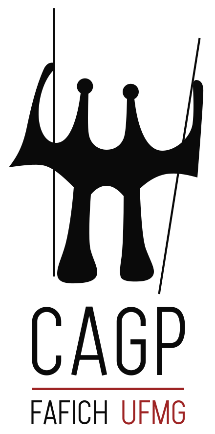

::: {.cagp-hero}
::: {.row .align-items-center}
::: {.col-lg-8}
Portal do Estudante • Gestão Pública UFMG

# BEM-VINDO(A) AO CAGP UFMG {.cagp-hero-title}

O **Centro Acadêmico de Gestão Pública** é a entidade de representação discente dos estudantes de Gestão Pública da FAFICH/UFMG. Estamos aqui para orientar, acolher e construir uma universidade democrática, pública e de excelência.

::: {.d-flex .flex-wrap .gap-2 .mt-4}
[🚀 Sou Calouro](calouros.qmd){.cagp-btn .cagp-btn-primary aria-label="Ir para o Guia de Sobrevivência do Calouro"}
[📋 Regras de ACG](acg.qmd){.cagp-btn .cagp-btn-secondary aria-label="Acessar o guia de Atividades Complementares de Graduação"}
[🗺️ Percurso do Curso](percurso.qmd){.cagp-btn .cagp-btn-outline aria-label="Visualizar a grade e o percurso curricular"}
:::
:::

::: {.col-lg-4 .text-center .d-none .d-lg-block}
{fig-alt="Logotipo vertical institucional do CAGP UFMG, inspirado na escultura Os Candangos de Bruno Giorgi" style="max-height: 220px; width: auto;"}
:::
:::
:::

## Acesso Rápido aos Módulos do Curso

::: {.row .g-4}
::: {.col-md-4}
::: {.cagp-card}
::: {.cagp-card-header}
🎓
<h3 class="cagp-card-title">Guia do Calouro</h3>
:::
::: {.cagp-card-body}
Acabou de chegar na UFMG? Veja como emitir sua carteirinha, cadastrar-se no RU, acessar o MinhaUFMG e se situar nos prédios da FAFICH.
:::

[Acessar Guia &rarr;](calouros.qmd){.cagp-btn .cagp-btn-outline .w-100}

:::
:::

::: {.col-md-4}
::: {.cagp-card}
::: {.cagp-card-header}
⏱️
<h3 class="cagp-card-title">ACG & Horas</h3>
:::
::: {.cagp-card-body}
Consulte a tabela completa de Atividades Complementares, limites máximos por categoria (Ensino, Pesquisa, Extensão e Gestão) e como enviar pelo SEI.
:::

[Tabela de ACG &rarr;](acg.qmd){.cagp-btn .cagp-btn-outline .w-100}

:::
:::

::: {.col-md-4}
::: {.cagp-card}
::: {.cagp-card-header}
🧭
<h3 class="cagp-card-title">Percurso Curricular</h3>
:::
::: {.cagp-card-body}
Planeje sua trajetória semestral: disciplinas obrigatórias, formação complementar, pré-requisitos fundamentais e dicas de matrícula do CAGP.
:::

[Ver Percurso &rarr;](percurso.qmd){.cagp-btn .cagp-btn-outline .w-100}

:::
:::
:::

---

## 📢 Mural de Avisos e Destaques

::: {.row .g-4 .mt-2}
::: {.col-md-6}
::: {.cagp-card}
Período de Matrícula
<h4>Planejamento Semestral e Ajuste com Colegiado</h4>

Fique atento aos prazos do calendário acadêmico da UFMG para requisição de matrícula online no SIGA e período de ajuste presencial.

[Ver Dicas de Matrícula &rarr;](percurso.qmd#dicas-de-matrícula)
:::
:::

::: {.col-md-6}
::: {.cagp-card}
Comunidade & Representação
<h4>Participe das Reuniões e Grupos de Trabalho do CAGP</h4>

O centro acadêmico realiza reuniões periódicas abertas a todos os estudantes de Gestão Pública na salinha do diretório da FAFICH.

[Conheça a Gestão &rarr;](sobre.qmd)
:::
:::
:::
