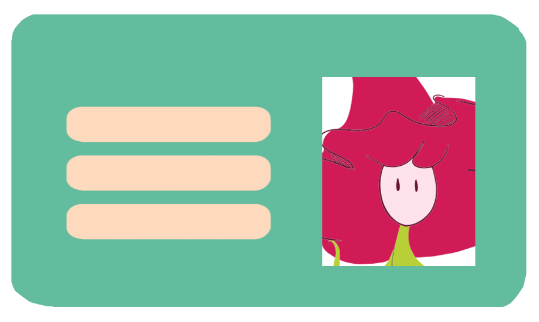

```{=html}
<header class="cagp-workspace-header" role="region" aria-label="Cabeçalho Principal do Portal e Super App CAGP UFMG">
  <div class="cagp-workspace-eyebrow">
    <div class="d-flex flex-wrap gap-1 align-items-center">
      <span class="cagp-badge cagp-badge-red">Turno Noturno</span>
      <span class="cagp-badge cagp-badge-dark">10 Semestres • 3.000h</span>
      <span class="cagp-badge cagp-badge-blue">Bacharelado FAFICH / UFMG</span>
    </div>
    <div class="d-flex flex-wrap gap-1 align-items-center">
      <span class="cagp-badge cagp-badge-gold"><i class="bi bi-shield-check me-1" aria-hidden="true"></i>Portal &amp; Super App Discente</span>
    </div>
  </div>

  <div class="cagp-workspace-title-row">
    <div>
      <h1 class="cagp-workspace-title"><i class="bi bi-bank me-2 text-danger" aria-hidden="true"></i>CENTRO ACADÊMICO DE GESTÃO PÚBLICA — UFMG</h1>
      <p class="cagp-workspace-subtitle">
        Entidade legítima de representação discente da FAFICH/UFMG. Simule horas de Extensão e AAC (<strong>600h</strong>), consulte as <strong>27 obrigatórias</strong> e <strong>68 optativas</strong>, verifique dispensa de estágio (<strong>Art. 41</strong>) e acesse os <strong>8 PDFs normativos offline</strong>.
      </p>
    </div>
    <div class="cagp-workspace-actions">
      <a href="calouros.html" class="cagp-doc-btn cagp-doc-btn-primary">
        <i class="bi bi-compass me-1" aria-hidden="true"></i> Sou Calouro (1º P)
      </a>
      <a href="percurso.html" class="cagp-doc-btn cagp-doc-btn-outline">
        <i class="bi bi-diagram-3 me-1" aria-hidden="true"></i> Grade 10P
      </a>
      <a href="curso.html" class="cagp-doc-btn cagp-doc-btn-outline">
        <i class="bi bi-mortarboard me-1" aria-hidden="true"></i> O Curso
      </a>
    </div>
  </div>

  <nav class="cagp-workspace-bar" aria-label="Sub-visualizações da Central Inicial">
    <span class="cagp-workspace-bar-label"><i class="bi bi-layers me-1" aria-hidden="true"></i>Central:</span>
    <div class="cagp-workspace-tabs" role="tablist">
      <button type="button" class="cagp-workspace-tab is-active" role="tab" data-ws-tab="v1" data-ws-hash="#bussola-interativa" aria-selected="true">
        <i class="bi bi-compass" aria-hidden="true"></i>
        <span>1. Bússola Discente, Carteira &amp; Campus</span>
        <span class="cagp-ws-badge">4 Perfis</span>
      </button>
      <button type="button" class="cagp-workspace-tab" role="tab" data-ws-tab="v2" data-ws-hash="#central-sistemas" aria-selected="false">
        <i class="bi bi-grid-3x3-gap" aria-hidden="true"></i>
        <span>2. Sistemas UFMG &amp; 8 Micro-Apps</span>
        <span class="cagp-ws-badge">SIGA • Ferramentas</span>
      </button>
      <button type="button" class="cagp-workspace-tab" role="tab" data-ws-tab="v3" data-ws-hash="#modulos-oficiais" aria-selected="false">
        <i class="bi bi-diagram-2" aria-hidden="true"></i>
        <span>3. Módulos do Curso &amp; Representação</span>
        <span class="cagp-ws-badge">CAGP • DA • DCE</span>
      </button>
      <button type="button" class="cagp-workspace-tab" role="tab" data-ws-tab="__all__" aria-selected="false" title="Exibir todas as seções simultaneamente">
        <i class="bi bi-arrows-expand" aria-hidden="true"></i>
        <span>Ver Tudo</span>
      </button>
    </div>
  </nav>
</header>

<div class="cagp-workspace-deck" data-ws-deck="index">
<div class="cagp-workspace-view is-active" data-ws-view="v1">
<span id="bussola" class="cagp-anchor-alias" aria-hidden="true"></span>

<!-- Banner de Onboarding e Primeiro Acesso -->
<div id="cagp-onboarding-banner" class="cagp-onboard-banner mb-3" role="region" aria-label="Boas-vindas e primeiros passos no portal">
  <div class="d-flex align-items-center justify-content-between flex-wrap gap-2">
    <div class="d-flex align-items-center gap-3">
      <div class="cagp-onboard-icon"><i class="bi bi-compass-fill" aria-hidden="true"></i></div>
      <div>
        <div class="fw-bold fs-6 text-uppercase">Primeira vez no Portal do CAGP?</div>
        <p class="small text-muted mb-0">Selecione seu perfil na Bússola abaixo (Vestibulando, Calouro, Meio de Curso ou Formando) para ver atalhos diretos e eliminar burocracias.</p>
      </div>
    </div>
    <div class="d-flex align-items-center gap-2">
      <a href="calouros.html" class="cagp-doc-btn cagp-doc-btn-primary py-1 px-2" style="font-size: 0.78rem;"><i class="bi bi-backpack me-1" aria-hidden="true"></i> Sou Calouro</a>
      <button type="button" id="btn-dismiss-onboard" class="cagp-doc-btn cagp-doc-btn-outline py-1 px-2" style="font-size: 0.78rem;" aria-label="Dispensar aviso de boas-vindas e não exibir novamente">✕ Entendi, fechar aviso</button>
    </div>
  </div>
</div>

<section id="bussola-interativa" class="cagp-tool-box mb-3" aria-labelledby="bussola-heading">
  <div class="cagp-tool-header">
    <div>
      <span class="cagp-badge cagp-badge-red mb-1">Navegação Guiada por Momento</span>
      <h2 id="bussola-heading" class="h4 mb-0">O QUE VOCÊ PRECISA RESOLVER HOJE?</h2>
    </div>
    <span class="small text-muted fw-semibold">Selecione seu perfil discente atual para ver atalhos, prazos e orientações sob medida:</span>
  </div>

  <div class="cagp-compass-tabs" role="tablist" aria-label="Etapas da jornada discente">
    <button type="button" class="cagp-compass-btn" role="tab" id="tab-ingressar" aria-selected="false" aria-controls="panel-ingressar" data-compass-target="panel-ingressar">
      <span class="cagp-compass-btn-title"><i class="bi bi-door-open" aria-hidden="true"></i> 1. Quero Ingressar</span>
      <span class="cagp-compass-btn-sub">Vestibulandos, SiSU, carreira e turno noturno</span>
    </button>
    <button type="button" class="cagp-compass-btn" role="tab" id="tab-calouro" aria-selected="true" aria-controls="panel-calouro" data-compass-target="panel-calouro">
      <span class="cagp-compass-btn-title"><i class="bi bi-backpack" aria-hidden="true"></i> 2. Calouro (1º P)</span>
      <span class="cagp-compass-btn-sub">Primeiros 30 dias, RU, circular e sistemas</span>
    </button>
    <button type="button" class="cagp-compass-btn" role="tab" id="tab-meio" aria-selected="false" aria-controls="panel-meio" data-compass-target="panel-meio">
      <span class="cagp-compass-btn-title"><i class="bi bi-diagram-3" aria-hidden="true"></i> 3. Meio de Curso (2º–6º P)</span>
      <span class="cagp-compass-btn-sub">Escolha de percurso, 300h Extensão e AAC</span>
    </button>
    <button type="button" class="cagp-compass-btn" role="tab" id="tab-formando" aria-selected="false" aria-controls="panel-formando" data-compass-target="panel-formando">
      <span class="cagp-compass-btn-title"><i class="bi bi-mortarboard" aria-hidden="true"></i> 4. Reta Final (7º–10º P)</span>
      <span class="cagp-compass-btn-sub">Estágio A/B, Dispensa Art. 41 e TCC</span>
    </button>
  </div>

  <!-- Painel 1: Quero Ingressar -->
  <div id="panel-ingressar" class="cagp-compass-panel" role="tabpanel" aria-labelledby="tab-ingressar" hidden>
    <div class="row g-3">
      <div class="col-md-4">
        <a href="curso.html" class="cagp-action-tile">
          <div>
            <span class="cagp-badge cagp-badge-red mb-2">Carreira &amp; Mercado</span>
            <h3 class="h6 fw-bold mb-1">O que Faz o Gestor Público?</h3>
            <p class="small text-muted mb-2">Formação no DCP/FAFICH, Nota 4 MEC, cientometria (cluster UFMG/USP/UFABC), 65% no Executivo e 55% com salários &gt; R$ 5k.</p>
          </div>
          <span class="small fw-bold text-danger">Conhecer o Curso &rarr;</span>
        </a>
      </div>
      <div class="col-md-4">
        <a href="calouros.html#rotina-noturna" class="cagp-action-tile">
          <div>
            <span class="cagp-badge cagp-badge-dark mb-2">Turno Noturno</span>
            <h3 class="h6 fw-bold mb-1">Aulas das 19h00 às 22h30</h3>
            <p class="small text-muted mb-2">Curso presencial estruturado para quem trabalha de dia. Conheça a rotina noturna na FAFICH, o jantar no RU e as linhas de circular.</p>
          </div>
          <span class="small fw-bold text-danger">Ver Rotina Noturna &rarr;</span>
        </a>
      </div>
      <div class="col-md-4">
        <a href="curso.html#ingresso" class="cagp-action-tile">
          <div>
            <span class="cagp-badge cagp-badge-blue mb-2">SiSU &amp; DRCA</span>
            <h3 class="h6 fw-bold mb-1">Formas de Ingresso na UFMG</h3>
            <p class="small text-muted mb-2">Saiba como funciona a entrada via ENEM/SiSU anual, além de editais de Transferência e Obtenção de Novo Título pelo DRCA.</p>
          </div>
          <span class="small fw-bold text-danger">Tirar Dúvidas &rarr;</span>
        </a>
      </div>
    </div>
  </div>

  <!-- Painel 2: Calouro -->
  <div id="panel-calouro" class="cagp-compass-panel" role="tabpanel" aria-labelledby="tab-calouro">
    <div class="row g-3">
      <div class="col-md-4">
        <a href="calouros.html#checklist-calouro" class="cagp-action-tile">
          <div>
            <span class="cagp-badge cagp-badge-red mb-2">Interativo</span>
            <h3 class="h6 fw-bold mb-1">Checklist dos Primeiros 30 Dias</h3>
            <p class="small text-muted mb-2">Marque passo a passo seu primeiro acesso ao MinhaUFMG, emissão de carteirinha, Wi-Fi eduroam e assistência estudantil pela FUMP.</p>
          </div>
          <span class="small fw-bold text-danger">Abrir Checklist &rarr;</span>
        </a>
      </div>
      <div class="col-md-4">
        <a href="calouros.html#rotina-noturna" class="cagp-action-tile">
          <div>
            <span class="cagp-badge cagp-badge-dark mb-2">19h00 às 22h30</span>
            <h3 class="h6 fw-bold mb-1">Rotina Noturna, Jantar e Circular</h3>
            <p class="small text-muted mb-2">Jantar no RU Setorial II até 19h30, linhas gratuitas do circular até 22h45 e atendimento noturno no CEAG (até 22h).</p>
          </div>
          <span class="small fw-bold text-danger">Ver Guia da Noite &rarr;</span>
        </a>
      </div>
      <div class="col-md-4">
        <a href="faq.html" class="cagp-action-tile">
          <div>
            <span class="cagp-badge cagp-badge-blue mb-2">Atenção até o 2ºP</span>
            <h3 class="h6 fw-bold mb-1">Dispensa de Matérias (Outra Faculdade)</h3>
            <p class="small text-muted mb-2">Já cursou matérias antes? O prazo máximo para pedir Aproveitamento de Estudos (Res. CEPE 06/19) encerra no 2º período!</p>
          </div>
          <span class="small fw-bold text-danger">Ver Regra no FAQ &rarr;</span>
        </a>
      </div>
    </div>
  </div>

  <!-- Painel 3: Meio de Curso -->
  <div id="panel-meio" class="cagp-compass-panel" role="tabpanel" aria-labelledby="tab-meio" hidden>
    <div class="row g-3">
      <div class="col-md-4">
        <a href="percurso.html#simulador-percurso" class="cagp-action-tile">
          <div>
            <span class="cagp-badge cagp-badge-red mb-2">5º ou 7º Período</span>
            <h3 class="h6 fw-bold mb-1">Qual dos 3 Percursos Escolher?</h3>
            <p class="small text-muted mb-2">Compare Geral (01-01), Complementar/Transversal (01-02 a partir do 5ºP) e Avançado/Pós (01-03 a partir do 7ºP).</p>
          </div>
          <span class="small fw-bold text-danger">Testar Percursos &rarr;</span>
        </a>
      </div>
      <div class="col-md-4">
        <a href="acg.html#calculadora-horas" class="cagp-action-tile">
          <div>
            <span class="cagp-badge cagp-badge-green mb-2">Simulador 600h</span>
            <h3 class="h6 fw-bold mb-1">Calculadora de Extensão &amp; AAC</h3>
            <p class="small text-muted mb-2">Some suas horas de Extensão (300h) e AAC (até 300h) respeitando o teto de cada uma das 9 categorias e o prazo de 120 dias.</p>
          </div>
          <span class="small fw-bold text-danger">Calcular Minhas Horas &rarr;</span>
        </a>
      </div>
      <div class="col-md-4">
        <a href="percurso.html#explorador-grade" class="cagp-action-tile">
          <div>
            <span class="cagp-badge cagp-badge-dark mb-2">27 Obrigatórias</span>
            <h3 class="h6 fw-bold mb-1">Explorador de Disciplinas e Ementas</h3>
            <p class="small text-muted mb-2">Filtre matérias por semestre (1º ao 10º) ou departamento (DCP, ECN, EST, SOA) e planeje seus 12 créditos mínimos.</p>
          </div>
          <span class="small fw-bold text-danger">Filtrar Grade &rarr;</span>
        </a>
      </div>
    </div>
  </div>

  <!-- Painel 4: Reta Final -->
  <div id="panel-formando" class="cagp-compass-panel" role="tabpanel" aria-labelledby="tab-formando" hidden>
    <div class="row g-3">
      <div class="col-md-4">
        <a href="estagio.html#simulador-art41" class="cagp-action-tile">
          <div>
            <span class="cagp-badge cagp-badge-red mb-2">Art. 41 do Regulamento</span>
            <h3 class="h6 fw-bold mb-1">Simulador de Dispensa de Estágio</h3>
            <p class="small text-muted mb-2">Trabalha em órgão público ou terceiro setor? Descubra em 3 cliques se pode abater o Estágio A (180h) e B (120h).</p>
          </div>
          <span class="small fw-bold text-danger">Verificar Elegibilidade &rarr;</span>
        </a>
      </div>
      <div class="col-md-4">
        <a href="tcc.html#modalidades-tcc" class="cagp-action-tile">
          <div>
            <span class="cagp-badge cagp-badge-dark mb-2">9º e 10º Períodos</span>
            <h3 class="h6 fw-bold mb-1">As 4 Modalidades de TCC &amp; Aceite</h3>
            <p class="small text-muted mb-2">Monografia, Projeto de Intervenção, Artigo ou Projeto de IC + download direto do Termo de Aceite de Orientador.</p>
          </div>
          <span class="small fw-bold text-danger">Planejar TCC &rarr;</span>
        </a>
      </div>
      <div class="col-md-4">
        <a href="documentos.html#formularios" class="cagp-action-tile">
          <div>
            <span class="cagp-badge cagp-badge-blue mb-2">Colação de Grau</span>
            <h3 class="h6 fw-bold mb-1">Requerimentos de Conclusão</h3>
            <p class="small text-muted mb-2">Baixe os modelos oficiais de Inscrição à Colação de Grau, Integralização de AAC e Termo de Aceite do Colegiado.</p>
          </div>
          <span class="small fw-bold text-danger">Baixar Formulários &rarr;</span>
        </a>
      </div>
    </div>
  </div>
</section>

<!-- Dashboard Carteira Acadêmica + Campus Ao Vivo -->
<section id="cagp-mobile-superapp-hub" class="mb-3" aria-label="Carteira Acadêmica do Estudante e Central do Campus em Tempo Real">
  <div class="cagp-mobile-hub-inner">

    <!-- 1. Passaporte Acadêmico CAGP & Carteira Discente (cagp_student_profile_v1) -->
    <div id="cagp-home-passport-card" class="cagp-wallet-card cagp-passport-card" aria-label="Passaporte Acadêmico CAGP e Carteira Discente">
      <div class="cagp-passport-topbar">
        <div class="cagp-passport-inst">
          <i class="bi bi-bank2 me-1 text-warning" aria-hidden="true"></i>
          <span>UNIVERSIDADE FEDERAL DE MINAS GERAIS • FAFICH • CAGP</span>
        </div>
        <div class="d-flex align-items-center gap-2">
          <span class="cagp-passport-stamp" data-cagp-passport-stamp>CALOURO • 1ºP</span>
          <button type="button" class="cagp-passport-top-btn" data-cagp-open-passport="true" aria-label="Editar Passaporte Acadêmico e Foto">
            <i class="bi bi-pencil-square me-1" aria-hidden="true"></i> Editar Perfil
          </button>
        </div>
      </div>

      <div class="cagp-passport-body">
        <button type="button" class="cagp-passport-avatar-btn" data-cagp-action="pick-photo" aria-label="Trocar foto de perfil do Passaporte Acadêmico" title="Clique para enviar ou tirar foto (256x256 WebP)">
          <span class="cagp-avatar-frame cagp-avatar-frame--lg" data-cagp-avatar-host>
            
            <span class="cagp-profile-avatar-fallback" aria-hidden="true"><i class="bi bi-person-badge-fill"></i></span>
            <span class="cagp-pride-pin cagp-pride-pin--lg" data-cagp-pride-pin hidden aria-hidden="true"></span>
          </span>
          <span class="cagp-avatar-cam-badge" aria-hidden="true"><i class="bi bi-camera-fill"></i></span>
        </button>

        <div class="cagp-passport-identity">
          <div class="cagp-passport-name-row mb-1">
            <span class="cagp-passport-name" data-cagp-profile-name-display>Estudante de Gestão Pública</span>
            <span class="cagp-passport-pronouns" data-cagp-profile-pronouns-display hidden></span>
          </div>
          <div class="cagp-passport-badges">
            <span class="cagp-badge cagp-badge-red" data-cagp-profile-period-display>1º Período</span>
            <span class="cagp-badge cagp-badge-dark font-mono" data-cagp-profile-semester-display>Ingresso 2026/1</span>
            <span class="cagp-badge cagp-badge-blue" data-cagp-profile-pathway-display>01-01 • Geral</span>
            <span class="cagp-pride-tag" data-cagp-pride-tag hidden>
              <span class="cagp-pride-tag-swatch" data-cagp-pride-swatch aria-hidden="true"></span>
              <span class="cagp-pride-tag-label" data-cagp-pride-label>Orgulho</span>
            </span>
          </div>
        </div>

        <div class="d-flex align-items-center gap-2 ms-auto">
          <div class="cagp-metric-ring" id="cagp-hub-vault-ring" style="--ring-pct: 0; --ring-size: 52px;" title="Índice Global de Integralização do Curso">
            <div class="cagp-metric-ring-inner" id="cagp-hub-vault-ring-val">0%</div>
          </div>
          <button type="button" class="cagp-chip py-1 px-2 d-none d-sm-inline-flex" data-cagp-open-passport="vault" aria-label="Abrir Cofre Acadêmico e Sync">
            <i class="bi bi-safe2-fill me-1 text-warning" aria-hidden="true"></i> Cofre &amp; Sync
          </button>
        </div>
      </div>

      <!-- Barra Dupla de Conclusão do Curso (27 Obrigatórias + 600h ACG) -->
      <div class="cagp-passport-progress-grid mb-2">
        <div class="cagp-passport-progress-item">
          <div class="d-flex justify-content-between align-items-center small mb-1">
            <span class="fw-bold text-uppercase font-display" style="font-size: 0.72rem;">Disciplinas Obrigatórias (27)</span>
            <span class="font-mono fw-bold cagp-tabular" style="font-size: 0.74rem;" data-cagp-passport-obrig-text>0/27 (0%)</span>
          </div>
          <div class="cagp-passport-mini-track" aria-hidden="true">
            <div class="cagp-passport-mini-fill is-obrig" data-cagp-passport-obrig-bar style="width: 0%;"></div>
          </div>
        </div>
        <div class="cagp-passport-progress-item">
          <div class="d-flex justify-content-between align-items-center small mb-1">
            <span class="fw-bold text-uppercase font-display" style="font-size: 0.72rem;">Extensão &amp; Horas AAC (600h)</span>
            <span class="font-mono fw-bold cagp-tabular" style="font-size: 0.74rem;" data-cagp-passport-acg-text>0h/600h (0%)</span>
          </div>
          <div class="cagp-passport-mini-track" aria-hidden="true">
            <div class="cagp-passport-mini-fill is-acg" data-cagp-passport-acg-bar style="width: 0%;"></div>
          </div>
        </div>
      </div>

      <div class="cagp-wallet-metrics-row">
        <a href="acg.html#calculadora" class="cagp-wallet-metric-slot" data-cagp-nav>
          <span class="cagp-vault-card-label">Horas ACG (600h)</span>
          <span class="cagp-vault-card-val cagp-tabular" id="cagp-hub-vault-acg">0h / 600h</span>
          <span class="cagp-vault-card-link mt-1">Simular &rarr;</span>
        </a>
        <a href="acg.html#guardiao-120-dias" class="cagp-wallet-metric-slot" data-cagp-nav>
          <span class="cagp-vault-card-label">Guardião 120 Dias</span>
          <span class="cagp-vault-card-val cagp-tabular" id="cagp-hub-vault-120d">0 certificados</span>
          <span class="cagp-vault-card-link mt-1">Prazos &rarr;</span>
        </a>
        <a href="calouros.html#checklist" class="cagp-wallet-metric-slot" data-cagp-nav>
          <span class="cagp-vault-card-label">Checklist 30 Dias</span>
          <span class="cagp-vault-card-val cagp-tabular" id="cagp-hub-vault-checklist">0 de 6 passos</span>
          <span class="cagp-vault-card-link mt-1">Conferir &rarr;</span>
        </a>
        <a href="percurso.html#quiz-percurso" class="cagp-wallet-metric-slot" data-cagp-nav>
          <span class="cagp-vault-card-label">Percurso Oficial</span>
          <span class="cagp-vault-card-val" id="cagp-hub-vault-percurso">Não simulado</span>
          <span class="cagp-vault-card-link mt-1">Testar &rarr;</span>
        </a>
      </div>
    </div>

    <!-- 2. Carrossel Magnético de Ações Rápidas de Bolso -->
    <div class="cagp-pocket-actions-section">
      <div class="d-flex align-items-center justify-content-between mb-2">
        <div class="cagp-pocket-actions-title mb-0">
          <i class="bi bi-lightning-charge-fill me-1 text-danger" aria-hidden="true"></i>
          <span>Ações Rápidas de Bolso</span>
        </div>
        <span class="small text-muted d-sm-none font-display text-uppercase" style="font-size: 0.72rem;">Deslize &rarr;</span>
      </div>
      <div class="cagp-pocket-actions-grid">
        <a href="calouros.html#ru-alimentacao" class="cagp-pocket-btn" data-cagp-nav>
          <div class="cagp-pocket-icon-wrap cagp-bg-gold"><i class="bi bi-egg-fried" aria-hidden="true"></i></div>
          <span>RU Hoje</span>
        </a>
        <a href="calouros.html#circulares-noturnos" class="cagp-pocket-btn" data-cagp-nav>
          <div class="cagp-pocket-icon-wrap cagp-bg-blue"><i class="bi bi-bus-front" aria-hidden="true"></i></div>
          <span>Circulares</span>
        </a>
        <a href="acg.html#calculadora" class="cagp-pocket-btn" data-cagp-nav>
          <div class="cagp-pocket-icon-wrap cagp-bg-amber"><i class="bi bi-calculator" aria-hidden="true"></i></div>
          <span>Calculadora</span>
        </a>
        <a href="optativas.html#catalogo-optativas" class="cagp-pocket-btn" data-cagp-nav>
          <div class="cagp-pocket-icon-wrap cagp-bg-dark"><i class="bi bi-journal-text" aria-hidden="true"></i></div>
          <span>68 Optativas</span>
        </a>
        <a href="curso.html#secretaria-colegiado" class="cagp-pocket-btn" data-cagp-nav>
          <div class="cagp-pocket-icon-wrap cagp-bg-charcoal"><i class="bi bi-geo-alt" aria-hidden="true"></i></div>
          <span>Secretaria</span>
        </a>
        <a href="documentos.html" class="cagp-pocket-btn" data-cagp-nav>
          <div class="cagp-pocket-icon-wrap cagp-bg-bordeaux"><i class="bi bi-file-earmark-pdf" aria-hidden="true"></i></div>
          <span>Documentos</span>
        </a>
      </div>
    </div>

    <!-- 3. Status Ao Vivo do Campus Noturno -->
    <div class="cagp-card p-3 mb-2">
      <div class="cagp-mobile-hub-header mb-2">
        <div class="cagp-mobile-hub-live">
          <i class="bi bi-broadcast me-1 text-success" aria-hidden="true"></i>
          <span class="cagp-mobile-hub-live-text">CAMPUS AO VIVO</span>
        </div>
        <div class="d-flex align-items-center gap-2">
          <div class="cagp-mobile-hub-clock">
            <i class="bi bi-clock me-1" aria-hidden="true"></i>
            <span id="cagp-live-clock" class="cagp-tabular">--:--</span>
          </div>
          <button type="button" class="cagp-chip py-0 px-2" style="min-height: 32px; font-size: 0.72rem;" onclick="window.cagpOpenCampusSheet &amp;&amp; window.cagpOpenCampusSheet()">
            Detalhes
          </button>
        </div>
      </div>

      <div class="cagp-campus-status-grid">
        <a href="calouros.html#ru-alimentacao" class="cagp-campus-status-card" data-cagp-nav>
          <div class="cagp-campus-status-icon cagp-bg-gold">
            <i class="bi bi-egg-fried" aria-hidden="true"></i>
          </div>
          <div class="cagp-campus-status-info">
            <div class="cagp-campus-status-label">RU II • FAFICH</div>
            <div id="cagp-status-ru" class="cagp-campus-status-val">Consultando...</div>
          </div>
        </a>

        <a href="calouros.html#circulares-noturnos" class="cagp-campus-status-card" data-cagp-nav>
          <div class="cagp-campus-status-icon cagp-bg-blue">
            <i class="bi bi-bus-front" aria-hidden="true"></i>
          </div>
          <div class="cagp-campus-status-info">
            <div class="cagp-campus-status-label">Circulares UFMG</div>
            <div id="cagp-status-circulares" class="cagp-campus-status-val">Consultando...</div>
          </div>
        </a>

        <a href="curso.html#secretaria-colegiado" class="cagp-campus-status-card" data-cagp-nav>
          <div class="cagp-campus-status-icon cagp-bg-bordeaux">
            <i class="bi bi-door-open" aria-hidden="true"></i>
          </div>
          <div class="cagp-campus-status-info">
            <div class="cagp-campus-status-label">Secretaria &amp; CEAG</div>
            <div id="cagp-status-secretaria" class="cagp-campus-status-val">Consultando...</div>
          </div>
        </a>
      </div>
    </div>

    <!-- Card Inteligente de Incentivo de Instalação (Adaptado à Plataforma: iOS vs Android) -->
    <div id="cagp-platform-incentive-container" class="cagp-platform-incentive-box"></div>
  </div>
</section>
<script>
  if (window.applyCagpCampusState) window.applyCagpCampusState();
  if (window.refreshCagpVault) window.refreshCagpVault();
</script>
```

## <i class="bi bi-bar-chart-line" aria-hidden="true"></i> O Curso de Gestão Pública em Números Oficiais

```{=html}
<div class="cagp-bento-grid">
  <div class="cagp-bento-cell cagp-stat-card-total">
    <div>
      <span class="cagp-badge cagp-badge-red mb-2">Matriz PPC 2020</span>
      <div class="cagp-bento-kpi text-danger">3.000 h</div>
      <div class="cagp-stat-label">Carga Horária Total</div>
    </div>
    <small class="text-muted mt-2">Núcleo Específico (2.880h) + Formação Livre (120h)</small>
  </div>

  <div class="cagp-bento-cell cagp-stat-card-periodos">
    <div>
      <span class="cagp-badge cagp-badge-dark mb-2">Turno Noturno</span>
      <div class="cagp-bento-kpi">10 Períodos</div>
      <div class="cagp-stat-label">Tempo Padrão (5 anos)</div>
    </div>
    <small class="text-muted mt-2">Mínimo 8 / Máximo 17 semestres letivos</small>
  </div>

  <div class="cagp-bento-cell cagp-stat-card-extensao">
    <div>
      <span class="cagp-badge cagp-badge-green mb-2">Res. CEPE 10/19</span>
      <div class="cagp-bento-kpi text-success">300 h</div>
      <div class="cagp-stat-label">Formação em Extensão</div>
    </div>
    <small class="text-muted mt-2">10% obrigatório + até 300h em AAC (Art. 15)</small>
  </div>

  <div class="cagp-bento-cell cagp-stat-card-estagio">
    <div>
      <span class="cagp-badge cagp-badge-blue mb-2">Prática Aplicada</span>
      <div class="cagp-bento-kpi">300 h</div>
      <div class="cagp-stat-label">Estágio Supervisionado</div>
    </div>
    <small class="text-muted mt-2">DCP 135 (180h) + DCP 136 (120h) ou Dispensa Art. 41</small>
  </div>
</div>
</div>

<!-- ==========================================================================
     View 2: Sistemas UFMG & 8 Micro-Apps
     ========================================================================== -->
<div class="cagp-workspace-view" data-ws-view="v2" hidden>
<span id="sistemas" class="cagp-anchor-alias" aria-hidden="true"></span>
<span id="avisos" class="cagp-anchor-alias" aria-hidden="true"></span>

<section id="central-sistemas" class="cagp-app-section" aria-labelledby="central-sistemas-heading">
  <div class="cagp-app-section-header">
    <div>
      <span class="cagp-badge cagp-badge-red mb-1">Acesso Direto &amp; Conectividade</span>
      <h2 id="central-sistemas-heading" class="h4 mb-0"><i class="bi bi-grid-3x3-gap" aria-hidden="true"></i> CENTRAL DE APLICATIVOS &amp; SISTEMAS UFMG</h2>
    </div>
    <div class="cagp-chip-rail" role="group" aria-label="Filtrar aplicativos por tipo de acesso">
      <button type="button" class="cagp-filter-chip cagp-app-filter-btn is-active" data-app-filter="all" aria-pressed="true">Todos os Sistemas (6)</button>
      <button type="button" class="cagp-filter-chip cagp-app-filter-btn" data-app-filter="desktop" aria-pressed="false"><i class="bi bi-display" aria-hidden="true"></i> Portais Web (Desktop)</button>
      <button type="button" class="cagp-filter-chip cagp-app-filter-btn" data-app-filter="mobile" aria-pressed="false"><i class="bi bi-phone" aria-hidden="true"></i> Apps de Celular (Mobile)</button>
      <button type="button" class="cagp-filter-chip cagp-app-filter-btn" data-app-filter="presencial" aria-pressed="false"><i class="bi bi-building" aria-hidden="true"></i> Atendimento Presencial</button>
    </div>
  </div>

  <div class="cagp-app-grid" id="app-cards-container">
    <!-- 1. SIGA UFMG -->
    <article class="cagp-app-card cagp-app-card-siga" data-app-cat="desktop mobile">
      <div class="cagp-app-header">
        <div class="cagp-app-logo-box">
          
        </div>
        <div class="cagp-app-meta">
          <h3 class="cagp-app-title">Siga UFMG</h3>
          <div class="cagp-app-tags">
            <span class="cagp-app-tag cagp-app-tag-siga">Acadêmico</span>
            <span class="cagp-app-tag cagp-app-tag-siga">Desktop + App</span>
          </div>
        </div>
      </div>
      <p class="cagp-app-desc">Sistema de gestão discente: matrícula semestral (via MinhaUFMG no desktop), histórico oficial, diário de classe e consulta de notas/salas no smartphone.</p>
      <div class="cagp-app-actions">
        <a href="https://sistemas.ufmg.br" target="_blank" rel="noopener noreferrer" class="cagp-store-btn cagp-store-btn-primary" aria-label="Acessar SIGA Web via portal MinhaUFMG"><i class="bi bi-window-stack" aria-hidden="true"></i> SIGA Web <i class="bi bi-box-arrow-up-right cagp-external-icon" aria-hidden="true"></i></a>
        <a href="https://play.google.com/store/apps/details?id=br.ufmg.ddp.cecom.academico.sigaufmg" target="_blank" rel="noopener noreferrer" class="cagp-store-btn" aria-label="Baixar aplicativo Siga UFMG para Android"><i class="bi bi-google-play" aria-hidden="true"></i> Android <i class="bi bi-box-arrow-up-right cagp-external-icon" aria-hidden="true"></i></a>
        <a href="https://apps.apple.com/br/app/siga-ufmg/id1456022680" target="_blank" rel="noopener noreferrer" class="cagp-store-btn" aria-label="Baixar aplicativo Siga UFMG para iOS"><i class="bi bi-apple" aria-hidden="true"></i> iOS <i class="bi bi-box-arrow-up-right cagp-external-icon" aria-hidden="true"></i></a>
        <a href="documentos/manual-aplicativo-siga-ufmg.pdf" target="_blank" class="cagp-store-btn" aria-label="Baixar manual oficial do Siga UFMG em PDF"><i class="bi bi-file-earmark-pdf" aria-hidden="true"></i> Manual</a>
      </div>
    </article>

    <!-- 2. MinhaUFMG -->
    <article class="cagp-app-card cagp-app-card-minhaufmg" data-app-cat="desktop">
      <div class="cagp-app-header">
        <div class="cagp-app-logo-box">
          
        </div>
        <div class="cagp-app-meta">
          <h3 class="cagp-app-title">MinhaUFMG</h3>
          <div class="cagp-app-tags">
            <span class="cagp-app-tag cagp-app-tag-minhaufmg">Portal Desktop</span>
            <span class="cagp-app-tag cagp-app-tag-minhaufmg">Login Único</span>
          </div>
        </div>
      </div>
      <p class="cagp-app-desc">Portal integrador da Universidade. É aqui que você faz o primeiro cadastro com a Folha NIPs e acessa o SIGA Web, e-mail @ufmg.br institucional e Moodle Virtual.</p>
      <div class="cagp-app-actions">
        <a href="https://sistemas.ufmg.br" target="_blank" rel="noopener noreferrer" class="cagp-store-btn cagp-store-btn-primary" aria-label="Acessar o portal MinhaUFMG"><i class="bi bi-browser-chrome" aria-hidden="true"></i> Portal Web <i class="bi bi-box-arrow-up-right cagp-external-icon" aria-hidden="true"></i></a>
        <a href="https://sistemas.ufmg.br/nips/home.seam" target="_blank" rel="noopener noreferrer" class="cagp-store-btn" aria-label="Cadastrar primeiro acesso com a Folha NIPs"><i class="bi bi-key" aria-hidden="true"></i> Folha NIPs <i class="bi bi-box-arrow-up-right cagp-external-icon" aria-hidden="true"></i></a>
      </div>
    </article>

    <!-- 3. FUMP Assistência Estudantil -->
    <article class="cagp-app-card cagp-app-card-fump" data-app-cat="desktop mobile">
      <div class="cagp-app-header">
        <div class="cagp-app-logo-box">
          
        </div>
        <div class="cagp-app-meta">
          <h3 class="cagp-app-title">FUMP Assistência</h3>
          <div class="cagp-app-tags">
            <span class="cagp-app-tag cagp-app-tag-fump">Permanência</span>
            <span class="cagp-app-tag cagp-app-tag-fump">Bolsas &amp; RU</span>
          </div>
        </div>
      </div>
      <p class="cagp-app-desc">Fundação Mendes Pimentel: preenchimento do questionário socioeconômico, solicitação de auxílios, moradia, consultas de saúde e cardápio diário dos RUs.</p>
      <div class="cagp-app-actions">
        <a href="https://www.fump.ufmg.br/" target="_blank" rel="noopener noreferrer" class="cagp-store-btn cagp-store-btn-primary" aria-label="Acessar Área do Aluno FUMP"><i class="bi bi-globe2" aria-hidden="true"></i> Área do Aluno <i class="bi bi-box-arrow-up-right cagp-external-icon" aria-hidden="true"></i></a>
        <a href="https://play.google.com/store/apps/details?id=com.appfump" target="_blank" rel="noopener noreferrer" class="cagp-store-btn" aria-label="Baixar App Fump para Android"><i class="bi bi-phone" aria-hidden="true"></i> App FUMP <i class="bi bi-box-arrow-up-right cagp-external-icon" aria-hidden="true"></i></a>
        <a href="https://wa.me/5531975370115" target="_blank" rel="noopener noreferrer" class="cagp-store-btn" aria-label="Falar com a FUMP no WhatsApp"><i class="bi bi-whatsapp" aria-hidden="true"></i> WhatsApp FUMP <i class="bi bi-box-arrow-up-right cagp-external-icon" aria-hidden="true"></i></a>
      </div>
    </article>

    <!-- 4. Interno Rotas -->
    <article class="cagp-app-card cagp-app-card-rotas" id="circular-ufmg" data-app-cat="mobile">
      <div class="cagp-app-header">
        <div class="cagp-app-logo-box">
          
        </div>
        <div class="cagp-app-meta">
          <h3 class="cagp-app-title">Interno Rotas</h3>
          <div class="cagp-app-tags">
            <span class="cagp-app-tag cagp-app-tag-rotas">Circulares Noturnos</span>
            <span class="cagp-app-tag cagp-app-tag-rotas">Software Livre</span>
          </div>
        </div>
      </div>
      <p class="cagp-app-desc">Rastreamento colaborativo dos circulares gratuitos da UFMG em tempo real com GPS. Criado por estudante da universidade com licença livre MIT.</p>
      <div class="cagp-app-actions">
        <a href="https://internorotas.com/" target="_blank" rel="noopener noreferrer" class="cagp-store-btn cagp-store-btn-primary" aria-label="Abrir mapa do Interno Rotas ao vivo no navegador"><i class="bi bi-bus-front" aria-hidden="true"></i> Abrir Mapa ao Vivo <i class="bi bi-box-arrow-up-right cagp-external-icon" aria-hidden="true"></i></a>
      </div>
    </article>

    <!-- 5. CEAG FAFICH (Atendimento Noturno) -->
    <article class="cagp-app-card cagp-app-card-ceag" data-app-cat="presencial">
      <div class="cagp-app-header">
        <div class="cagp-app-logo-box cagp-app-logo-ceag">
          <i class="bi bi-building fs-4" aria-hidden="true"></i>
        </div>
        <div class="cagp-app-meta">
          <h3 class="cagp-app-title">CEAG FAFICH</h3>
          <div class="cagp-app-tags">
            <span class="cagp-app-tag cagp-app-tag-ceag">Presencial</span>
            <span class="cagp-app-tag cagp-app-tag-ceag">08h às 22h</span>
          </div>
        </div>
      </div>
      <p class="cagp-app-desc">Centro de Atendimento à Graduação no 2º andar da FAFICH. Aberto ininterruptamente até as 22h para protocolos de atestados, requerimentos e certidões.</p>
      <div class="cagp-app-actions">
        <a href="calouros.html#secretaria-e-ceag" class="cagp-store-btn cagp-store-btn-primary" aria-label="Ver horários e serviços da CEAG FAFICH">Guichês &amp; Horários &rarr;</a>
        <a href="documentos.html#formularios" class="cagp-store-btn" aria-label="Baixar modelos de requerimentos">Modelos PDF &rarr;</a>
      </div>
    </article>

    <!-- 6. Biblioteca Setorial BU / FAFICH -->
    <article class="cagp-app-card cagp-app-card-bu" data-app-cat="desktop presencial">
      <div class="cagp-app-header">
        <div class="cagp-app-logo-box cagp-app-logo-bu">
          <i class="bi bi-book fs-4" aria-hidden="true"></i>
        </div>
        <div class="cagp-app-meta">
          <h3 class="cagp-app-title">Biblioteca da FAFICH</h3>
          <div class="cagp-app-tags">
            <span class="cagp-app-tag cagp-app-tag-bu">1º Andar FAFICH</span>
            <span class="cagp-app-tag cagp-app-tag-bu">Acervo BU</span>
          </div>
        </div>
      </div>
      <p class="cagp-app-desc">Acervo especializado em Ciências Humanas e Sociais, salas de estudo individuais e coletivas, empréstimo domiciliar e acesso ao catálogo online Pergamum.</p>
      <div class="cagp-app-actions">
        <a href="https://catalogobiblioteca.ufmg.br/pergamum/biblioteca/index.php" target="_blank" rel="noopener noreferrer" class="cagp-store-btn cagp-store-btn-primary" aria-label="Consultar catálogo online Pergamum da UFMG"><i class="bi bi-journal-bookmark" aria-hidden="true"></i> Catálogo Online <i class="bi bi-box-arrow-up-right cagp-external-icon" aria-hidden="true"></i></a>
        <a href="calouros.html#guia-biblioteca" class="cagp-store-btn" aria-label="Ver orientações de uso da biblioteca">Guia de Uso &rarr;</a>
      </div>
    </article>
  </div>
</section>

<!-- 4. Grade Bento Tátil dos 8 Micro-Apps do Curso (#micro-apps-hub) -->
<div id="micro-apps-hub" class="pt-3" aria-label="Central dos 8 Micro-Apps CAGP">
  <div class="d-flex align-items-center justify-content-between mb-2">
    <h2 class="font-display fw-bold text-uppercase fs-5 mb-0">
      <i class="bi bi-grid-3x3-gap-fill me-1 text-danger" aria-hidden="true"></i> Catálogo dos 8 Micro-Apps Interativos
    </h2>
    <span class="cagp-badge cagp-badge-dark">Acesso em 1 Toque</span>
  </div>

  <div class="cagp-microapp-grid">
    <a href="#cagp-mobile-superapp-hub" class="cagp-microapp-card" onclick="if(window.cagpOpenCampusSheet){window.cagpOpenCampusSheet(); return false;}">
      <div class="cagp-microapp-top">
        <div class="cagp-microapp-icon-badge cagp-bg-gold">
          <i class="bi bi-building" aria-hidden="true"></i>
        </div>
        <span class="cagp-microapp-tag">Campus</span>
      </div>
      <div>
        <h3 class="cagp-microapp-title">Campus Hoje</h3>
        <p class="cagp-microapp-desc">RU II, circulares e atendimento CEAG até 22h.</p>
      </div>
    </a>

    <a href="acg.html#calculadora" class="cagp-microapp-card" data-cagp-nav>
      <div class="cagp-microapp-top">
        <div class="cagp-microapp-icon-badge cagp-bg-amber">
          <i class="bi bi-calculator" aria-hidden="true"></i>
        </div>
        <span class="cagp-microapp-tag">Simulador</span>
      </div>
      <div>
        <h3 class="cagp-microapp-title">Calculadora ACG</h3>
        <p class="cagp-microapp-desc">Extensão 300h + AAC 300h e prazo fatal 120 dias.</p>
      </div>
    </a>

    <a href="percurso.html#quiz-percurso" class="cagp-microapp-card" data-cagp-nav>
      <div class="cagp-microapp-top">
        <div class="cagp-microapp-icon-badge cagp-bg-blue">
          <i class="bi bi-diagram-3" aria-hidden="true"></i>
        </div>
        <span class="cagp-microapp-tag">Matriz</span>
      </div>
      <div>
        <h3 class="cagp-microapp-title">Termômetro &amp; Grade</h3>
        <p class="cagp-microapp-desc">Quiz de percurso e 27 obrigatórias sem rolagem.</p>
      </div>
    </a>

    <a href="optativas.html#catalogo-optativas" class="cagp-microapp-card" data-cagp-nav>
      <div class="cagp-microapp-top">
        <div class="cagp-microapp-icon-badge cagp-bg-dark">
          <i class="bi bi-journal-text" aria-hidden="true"></i>
        </div>
        <span class="cagp-microapp-tag">Catálogo</span>
      </div>
      <div>
        <h3 class="cagp-microapp-title">68 Optativas</h3>
        <p class="cagp-microapp-desc">Busca rápida e filtro por departamentos DCP/ECN/SOA.</p>
      </div>
    </a>

    <a href="estagio.html#simulador-art41" class="cagp-microapp-card" data-cagp-nav>
      <div class="cagp-microapp-top">
        <div class="cagp-microapp-icon-badge cagp-bg-green">
          <i class="bi bi-briefcase" aria-hidden="true"></i>
        </div>
        <span class="cagp-microapp-tag">Regras</span>
      </div>
      <div>
        <h3 class="cagp-microapp-title">Estágio &amp; Art. 41</h3>
        <p class="cagp-microapp-desc">Simulador de dispensa profissional e TCE anotado.</p>
      </div>
    </a>

    <a href="calouros.html#checklist" class="cagp-microapp-card" data-cagp-nav>
      <div class="cagp-microapp-top">
        <div class="cagp-microapp-icon-badge cagp-bg-red">
          <i class="bi bi-compass" aria-hidden="true"></i>
        </div>
        <span class="cagp-microapp-tag">Guia</span>
      </div>
      <div>
        <h3 class="cagp-microapp-title">Guia do Calouro</h3>
        <p class="cagp-microapp-desc">Checklist 30 dias e dicas de sobrevivência noturna.</p>
      </div>
    </a>

    <a href="documentos.html" class="cagp-microapp-card" data-cagp-nav>
      <div class="cagp-microapp-top">
        <div class="cagp-microapp-icon-badge cagp-bg-bordeaux">
          <i class="bi bi-file-earmark-pdf" aria-hidden="true"></i>
        </div>
        <span class="cagp-microapp-tag">Acervo</span>
      </div>
      <div>
        <h3 class="cagp-microapp-title">Central de Normas</h3>
        <p class="cagp-microapp-desc">8 PDFs oficiais, formulários e protocolo SEI.</p>
      </div>
    </a>

    <a href="pesquisa.html#grupos-pesquisa" class="cagp-microapp-card" data-cagp-nav>
      <div class="cagp-microapp-top">
        <div class="cagp-microapp-icon-badge cagp-bg-blue">
          <i class="bi bi-mortarboard" aria-hidden="true"></i>
        </div>
        <span class="cagp-microapp-tag">Ciência</span>
      </div>
      <div>
        <h3 class="cagp-microapp-title">Pesquisa &amp; IC DCP</h3>
        <p class="cagp-microapp-desc">11 núcleos temáticos para bolsas e extensão.</p>
      </div>
    </a>
  </div>
</div>
</div>

<!-- ==========================================================================
     View 3: Módulos do Curso & Representação Discente
     ========================================================================== -->
<div class="cagp-workspace-view" data-ws-view="v3" hidden>
<span id="jornada" class="cagp-anchor-alias" aria-hidden="true"></span>
```

## <i class="bi bi-grid" aria-hidden="true"></i> Navegação por Módulos Oficiais {#modulos-oficiais}

::: {.row .g-4 .mb-4}
::: {.col-lg-3 .col-md-6 .col-12}
::: {.cagp-card .cagp-equal-card .cagp-hub-calouros}
::: {.cagp-card-header}
<span class="cagp-card-icon" aria-hidden="true"><i class="bi bi-backpack"></i></span>
<h3 class="cagp-card-title">Guia do Calouro</h3>
:::
::: {.cagp-card-body}
Chegou à UFMG? Veja como funciona o **Turno Noturno**, horários (19h–22h30), emissão de carteirinha, jantar no RU e matrícula mínima de 180h.
:::
<div class="cagp-card-footer">
[Acessar Guia &rarr;](calouros.qmd){.cagp-btn .cagp-btn-outline .w-100 aria-label="Acessar Guia de Sobrevivência do Calouro"}
</div>
:::
:::

::: {.col-lg-3 .col-md-6 .col-12}
::: {.cagp-card .cagp-equal-card .cagp-hub-percurso}
::: {.cagp-card-header}
<span class="cagp-card-icon" aria-hidden="true"><i class="bi bi-diagram-3"></i></span>
<h3 class="cagp-card-title">Percurso & Optativas</h3>
:::
::: {.cagp-card-body}
Linha do tempo dos **10 semestres**, as 27 matérias obrigatórias com ementas, os 3 percursos oficiais e o catálogo das **68 optativas**.
:::
<div class="cagp-card-footer d-flex gap-1">
[27 Obrigatórias](percurso.qmd){.cagp-btn .cagp-btn-outline .w-50 aria-label="Ver 27 obrigatórias"}
[68 Optativas](optativas.qmd){.cagp-btn .cagp-btn-outline .w-50 aria-label="Ver 68 optativas"}
</div>
:::
:::

::: {.col-lg-3 .col-md-6 .col-12}
::: {.cagp-card .cagp-equal-card .cagp-hub-estagio}
::: {.cagp-card-header}
<span class="cagp-card-icon" aria-hidden="true"><i class="bi bi-briefcase"></i></span>
<h3 class="cagp-card-title">Estágio & TCC</h3>
:::
::: {.cagp-card-body}
Regras dos Estágios A (180h) e B (120h), dispensa profissional no setor público (Art. 41) e as 4 modalidades de TCC (DCP 089/137).
:::
<div class="cagp-card-footer d-flex gap-1">
[Estágio](estagio.qmd){.cagp-btn .cagp-btn-outline .w-50 aria-label="Acessar Estágio e Art. 41"}
[TCC](tcc.qmd){.cagp-btn .cagp-btn-outline .w-50 aria-label="Acessar TCC"}
</div>
:::
:::

::: {.col-lg-3 .col-md-6 .col-12}
::: {.cagp-card .cagp-equal-card .cagp-hub-extensao}
::: {.cagp-card-header}
<span class="cagp-card-icon" aria-hidden="true"><i class="bi bi-award"></i></span>
<h3 class="cagp-card-title">Extensão, AAC & IC</h3>
:::
::: {.cagp-card-body}
Entenda a **Extensão Obrigatória (300h)**, as **AAC (até 300h)** com prazo de 120 dias e os **11 Núcleos de Pesquisa do DCP**.
:::
<div class="cagp-card-footer d-flex gap-1">
[600h ACG](acg.qmd){.cagp-btn .cagp-btn-outline .w-50 aria-label="Consultar Extensão e AAC"}
[Pesquisa](pesquisa.qmd){.cagp-btn .cagp-btn-outline .w-50 aria-label="Consultar 11 Grupos de Pesquisa"}
</div>
:::
:::
:::

::: {.cagp-card .mb-4}
::: {.row .align-items-center}
::: {.col-md-8}
<span class="cagp-badge cagp-badge-red mb-2">Acervo Oficial em PDF</span>
<h3 class="mb-2">Acesse os Documentos Oficiais e Regulamentares do Curso</h3>
<p class="text-muted small mb-0">Faça o download direto do <strong>Projeto Pedagógico do Curso (PPC)</strong>, do <strong>Regulamento Oficial da Graduação</strong>, do <strong>Ementário das 27 Disciplinas</strong> e das <strong>Matrizes Curriculares dos 3 Percursos</strong> em formato PDF original da UFMG.</p>
:::
::: {.col-md-4 .text-md-end .mt-3 .mt-md-0}
[Consultar Acervo em PDF &rarr;](documentos.qmd){.cagp-btn .cagp-btn-primary aria-label="Consultar acervo de documentos e resoluções em PDF"}
:::
:::
:::

```{=html}
<!-- ==========================================================================
     Módulo Tripartite de Representação Estudantil (DCE, DA FAFICH, CAGP)
     ========================================================================== -->
<section id="representacao-estudantil" class="cagp-rep-section" aria-labelledby="rep-heading">
  <div class="cagp-tool-header mb-1">
    <div>
      <span class="cagp-badge cagp-badge-dark mb-1">Estrutura de Defesa Discente</span>
      <h2 id="rep-heading" class="h4 mb-0"><i class="bi bi-people" aria-hidden="true"></i> AS TRÊS ESFERAS DE REPRESENTAÇÃO ESTUDANTIL NA UFMG</h2>
    </div>
    <span class="small text-muted fw-semibold">A UFMG possui instâncias complementares de representação. Saiba quem te defende em cada nível:</span>
  </div>

  <div class="cagp-rep-grid">
    <!-- Nível 1: CAGP -->
    <article class="cagp-rep-card cagp-rep-card-cagp">
      <span class="cagp-rep-badge cagp-rep-badge-cagp">1. Nível de Curso</span>
      <h3 class="cagp-rep-title">CAGP UFMG</h3>
      <div class="cagp-rep-scope">Centro Acadêmico de Gestão Pública</div>
      <ul class="cagp-rep-list">
        <li>Voz e voto discente no Colegiado e Núcleo Docente Estruturante (NDE).</li>
        <li>Mediação direta em quebras de barreira, percursos e ementas.</li>
        <li>Acolhimento da rotina noturna e fiscalização da oferta de matérias.</li>
        <li>Orientação regimental em Estágios (Art. 41), Horas AAC e TCC.</li>
      </ul>
      <a href="sobre.html" class="cagp-btn cagp-btn-primary w-100 text-center" aria-label="Conhecer o Centro Acadêmico de Gestão Pública">Conhecer o CAGP &rarr;</a>
    </article>

    <!-- Nível 2: DA FAFICH -->
    <article class="cagp-rep-card cagp-rep-card-da">
      <span class="cagp-rep-badge cagp-rep-badge-da">2. Nível de Unidade</span>
      <h3 class="cagp-rep-title">DA FAFICH</h3>
      <div class="cagp-rep-scope">Diretório Acadêmico da FAFICH</div>
      <ul class="cagp-rep-list">
        <li>Articulação integrada dos 7 cursos de Humanas e Sociais da unidade.</li>
        <li>Assento discente na Congregação e interlocução com a Diretoria da FAFICH.</li>
        <li>Defesa de melhorias na infraestrutura física, banheiros e salas de aula.</li>
        <li>Segurança noturna no entorno do prédio e gestão de espaços coletivos.</li>
      </ul>
      <a href="sobre.html#representacao-tripartite" class="cagp-btn cagp-btn-outline w-100 text-center" aria-label="Entender a atuação do DA FAFICH">Atuação na Unidade &rarr;</a>
    </article>

    <!-- Nível 3: DCE UFMG -->
    <article class="cagp-rep-card cagp-rep-card-dce">
      <span class="cagp-rep-badge cagp-rep-badge-dce">3. Nível Universitário</span>
      <h3 class="cagp-rep-title">DCE UFMG</h3>
      <div class="cagp-rep-scope">Diretório Central dos Estudantes</div>
      <ul class="cagp-rep-list">
        <li>Representação geral dos mais de 35 mil discentes da graduação.</li>
        <li>Voto nos Conselhos Superiores da UFMG (Conselho Universitário e CEPE).</li>
        <li>Luta estrutural por ampliação de bolsas e assistência discente (FUMP/PRAE).</li>
        <li>Mobilização por gratuidade do transporte circular e moradia estudantil.</li>
      </ul>
      <a href="sobre.html#representacao-tripartite" class="cagp-btn cagp-btn-outline w-100 text-center" aria-label="Entender a atuação do DCE UFMG">Atuação na UFMG &rarr;</a>
    </article>
  </div>
</section>
</div>
</div>

<script>
(function () {
  function initIndexPage() {
    var tabs = document.querySelectorAll('[data-compass-target]');
    var panels = document.querySelectorAll('.cagp-compass-panel');

    function activateTab(targetId, updateHash) {
      if (updateHash === undefined) updateHash = true;
      var activeTab = document.querySelector('[data-compass-target="' + targetId + '"]');
      if (!activeTab) return;

      tabs.forEach(function (t) { t.setAttribute('aria-selected', 'false'); });
      panels.forEach(function (p) { p.hidden = true; });

      activeTab.setAttribute('aria-selected', 'true');
      var targetPanel = document.getElementById(targetId);
      if (targetPanel) targetPanel.hidden = false;

      if (updateHash) {
        var hashKey = targetId.replace('panel-', '');
        history.replaceState(null, '', '#bussola=' + hashKey);
      }
    }

    tabs.forEach(function (tab) {
      tab.onclick = function () {
        var targetId = tab.getAttribute('data-compass-target');
        activateTab(targetId);
      };

      tab.onkeydown = function (e) {
        var tabList = Array.from(tabs);
        var index = tabList.indexOf(tab);
        var nextIndex = null;

        if (e.key === 'ArrowRight') {
          nextIndex = (index + 1) % tabList.length;
        } else if (e.key === 'ArrowLeft') {
          nextIndex = (index - 1 + tabList.length) % tabList.length;
        } else if (e.key === 'Home') {
          nextIndex = 0;
        } else if (e.key === 'End') {
          nextIndex = tabList.length - 1;
        }

        if (nextIndex !== null) {
          e.preventDefault();
          tabList[nextIndex].focus();
          var nextTargetId = tabList[nextIndex].getAttribute('data-compass-target');
          activateTab(nextTargetId);
        }
      };
    });

    function checkHash() {
      var hash = window.location.hash;
      if (hash && hash.indexOf('#bussola=') === 0) {
        var key = hash.replace('#bussola=', '');
        var targetPanelId = 'panel-' + key;
        activateTab(targetPanelId, false);
        var bussolaSection = document.getElementById('bussola-interativa');
        if (bussolaSection) {
          bussolaSection.scrollIntoView({ behavior: 'smooth' });
        }
      }
    }

    function syncCompassWithProfile() {
      if (window.location.hash && window.location.hash.indexOf('#bussola=') === 0) return;
      try {
        var rawProf = localStorage.getItem('cagp_student_profile_v1');
        if (!rawProf) return;
        var prof = JSON.parse(rawProf);
        if (!prof || !prof.period) return;
        var pNum = parseInt(prof.period, 10);
        var targetPanel = 'panel-calouro';
        if (prof.period === 'egresso' || pNum >= 7) {
          targetPanel = 'panel-formando';
        } else if (pNum >= 2 && pNum <= 6) {
          targetPanel = 'panel-meio';
        } else {
          targetPanel = 'panel-calouro';
        }
        activateTab(targetPanel, false);
      } catch (e) {}
    }

    checkHash();
    syncCompassWithProfile();
    if (window.refreshCagpVault) window.refreshCagpVault();

    if (window.__cagpIndexProfileListener) {
      window.removeEventListener('cagp:profile-updated', window.__cagpIndexProfileListener);
    }
    window.__cagpIndexProfileListener = function () {
      syncCompassWithProfile();
    };
    window.addEventListener('cagp:profile-updated', window.__cagpIndexProfileListener);

    var onboardBanner = document.getElementById('cagp-onboarding-banner');
    var btnDismissOnboard = document.getElementById('btn-dismiss-onboard');
    if (onboardBanner && btnDismissOnboard) {
      try {
        if (localStorage.getItem('cagp_onboard_v1_dismissed') === 'true') {
          onboardBanner.style.display = 'none';
        }
      } catch (e) {}

      btnDismissOnboard.onclick = function () {
        onboardBanner.style.display = 'none';
        try {
          localStorage.setItem('cagp_onboard_v1_dismissed', 'true');
        } catch (e) {}
      };
    }

    var filterButtons = document.querySelectorAll('.cagp-app-filter-btn');
    var appCards = document.querySelectorAll('.cagp-app-card');

    filterButtons.forEach(function (btn) {
      btn.onclick = function () {
        filterButtons.forEach(function (b) {
          b.classList.remove('is-active');
          b.setAttribute('aria-pressed', 'false');
        });
        btn.classList.add('is-active');
        btn.setAttribute('aria-pressed', 'true');

        var filter = btn.getAttribute('data-app-filter');
        appCards.forEach(function (card) {
          if (filter === 'all') {
            card.style.display = 'flex';
          } else {
            var cardCat = card.getAttribute('data-app-cat') || '';
            card.style.display = cardCat.indexOf(filter) !== -1 ? 'flex' : 'none';
          }
        });
      };
    });
  }

  if (document.readyState === 'loading') {
    document.addEventListener('DOMContentLoaded', initIndexPage, { once: true });
  } else {
    initIndexPage();
  }
})();
</script>

<nav class="cagp-journey-nav" aria-label="Continuidade da jornada acadêmica">
  <div class="row g-3">
    <div class="col-md-6">
      <a href="calouros.html" class="cagp-journey-link">
        <div>
          <div class="cagp-journey-dir">Comece por aqui &rarr;</div>
          <div class="cagp-journey-title">Guia de Sobrevivência do Calouro</div>
        </div>
        <p class="cagp-journey-desc">Checklist interativo dos primeiros 30 dias, jantar no RU, circular noturno e atendimento na FAFICH.</p>
      </a>
    </div>
    <div class="col-md-6">
      <a href="percurso.html" class="cagp-journey-link">
        <div>
          <div class="cagp-journey-dir">Planejamento do Curso &rarr;</div>
          <div class="cagp-journey-title">Percurso Curricular &amp; Explorador de Ementas</div>
        </div>
        <p class="cagp-journey-desc">Filtre as 27 matérias obrigatórias por semestre e departamento e compare os 3 percursos oficiais.</p>
      </a>
    </div>
  </div>
</nav>
```
