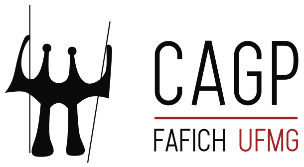

```{=html}
<nav class="cagp-breadcrumbs" aria-label="Você está aqui: Trilha de navegação">
  <ol class="cagp-breadcrumb-list" itemscope itemtype="https://schema.org/BreadcrumbList">
    <li class="cagp-breadcrumb-item" itemprop="itemListElement" itemscope itemtype="https://schema.org/ListItem">
      <a href="index.html" itemprop="item"><i class="bi bi-house-door" aria-hidden="true"></i> <span itemprop="name">Início</span></a>
      <meta itemprop="position" content="1" />
    </li>
    <li class="cagp-breadcrumb-separator" aria-hidden="true">&rsaquo;</li>
    <li class="cagp-breadcrumb-item">
      <span class="cagp-breadcrumb-parent">Acervo &amp; Ajuda</span>
    </li>
    <li class="cagp-breadcrumb-separator" aria-hidden="true">&rsaquo;</li>
    <li class="cagp-breadcrumb-item is-active" itemprop="itemListElement" itemscope itemtype="https://schema.org/ListItem" aria-current="page">
      <span itemprop="name">Mapa do Site</span>
      <meta itemprop="position" content="2" />
    </li>
  </ol>
</nav>
```

::: {.cagp-hero}
::: {.row .align-items-center}
::: {.col-lg-8}
<div class="d-flex flex-wrap gap-2 mb-2">
  <span class="cagp-badge cagp-badge-red">Acessibilidade Universal</span>
  <span class="cagp-badge cagp-badge-dark">WCAG 2.1 (Critério 2.4.5)</span>
  <span class="cagp-badge cagp-badge-gold">Índice Completo do Portal</span>
</div>

# MAPA DO SITE DO CAGP UFMG {.cagp-hero-title}

O portal do **Centro Acadêmico de Gestão Pública (CAGP)** da Faculdade de Filosofia e Ciências Humanas da UFMG reúne todas as diretrizes normativas, ferramentas interativas de cálculo curricular, matrizes pedagógicas e informações de governança discente.

Utilize esta página como uma visão panorâmica (*bird's-eye view*) da arquitetura do site, explore os **5 eixos temáticos** ou utilize o campo de busca em tempo real abaixo para localizar instantaneamente qualquer seção ou serviço.
:::
::: {.col-lg-4 .col-12 .text-center .mt-4 .mt-lg-0}
```{=html}
<div class="cagp-hero-emblem-card">
  
</div>
```
:::
:::
:::

```{=html}
<!-- Campo de Filtro Instantâneo do Mapa do Site -->
<div class="cagp-sitemap-search">
  <i class="bi bi-search cagp-sitemap-search-icon" aria-hidden="true"></i>
  <input type="search" id="sitemap-search-input" class="cagp-sitemap-input" placeholder="Filtrar tópicos (ex.: optativas, TCC, AAC, CEAG, circular, FUMP, regimento)..." aria-label="Filtrar tópicos do mapa do site">
</div>
<div id="sitemap-live-region" class="visually-hidden" role="status" aria-live="polite"></div>
```

## <i class="bi bi-lightning-charge" aria-hidden="true"></i> Atalhos de Alta Demanda {#atalhos-rapidos}

Acesso direto às ferramentas interativas, normativas e rotinas operacionais mais consultadas pela comunidade discente:

```{=html}
<div class="row g-3 mb-5" id="sitemap-shortcuts">
  <div class="col-md-4 col-sm-6">
    <div class="cagp-card h-100 text-center">
      <i class="bi bi-calculator fs-2 text-danger mb-2" aria-hidden="true"></i>
      <h3 class="fs-6 fw-bold text-uppercase mb-1">Calculadora de AAC</h3>
      <p class="small text-muted mb-3">Simule seus créditos e aproveitamento de até 300h nas 5 modalidades oficiais.</p>
      <a href="acg.html#calculadora-aac" class="cagp-doc-btn cagp-doc-btn-primary w-100 justify-content-center">
        Abrir Calculadora &rarr;
      </a>
    </div>
  </div>

  <div class="col-md-4 col-sm-6">
    <div class="cagp-card h-100 text-center">
      <i class="bi bi-search fs-2 text-danger mb-2" aria-hidden="true"></i>
      <h3 class="fs-6 fw-bold text-uppercase mb-1">Busca de 68 Optativas</h3>
      <p class="small text-muted mb-3">Consulte ementas completas com filtros por departamento (DCP, ECN, SOA).</p>
      <a href="percurso.html#catalogo-optativas" class="cagp-doc-btn cagp-doc-btn-primary w-100 justify-content-center">
        Filtrar Optativas &rarr;
      </a>
    </div>
  </div>

  <div class="col-md-4 col-sm-6">
    <div class="cagp-card h-100 text-center">
      <i class="bi bi-bus-front fs-2 text-danger mb-2" aria-hidden="true"></i>
      <h3 class="fs-6 fw-bold text-uppercase mb-1">Circular UFMG ao Vivo</h3>
      <p class="small text-muted mb-3">Previsão em tempo real dos ônibus internos no Campus Pampulha via Interno Rotas.</p>
      <a href="index.html#circular-ufmg" class="cagp-doc-btn cagp-doc-btn-primary w-100 justify-content-center">
        Ver Linhas & Horários &rarr;
      </a>
    </div>
  </div>

  <div class="col-md-4 col-sm-6">
    <div class="cagp-card h-100 text-center">
      <i class="bi bi-file-earmark-pdf fs-2 text-danger mb-2" aria-hidden="true"></i>
      <h3 class="fs-6 fw-bold text-uppercase mb-1">Regimento Interno 2024</h3>
      <p class="small text-muted mb-3">Download do PDF oficial aprovado em 14/10/2024 com as 7 diretorias e normas eleitorais.</p>
      <a href="documentos/regimento-interno-cagp-ufmg.pdf" class="cagp-doc-btn cagp-doc-btn-outline w-100 justify-content-center" target="_blank" rel="noopener noreferrer">
        Baixar PDF Oficial &rarr;
      </a>
    </div>
  </div>

  <div class="col-md-4 col-sm-6">
    <div class="cagp-card h-100 text-center">
      <i class="bi bi-clock-history fs-2 text-danger mb-2" aria-hidden="true"></i>
      <h3 class="fs-6 fw-bold text-uppercase mb-1">Secretaria & CEAG 2025/2</h3>
      <p class="small text-muted mb-3">Escala da secretária Norma Guedes (F-2039) e plantão do CEAG FAFICH até 22h.</p>
      <a href="calouros.html#secretaria-colegiado" class="cagp-doc-btn cagp-doc-btn-outline w-100 justify-content-center">
        Consultar Horários &rarr;
      </a>
    </div>
  </div>

  <div class="col-md-4 col-sm-6">
    <div class="cagp-card h-100 text-center">
      <i class="bi bi-journal-bookmark fs-2 text-danger mb-2" aria-hidden="true"></i>
      <h3 class="fs-6 fw-bold text-uppercase mb-1">11 Grupos do DCP</h3>
      <p class="small text-muted mb-3">Catálogo com Rede Femjusp, PUBLICUS, CEPPI, CEL, PRODEP e regras de Iniciação Científica.</p>
      <a href="curso.html#grupos-pesquisa" class="cagp-doc-btn cagp-doc-btn-outline w-100 justify-content-center">
        Explorar Pesquisa &rarr;
      </a>
    </div>
  </div>
</div>
```

---

## <i class="bi bi-diagram-3" aria-hidden="true"></i> Árvore Completa em 5 Eixos Estruturais {#arvore-eixos}

```{=html}
<div class="row g-4" id="sitemap-tree-container">

  <!-- Eixo 1: Hub & Acolhimento -->
  <div class="col-lg-6 sitemap-axis-card">
    <div class="cagp-card h-100">
      <div class="d-flex align-items-center justify-content-between border-bottom pb-2 mb-3">
        <div class="d-flex align-items-center gap-2">
          <span class="cagp-badge cagp-badge-red">Eixo 1</span>
          <h3 class="fs-5 fw-bold text-uppercase mb-0">Hub & Acolhimento</h3>
        </div>
        <span class="small text-muted">2 Páginas</span>
      </div>

      <!-- Página: Início -->
      <div class="sitemap-topic mb-3">
        <a href="index.html" class="cagp-sitemap-item-link">
          <i class="bi bi-house-door" aria-hidden="true"></i> Início (Bússola do Estudante)
        </a>
        <p class="small text-muted mb-1">Portal aberto, compromisso ético da chapa, números oficiais do curso (Noturno, 10 períodos, 3.000h) e acessos rápidos.</p>
        <div class="cagp-sitemap-sublinks">
          <a href="index.html#acesso-rapido" class="cagp-sitemap-tag">Acesso Rápido</a>
          <a href="index.html#circular-ufmg" class="cagp-sitemap-tag">Circular UFMG</a>
          <a href="index.html#destaques-curso" class="cagp-sitemap-tag">Pilares do Curso</a>
        </div>
      </div>

      <!-- Página: Guia do Calouro -->
      <div class="sitemap-topic">
        <a href="calouros.html" class="cagp-sitemap-item-link">
          <i class="bi bi-compass" aria-hidden="true"></i> Guia do Calouro (1º Período)
        </a>
        <p class="small text-muted mb-1">Orientações de sobrevivência para o noturno (19h–22h30), rotinas de sobrevivência, biblioteca, alimentação e bolsas.</p>
        <div class="cagp-sitemap-sublinks">
          <a href="calouros.html#guia-sobrevivencia" class="cagp-sitemap-tag">Rotina Noturna</a>
          <a href="calouros.html#biblioteca-espacos" class="cagp-sitemap-tag">Biblioteca FAFICH (1º Andar)</a>
          <a href="calouros.html#biblioteca-face" class="cagp-sitemap-tag">Biblioteca FACE (Econometria)</a>
          <a href="calouros.html#secretaria-colegiado" class="cagp-sitemap-tag">Secretaria (F-2039) & CEAG</a>
          <a href="calouros.html#assistencia-estudantil" class="cagp-sitemap-tag">FUMP / PRAE / NAI</a>
        </div>
      </div>
    </div>
  </div>

  <!-- Eixo 2: O Curso & Formação Curricular -->
  <div class="col-lg-6 sitemap-axis-card">
    <div class="cagp-card h-100">
      <div class="d-flex align-items-center justify-content-between border-bottom pb-2 mb-3">
        <div class="d-flex align-items-center gap-2">
          <span class="cagp-badge cagp-badge-dark">Eixo 2</span>
          <h3 class="fs-5 fw-bold text-uppercase mb-0">O Curso & Matriz</h3>
        </div>
        <span class="small text-muted">2 Páginas</span>
      </div>

      <!-- Página: O Curso -->
      <div class="sitemap-topic mb-3">
        <a href="curso.html" class="cagp-sitemap-item-link">
          <i class="bi bi-mortarboard" aria-hidden="true"></i> O Curso de Gestão Pública
        </a>
        <p class="small text-muted mb-1">Histórico institucional (REUNI 2009), nota 4 no CPC/MEC, perfil do egresso, departamentos parceiros e os 11 grupos do DCP.</p>
        <div class="cagp-sitemap-sublinks">
          <a href="curso.html#historia-curso" class="cagp-sitemap-tag">História & Criação</a>
          <a href="curso.html#perfil-egresso" class="cagp-sitemap-tag">Mercado & Atuação</a>
          <a href="curso.html#grupos-pesquisa" class="cagp-sitemap-tag">11 Grupos de Pesquisa (DCP)</a>
          <a href="curso.html#guia-pibic" class="cagp-sitemap-tag">Guia de Iniciação Científica</a>
        </div>
      </div>

      <!-- Página: Percurso & Ementas -->
      <div class="sitemap-topic">
        <a href="percurso.html" class="cagp-sitemap-item-link">
          <i class="bi bi-diagram-2" aria-hidden="true"></i> Percurso Curricular & Ementas
        </a>
        <p class="small text-muted mb-1">Linha do tempo oficial dos 10 semestres, 27 obrigatórias com ementas, catálogo das 68 optativas e 3 percursos formais.</p>
        <div class="cagp-sitemap-sublinks">
          <a href="percurso.html#trajetoria-semestral" class="cagp-sitemap-tag">10 Semestres</a>
          <a href="percurso.html#catalogo-optativas" class="cagp-sitemap-tag">68 Optativas com Busca</a>
          <a href="percurso.html#percursos-formais" class="cagp-sitemap-tag">3 Percursos (Geral, Compl., Avanç.)</a>
        </div>
      </div>
    </div>
  </div>

  <!-- Eixo 3: Experiência Prática & Integralização -->
  <div class="col-lg-6 sitemap-axis-card">
    <div class="cagp-card h-100">
      <div class="d-flex align-items-center justify-content-between border-bottom pb-2 mb-3">
        <div class="d-flex align-items-center gap-2">
          <span class="cagp-badge cagp-badge-gold">Eixo 3</span>
          <h3 class="fs-5 fw-bold text-uppercase mb-0">Extensão, Estágio & TCC</h3>
        </div>
        <span class="small text-muted">2 Páginas</span>
      </div>

      <!-- Página: ACG & Extensão -->
      <div class="sitemap-topic mb-3">
        <a href="acg.html" class="cagp-sitemap-item-link">
          <i class="bi bi-clock" aria-hidden="true"></i> Extensão & Horas AAC (600h)
        </a>
        <p class="small text-muted mb-1">Curricularização da Extensão (300h), Programa de Imersão, ATLAS Consultoria Jr., 300h de AAC (Art. 15) e calculadora.</p>
        <div class="cagp-sitemap-sublinks">
          <a href="acg.html#extensao-obrigatoria" class="cagp-sitemap-tag">Extensão (300h)</a>
          <a href="acg.html#calculadora-aac" class="cagp-sitemap-tag">Calculadora Interativa</a>
          <a href="acg.html#nucleos-pesquisa" class="cagp-sitemap-tag">Hub de IC nos 3 Eixos</a>
          <a href="acg.html#submissao-colegiado" class="cagp-sitemap-tag">Fluxo de Protocolo (F-2039)</a>
        </div>
      </div>

      <!-- Página: Estágio & TCC -->
      <div class="sitemap-topic">
        <a href="estagio-tcc.html" class="cagp-sitemap-item-link">
          <i class="bi bi-briefcase" aria-hidden="true"></i> Estágio Supervisionado & TCC
        </a>
        <p class="small text-muted mb-1">Estágio A (180h) e B (120h), dispensa por atuação profissional (Art. 41), 4 modalidades aceitas de TCC e termo de aceite.</p>
        <div class="cagp-sitemap-sublinks">
          <a href="estagio-tcc.html#estagio-supervisionado" class="cagp-sitemap-tag">Estágios A e B (300h)</a>
          <a href="estagio-tcc.html#dispensa-profissional" class="cagp-sitemap-tag">Dispensa Profissional (Art. 41)</a>
          <a href="estagio-tcc.html#modalidades-tcc" class="cagp-sitemap-tag">4 Modalidades de TCC</a>
          <a href="estagio-tcc.html#termo-aceite" class="cagp-sitemap-tag">Termo de Aceite</a>
        </div>
      </div>
    </div>
  </div>

  <!-- Eixo 4: Acervo Normativo, Dúvidas & Formulários -->
  <div class="col-lg-6 sitemap-axis-card">
    <div class="cagp-card h-100">
      <div class="d-flex align-items-center justify-content-between border-bottom pb-2 mb-3">
        <div class="d-flex align-items-center gap-2">
          <span class="cagp-badge cagp-badge-red">Eixo 4</span>
          <h3 class="fs-5 fw-bold text-uppercase mb-0">Acervo & Ajuda</h3>
        </div>
        <span class="small text-muted">3 Páginas</span>
      </div>

      <!-- Página: Documentos -->
      <div class="sitemap-topic mb-3">
        <a href="documentos.html" class="cagp-sitemap-item-link">
          <i class="bi bi-file-earmark-pdf" aria-hidden="true"></i> Documentos & Formulários
        </a>
        <p class="small text-muted mb-1">Repositório digital com 8 PDFs normativos oficiais e Central de Formulários Administrativos da FAFICH para download.</p>
        <div class="cagp-sitemap-sublinks">
          <a href="documentos.html#documentos-normativos" class="cagp-sitemap-tag">8 PDFs Oficiais</a>
          <a href="documentos.html#central-formularios" class="cagp-sitemap-tag">Requerimentos FAFICH</a>
          <a href="documentos.html#solicitacao-documentos" class="cagp-sitemap-tag">Como Solicitar</a>
        </div>
      </div>

      <!-- Página: FAQ -->
      <div class="sitemap-topic mb-3">
        <a href="faq.html" class="cagp-sitemap-item-link">
          <i class="bi bi-question-circle" aria-hidden="true"></i> Dúvidas Frequentes (FAQ)
        </a>
        <p class="small text-muted mb-1">Respostas diretas fundamentadas nas Normas de Graduação sobre trancamento, pré-requisitos, intercâmbio e prazos.</p>
        <div class="cagp-sitemap-sublinks">
          <a href="faq.html#trancamento-matricula" class="cagp-sitemap-tag">Trancamento Total/Parcial</a>
          <a href="faq.html#quebra-prerequisito" class="cagp-sitemap-tag">Quebra de Pré-Requisito</a>
          <a href="faq.html#mobilidade-academica" class="cagp-sitemap-tag">Intercâmbio (DRI/ANDIFES)</a>
        </div>
      </div>

      <!-- Página: Mapa do Site -->
      <div class="sitemap-topic">
        <a href="mapa-do-site.html" class="cagp-sitemap-item-link">
          <i class="bi bi-map" aria-hidden="true"></i> Mapa do Site (Você está aqui)
        </a>
        <p class="small text-muted mb-1">Índice estruturado, conformidade WCAG 2.1 e árvore de navegação com busca instantânea.</p>
      </div>
    </div>
  </div>

  <!-- Eixo 5: Governança Discente & O CAGP -->
  <div class="col-lg-12 sitemap-axis-card">
    <div class="cagp-card h-100">
      <div class="d-flex align-items-center justify-content-between border-bottom pb-2 mb-3">
        <div class="d-flex align-items-center gap-2">
          <span class="cagp-badge cagp-badge-dark">Eixo 5</span>
          <h3 class="fs-5 fw-bold text-uppercase mb-0">O CAGP & Governança Discente</h3>
        </div>
        <span class="small text-muted">2 Páginas</span>
      </div>

      <div class="row g-4">
        <!-- Página: O Centro Acadêmico -->
        <div class="col-md-6 sitemap-topic">
          <a href="sobre.html" class="cagp-sitemap-item-link">
            <i class="bi bi-bank" aria-hidden="true"></i> O Centro Acadêmico (Institucional)
          </a>
          <p class="small text-muted mb-1">História, monumento Os Candangos de Bruno Giorgi, Princípios do LIMPE, Soberana Assembleia Geral, Junta Eleitoral, as 7 Diretorias Estatutárias, Linha Sucessória, Colegiado do Curso e representação tripartite.</p>
          <div class="cagp-sitemap-sublinks">
            <a href="sobre.html#simbolo-candangos" class="cagp-sitemap-tag">Os Candangos (1959)</a>
            <a href="sobre.html#principios-regimentais" class="cagp-sitemap-tag">Princípios (LIMPE)</a>
            <a href="sobre.html#governanca-institucional" class="cagp-sitemap-tag">Assembleia & Junta Eleitoral</a>
            <a href="sobre.html#diretorias-cagp" class="cagp-sitemap-tag">As 7 Diretorias Estatutárias</a>
            <a href="sobre.html#colegiado-curso" class="cagp-sitemap-tag">Colegiado & NDE</a>
            <a href="sobre.html#representacao-tripartite" class="cagp-sitemap-tag">CAGP x DA FAFICH x DCE</a>
            <a href="sobre.html#sede-contato" class="cagp-sitemap-tag">Sede nos Pilotis</a>
          </div>
        </div>

        <!-- Página: Gestão em Exercício -->
        <div class="col-md-6 sitemap-topic">
          <a href="gestao.html" class="cagp-sitemap-item-link">
            <i class="bi bi-people" aria-hidden="true"></i> Gestão em Exercício & Equipe
          </a>
          <p class="small text-muted mb-1">Organograma hierárquico com as 7 diretorias (DIPRE, DIJUR, DIFI, DIAC, DIAP, DICULT, DIMAC), equipe por diretoria, Transparência Ativa (RREO mensal), Atas em Drive aberto e chamada contínua de novos assessores.</p>
          <div class="cagp-sitemap-sublinks">
            <a href="gestao.html#organograma-funcional" class="cagp-sitemap-tag">Organograma Oficial</a>
            <a href="gestao.html#diretoria-presidencia" class="cagp-sitemap-tag">Presidência (DIPRE)</a>
            <a href="gestao.html#governanca-financas" class="cagp-sitemap-tag">DIJUR • DIFI • DIAC</a>
            <a href="gestao.html#articulacao-cultura-midias" class="cagp-sitemap-tag">DIAP • DICULT • DIMAC</a>
            <a href="gestao.html#transparencia-ativa" class="cagp-sitemap-tag">RREO Mensal & Atas</a>
            <a href="gestao.html#participe-gestao" class="cagp-sitemap-tag">Seja Assessor Discente</a>
          </div>
        </div>
      </div>
    </div>
  </div>

</div>

<!-- Empty State Acolhedor de Busca do Mapa do Site -->
<div id="sitemap-empty-state" class="cagp-empty-state mb-4" style="display: none;" role="status">
  <div class="cagp-empty-icon"><i class="bi bi-diagram-3" aria-hidden="true"></i></div>
  <h4 class="h5 mb-1">NENHUM TÓPICO ENCONTRADO NO MAPA</h4>
  <p class="small text-muted mb-3">Nenhuma página ou seção corresponde à palavra pesquisada.</p>
  <div>
    <button type="button" id="btn-sitemap-empty-reset" class="cagp-chip">
      <i class="bi bi-arrow-counterclockwise me-1" aria-hidden="true"></i> Limpar filtro e ver todo o mapa
    </button>
  </div>
</div>

<!-- Navegação de Continuidade -->
<nav class="cagp-journey-nav my-5" aria-label="Continuidade da navegação">
  <div class="row g-3">
    <div class="col-md-6">
      <a href="index.html" class="cagp-journey-link">
        <div>
          <div class="cagp-journey-dir">&larr; Voltar ao Início</div>
          <div class="cagp-journey-title">Hub Principal do CAGP (Bússola)</div>
        </div>
        <p class="cagp-journey-desc">Retorne à página inicial com cards de acesso rápido e atalhos SIGA/MinhaUFMG.</p>
      </a>
    </div>
    <div class="col-md-6">
      <a href="documentos.html" class="cagp-journey-link">
        <div>
          <div class="cagp-journey-dir">Próximo Passo &rarr;</div>
          <div class="cagp-journey-title">Documentos & Formulários Oficiais</div>
        </div>
        <p class="cagp-journey-desc">Acesse e baixe os 8 PDFs normativos do curso e os requerimentos administrativos.</p>
      </a>
    </div>
  </div>
</nav>

<!-- Script de Filtragem em Tempo Real -->
<script>
document.addEventListener('DOMContentLoaded', function() {
  const searchInput = document.getElementById('sitemap-search-input');
  const topics = document.querySelectorAll('.sitemap-topic');
  const axisCards = document.querySelectorAll('.sitemap-axis-card');
  const liveRegion = document.getElementById('sitemap-live-region');
  const emptyState = document.getElementById('sitemap-empty-state');
  const btnEmptyReset = document.getElementById('btn-sitemap-empty-reset');

  if (!searchInput) return;

  searchInput.addEventListener('input', function() {
    const term = searchInput.value.toLowerCase().trim();
    let visibleTopicsCount = 0;

    topics.forEach(function(topic) {
      const text = topic.textContent.toLowerCase();
      const matches = term === '' || text.includes(term);
      topic.style.display = matches ? '' : 'none';
      if (matches) visibleTopicsCount++;
    });

    // Ocultar card de eixo caso nenhum tópico dele coincida
    axisCards.forEach(function(card) {
      const cardTopics = card.querySelectorAll('.sitemap-topic');
      let hasVisible = false;
      cardTopics.forEach(function(t) {
        if (t.style.display !== 'none') hasVisible = true;
      });
      card.style.display = hasVisible ? '' : 'none';
    });

    if (emptyState) {
      emptyState.style.display = (visibleTopicsCount === 0) ? 'block' : 'none';
    }

    // Notificar leitores de tela de forma acessível
    if (liveRegion) {
      if (term === '') {
        liveRegion.textContent = 'Todos os tópicos do mapa do site estão visíveis.';
      } else {
        liveRegion.textContent = visibleTopicsCount + ' tópicos encontrados para o filtro informado.';
      }
    }
  });

  searchInput.addEventListener('keydown', function(e) {
    if (e.key === 'Escape') {
      searchInput.value = '';
      searchInput.dispatchEvent(new Event('input'));
    }
  });

  if (btnEmptyReset) {
    btnEmptyReset.addEventListener('click', function() {
      searchInput.value = '';
      searchInput.dispatchEvent(new Event('input'));
    });
  }
});
</script>
```
