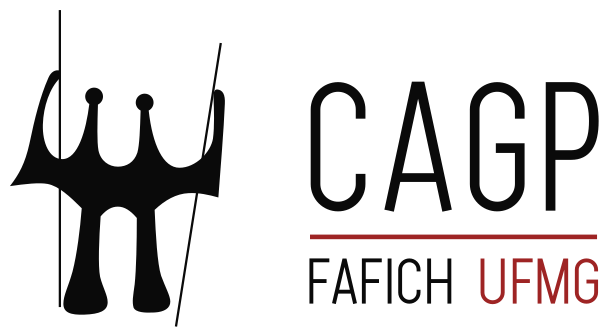

::: {.cagp-hero}
::: {.row .align-items-center}
::: {.col-lg-8}
<div class="d-flex flex-wrap gap-2 mb-2">
  <span class="cagp-badge cagp-badge-red">Entidade Oficial Discente</span>
  <span class="cagp-badge cagp-badge-dark">FAFICH / UFMG</span>
  <span class="cagp-badge cagp-badge-gold">Regimento Interno 2024</span>
</div>

# O CENTRO ACADÊMICO DE GESTÃO PÚBLICA {.cagp-hero-title}

O **Centro Acadêmico de Gestão Pública (CAGP)** da Faculdade de Filosofia e Ciências Humanas da Universidade Federal de Minas Gerais (FAFICH/UFMG) é uma **entidade civil sem fins lucrativos, expressamente suprapartidária, livre e independente dos órgãos públicos e governamentais** (Arts. 3º e 4º do Regimento Interno).

Sediado no Departamento de Ciência Política (DCP), o CAGP é o órgão legítimo de representação da totalidade dos estudantes regularmente matriculados no curso de Gestão Pública. Rege-se pelo **Regimento Interno formal aprovado em 14 de outubro de 2024**, atuando na defesa do ensino público, gratuito, crítico, autônomo e socialmente referenciado.
:::
::: {.col-lg-4 .col-12 .text-center .mt-4 .mt-lg-0}
```{=html}
<div class="cagp-hero-emblem-card">
  
</div>
```
:::
:::
:::

## 🏛️ A Nossa Identidade Visual e o Símbolo dos Candangos

O símbolo do CAGP é diretamente inspirado no monumento histórico **"Os Candangos"** (título original: *Dois Guerreiros*), obra-prima de **Bruno Giorgi (1905–1993)** inaugurada em 1959 na Praça dos Três Poderes, em Brasília.

::: {.row .g-4 .align-items-center .my-3}
::: {.col-md-4 .text-center}
::: {.cagp-card}
{fig-alt="Fotografia do monumento Os Candangos de Bruno Giorgi na Praça dos Três Poderes em Brasília" style="height: auto; width: auto;"}
<p class="text-muted small mt-2 mb-0"><strong>Os Candangos (1959)</strong><br>Monumento aos Construtores de Brasília</p>
:::
:::

::: {.col-md-8}
::: {.cagp-card}
### Semiótica e Significado Institucional
- **Trabalho Coletivo e Soberania Popular:** A união das duas figuras em traço vertical ascendente simboliza o esforço coletivo de construção da sociedade e a centralidade dos cidadãos no interesse público.
- **Prumo da Administração Pública:** A haste horizontal central representa o equilíbrio, a transparência, a equidade e a ética republicana que devem orientar o gestor público e a tomada de decisão estatal.
- **Pilares Democráticos:** As colunas sólidas representam as instituições perenes do Estado Democrático de Direito e a defesa irrestrita dos direitos fundamentais e das políticas públicas inclusivas.
:::
:::
:::

---

## ⚖️ Princípios e Fundamentos Regimentais

Conforme os **Arts. 2º, 3º, 4º e 8º do Regimento Interno**, a atuação do CAGP orienta-se por pilares inegociáveis de ética pública e compromisso discente:

```{=html}
<div class="row g-4 mb-4">
  <div class="col-md-6 col-lg-3">
    <div class="cagp-card h-100">
      <div class="d-flex align-items-center gap-2 mb-2">
        <span class="fs-4" aria-hidden="true">🏛️</span>
        <h3 class="mb-0 fs-6 text-uppercase fw-bold">Administração Pública</h3>
      </div>
      <p class="small text-muted mb-0">Prezar irrestritamente pelos princípios constitucionais da <strong>Legalidade, Impessoalidade, Moralidade, Publicidade e Eficiência</strong> em todas as decisões e atos (Art. 8º, III).</p>
    </div>
  </div>
  <div class="col-md-6 col-lg-3">
    <div class="cagp-card h-100">
      <div class="d-flex align-items-center gap-2 mb-2">
        <span class="fs-4" aria-hidden="true">🕊️</span>
        <h3 class="mb-0 fs-6 text-uppercase fw-bold">Suprapartidarismo</h3>
      </div>
      <p class="small text-muted mb-0">É <strong>expressamente vedada a filiação a partidos políticos</strong> de qualquer âmbito (Art. 4º). Autonomia plena frente a governos, DA FAFICH e DCE UFMG (Art. 3º e 7º).</p>
    </div>
  </div>
  <div class="col-md-6 col-lg-3">
    <div class="cagp-card h-100">
      <div class="d-flex align-items-center gap-2 mb-2">
        <span class="fs-4" aria-hidden="true">🎓</span>
        <h3 class="mb-0 fs-6 text-uppercase fw-bold">Educação Crítica</h3>
      </div>
      <p class="small text-muted mb-0">Defender o ensino público, gratuito, de excelência e socialmente referenciado, assegurando <strong>acesso, permanência e evolução constante da grade do curso</strong> (Art. 8º, I e II).</p>
    </div>
  </div>
  <div class="col-md-6 col-lg-3">
    <div class="cagp-card h-100">
      <div class="d-flex align-items-center gap-2 mb-2">
        <span class="fs-4" aria-hidden="true">🔍</span>
        <h3 class="mb-0 fs-6 text-uppercase fw-bold">Transparência & CNPJ</h3>
      </div>
      <p class="small text-muted mb-0">Manutenção do CNPJ ativo, emissão mensal do RREO, prestação de contas anual e <strong>acesso de qualquer discente às contas em até 3 dias úteis</strong> (Art. 8º, V e Art. 15, V).</p>
    </div>
  </div>
</div>
```

---

## 🏛️ Governança Institucional: Deliberação e Controle

O CAGP fundamenta-se na separação democrática entre a soberania dos representados, a fiscalização independente e a execução diretiva:

```{=html}
<div class="row g-4 mb-4">
  <div class="col-lg-6">
    <div class="cagp-governance-card cagp-highlight-red">
      <div class="d-flex align-items-center justify-content-between mb-2">
        <span class="cagp-badge cagp-badge-red">Instância Máxima</span>
        <span class="text-muted small fw-bold">Arts. 35 a 40</span>
      </div>
      <h3 class="fs-4 fw-bold mb-2">A SOBERANA ASSEMBLEIA GERAL</h3>
      <p class="mb-3">A Assembleia Geral é a autoridade máxima de deliberação da entidade, composta por todos os estudantes regularmente matriculados no curso de Gestão Pública da UFMG.</p>
      <ul class="small mb-3 ps-3">
        <li><strong>Ordinária (Anual):</strong> Convocada para apreciar e votar a prestação de contas da gestão e dar posse formal aos eleitos (Art. 36).</li>
        <li><strong>Extraordinária:</strong> Pode ser convocada pela Diretoria de Gestão, pela Junta Eleitoral ou por requerimento de <strong>apenas 5 estudantes</strong> (Art. 37, III).</li>
        <li><strong>Instalação Rápida:</strong> 1ª chamada com 50% dos discentes; 2ª chamada (após 5 min) com 10%; 3ª chamada com qualquer quórum (Art. 39).</li>
        <li><strong>Quórum Qualificado de 2/3:</strong> Exigido para reforma estatutária, impugnação de mandatos e ingresso de novos membros (Art. 38).</li>
      </ul>
      <div class="p-2 bg-light border border-dark small">
        📢 <strong>Convocação Obrigatória:</strong> Editais fixados no mural, secretaria do colegiado e mídias sociais com pelo menos 5 dias letivos de antecedência.
      </div>
    </div>
  </div>

  <div class="col-lg-6">
    <div class="cagp-governance-card cagp-highlight-gold">
      <div class="d-flex align-items-center justify-content-between mb-2">
        <span class="cagp-badge cagp-badge-gold">Controle Independente</span>
        <span class="text-muted small fw-bold">Arts. 20 a 23</span>
      </div>
      <h3 class="fs-4 fw-bold mb-2">A JUNTA ELEITORAL PERMANENTE</h3>
      <p class="mb-3">Órgão independente permanente responsável por assegurar a lisura, legitimidade e transparência de todos os pleitos eleitorais do CAGP.</p>
      <ul class="small mb-3 ps-3">
        <li><strong>Composição Soberana:</strong> 3 (três) estudantes eleitos diretamente em Assembleia Geral da comunidade discente (Art. 20).</li>
        <li><strong>Incompatibilidade Absoluta:</strong> É terminantemente proibida a participação de integrantes da gestão atual ou de candidatos de quaisquer chapas inscritas (Art. 21).</li>
        <li><strong>Debate Eleitoral Obrigatório:</strong> Organização e mediação de debate público entre as chapas no mínimo 24 horas antes do início da votação (Art. 23, III).</li>
        <li><strong>Atribuições Plenas:</strong> Homologação ou impugnação de chapas, credenciamento de mesários, apuração e lavratura de ata (Art. 23).</li>
      </ul>
      <div class="p-2 bg-light border border-dark small">
        🛡️ <strong>Permanência:</strong> Mantém-se em vigência durante todo o ano letivo para atender aos discentes e avaliar solicitações de Assembleias Gerais.
      </div>
    </div>
  </div>
</div>
```

---

## 👥 As 7 Diretorias Executivas do CAGP

A competência executiva do Centro Acadêmico é subdividida em **7 Diretorias de Gestão** (Arts. 24 a 34), exigindo-se uma chapa de **no mínimo 8 membros** para a sua apresentação formal (Art. 25):

```{=html}
<div class="row g-4 mb-4">
  <!-- 1. DIPRE -->
  <div class="col-md-6 col-lg-4">
    <div class="cagp-directorate-card">
      <div>
        <div class="cagp-directorate-header">
          <div class="cagp-directorate-acronym">DIPRE</div>
          <h3 class="cagp-directorate-title">Diretoria da Presidência</h3>
          <p class="cagp-directorate-roles">Presidente • Vice-Presidente • Assessores</p>
        </div>
        <p class="small text-muted mb-2">Representação institucional externa do CAGP, coordenação geral das unidades subordinadas, celebração de convênios/acordos e planejamento financeiro conjunto com a DIFI.</p>
      </div>
      <details class="cagp-details-box">
        <summary>Atribuições Regimentais (Art. 28)</summary>
        <div class="cagp-details-content">
          <ul>
            <li>Representar externamente o CAGP perante a UFMG e a sociedade civil;</li>
            <li>Coordenar as atividades de todas as unidades administrativas;</li>
            <li>Elaborar o Planejamento Financeiro e de Execução Orçamentária com a DIFI;</li>
            <li>Coordenar o atendimento ao público discente e autoridades;</li>
            <li>Assinar convênios, contratos ou acordos de interesse da entidade.</li>
          </ul>
        </div>
      </details>
    </div>
  </div>

  <!-- 2. DIJUR -->
  <div class="col-md-6 col-lg-4">
    <div class="cagp-directorate-card">
      <div>
        <div class="cagp-directorate-header">
          <div class="cagp-directorate-acronym">DIJUR</div>
          <h3 class="cagp-directorate-title">Diretoria de Assuntos Jurídicos</h3>
          <p class="cagp-directorate-roles">Diretor(a) Jurídico • Vice-Diretor(a) • Assessores</p>
        </div>
        <p class="small text-muted mb-2">Consultoria e assessoramento jurídico interno, emissão de pareceres e notas, guarda oficial do Livro de Atas e Drive, e coordenação da transparência ativa da entidade.</p>
      </div>
      <details class="cagp-details-box">
        <summary>Atribuições Regimentais (Art. 29)</summary>
        <div class="cagp-details-content">
          <ul>
            <li>Prestar consultoria e assessoramento jurídico às diretorias;</li>
            <li>Interpretar atos normativos e avaliar minutas de contratos/convênios;</li>
            <li>Emitir notas e pareceres jurídicos formais;</li>
            <li>Arquivar as atas de reuniões e Assembleias Gerais no Livro de Atas e Drive;</li>
            <li>Coordenar as atividades de transparência pública do CAGP;</li>
            <li>Auxiliar na elaboração da prestação de contas anual com a DIFI.</li>
          </ul>
        </div>
      </details>
    </div>
  </div>

  <!-- 3. DIFI -->
  <div class="col-md-6 col-lg-4">
    <div class="cagp-directorate-card">
      <div>
        <div class="cagp-directorate-header">
          <div class="cagp-directorate-acronym">DIFI</div>
          <h3 class="cagp-directorate-title">Diretoria Financeira</h3>
          <p class="cagp-directorate-roles">Diretor(a) Financeiro • Vice-Diretor(a) • Assessores</p>
        </div>
        <p class="small text-muted mb-2">Execução orçamentária, gestão de contas bancárias e caixa, regularidade contábil/fiscal do CNPJ, emissão mensal do RREO e venda semestral de itens oficiais do curso.</p>
      </div>
      <details class="cagp-details-box">
        <summary>Atribuições Regimentais (Art. 30)</summary>
        <div class="cagp-details-content">
          <ul>
            <li>Captar recursos e assegurar o equilíbrio econômico-financeiro;</li>
            <li>Gerenciar contas bancárias e custódia de valores em caixa;</li>
            <li>Manter atualizado o registro patrimonial dos bens do CAGP;</li>
            <li>Zelar pela regularidade fiscal e tributária vinculada ao CNPJ;</li>
            <li>Elaborar mensalmente o Relatório Resumido de Execução Orçamentária (RREO);</li>
            <li>Organizar semestralmente a venda de produtos (camisas, canecas, botons).</li>
          </ul>
        </div>
      </details>
    </div>
  </div>

  <!-- 4. DIAC -->
  <div class="col-md-6 col-lg-4">
    <div class="cagp-directorate-card">
      <div>
        <div class="cagp-directorate-header">
          <div class="cagp-directorate-acronym">DIAC</div>
          <h3 class="cagp-directorate-title">Diretoria Acadêmica</h3>
          <p class="cagp-directorate-roles">Diretor(a) Acadêmico • Vice-Diretor(a) • Assessores</p>
        </div>
        <p class="small text-muted mb-2">Mediação acadêmica, revisão das ementas das 27 matérias obrigatórias junto ao corpo docente, divulgação de normas de ensino e fomento a oportunidades de pesquisa e pós-graduação.</p>
      </div>
      <details class="cagp-details-box">
        <summary>Atribuições Regimentais (Art. 31)</summary>
        <div class="cagp-details-content">
          <ul>
            <li>Orientar os discentes sobre rotinas acadêmicas e profissionais;</li>
            <li>Promover cursos, palestras, seminários e grupos de estudo;</li>
            <li>Revisar as ementas das disciplinas que compõem a grade do curso;</li>
            <li>Fomentar o debate sobre o percurso formativo com o corpo docente;</li>
            <li>Consolidar oportunidades de estágio, pesquisa e extensão.</li>
          </ul>
        </div>
      </details>
    </div>
  </div>

  <!-- 5. DIAP -->
  <div class="col-md-6 col-lg-4">
    <div class="cagp-directorate-card">
      <div>
        <div class="cagp-directorate-header">
          <div class="cagp-directorate-acronym">DIAP</div>
          <h3 class="cagp-directorate-title">Diretoria de Articulação e Assuntos Políticos</h3>
          <p class="cagp-directorate-roles">Diretor(a) Político • Vice-Diretor(a) • Assessores</p>
        </div>
        <p class="small text-muted mb-2">Representação discente no Conselho de CAs e DAs da UFMG, interlocução com órgãos governamentais e terceiro setor, e articulação com os movimentos sociais da RMBH.</p>
      </div>
      <details class="cagp-details-box">
        <summary>Atribuições Regimentais (Art. 32)</summary>
        <div class="cagp-details-content">
          <ul>
            <li>Representar o CAGP nos fóruns deliberativos discentes (Conselho de CAs e DAs);</li>
            <li>Articular parcerias institucionais com entidades do Campo de Públicas;</li>
            <li>Manter diálogo com instâncias de representação docente e discente da UFMG;</li>
            <li>Estabelecer relações com órgãos sociais e governamentais externos;</li>
            <li>Interlocução com movimentos sociais na Região Metropolitana de BH.</li>
          </ul>
        </div>
      </details>
    </div>
  </div>

  <!-- 6. DICULT -->
  <div class="col-md-6 col-lg-4">
    <div class="cagp-directorate-card">
      <div>
        <div class="cagp-directorate-header">
          <div class="cagp-directorate-acronym">DICULT</div>
          <h3 class="cagp-directorate-title">Diretoria de Cultura</h3>
          <p class="cagp-directorate-roles">Diretor(a) de Cultura • Vice-Diretor(a) • Assessores</p>
        </div>
        <p class="small text-muted mb-2">Produção cultural e artística, organização semestral obrigatória da Calourada de integração discente e captação de fundos, e parceria esportiva com a AAFAFICH.</p>
      </div>
      <details class="cagp-details-box">
        <summary>Atribuições Regimentais (Art. 33)</summary>
        <div class="cagp-details-content">
          <ul>
            <li>Promover conferências, mostras, festivais e atividades culturais;</li>
            <li>Incentivar o esporte universitário em conjunto com a AAFAFICH;</li>
            <li>Planejar, produzir e coordenar eventos internos do CAGP;</li>
            <li><strong>Calourada Semestral:</strong> Realização obrigatória de evento de integração de calouros e captação de recursos com a DIFI.</li>
          </ul>
        </div>
      </details>
    </div>
  </div>

  <!-- 7. DIMAC -->
  <div class="col-md-12 col-lg-8">
    <div class="cagp-directorate-card">
      <div>
        <div class="cagp-directorate-header">
          <div class="cagp-directorate-acronym">DIMAC</div>
          <h3 class="cagp-directorate-title">Diretoria de Marketing e Comunicação</h3>
          <p class="cagp-directorate-roles">Diretor(a) de Marketing • Vice-Diretor(a) • Assessores</p>
        </div>
        <p class="small text-muted mb-2">Comunicação integral com a comunidade acadêmica, gestão dos canais digitais e redes sociais, preservação da memória documental e campanhas gráficas transversais em colaboração com todas as diretorias.</p>
      </div>
      <details class="cagp-details-box">
        <summary>Atribuições Regimentais (Art. 34)</summary>
        <div class="cagp-details-content">
          <ul>
            <li>Gerenciar as mídias sociais, portal e plataformas tecnológicas da entidade;</li>
            <li>Elaborar estratégias de marketing interno e institucional;</li>
            <li>Redigir e arquivar atas de reuniões e Assembleias Gerais com a DIJUR;</li>
            <li>Executar a gestão documental lógica dos arquivos do CAGP;</li>
            <li>Produzir material gráfico para produtos personalizados (DIFI), eventos (DICULT) e oportunidades acadêmicas (DIAC).</li>
          </ul>
        </div>
      </details>
    </div>
  </div>

  <!-- Box Linha Sucessória -->
  <div class="col-md-12 col-lg-4">
    <div class="cagp-succession-box h-100">
      <h3 class="fs-6 fw-bold text-uppercase mb-2 text-danger"><span aria-hidden="true">⚖️</span> Linha Sucessória da Presidência</h3>
      <p class="small text-muted mb-3">Conforme o <strong>Art. 26 do Regimento</strong>, em caso de vacância da Presidência, a ordem legal de sucessão é estrita:</p>
      <ol class="small ps-3 mb-3 fw-bold">
        <li>Vice-Presidência</li>
        <li>Diretoria de Assuntos Jurídicos (DIJUR)</li>
        <li>Diretoria Financeira (DIFI)</li>
      </ol>
      <p class="small text-danger mb-0"><strong>Parágrafo Único:</strong> Se houver vacância após a Diretoria Financeira, a gestão é <em>imediatamente dissolvida</em>, cabendo à Junta Eleitoral convocar novas eleições.</p>
    </div>
  </div>
</div>
```

---

## 🎓 O Colegiado de Coordenação Didática

Enquanto o CAGP é a voz política e representativa dos estudantes, o **Colegiado de Gestão Pública** é o órgão colegiado da UFMG responsável pela gestão didática e administrativa do curso (com mandato de dois anos para seus membros). Conforme as deliberações oficiais, a composição atual é:

```{=html}
<div class="cagp-card mb-4">
  <div class="row g-3">
    <div class="col-md-6">
      <h3 class="fs-6 fw-bold text-uppercase text-danger mb-2">Coordenação do Curso</h3>
      <ul class="small mb-3 ps-3">
        <li><strong>Coordenadora:</strong> Profª Isabele Batista Mitozo (<a href="mailto:coordgestaopublicaufmg@gmail.com">coordgestaopublicaufmg@gmail.com</a>)</li>
        <li><strong>Subcoordenadora:</strong> Profª Ludmila Mendonça Lopes Ribeiro (<a href="mailto:ludmila.ribeiro@gmail.com">ludmila.ribeiro@gmail.com</a>)</li>
        <li><em>Atendimento presencial mediante agendamento prévio.</em></li>
      </ul>
      <h3 class="fs-6 fw-bold text-uppercase text-dark mb-2">Representação Discente no Colegiado</h3>
      <ul class="small mb-0 ps-3">
        <li><strong>Titular:</strong> Nina Queirolo Lage (<a href="mailto:ninaqueirololage@gmail.com">ninaqueirololage@gmail.com</a>)</li>
      </ul>
    </div>

    <div class="col-md-6">
      <h3 class="fs-6 fw-bold text-uppercase text-dark mb-2">Representantes Docentes dos Departamentos</h3>
      <ul class="small mb-0 ps-3">
        <li><strong>Ciência Política (DCP):</strong> Prof. Paulo Ricardo Diniz Filho (titular) / Prof. Lucas Gelape (suplente); Prof. Lucas Pereira Rezende (titular) / Prof. José Angelo Machado (suplente).</li>
        <li><strong>Sociologia (DSO):</strong> Profª Ana Paula Vasconcelos Gonçalves (titular) / Profª Elaine Meire Vilela (suplente).</li>
        <li><strong>Economia (ECN):</strong> Profª Lizia de Figueiredo (titular) / Profª Clara Zanon (suplente).</li>
      </ul>
    </div>
  </div>
</div>
```

---

## 🗳️ Democracia Discente & Processo Eleitoral

Conforme o **Título VI do Regimento Interno (Arts. 41 a 45)**, as eleições do CAGP garantem a soberania popular e a alternância de poder através de regras rígidas e impessoais:

```{=html}
<div class="row g-3 mb-5">
  <div class="col-md-3">
    <div class="cagp-card h-100 text-center">
      <span class="fs-3" aria-hidden="true">🗳️</span>
      <h3 class="fs-6 fw-bold text-uppercase mt-2 mb-1">Voto Secreto e Direto</h3>
      <p class="small text-muted mb-0">Todo discente regularmente matriculado no curso é eleitor e elegível (Art. 41 e 42).</p>
    </div>
  </div>
  <div class="col-md-3">
    <div class="cagp-card h-100 text-center">
      <span class="fs-3" aria-hidden="true">📋</span>
      <h3 class="fs-6 fw-bold text-uppercase mt-2 mb-1">Chapas com Mín. 8 Membros</h3>
      <p class="small text-muted mb-0">Estrutura completa das 7 diretorias sem membros em duplicidade (Art. 25 e 42).</p>
    </div>
  </div>
  <div class="col-md-3">
    <div class="cagp-card h-100 text-center">
      <span class="fs-3" aria-hidden="true">🎙️</span>
      <h3 class="fs-6 fw-bold text-uppercase mt-2 mb-1">Debate Eleitoral</h3>
      <p class="small text-muted mb-0">Obrigatório, organizado pela Junta Eleitoral pelo menos 24h antes da eleição (Art. 23, III).</p>
    </div>
  </div>
  <div class="col-md-3">
    <div class="cagp-card h-100 text-center">
      <span class="fs-3" aria-hidden="true">⏱️</span>
      <h3 class="fs-6 fw-bold text-uppercase mt-2 mb-1">Mandato de 1 Ano</h3>
      <p class="small text-muted mb-0">Permitida apenas 1 (uma) reeleição consecutiva da mesma gestão (Art. 44).</p>
    </div>
  </div>
</div>
```

---

## 📬 Canais Oficiais e Sede Física

Conforme o **Art. 6º do Regimento**, a sede e o foro da entidade situam-se no campus universitário:

::: {.cagp-card}
::: {.row .g-4}
::: {.col-md-6}
### 📍 Localização Institucional {.fs-5 .fw-bold}
- **Centro Acadêmico de Gestão Pública (CAGP)**
- Faculdade de Filosofia e Ciências Humanas (FAFICH) • UFMG
- Pilotis — Espaço dos Centros Acadêmicos
- Av. Presidente Antônio Carlos, 6627 - Campus Pampulha
- CEP: 31270-901 - Belo Horizonte / MG
:::

::: {.col-md-6}
### ✉️ Atendimento e Contato {.fs-5 .fw-bold}
- **E-mail Institucional:** [cagp@fafich.ufmg.br](mailto:cagp@fafich.ufmg.br)
- **Instagram Oficial:** [@cagp.ufmg](https://www.instagram.com/cagp.ufmg)
- **Atendimento Presencial:** De segunda a sexta-feira, nos intervalos de aula do turno noturno e plantões discentes.
:::
:::
:::
